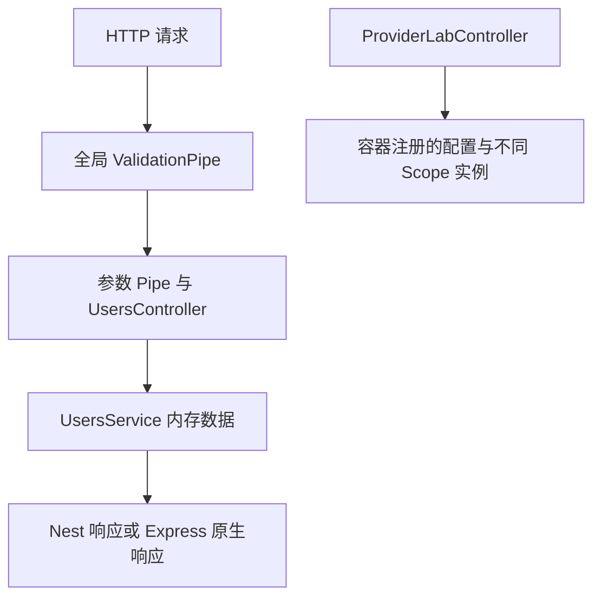

# Study 1：从用户 HTTP 接口认识 Controller 与 Provider

[返回学习路线](../README.md)

## 项目介绍

本章把用户管理作为入口：查询、分页、创建、修改、替换和删除用户，再用 Provider 实验观察依赖注入和实例复用。还保留一组能实际运行的商品、订单、模拟支付与通知模块，作为“多个 Service 怎样协作”的延伸阅读。

如果你来自 React，可以先把 Controller 理解为 HTTP 的入口，把 Service 理解为承载操作规则的对象。Service 由 Nest 容器创建并注入，Controller 不必自己 `new` 出整棵依赖树。

## 学习目标

- 能从装饰器读出路由、参数来源、状态码和响应方式。
- 分清 DTO 的输入规则、User interface 的内部数据形状，以及 Service 的内存状态。
- 理解普通类 Provider、自定义 Symbol Token、`useValue` 和 `@Optional()`。
- 通过实例 ID 判断默认、请求和瞬态作用域，而非只记住名称。

## 业务场景与边界

用户最初有 Robin、Alice 两条内存数据。列表支持 `page`、`limit`、`name`、`city`；创建时间和 ID 由服务端生成。所有数据在重启后恢复初始值，没有数据库、登录、邮箱唯一性检查。

订单流程会检查库存、模拟支付、扣减库存并打印通知；`paid` 只是同步 Mock 的结果，不代表接入支付平台。本章没有事务、并发扣库存或支付补偿，不能直接当作真实交易系统。

## 项目结构

```text
src/
├── notifications/
│   ├── notifications.module.ts
│   └── notifications.service.ts
├── orders/
│   ├── orders.controller.ts
│   ├── orders.module.ts
│   └── orders.service.ts
├── payments/
│   ├── payments.controller.ts
│   ├── payments.module.ts
│   └── payments.service.ts
├── products/
│   ├── products.controller.ts
│   ├── products.module.ts
│   └── products.service.ts
├── provider-lab/
│   ├── custom/
│   │   ├── config.service.ts
│   │   └── tokens.ts
│   ├── optional/
│   │   └── notification.service.ts
│   ├── scope/
│   │   ├── request.service.ts
│   │   ├── singleton.service.ts
│   │   └── transient.service.ts
│   ├── provider-lab.controller.ts
│   └── provider-lab.module.ts
├── users/
│   ├── dto/
│   │   ├── create-user.dto.ts
│   │   ├── query-users.dto.ts
│   │   └── update-user.dto.ts
│   ├── interfaces/
│   │   └── user.interface.ts
│   ├── users.controller.ts
│   ├── users.module.ts
│   ├── users.service.spec.ts
│   └── users.service.ts
├── app.module.ts
└── main.ts
```

重点看 `users/` 的 HTTP 与数据分工，以及 `provider-lab/` 的容器注册。`orders/` 依赖其他三个业务模块，由 `AppModule` 接入；它不是用户订单查询路由的真实存储，`/users/:id/orders/:orderId` 仅回显参数。

## 核心知识：请求怎样变成业务操作

### Controller 提取输入，Service 管理数据

[users.controller.ts](src/users/users.controller.ts) 用 `@Query()` 获取列表 DTO，用 `@Param('id', ParseIntPipe)` 将路径 ID 转成整数，然后调用 [UsersService](src/users/users.service.ts)。静态的 `count`、`search` 等路由排在 `:id` 前，避免被当成用户 ID。

DTO 必须是运行时存在的 class。interface 只参与 TypeScript 检查，不能单独触发请求验证。[app.module.ts](src/app.module.ts) 通过 `APP_PIPE` 绑定全局 `ValidationPipe`，HTTP 和 e2e 使用同一组规则：

```ts
new ValidationPipe({
  transform: true,
  whitelist: true,
  forbidNonWhitelisted: true,
})
```

`QueryUsersDto` 的 `@Type(() => Number)` 把 URL 中的分页字符串转成数字；字段默认值让 `/users` 直接得到第 1 页、每页 10 条。`CreateUserDto` 约束名称、邮箱、年龄；未知的 `id` 等字段会返回 400。

`PATCH` 只合并提交的字段；`PUT` 使用完整创建 DTO，保留服务端 ID、创建时间，并移除本次未提交的可选字段。`UpdateUserDto` 的 `PartialType(..., { skipNullProperties: false })` 允许省略必填字段，但不能把名称设为 `null`。

### 注册关系决定能否注入

[UsersModule](src/users/users.module.ts) 在 `providers` 注册 `UsersService`，在 `controllers` 注册入口。`exports` 允许导入该模块的其他模块注入服务。只把文件写在磁盘上不会自动得到路由或 Provider。

[ProviderLabModule](src/provider-lab/provider-lab.module.ts) 把 `APP_CONFIG` Symbol 作为查找依赖的 Token：

```ts
{
  provide: APP_CONFIG,
  useValue: {
    appName: 'NestJS Provider Lab',
    environment: 'development',
    version: '1.0.0',
  },
}
```

`ConfigService` 用 `@Inject(APP_CONFIG)` 获取这个值，不能用已经在编译后消失的 `AppConfig` interface 当 Token。

[NotificationService](src/provider-lab/optional/notification.service.ts) 故意不注册 `EMAIL_CLIENT`，因此 `@Optional()` 注入 `undefined`，结果显示 `emailEnabled: false`。这是一项可观察的降级设计，不是遗漏 Provider 后忽略报错。

### Scope 是实例的存活范围

连续调用 `/provider-lab/scope`：默认 Singleton 的 ID 不变，请求服务 ID 改变。这里 Controller 注入了请求作用域服务，因此 Controller 也随请求创建；它消费的瞬态服务也会变化。

**瞬态不是“每次调用方法都创建”。** 它按消费方分配实例。本例跨请求变化还受到 Controller 请求作用域的影响；Study 11 会用两个消费方作更明确的比较。

### 响应的控制权

普通方法返回值交给 Nest 序列化；`@Res()` 路由由自己调用 `.json()` 完成响应；`@Res({ passthrough: true })` 允许设置头和状态后仍由 Nest 返回对象。`@Redirect()` 控制 Location，`@HttpCode()` 控制状态。

请求调试路由只回显必要头信息；Authorization 只返回是否存在，避免把凭证复制进响应。

## 核心执行流程



## 如何运行

在本目录执行。建议 Node.js 24，当前验证版本为 24.5.0；pnpm 12.3.4。`package.json` 声明 Nest `^12.0.1`、TypeScript `^6.0.2`，当前锁定/安装为 12.3.2、6.0.3。使用独立锁文件安装，不需要外部服务。

```bash
pnpm install --frozen-lockfile
pnpm start:dev
# 另一个终端，在同一目录
pnpm build
pnpm exec tsc --noEmit --incremental false
pnpm lint
pnpm test
pnpm test:e2e
# 构建后直接运行
pnpm start:prod
```

默认端口 3000，也可以 `PORT=3101 pnpm start:dev`。只运行一个占用 3000 的 Study。无需 `.env` 或 Observe 凭证；依赖中保留了原有 `@nestjs/observe`，当前模块未注册它。

## 如何验证

```bash
# 默认分页：total=2，page=1，limit=10
curl -s http://localhost:3000/users
curl -s 'http://localhost:3000/users?name=Robin&limit=1'
# 201，获得新用户ID
curl -i -X POST http://localhost:3000/users -H 'Content-Type: application/json' \
  -d '{"name":"Researcher","email":"researcher@example.com","city":"Beijing"}'
# 400：名称过短/邮箱格式错误
curl -i -X POST http://localhost:3000/users -H 'Content-Type: application/json' \
  -d '{"name":"A","email":"bad"}'
# 连续运行两次，对比实例ID
curl -s http://localhost:3000/provider-lab/scope
curl -s http://localhost:3000/provider-lab/scope
curl -s http://localhost:3000/provider-lab/config
curl -s http://localhost:3000/provider-lab/optional
# 201；商品1库存从10变8
curl -i -X POST http://localhost:3000/orders -H 'Content-Type: application/json' \
  -d '{"productId":1,"quantity":2}'
curl -s http://localhost:3000/products/1
# 检查自定义头、202、302
curl -i http://localhost:3000/users/custom-header
curl -i http://localhost:3000/users/custom-status
curl -i http://localhost:3000/users/docs
```

[e2e 测试](test/app.e2e-spec.ts) 还覆盖 CRUD、PUT/PATCH 差异、非法分页、服务端字段保护及凭证不回显；测试导入 TypeScript 构建产物，`test:e2e` 会先构建。

## 推荐阅读顺序

1. [main.ts](src/main.ts) → [AppModule](src/app.module.ts)：先确认应用加载了哪些模块和全局验证。
2. [UsersController](src/users/users.controller.ts)：先选一条 `GET /users`，理解输入到 Service 的调用。
3. [QueryUsersDto](src/users/dto/query-users.dto.ts) → [UsersService](src/users/users.service.ts)：跟进转换、过滤、分页和状态保存。
4. [CreateUserDto](src/users/dto/create-user.dto.ts) → [UpdateUserDto](src/users/dto/update-user.dto.ts)：比较创建与部分更新。
5. [ProviderLabModule](src/provider-lab/provider-lab.module.ts) → [ProviderLabController](src/provider-lab/provider-lab.controller.ts)：把容器配置与实例 ID 对上。
6. [OrdersModule](src/orders/orders.module.ts) → [OrdersService](src/orders/orders.service.ts)：最后读跨模块业务，避免一开始陷入全部接口。

## 思考与练习

1. 为用户增加可选的职业字段，补验证并观察未知字段检查会怎样变化。
2. 给 `EMAIL_CLIENT` 注册一个 `useValue` Mock，对比 optional 接口的结果。
3. 在同一次请求内调用同一个瞬态服务两次，观察为什么不是两个实例。
4. 创建带 `city` 的用户，分别用 PATCH 和 PUT 省略 city，比较结果。

## 本章总结

优先掌握 Controller、Module、Service 和 DTO 的职责，再用 Provider 实验建立容器认知。原生响应、作用域和跨模块订单可二刷。下一章会收窄到模块导入导出，后续管道、作用域章节再深入本章提前出现的机制。

参考：[Controllers](https://docs.nestjs.com/controllers)、[Providers](https://docs.nestjs.com/providers)、[中文文档](https://docs.nestjs.cn/introduction/)。
