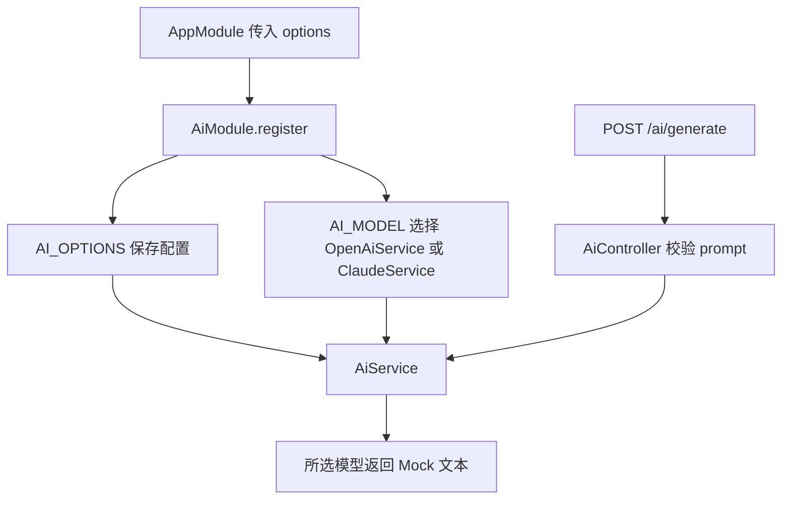

# Study 10：用动态模块配置 AI 模型实现

## 项目介绍

同一套 AI 业务代码，如何在启动时选择 OpenAI 或 Claude，而不让 Controller 到处判断供应商？本章用 `AiModule.register(options)` 返回不同的模块定义，把选择集中在应用组装阶段。

HTTP 接口可以查看当前配置，并让选中的模型返回模拟文本。所有模型均为本地 Mock，不访问 OpenAI 或 Anthropic，也不需要 API Key。

## 学习目标

- 理解动态模块是“根据参数构造模块元数据”，不是收到每个请求后动态换模块。
- 区分配置 Token `AI_OPTIONS` 与实现 Token `AI_MODEL`：一个提供参数，一个提供可调用对象。
- 理解 `useValue` 如何注入配置、`useClass` 如何让相同 Token 对应不同实现。
- 追踪模块配置从 `AppModule` 到 `AiService` 再到 HTTP 响应的过程。

## 业务场景

AI 应用可能在不同环境中使用不同模型。调用方希望始终执行 `generate(prompt)`，而不必知道供应商的类名。本章把模型选择交给应用启动时的配置，使 HTTP 业务保持稳定。

配置中的 `timeout` 和 `maxRetries` **只演示配置传递和读取**，当前 Mock 没有实现超时控制、失败重试或真实网络请求。不能根据响应中出现这些数值，就认为这些运行策略已经生效。

## 项目结构

```text
src/
├── main.ts
├── app.module.ts                       # 注册一次 AiModule 并传入配置
├── app.controller.ts                   # 未注册的脚手架文件
├── app.controller.spec.ts
├── app.service.ts
└── ai/
    ├── ai.module.ts                    # register() 构造 DynamicModule
    ├── ai.controller.ts                # /ai/config、/ai/generate
    ├── ai.service.ts                   # 同时注入配置与模型
    ├── constants/ai.tokens.ts          # 两个 Symbol Token
    ├── interfaces/
    │   ├── ai-options.interface.ts     # 模块配置的类型约束
    │   └── ai-model.interface.ts       # 模型能力约定
    └── models/
        ├── openai.service.ts           # OpenAI 文本 Mock
        └── claude.service.ts           # Claude 文本 Mock
 test/app.e2e-spec.ts                   # 两种注册配置的真实 HTTP 验证
```

## 核心知识讲解

### 先理解模块的使用者

[app.module.ts](./src/app.module.ts) 中的入口配置：

```ts
AiModule.register({
  provider: 'openai',
  timeout: 30000,
  maxRetries: 3,
})
```

`register()` 在组装模块时执行。返回值仍然包含 Nest 熟悉的 `module`、`controllers`、`providers`、`exports`，只是这些内容现在可以由参数决定。

### 把配置和实现分别放进容器

[ai.module.ts](./src/ai/ai.module.ts) 中，`provider` 决定 `modelClass`，再注册：

```ts
{ provide: AI_OPTIONS, useValue: options },
{ provide: AI_MODEL, useClass: modelClass },
```

第一项直接保存传入的配置对象；第二项让 Nest 创建相应模型实例。`AiService` 只注入 `AI_MODEL`，因此不必在每次生成时重复判断 `openai` 或 `claude`。

`AiModel` 接口约定 `getName()` 与 `generate()`，帮助 TypeScript 检查两种实现是否具备同样能力；接口本身不能充当运行时注入标识，所以仍要使用 Symbol Token。

### exports 不等于 HTTP 路由

模块导出 `AiService`、`AI_MODEL` 和 `AI_OPTIONS`，表示导入该模块的其他模块可以依赖它们。路由来自 `controllers: [AiController]` 的注册，两者承担不同职责。

本章在一个应用中只注册一套 AI HTTP 接口。不要直接同时引入两次带相同 Controller 路由的动态模块，再期待 Nest 自动为它们区分 URL；多实例路由命名属于后续设计问题。

### 输入检查发生在哪里

[ai.controller.ts](./src/ai/ai.controller.ts) 将 `prompt` 当作 `unknown`，检查它是非空字符串后才调用 Service。TypeScript 参数注解无法保证客户端 JSON 合法；这里使用简单检查，不把接口类型误当成运行时 DTO 验证。

## 核心执行流程



## 如何运行

使用 Node.js 22（22.12 及以上）或 24+、pnpm。审查使用 Node.js 24.5.0、pnpm 12.3.4。`package.json` 声明 Nest `^12.0.1`、TypeScript `^6.0.2`；当前锁文件安装为 Nest 12.3.2、TypeScript 6.0.3。无需 Redis、数据库或模型账号。

```bash
cd nestjs-study-10
pnpm install --frozen-lockfile
pnpm build
pnpm exec tsc --noEmit
pnpm start:dev
# 构建后也可以直接启动；默认 PORT=3000
PORT=3010 pnpm start:prod
```

同时启动多个 Study 时设置不同 `PORT`，并调整 curl 地址。本章不读取自定义 AI 环境变量，模型选择写在 `app.module.ts` 中。

## 如何验证

默认注册 OpenAI：

```bash
# 200：model=OpenAI、timeout=30000、maxRetries=3
curl -i http://localhost:3000/ai/config
# 201：provider=OpenAI，result 为本地模拟文本
curl -i -X POST http://localhost:3000/ai/generate \
  -H 'Content-Type: application/json' \
  -d '{"prompt":"解释 NestJS 动态模块"}'
# 400：请求没有合法 prompt
curl -i -X POST http://localhost:3000/ai/generate \
  -H 'Content-Type: application/json' -d '{"prompt":42}'
curl -i -X POST http://localhost:3000/ai/generate \
  -H 'Content-Type: application/json' -d '{"prompt":"   "}'
```

把 `app.module.ts` 的 `provider` 改为 `'claude'` 并重新启动后，重复前两个请求：配置中的 `model` 变为 `Claude`，生成结果以 `[Claude 模拟响应]` 开头。**不改 Controller 和 Service**，就能观察动态注册带来的实现替换；实验完成后可恢复默认配置。

```bash
pnpm test
pnpm test:e2e
pnpm lint
```

`test:e2e` 先构建，再导入 `dist` 模块；既验证实际应用的默认注册，也单独创建 Claude 配置的模块测试 HTTP 行为，还验证非法 prompt。这些测试只覆盖 Mock，不是供应商 API 的集成测试。

## 推荐阅读顺序

1. [app.module.ts](./src/app.module.ts)：先从调用方看本章希望提供怎样的配置接口。
2. [ai-options.interface.ts](./src/ai/interfaces/ai-options.interface.ts) 与 [ai-model.interface.ts](./src/ai/interfaces/ai-model.interface.ts)：区分“配置数据”和“模型能力”。
3. [ai.tokens.ts](./src/ai/constants/ai.tokens.ts) → [ai.module.ts](./src/ai/ai.module.ts)：把类型约定映射到运行时注册规则。
4. [ai.service.ts](./src/ai/ai.service.ts) → [models/](./src/ai/models/)：确认业务如何只依赖统一能力。
5. [ai.controller.ts](./src/ai/ai.controller.ts) → [端到端测试](./test/app.e2e-spec.ts)：最后看请求和配置切换如何得到验证。

## 思考与练习

1. 添加一个完全本地的第三种模型实现，需要修改哪些配置类型和注册分支？哪些调用代码应保持稳定？
2. 修改 `timeout` 数值，观察它仅出现在配置响应中；如果实现真正超时控制，应把逻辑放在哪一层？
3. 将动态模块中的 `useClass` 改为基于依赖的 `useFactory`，思考何时这种写法才有必要。
4. 为不受 TypeScript 约束的外部配置增加运行时校验，避免非法供应商值意外走到另一种实现。

## 本章总结

Study 8 解决“如何注册不同 Provider”，本章进一步解决“如何把一组相关注册封装成可配置模块”。重点是读取 `register()` 的返回值，并追踪两个 Token；异步配置、真正的重试和网络调用仍是后续内容。

下一章会研究同一注册规则下实例的生命周期与共享范围。动态模块决定如何组装，Scope 决定什么时候创建和复用。

参考：[动态模块](https://docs.nestjs.com/fundamentals/dynamic-modules)、[自定义 Provider](https://docs.nestjs.com/fundamentals/custom-providers)。
