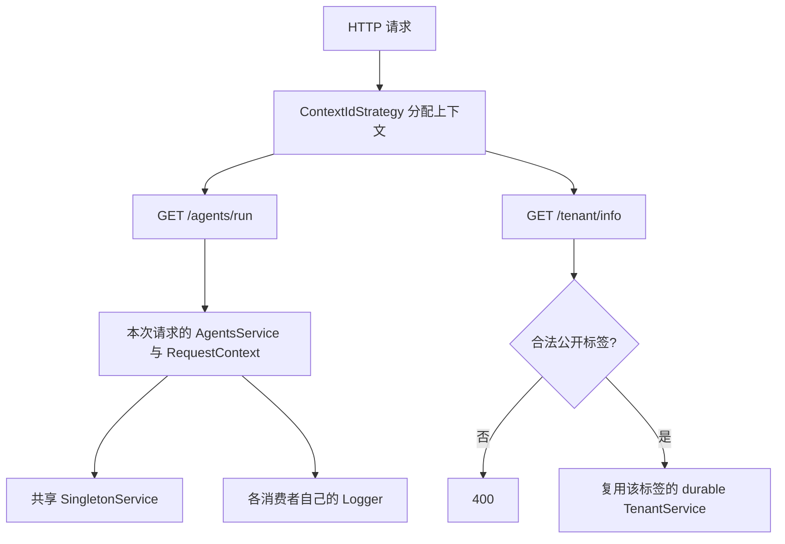

# Study 11：观察 Provider 作用域与持久依赖树

## 项目介绍

本章不调用真实 AI，而是给一个 Agent 执行接口附上各个 Provider 的实例 ID。通过连续发送请求，可以直接看出哪些对象被复用、哪些对象重新创建。

另一个 `/tenant/info` 接口展示 `durable: true`：将两个公开演示标签对应的依赖树分别复用。它是理解 Nest 容器作用域的实验，不是多租户认证系统。

## 学习目标与业务场景

Agent 请求可能需要请求 ID，而审计日志组件可能长期复用。它们都叫 Service，但不应该默认具有同样的生命周期。本章需要理解：

- `DEFAULT`：容器内复用实例，适合不保存请求私有状态的通用能力。
- `REQUEST`：为请求创建实例，依赖它的 Service、Controller 也会受到作用域传播影响。
- `TRANSIENT`：为不同消费者提供不同实例；不是每次调用方法都新建对象。
- `INQUIRER`：让日志组件知道谁在依赖自己，而不要求每个业务类手写名称。
- 持久依赖树：在明确的分组规则下，让请求作用域的部分子树跨请求复用。

## 项目结构

```text
src/
├── main.ts                           # 注册 ContextIdStrategy，启动应用
├── app.module.ts                     # 导入 AgentsModule、TenantModule
├── app.controller.ts                 # 未注册的脚手架文件
├── app.controller.spec.ts
├── app.service.ts
├── common/
│   ├── singleton.service.ts          # 默认作用域
│   ├── request-context.service.ts    # REQUEST 与原始 HTTP 请求
│   └── logger.service.ts             # TRANSIENT 与 INQUIRER
├── agents/
│   ├── agents.module.ts
│   ├── agents.controller.ts          # GET /agents/run
│   ├── agents.service.ts             # 同时使用三种作用域
│   └── agents-audit.service.ts       # 另一个 Logger 消费者
└── tenant/
    ├── tenant.module.ts
    ├── tenant.controller.ts          # GET /tenant/info
    ├── tenant.service.ts             # durable 请求作用域
    └── tenant-context.strategy.ts    # 公开标签与 DI 上下文的映射
 test/app.e2e-spec.ts                 # 请求、消费者与分组的实例比较
```

## 核心知识讲解

### 用实例 ID 看清依赖关系

[AgentsService](./src/agents/agents.service.ts) 同时依赖单例、请求上下文、瞬态日志和审计 Service。`run()` 返回它们各自的 `getInfo()`，所以无需猜测控制台日志就能验证容器行为。

[RequestContextService](./src/common/request-context.service.ts) 声明：

```ts
@Injectable({ scope: Scope.REQUEST })
export class RequestContextService {
  constructor(@Inject(REQUEST) private readonly request: Request) {}
}
```

它需要当前请求，因此不能像普通单例一样被所有请求共享。`AgentsService` 依赖它，`AgentsController` 又依赖 `AgentsService`，这条依赖链也会按请求创建；没有写 `scope` 不一定意味着最终是单例。

`x-request-id` 只是读取客户端输入的演示字段，本章没有生成可靠追踪 ID，也不把该值当成身份凭证。

### TRANSIENT 是按消费者隔离

[LoggerService](./src/common/logger.service.ts) 通过 `@Inject(INQUIRER)` 获取消费者，返回 `consumer` 与日志实例 ID。

| 观察对象 | 连续两个请求的预期 |
| --- | --- |
| `singleton.instanceId` | 相同 |
| `request.instanceId` | 不同 |
| `logger.consumer` | `AgentsService` |
| `auditLogger.consumer` | `AgentsAuditService` |
| 同一响应的两个 Logger ID | 不同 |

`AgentsAuditService` 本身是默认作用域，它拿到的瞬态 Logger 可以随着这个消费者长期存在。因此不要把 TRANSIENT 理解成“每个请求都重建”或“每次 `.log()` 都重建”。本章日志只输出操作说明，不记录完整 prompt 内容。

### durable 还需要上下文分组策略

只给 [TenantService](./src/tenant/tenant.service.ts) 写 `durable: true` 不够；[main.ts](./src/main.ts) 还要执行：

```ts
ContextIdFactory.apply(new TenantContextStrategy());
```

[策略文件](./src/tenant/tenant-context.strategy.ts) 只接受 `tenant-a` 和 `tenant-b`。当 `info.isTreeDurable` 为真时，返回该标签对应的父上下文；普通请求依赖仍使用本次请求自己的上下文。Map 只会保存这两个演示标签，避免任意客户端输入不断创建持久分组。

策略的 `payload` 是 `{ tenantId }`。因此持久树中的 `@Inject(REQUEST)` 得到的是这份小对象；它不再等于 Express Request，不能随意读取 `headers`、`url`。标签缺失或非法时也提供明确 payload，由 Service 返回 400。

**公开标签不证明企业身份。** 任意调用者都能切换这两个标签，这里只返回实例 ID，没有企业私有数据。真实多租户系统应从已验证身份和授权关系推导租户，不应照搬客户端 header 作为可信身份。

## 核心执行流程



## 如何运行

使用 Node.js 22（22.12 及以上）或 24+ 与 pnpm。审查环境是 Node.js 24.5.0、pnpm 12.3.4；声明 Nest `^12.0.1`、TypeScript `^6.0.2`，当前锁文件安装为 Nest 12.3.2、TypeScript 6.0.3。

所有实例和分组都在进程内，不需要数据库、Redis、AI Key 或企业账号。

```bash
cd nestjs-study-11
pnpm install --frozen-lockfile
pnpm build
pnpm exec tsc --noEmit
pnpm start:dev
# 构建后运行，可指定其他端口
PORT=3011 pnpm start:prod
```

默认端口是 3000；修改 `PORT` 后同步修改验证地址。重启会清空全部实例和上下文；未注册的脚手架 Controller 不会提供 `GET /`。

## 如何验证

```bash
curl -s 'http://localhost:3000/agents/run?prompt=first' -H 'x-request-id: r1'
curl -s 'http://localhost:3000/agents/run?prompt=second' -H 'x-request-id: r2'
```

两次都应返回 200，逐项比较前面的表格；`request.requestId` 分别是 `r1`、`r2`。再检查 `auditLogger.instanceId` 是否随单例消费者被复用，而不是误认为所有 Logger 都按请求创建。

```bash
curl -s http://localhost:3000/tenant/info -H 'x-tenant-id: tenant-a'
curl -s http://localhost:3000/tenant/info -H 'x-tenant-id: tenant-a'
curl -s http://localhost:3000/tenant/info -H 'x-tenant-id: tenant-b'
# 以下两次均应 400
curl -i http://localhost:3000/tenant/info
curl -i http://localhost:3000/tenant/info -H 'x-tenant-id: other'
```

前两次的 `instanceId` 相同，第三次不同；返回的 `tenantId` 应与合法标签一致。重启后，再访问相同标签会出现新的实例 ID。

```bash
pnpm test
pnpm test:e2e
pnpm lint
```

端到端测试先构建并导入编译后的模块，通过真实 HTTP 请求比较实例。测试启动时应用同一个分组策略，结束后重置进程级 `ContextIdFactory` 策略，避免影响其他测试。

## 推荐阅读顺序

1. [agents.controller.ts](./src/agents/agents.controller.ts) → [agents.service.ts](./src/agents/agents.service.ts)：先看响应里准备观察哪些对象。
2. [common/](./src/common/) 的三个 Service：将响应字段与各自 Scope 对上。
3. [agents-audit.service.ts](./src/agents/agents-audit.service.ts)：理解为什么需要第二个消费者来观察 TRANSIENT。
4. [tenant.service.ts](./src/tenant/tenant.service.ts) → [tenant-context.strategy.ts](./src/tenant/tenant-context.strategy.ts)：在理解普通作用域后再读持久树。
5. [main.ts](./src/main.ts)、[app.module.ts](./src/app.module.ts)、[端到端测试](./test/app.e2e-spec.ts)：确认策略与模块都实际接通。

## 思考与练习

1. 暂时把请求上下文改成单例，思考为什么它仍然不能直接持有某位用户的 Request；记录实际报错或行为后恢复。
2. 在同一个消费者里连续调用两次 `logger.getInfo()`，验证 TRANSIENT 是否按方法调用创建。
3. 给审计 Service 增加一次调用计数，观察其默认作用域与 Agent 请求作用域的差别。
4. 移除 `durable: true` 后重复 tenant 实验，解释“相同标签”为什么不再意味着同一实例。

## 本章总结

作用域决定实例归谁、活多久；关键是把依赖链和消费者一起看，而不是只背三个枚举值。普通请求作用域是本章重点，`INQUIRER` 与持久依赖树属于进阶内容。

Study 10 配置容器中有哪些实现，本章观察容器如何复用它们。下一章将通过 `ModuleRef` 显式查找与解析 Provider，继续理解上下文与容器的关系。

参考：[注入作用域](https://docs.nestjs.com/fundamentals/injection-scopes)。
