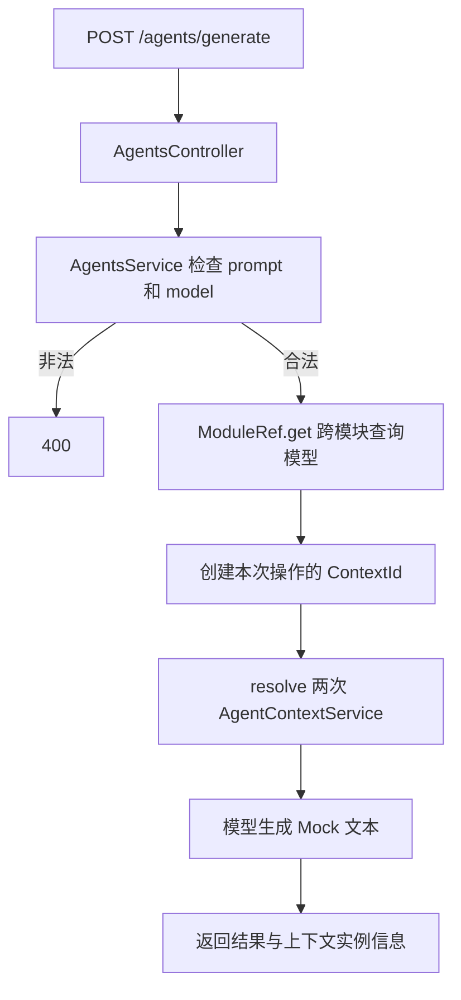

# Study 12：通过 ModuleRef 选择模型与解析作用域实例

## 项目介绍

本章在同一个 Agent 生成接口中，根据请求的 `model` 选择 OpenAI、Claude 或 Gemini 的本地模拟实现。与 Study 10 在启动时选择一个实现不同，这里的选择发生在每次生成操作中。

核心工具是 `ModuleRef`：用 `get()` 取已有模型实例，用 `resolve()` 在显式创建的 DI 上下文中获取请求作用域的 `AgentContextService`。当前源码没有循环依赖、`forwardRef()` 或真实模型网络调用，不应将本章当成循环依赖教程。

## 学习目标

- 理解 `ModuleRef` 是 Nest 容器的运行时查询入口，不等于自己 `new` 一个 Service。
- 区分 `get()` 的模块搜索范围与 `resolve()` 的作用域上下文。
- 知道跨模块查询为什么需要明确处理 `strict`，避免编译通过但接口运行时报错。
- 观察同一 `ContextId` 中的实例复用，以及不同生成操作之间的实例隔离。
- 对 HTTP JSON 做真实运行时检查，不把 `string` 类型注解当作输入验证。

## 业务场景

Agent 可以让使用者选择不同的模型；三种模型已经注册进容器，但每次只调用其中一个。生成操作还需要一个局部上下文，用来观察同一次操作内部共享对象、不同操作互不共享。

这让模型选择和上下文解析成为可观察的实验。真实业务如果只需要固定依赖，优先使用构造函数注入；不要因为本章展示了 `ModuleRef`，就把所有依赖都改成运行时查找。

## 项目结构

```text
src/
├── main.ts
├── app.module.ts                      # 导入 AgentsModule
├── app.controller.ts                  # 未注册的脚手架文件
├── app.controller.spec.ts
├── app.service.ts
├── agents/
│   ├── agents.module.ts               # 导入 ModelsModule，注册操作上下文
│   ├── agents.controller.ts           # POST /agents/generate
│   ├── agents.service.ts              # get/resolve 与输入检查
│   └── agent-context.service.ts       # REQUEST scope，生成观察用 UUID
└── models/
    ├── models.module.ts               # 注册并导出三个模型
    ├── openai.service.ts              # OpenAI Mock
    ├── claude.service.ts              # Claude Mock
    └── gemini.service.ts              # Gemini Mock
 test/app.e2e-spec.ts                  # 模型选择、作用域与错误输入验证
```

## 核心知识讲解

### get() 查找的是容器已有实例

[ModelsModule](./src/models/models.module.ts) 注册三个模型，[AgentsModule](./src/agents/agents.module.ts) 导入该模块。`AgentsService` 的构造函数只注入 `ModuleRef`，真正使用哪个模型由 `generate()` 决定。

```ts
const service = this.moduleRef.get(OpenAiService, { strict: false });
```

`get()` 默认只搜索 `ModuleRef` 所在模块。此处模型注册在 `ModelsModule`，业务 Service 位于 `AgentsModule`，如果省略参数，即使模块间已经导入/导出，也不能假设 `get()` 会像构造函数注入一样搜索导入模块。

本章显式使用 `{ strict: false }` 从应用容器查找三个唯一的模型 Token。它放宽的是**搜索范围**，不是 TypeScript 严格检查，也不是权限校验。大型应用若重复注册相同 Token，应重新设计明确的依赖边界，不能把全局搜索当作通用解法。

### resolve() 才适合请求作用域 Provider

[AgentContextService](./src/agents/agent-context.service.ts) 声明 `Scope.REQUEST`。`get()` 不能直接获取这类作用域实例；业务层使用：

```ts
const contextId = ContextIdFactory.create();
const first = await this.moduleRef.resolve(AgentContextService, contextId);
const second = await this.moduleRef.resolve(AgentContextService, contextId);
```

两次传入同一个上下文对象，会获得同一 DI 子树内的实例。每次 `generate()` 都创建新的 `contextId`，因此不同生成操作之间不会复用这个实例。

响应中的 `context.instanceId` 来自该 Service，`reusedWithinOperation` 表示上面两次解析得到相同对象。这是对本章机制的观察信息，不是业务任务 ID。

**这里显式创建的是操作上下文，不是当前 Express 请求。** `AgentContextService` 不注入 `REQUEST`。如果后续让它依赖请求对象，就需要研究 `registerRequestByContextId()` 或获取当前请求的上下文；不能仅凭 `Scope.REQUEST` 就认为手动创建的上下文已经包含 HTTP Request。

### HTTP 输入保持 unknown，检查后再交给模型

[Controller](./src/agents/agents.controller.ts) 接收 `unknown`，由 Service 检查 `prompt` 是非空字符串，再使用 `switch` 将 `model` 限定为三个已知名称。非法输入返回 400，不会进入模型调用。

本章没有注册 `ValidationPipe`，也没有使用 class-validator DTO；检查来自真实的条件分支。三个模型只是拼接文本，不会执行用户代码。

## 核心执行流程



## 如何运行

使用 Node.js 22（22.12 及以上）或 24+ 与 pnpm。本次审查使用 Node.js 24.5.0、pnpm 12.3.4；声明 Nest `^12.0.1`、TypeScript `^6.0.2`，当前锁文件安装为 Nest 12.3.2、TypeScript 6.0.3。

三种模型完全在本地运行，不需要 API Key、Redis、数据库或外部账号。

```bash
cd nestjs-study-12
pnpm install --frozen-lockfile
pnpm build
pnpm exec tsc --noEmit
pnpm start:dev
# 构建后直接运行，可避开其他 Study 的端口
PORT=3012 pnpm start:prod
```

默认端口 3000，可通过 `PORT` 修改。模型选择来自请求 body，没有模型环境变量；根路径 `/` 没有业务路由。

## 如何验证

```bash
curl -i -X POST http://localhost:3000/agents/generate \
  -H 'Content-Type: application/json' \
  -d '{"model":"openai","prompt":"解释依赖注入"}'
curl -i -X POST http://localhost:3000/agents/generate \
  -H 'Content-Type: application/json' \
  -d '{"model":"claude","prompt":"解释依赖注入"}'
curl -i -X POST http://localhost:3000/agents/generate \
  -H 'Content-Type: application/json' \
  -d '{"model":"gemini","prompt":"解释依赖注入"}'
```

三次都应返回 201，供应商与模型字段分别为：

| 请求 `model` | 响应 `provider` | 响应 `model` |
| --- | --- | --- |
| `openai` | `OpenAI` | `gpt` |
| `claude` | `Anthropic` | `claude` |
| `gemini` | `Google` | `gemini` |

`result` 是带输入文本的 Mock 字符串；`gpt` 只是示例模型名，不代表真实供应商的可调用型号。每次响应的 `context.reusedWithinOperation` 应为 `true`，连续请求的 `context.instanceId` 应不同。

```bash
# 不支持的模型：400
curl -i -X POST http://localhost:3000/agents/generate \
  -H 'Content-Type: application/json' \
  -d '{"model":"unknown","prompt":"hello"}'
# prompt 不是字符串：400
curl -i -X POST http://localhost:3000/agents/generate \
  -H 'Content-Type: application/json' \
  -d '{"model":"openai","prompt":42}'
# 缺失 prompt 或只有空白，也应为 400
```

```bash
pnpm test
pnpm test:e2e
pnpm lint
```

`test:e2e` 先构建，使用编译后的真实模块；覆盖三种模型、上下文复用与跨操作隔离、非法输入。它没有替换模型 Provider，但被调用的真实实现本身就是 Mock，不能据此宣称真实模型 API 已接通。

## 推荐阅读顺序

1. [agents.controller.ts](./src/agents/agents.controller.ts)：先认识唯一的业务请求与输入结构。
2. [agents.service.ts](./src/agents/agents.service.ts)：找到输入检查、`get()`、`resolve()` 三个关键步骤。
3. [models.module.ts](./src/models/models.module.ts) → [agents.module.ts](./src/agents/agents.module.ts)：确认模型在哪注册、上下文在哪注册，解释搜索边界。
4. [agent-context.service.ts](./src/agents/agent-context.service.ts)：理解为什么这个对象不能用普通 `get()` 获取。
5. [三个模型实现](./src/models/) → [端到端测试](./test/app.e2e-spec.ts)：最后确认返回内容与容器行为如何被验证。

## 思考与练习

1. 移除一次 `{ strict: false }`，实际请求该模型并观察错误，再解释为什么构造函数注入与 `ModuleRef.get()` 的搜索行为不同。
2. 不传 `contextId` 连续调用两次 `resolve()`，比较得到的实例；然后恢复共享上下文。
3. 新增一个本地模型实现，列出模块注册和运行时选择分别需要修改的位置。
4. 为操作上下文增加一个计数器，验证同一次操作共享、不同操作隔离，不把状态误放到单例模型中。

## 本章总结

`ModuleRef` 让代码在运行时与容器交互：`get()` 关注已有实例与搜索边界，`resolve()` 关注作用域与上下文。重点是弄清查询位置和实例归属；手动绑定 HTTP Request 是进阶内容。

本章延续 Study 11 对作用域的观察，下一章转向按需加载模块：本章三个模型在启动时已经注册，运行时只选择调用哪个，尚未实现懒加载。

本章没有认证、计费、会话存储或真实模型请求；不要向公开教学服务提交敏感 prompt，也不要把实例 UUID 当作访问凭证。

参考：[ModuleRef](https://docs.nestjs.com/fundamentals/module-ref)。
