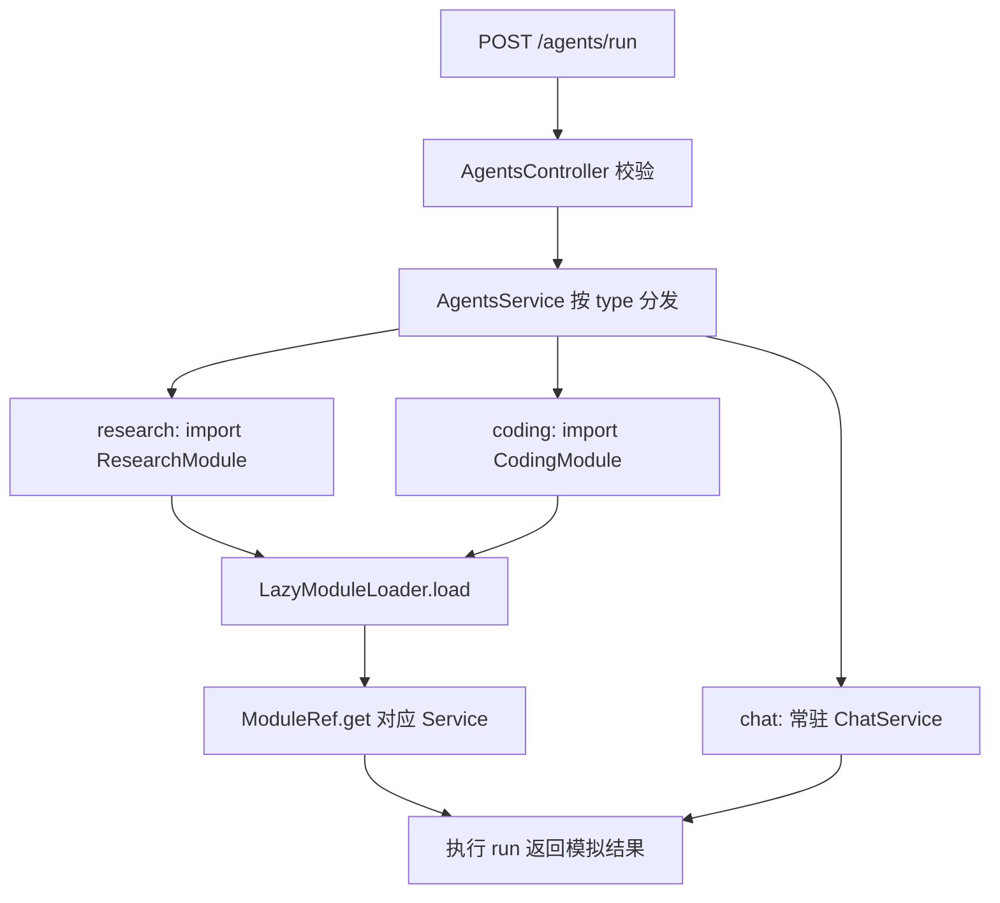

# Study 13：按需加载 AI Agent 模块

[返回学习路线](../README.md) · 前置：[Study 12](../nestjs-study-12/README.md) · 后续：[Study 14](../nestjs-study-14/README.md)

## 项目介绍

聊天、研究、代码三个 Agent 并非每次启动都会使用。本章保留一个常驻聊天服务，收到研究或代码任务时，再通过 `LazyModuleLoader` 创建对应模块的 Provider。

最终得到一个 `POST /agents/run` 入口，以及三条确实执行不同 Service 的分支。所有结果都是本地模拟字符串，研究与代码任务分别等待约 1 秒、1.5 秒，没有连接模型 API，也不会执行生成的代码。

## 学习目标

- 区分 JavaScript 的动态 `import()` 与 Nest 的模块加载：前者取得类，后者建立依赖注入关系。
- 理解为什么 HTTP Controller 常驻，而成本较高、使用较少的 Service 可以按需创建。
- 使用模块返回的 `ModuleRef` 找到 Provider，理解按需加载后的实例缓存。
- 通过启动日志与请求前后的 Provider 状态验证懒加载，而不是只看到一个 `import()` 就认定实现成功。

## 业务场景

一个 Agent 入口根据 `type` 分发工作：`chat` 用于普通对话，`research` 用于研究，`coding` 用于代码任务。实际模型客户端可能需要加载较多资源，懒加载可以把这些初始化推迟到真正使用时。

当前的延时只是模拟任务耗时，并没有测量或承诺启动性能提升；本章展示的是加载时机和模块实例复用。

## 项目结构

```text
src/
├── main.ts
├── app.module.ts
├── app.controller.ts / app.service.ts / app.controller.spec.ts
├── agents/
│   ├── agents.module.ts       # 只注册聊天服务与分发入口
│   ├── agents.controller.ts   # 请求校验
│   └── agents.service.ts      # 三个分支与 LazyModuleLoader
├── chat/
│   └── chat.service.ts        # 随 AgentsModule 初始化
├── research/
│   ├── research.module.ts
│   └── research.service.ts    # 首次研究请求才初始化
└── coding/
    ├── coding.module.ts
    └── coding.service.ts      # 首次代码请求才初始化
test/
└── app.e2e-spec.ts            # HTTP 分发与加载状态验证
```

根目录还有各自的 `package.json`、`pnpm-lock.yaml`、`tsconfig*.json`、`nest-cli.json` 与两份 Vitest 配置。`app.controller.ts`、`app.service.ts` 保留了 CLI 原始示例，但没有注册到本章 `AppModule`，所以 `GET /` 返回 404。

## 核心知识讲解

### 1. 模块没有出现在 imports 中，也可以稍后加载

[AppModule](src/app.module.ts) 只引入 [AgentsModule](src/agents/agents.module.ts)，后者直接注册 `ChatService`，没有导入 `ResearchModule` 或 `CodingModule`。

这点很关键：如果提前把研究模块写进 `imports`，Nest 启动时就已经创建研究 Service，后面的动态调用将失去本章希望展示的按需创建意义。

### 2. 动态导入之后，还需要 Nest 建立模块

[AgentsService](src/agents/agents.service.ts) 的研究分支分四步执行：

```ts
const { ResearchModule } = await import('../research/research.module.js');
const moduleRef = await this.lazyModuleLoader.load(() => ResearchModule);
const { ResearchService } = await import('../research/research.service.js');
const researchService = moduleRef.get(ResearchService, { strict: false });
```

`import()` 返回模块类；`load()` 扫描模块、创建依赖，并返回该模块的 `ModuleRef`；`get()` 才取得 Nest 管理的 Service。这里的 `strict: false` 放宽查询范围，不是 TypeScript 的严格检查开关；本章研究 Service 就在目标模块内，练习时可以改用默认的严格查找。

相对路径写 `.js` 是当前 NodeNext/ESM 编译方式的要求：源码文件是 `.ts`，运行的输出文件则是 `.js`。

### 3. 第二次请求复用模块，不缓存任务结果

[ResearchService](src/research/research.service.ts) 的构造函数打印初始化日志。第一次研究请求会看到该日志，重复请求不会再构造一次；每个请求仍会执行 `run()`，仍有约 1 秒模拟耗时。

Nest 的模块实例缓存和业务结果缓存是两个不同问题。本章没有实现后者。

### 4. 输入类型不等于运行时校验

[AgentsController](src/agents/agents.controller.ts) 中的 `RunAgentDto` 是 TypeScript interface，编译后不会保留为可验证的类。Controller 因此显式检查类型必须属于三种 Agent、`prompt` 必须是非空字符串，非法请求返回 400。

本章不依赖 `class-validator`，也没有把 interface 当作自动校验规则。

## 核心执行流程



## 如何运行

建议 Node.js 24，使用 pnpm。本章 `package.json` 声明 Nest `^12.0.1`、TypeScript `^6.0.2`，本次安装解析为 Nest 12.3.2、TypeScript 6.0.3。Vite 8 的引擎要求为 Node `^20.19.0 || >=22.12.0`，不要仅根据 Nest 的最低版本选择环境。

在仓库根目录执行：

```bash
cd nestjs-study-13
pnpm install --frozen-lockfile
pnpm start:dev
```

另一个终端执行检查：

```bash
pnpm build
pnpm exec tsc --noEmit
pnpm lint
pnpm test
pnpm test:e2e
pnpm start:prod
```

`start:dev` 与 `start:prod` 是两种启动方式，先停止前者再运行后者，避免端口冲突。默认端口 3000；例如 `PORT=3013 pnpm start:dev` 可换端口，相应修改下面请求地址。没有必须配置的密钥、数据库或 Redis。

首次类型检查前先运行 `pnpm build`，因为测试会导入构建生成的声明文件。E2E 测试先构建，再导入 `dist` 中保留装饰器元数据的真实模块，不把 TypeScript 编译能力等同于 HTTP 验证。

## 如何验证

```bash
# 启动日志只应先出现 ChatService 初始化
curl -sS -X POST http://localhost:3000/agents/run \
  -H 'Content-Type: application/json' \
  -d '{"type":"chat","prompt":"你好"}'

curl -sS -X POST http://localhost:3000/agents/run \
  -H 'Content-Type: application/json' \
  -d '{"type":"research","prompt":"解释依赖注入"}'

curl -sS -X POST http://localhost:3000/agents/run \
  -H 'Content-Type: application/json' \
  -d '{"type":"coding","prompt":"编写加法函数"}'

# 非法类型与空白 prompt：400
curl -i -X POST http://localhost:3000/agents/run \
  -H 'Content-Type: application/json' \
  -d '{"type":"other","prompt":""}'
```

前三个成功请求返回 201。`result` 分别以“普通聊天结果”“深度研究完成”“代码任务完成”开头。连续执行研究请求，观察 `ResearchService 初始化` 只出现一次；代码服务在第一次代码请求前不应初始化。

`pnpm test:e2e` 还检查加载前查不到研究/代码 Provider，加载后研究实例保持相同，并覆盖非法请求。

## 推荐阅读顺序

1. [app.module.ts](src/app.module.ts)：确认启动时究竟加载了什么。
2. [agents.module.ts](src/agents/agents.module.ts)：确认聊天常驻、其他模块没有提前导入。
3. [agents.controller.ts](src/agents/agents.controller.ts)：先弄清输入协议与错误分支。
4. [agents.service.ts](src/agents/agents.service.ts)：顺着研究分支逐步区分 `import`、`load`、`get`。
5. [research.module.ts](src/research/research.module.ts) 与 [research.service.ts](src/research/research.service.ts)：理解被加载模块的普通结构；再对照 coding 实现。
6. [app.e2e-spec.ts](test/app.e2e-spec.ts)：阅读如何证明“之前不存在、之后复用”。

## 思考与练习

1. 提前把 `ResearchModule` 加进 `AgentsModule.imports`，启动日志与懒加载测试会怎样变化？
2. 将研究分支的 `moduleRef.get` 改为默认严格查找，验证当前模块是否足以提供依赖。
3. 给研究结果加一个每次变化的时间字段，解释为什么实例复用不代表结果复用。
4. 按同样路径新增一种本地模拟 Agent，并让它直到首次调用才初始化。

## 本章总结

核心是区分文件导入与依赖容器加载，并用可观察行为验证创建时机。懒加载适合部分低频、初始化较重的服务，是否采用仍需测量业务收益。

本章只按需加载 Provider；不要在懒加载模块里期待新增 HTTP 路由自动生效，也不要依赖其生命周期钩子初始化资源。下一章回到常驻 HTTP 请求，学习如何读取执行上下文和元数据。

参考：[官方懒加载文档](https://docs.nestjs.com/fundamentals/lazy-loading-modules)。API 同时对照本章安装的 `@nestjs/core` 12.3.2 实现。
