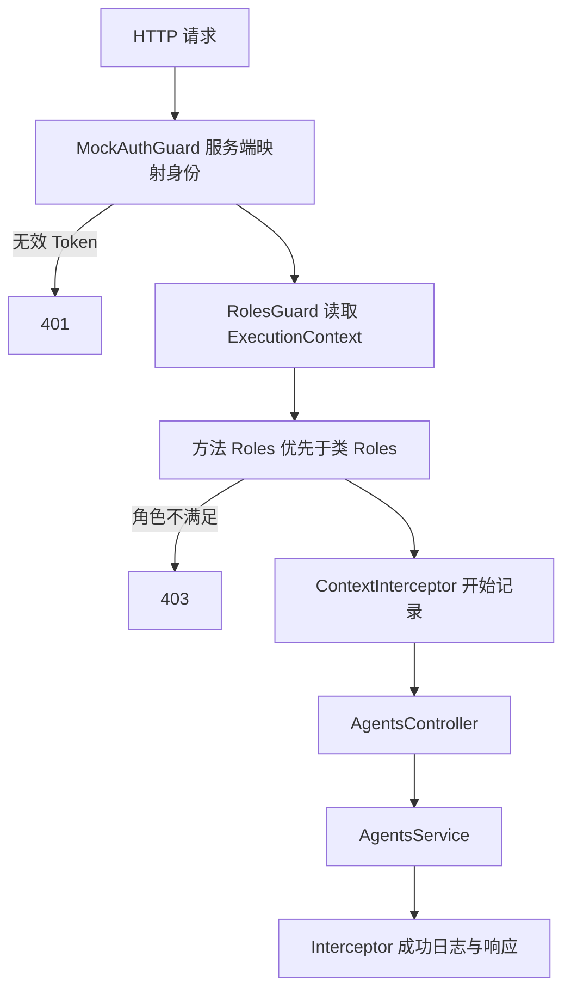

# Study 14：执行上下文与分层角色元数据

[返回学习路线](../README.md) · 前置：[Study 13](../nestjs-study-13/README.md) · 后续：[Study 15](../nestjs-study-15/README.md)

## 项目介绍

本章通过 Agent 列表、创建和删除接口，学习 Guard 与 Interceptor 如何知道“当前正在处理哪个请求、哪个 Controller、哪个方法”。

普通用户和管理员都能查看、创建 Agent，只有管理员能删除。角色来自服务端固定 Token 映射；类级权限作为默认规则，方法级权限覆盖它。这里的重点是 `ExecutionContext`、`Reflector` 和元数据优先级。

## 学习目标

- 使用 `getClass()`、`getHandler()` 定位当前执行位置。
- 使用 `switchToHttp()` 获取本次 HTTP 请求，而不在 Guard 中写死某个 Controller。
- 理解 `Reflector.createDecorator<Role[]>()` 如何保存类型明确的角色要求。
- 理解方法优先的 `getAllAndOverride()`，区分“默认规则”与“规则合并”。
- 分清身份验证、权限判断、业务执行与日志记录的责任。

## 业务场景与教学边界

系统有一组所有已认证用户共享的 Agent，保存在 Service 的内存数组中。它展示角色权限，并没有实现个人私有 Agent 或多租户隔离；重新启动会丢失新增和删除的数据。

[MockAuthGuard](src/common/guards/mock-auth.guard.ts) 的两个固定 Token 仅用于本地实验：

| 请求中的 Token | 服务端身份 | 角色 |
| --- | --- | --- |
| `demo-user-token` | id 1 | user |
| `demo-admin-token` | id 2 | admin |

这些值是公开的教学凭据，没有 JWT 签名、过期、撤销、密码校验或登录过程，不能用于真实认证。客户端传来的 `x-role`、`body.role` 不会决定权限；实际系统应由可信认证结果生成 `request.user`。

## 项目结构

```text
src/
├── main.ts
├── app.module.ts              # 注册 AgentsModule 与原始根路由
├── app.controller.ts / app.service.ts / app.controller.spec.ts
├── agents/
│   ├── agents.module.ts       # 注册本章 Controller、Service 和增强器
│   ├── agents.controller.ts   # 类级与方法级 Roles
│   └── agents.service.ts      # 内存 Agent 操作
└── common/
    ├── decorators/
    │   └── roles.decorator.ts # Role 类型与 typed decorator
    ├── guards/
    │   ├── mock-auth.guard.ts # 固定 Token 映射
    │   └── roles.guard.ts     # 读取上下文与权限元数据
    └── interceptors/
        └── context.interceptor.ts
test/
└── app.e2e-spec.ts            # 身份、越权、规则覆盖与创建验证
```

构建和测试配置独立保存在本章根目录，锁文件为 `pnpm-lock.yaml`。

## 核心知识讲解

### 1. 装饰器存规则，Guard 执行规则

[Roles](src/common/decorators/roles.decorator.ts) 使用 `Reflector.createDecorator<Role[]>()`，所以 Controller 的写法是数组参数：

```ts
@Roles(['user', 'admin'])
@UseGuards(MockAuthGuard, RolesGuard)
export class AgentsController {
  @Delete(':id')
  @Roles(['admin'])
  remove(/* ... */) { /* ... */ }
}
```

`@Roles()` 只附加元数据，不会自己拦截请求。真正的权限检查由绑定到 Controller 的 `RolesGuard` 完成。两个 Guard 按列出的顺序执行：先确定身份，再判断角色。

### 2. ExecutionContext 把通用增强器与当前请求连接起来

[RolesGuard](src/common/guards/roles.guard.ts) 打印当前上下文类型、Controller 名和 handler 名，再用 `switchToHttp().getRequest<DemoRequest>()` 取得认证 Guard 写入的用户。

这使同一段权限逻辑可以用于多个路由，不需要在 Guard 里逐条比较 URL。本章只实现 HTTP；使用了 `switchToHttp()` 并不意味着已经支持 WebSocket 或 RPC。

### 3. 为什么删除接口不会继承普通用户权限

```ts
const requiredRoles = this.reflector.getAllAndOverride(Roles, [
  context.getHandler(),
  context.getClass(),
]);
```

查找顺序先方法、后类。列表和创建方法没有自己的规则，使用类上的 `['user', 'admin']`；删除方法有 `['admin']`，直接覆盖默认规则。

如果改成合并数组，删除权限可能意外包含 `user`。因此要先明确业务语义，再选择读取方式。这里没有“管理员自动拥有所有角色”的继承机制，管理员能访问列表是因为类级数组显式列出了它。

### 4. Interceptor 只包围获准执行的业务

[ContextInterceptor](src/common/interceptors/context.interceptor.ts) 通过同一个上下文取得 Controller 与方法名，在 `next.handle()` 前后记录执行和耗时。当前的 `tap()` 成功回调用于成功返回日志，异常时不会打印“执行完成”。

身份或角色校验失败时，Controller 与该 Interceptor 的业务处理部分都不会执行。日志不输出请求 Token。

## 核心执行流程



## 如何运行

建议 Node.js 24 与 pnpm。`package.json` 声明 Nest `^12.0.1`、TypeScript `^6.0.2`；本次安装版本分别为 12.3.2、6.0.3。Vite 8 要求 Node `^20.19.0 || >=22.12.0`。本章没有数据库、Redis 或模型服务依赖，也不需要配置密钥。

```bash
cd nestjs-study-14
pnpm install --frozen-lockfile
pnpm start:dev
```

默认端口 3000，`PORT=3014 pnpm start:dev` 可以更换。独立运行检查命令：

```bash
pnpm build
pnpm exec tsc --noEmit
pnpm test
pnpm test:e2e
pnpm start:prod
```

`test:e2e` 先构建，再加载 `dist` 的真实 Nest 模块。运行 `start:prod` 前先停止开发服务，避免占用同一端口。

## 如何验证

```bash
# 缺少身份：401
curl -i http://localhost:3000/agents

# 普通用户继承类级规则：200
curl -i http://localhost:3000/agents \
  -H 'Authorization: Bearer demo-user-token'

# 普通用户即使伪造角色头，也不能删除：403
curl -i -X DELETE http://localhost:3000/agents/1 \
  -H 'Authorization: Bearer demo-user-token' -H 'x-role: admin'

# 管理员满足方法级规则：200
curl -i -X DELETE http://localhost:3000/agents/1 \
  -H 'Authorization: Bearer demo-admin-token'

# 有效名称：201；把名称改成空白字符串则返回 400
curl -i -X POST http://localhost:3000/agents \
  -H 'Authorization: Bearer demo-user-token' \
  -H 'Content-Type: application/json' -d '{"name":"Tutor Agent"}'
```

删除示例应按上面的顺序运行：普通用户的失败请求不改变数据，随后管理员可以删除 id 1。再次由管理员删除同一个 id 得到 404。观察日志中的 handler 名、Required Roles 和 Interceptor 开始/完成记录，验证具体规则的读取。

## 推荐阅读顺序

1. [agents.controller.ts](src/agents/agents.controller.ts)：先理解默认权限与删除权限的差异。
2. [roles.decorator.ts](src/common/decorators/roles.decorator.ts)：确认元数据如何定义以及参数类型。
3. [mock-auth.guard.ts](src/common/guards/mock-auth.guard.ts)：追踪 `request.user` 的可信来源及其简化边界。
4. [roles.guard.ts](src/common/guards/roles.guard.ts)：沿请求上下文到元数据再到角色判断阅读。
5. [context.interceptor.ts](src/common/interceptors/context.interceptor.ts)：对比 Guard 与 Interceptor 的不同职责。
6. [agents.module.ts](src/agents/agents.module.ts)、[app.module.ts](src/app.module.ts)：确认这些类实际注册、路由实际生效。
7. [app.e2e-spec.ts](test/app.e2e-spec.ts)：阅读如何用 401、403 与成功结果验证机制。

## 思考与练习

1. 将删除方法的读取策略改成 `getAllAndMerge`，用普通用户重复请求，说明权限为何变化。
2. 增加一个只允许管理员访问的查询接口，复用现有 Guard，保持角色来源在服务端。
3. 给 Interceptor 增加异常分支日志，比较成功、400、403 三种请求经过的阶段。
4. 新增 `reviewer` 角色与固定教学 Token，明确哪些接口允许该角色后再修改元数据。

## 本章总结

本章把声明式权限规则与执行检查连接起来。重点是上下文对象、元数据查找顺序，以及身份验证先于授权；日志拦截器则用于观察获准进入的业务。

[Study 5](../nestjs-study-5/README.md) 与 [Study 7](../nestjs-study-7/README.md) 也涉及权限，本章进一步关注规则从哪里读取。下一章从单次请求转向整个应用的启动、运行和关闭。

参考：[官方执行上下文文档](https://docs.nestjs.com/fundamentals/execution-context)。
