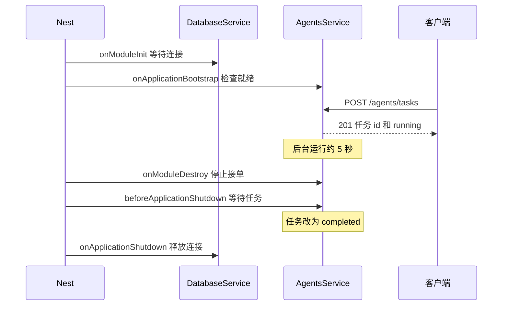

# Study 15：应用生命周期与 Agent 任务排空

[返回学习路线](../README.md) · 前置：[Study 14](../nestjs-study-14/README.md) · 后续：[Study 16](../nestjs-study-16/README.md)

## 项目介绍

服务启动时，数据库连接还没准备好，能否开始接收 Agent 任务？服务关闭时，已经开始的任务还没执行完，能否立刻释放连接？本章用一个模拟数据库和一个耗时任务，展示这些工作应该放在哪个生命周期阶段。

项目提供创建任务、查询任务两个接口。数据库初始化约 1 秒，每个任务约 5 秒。关闭时先拒绝新任务，再等待已跟踪任务，最后释放数据库资源。所有资源和任务都在本进程内模拟。

## 学习目标

- 区分构造函数、`onModuleInit` 与 `onApplicationBootstrap` 的职责。
- 在准备资源后才声明应用就绪，避免把异步初始化藏进构造函数。
- 用 `onModuleDestroy`、`beforeApplicationShutdown`、`onApplicationShutdown` 划分关闭阶段。
- 理解 `app.close()` 与系统信号触发钩子的条件。
- 用任务状态与连接状态检查关闭行为，而不是只看有没有写接口方法。

## 业务场景

AI 任务可能比普通 HTTP 请求耗时更长。本例创建任务后立即返回任务 id，任务在后台等待 5 秒，客户端随后查询状态。

如果先关掉任务依赖的数据库，再等待任务结束，真实业务中的最终写入就可能失败。本章把资源释放移到排空之后，强调资源的生命周期必须覆盖使用它的工作。

这里没有真实数据库、LLM、队列、持久化或分布式任务调度。任务仅在当前进程存活，应用崩溃、强制终止和 `SIGKILL` 都不能依靠本例完成任务；它也没有认证、关闭超时、失败重试与任务记录清理。

## 项目结构

```text
src/
├── main.ts                    # enableShutdownHooks
├── app.module.ts              # 注册 AgentsModule
├── app.controller.ts / app.service.ts / app.controller.spec.ts
├── agents/
│   ├── agents.module.ts       # 引入 InfrastructureModule
│   ├── agents.controller.ts   # 创建、查询任务
│   └── agents.service.ts      # 后台 Promise 与关闭阶段
└── infrastructure/
    ├── infrastructure.module.ts # 导出 DatabaseService
    └── database.service.ts    # 模拟连接初始化和释放
test/
└── app.e2e-spec.ts             # 初始化、排空、释放与 404
```

本章独立维护 `package.json`、锁文件、TypeScript、Nest CLI 和 Vitest 配置。

## 核心知识讲解

### 1. 构造依赖不代表异步资源已就绪

[DatabaseService](src/infrastructure/database.service.ts) 在构造函数打印创建日志，在 `onModuleInit()` 中等待模拟连接完成，然后把 `connected` 设为 `true`。

构造函数只负责拿到依赖和建立初始状态。Nest 会等待初始化钩子返回的 Promise，因此 [AgentsService](src/agents/agents.service.ts) 的 `onApplicationBootstrap()` 可以检查数据库是否已连接。

`onApplicationBootstrap` 位于各模块初始化之后、开始监听请求之前，适合本章的应用就绪检查；它不同于“构造了这个 Service”。

### 2. 请求结束后，任务还在执行

```ts
const promise = this.executeTask(taskId);
this.runningTasks.add(promise);
void promise.finally(() => {
  this.runningTasks.delete(promise);
});
```

`createTask()` 将状态保存在 `tasks` Map，启动异步工作，但不会等待它完成才响应。`runningTasks` Set 则单独跟踪还没结束的 Promise，为关闭过程提供等待对象。

Map 存的是可查询的任务状态，Set 存的是需要排空的执行过程。当前任务函数只模拟等待并标记 `completed`，没有实现真实业务失败状态。

### 3. 把关闭过程分成三段

| 阶段 | 当前项目的工作 | 为什么放在这里 |
| --- | --- | --- |
| `AgentsService.onModuleDestroy` | `acceptingTasks = false` | 先停止接受新任务 |
| `AgentsService.beforeApplicationShutdown` | `Promise.allSettled` 等待运行中的任务 | 保留资源完成已接受工作 |
| `DatabaseService.onApplicationShutdown` | 将模拟连接置为断开 | 排空完成、连接关闭阶段之后再释放 |
| `AgentsService.onApplicationShutdown` | 记录关闭完成和信号 | 观察最终阶段 |

同一阶段内不同 Provider 的打印顺序不应作为跨模块协议。这里依靠的是不同生命周期阶段的先后关系，数据库不会在 `onModuleDestroy` 阶段过早断开。

### 4. 信号关闭需要显式启用

[main.ts](src/main.ts) 调用：

```ts
app.enableShutdownHooks();
```

本地直接运行 Node 时，`Ctrl+C` 产生的 `SIGINT` 可以触发关闭钩子。测试使用 `app.close()` 主动进入同样的关闭阶段。强制杀进程并不会保证钩子执行；在其他操作系统上还需确认具体信号支持。

### 5. 对外返回类型也需要能导出

[AgentsService](src/agents/agents.service.ts) 导出 `AgentTask`，Controller 显式声明返回 `AgentTask`。当前 TypeScript 开启声明文件输出，跨文件公开方法使用不可导出的私有类型会出现 TS4053；只做 `tsc --noEmit` 并不能替代真实构建检查。

## 核心执行流程



## 如何运行

建议 Node.js 24 与 pnpm。声明依赖为 Nest `^12.0.1`、TypeScript `^6.0.2`；本次安装对应 12.3.2、6.0.3。Vite 8 要求 Node `^20.19.0 || >=22.12.0`。不需要环境密钥和外部服务。

```bash
cd nestjs-study-15
pnpm install --frozen-lockfile
pnpm start:dev
```

默认端口 3000；可使用 `PORT=3015 pnpm start:dev`。以下检查在本章目录执行：

```bash
pnpm build
pnpm exec tsc --noEmit
pnpm test
pnpm test:e2e
```

E2E 会先构建真实模块，再使用 `app.init()` / `app.close()` 验证完整生命周期。测试使用真实的约 1 秒初始化与 5 秒任务等待。

## 如何验证

先观察启动日志中的“数据库连接成功”，然后才是“Agent 系统准备就绪”。

```bash
# 返回 201 与 { id, status: "running" }，保存其中的 id
TASK_ID=$(curl -sS -X POST http://localhost:3000/agents/tasks \
  | node -pe 'JSON.parse(require("node:fs").readFileSync(0,"utf8")).id')
curl -sS "http://localhost:3000/agents/tasks/$TASK_ID"

# 等待约 5 秒后再查询，status 应变为 completed
curl -sS "http://localhost:3000/agents/tasks/$TASK_ID"

# 不存在的 id 返回 404
curl -i http://localhost:3000/agents/tasks/missing
```

验证关闭时，停止开发服务，改用已构建入口直接运行，以便明确观察当前 Node 进程：

```bash
pnpm build
pnpm start:prod
```

在另一终端创建一个新任务，并在 5 秒内回到服务终端按 `Ctrl+C`。应依次看到停止接单、等待任务、任务完成与所有任务处理完毕；数据库资源应在排空后才释放。当前终端不会立即退出，而是等待已跟踪任务。

`pnpm test:e2e` 还会验证排空期间数据库仍连接、Service 拒绝新任务，关闭返回时原任务为 `completed` 且资源已释放。

## 推荐阅读顺序

1. [database.service.ts](src/infrastructure/database.service.ts)：先理解资源何时准备、何时释放。
2. [agents.service.ts](src/agents/agents.service.ts)：依次读就绪检查、任务跟踪和三个关闭阶段。
3. [agents.controller.ts](src/agents/agents.controller.ts)：理解 HTTP 响应为何不等待任务结束。
4. [agents.module.ts](src/agents/agents.module.ts) 与 [infrastructure.module.ts](src/infrastructure/infrastructure.module.ts)：追踪模块导出与注入关系。
5. [app.module.ts](src/app.module.ts) 与 [main.ts](src/main.ts)：确认业务确实注册、系统信号确实启用。
6. [app.e2e-spec.ts](test/app.e2e-spec.ts)：阅读跨阶段资源状态如何验证。

## 思考与练习

1. 将数据库释放改回 `onModuleDestroy`，观察排空期间连接状态测试为什么失败。
2. 连续创建三个任务后关闭，解释 `Promise.allSettled` 为什么可以等待它们共同结束。
3. 为模拟任务增加失败状态，并妥善处理后台 Promise 拒绝；思考为何 HTTP 成功创建不等于任务执行成功。
4. 设计关闭等待上限，明确超时后的任务状态和资源处理策略，再尝试实现。

## 本章总结

生命周期机制的价值是安排工作顺序：先完成初始化再接单，先排空工作再释放依赖。重点是阶段边界和真实注册，进阶部分是任务失败、超时和持久化恢复。

与上一章的请求上下文不同，这些钩子面向应用生命周期；下一章将利用应用启动完成阶段扫描已注册 Provider。

参考：[官方生命周期文档](https://docs.nestjs.com/fundamentals/lifecycle-events)。
