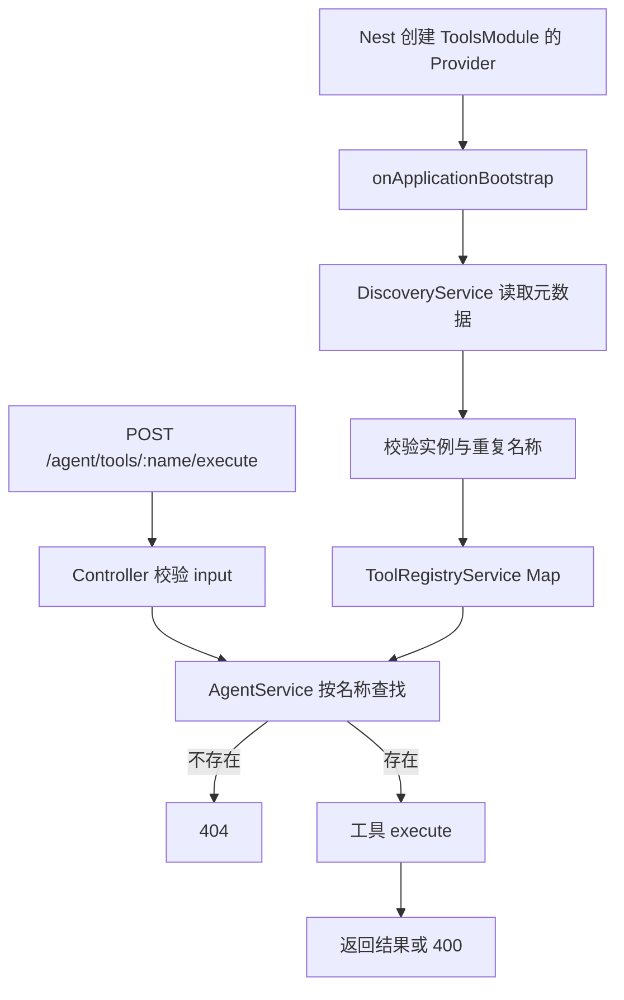

# Study 16：用 DiscoveryService 建立 Agent 工具注册表

[返回学习路线](../README.md) · 前置：[Study 15](../nestjs-study-15/README.md)

## 项目介绍

如果每新增一个 Agent 工具，都要到分发 Service 里再写一个 `switch` 分支，入口会逐渐知道所有工具的具体实现。本章通过自定义装饰器标记工具，在启动完成时用 `DiscoveryService` 找到它们，建立按名称查找的注册表。

最终实现查看工具目录和按名称执行工具两个入口。计算器执行两个有限数字的加法；搜索和天气明确返回本地 Mock 数据，没有联网搜索或真实天气查询，也没有模型自主规划与多轮工具调用。

## 学习目标

- 区分“把类注册为 Provider”和“给 Provider 加上业务元数据”。
- 使用 `DiscoveryModule` 提供的 `DiscoveryService` 读取已注册 Provider。
- 理解自定义装饰器、运行时元数据和 TypeScript interface 的不同作用。
- 在应用启动完成阶段构建注册表，并检测重复名称和不合格实例。
- 让入口面向工具接口，而不是依赖每个工具的具体类。

## 业务场景

Agent 需要知道有哪些工具、每个工具叫什么，并在执行时把字符串输入交给对应实现。本章选择三个容易在本地验证的工具，展示“注册—发现—分发”这一条链路。

这只是本地工具目录，不是远程插件市场。工具必须先在 Nest 模块里注册，接口不接受客户端上传代码，也不使用 `eval` 执行表达式。当前接口没有认证，教学工具不应直接替换为带外部权限的真实工具后公开暴露。

## 项目结构

```text
src/
├── main.ts
├── app.module.ts                # 注册 AgentModule
├── app.controller.ts / app.service.ts / app.controller.spec.ts
├── agent/
│   ├── agent.module.ts          # 导入 ToolsModule
│   ├── agent.controller.ts      # HTTP 参数校验
│   └── agent.service.ts         # 查找并执行工具
└── tools/
    ├── tools.module.ts          # DiscoveryModule 与工具 Provider
    ├── tool-registry.service.ts # 启动时扫描与注册
    ├── decorators/
    │   └── agent-tool.decorator.ts
    ├── interfaces/
    │   └── agent-tool.interface.ts
    └── implementations/
        ├── calculator.tool.ts   # 有限数字加法
        ├── search.tool.ts       # 本地模拟搜索
        └── weather.tool.ts      # 本地模拟天气
test/
└── app.e2e-spec.ts               # 工具发现、执行与失败分支
```

根目录独立保存包管理、TypeScript、Nest CLI 和 Vitest 配置。CLI 原始 `AppController`、`AppService` 没有注册到本章应用，`GET /` 返回 404；从 `/agent/tools` 开始验证。

## 核心知识讲解

### 1. 为什么只有 interface 不够

[工具接口](src/tools/interfaces/agent-tool.interface.ts) 约定 `execute(input: string): Promise<unknown>`，用于 TypeScript 检查实现是否符合形状；它在编译后被擦除，不能告诉运行中的 Nest 哪个 Provider 是工具。

[AgentTool 装饰器](src/tools/decorators/agent-tool.decorator.ts) 使用 `DiscoveryService.createDecorator<AgentToolMetadata>()`，给类附加名称和说明。它与同名 interface 分别承担运行时标记和编译时约束，实现中用 `IAgentTool` 别名区分两者。

```ts
@Injectable()
@AgentTool({ name: 'calculator', description: '计算两个数字的加法' })
export class CalculatorTool implements IAgentTool {
  // execute 的实现见 calculator.tool.ts
}
```

### 2. 装饰器不会代替 providers 注册

[ToolsModule](src/tools/tools.module.ts) 必须先导入 `DiscoveryModule`，再在 `providers` 中注册 `ToolRegistryService` 和三个工具类。Nest 先创建这些 Provider，发现服务才有可扫描的对象。

`DiscoveryService` 不会扫描硬盘上的所有 `.ts` 文件。只新建工具文件、只加装饰器而不注册，工具不会出现在目录里。

### 3. 启动完成后构建注册表

[ToolRegistryService](src/tools/tool-registry.service.ts) 在 `onApplicationBootstrap()` 中读取 `getProviders()`，逐个使用 `getMetadataByDecorator(AgentTool, provider)` 取得元数据。

没有元数据的普通 Service 被跳过；有元数据的实例必须存在可调用的 `execute()`；重复工具名直接导致启动失败，而不是悄悄覆盖。成功后保存为 `Map<名称, 元数据与实例>`。

选择启动完成阶段，是为了使用已经实例化的普通单例 Provider。本章没有实现请求作用域工具，也不会自动重扫后来懒加载进来的工具。

### 4. 分发入口只依赖注册表

[AgentService](src/agent/agent.service.ts) 不导入 `CalculatorTool`、`SearchTool` 或 `WeatherTool`。它查询名称，找不到时返回 404，找到后调用统一的 `execute` 方法，并返回 `{ tool, result }`。

`unknown` 表示每个工具可以返回不同形状。调用方应在使用结果时明确其结构，而不是把所有工具输出强行设为 `any`。

### 5. 校验分为公共输入与工具专用输入

[AgentController](src/agent/agent.controller.ts) 把外部 `input` 视为 `unknown`，显式确认它是非空字符串并去掉首尾空白。当前项目不安装 `class-validator` / `class-transformer`，不把 DTO 类型当成自动校验。

[CalculatorTool](src/tools/implementations/calculator.tool.ts) 再检查恰好两个数字、操作数有限且相加结果仍有限。这样非法输入返回 400，超大数字相加不会被 JSON 序列化成含义不清的 `null`。

搜索和天气结果都有 `mock: true`，工具目录的说明也明确标记为模拟功能。

## 核心执行流程



## 如何运行

建议 Node.js 24 与 pnpm。Nest 声明为 `^12.0.1`，本次安装为 12.3.2；TypeScript 声明为 `^6.0.2`，本次为 6.0.3。Vite 8 还要求 Node `^20.19.0 || >=22.12.0`。本章无需 API Key、数据库、Redis 或互联网工具服务。

```bash
cd nestjs-study-16
pnpm install --frozen-lockfile
pnpm start:dev
```

默认端口 3000，可用 `PORT=3016 pnpm start:dev` 更换。检查及另一种启动方式：

```bash
pnpm build
pnpm exec tsc --noEmit
pnpm lint
pnpm test
pnpm test:e2e
pnpm start:prod
```

`test:e2e` 会先构建，再加载 `dist` 中的模块以保留真实 Nest 装饰器元数据。`start:dev` 与 `start:prod` 不要同时占用同一个端口。

## 如何验证

启动日志应包含发现的 `search`、`calculator`、`weather`。列表顺序不作为接口约定。

```bash
# 三项工具目录：200
curl -sS http://localhost:3000/agent/tools

# 加法：201；外层 result 内的 result 应为 30
curl -i -X POST http://localhost:3000/agent/tools/calculator/execute \
  -H 'Content-Type: application/json' -d '{"input":"10 20"}'

# 模拟天气：201，包含 mock:true
curl -sS -X POST http://localhost:3000/agent/tools/weather/execute \
  -H 'Content-Type: application/json' -d '{"input":"北京"}'

# 模拟搜索：201，固定文档条目，包含 mock:true
curl -sS -X POST http://localhost:3000/agent/tools/search/execute \
  -H 'Content-Type: application/json' -d '{"input":"NestJS"}'

# 非法操作数：400；换为 {"input":" "} 同样返回 400
curl -i -X POST http://localhost:3000/agent/tools/calculator/execute \
  -H 'Content-Type: application/json' -d '{"input":"10 nope"}'

# 未知工具：404
curl -i -X POST http://localhost:3000/agent/tools/missing/execute \
  -H 'Content-Type: application/json' -d '{"input":"hello"}'
```

`pnpm test:e2e` 覆盖三项工具确实被发现、真实加法、Mock 标记、缺失/非字符串/空白输入、无效数字及结果溢出，避免只验证一个模板根路由。

## 推荐阅读顺序

1. [agent-tool.interface.ts](src/tools/interfaces/agent-tool.interface.ts)：先确定工具的共同能力。
2. [agent-tool.decorator.ts](src/tools/decorators/agent-tool.decorator.ts)：理解运行时标记和元数据。
3. [calculator.tool.ts](src/tools/implementations/calculator.tool.ts)：看一个完整且可验证的实现，再对比两个 Mock 工具。
4. [tools.module.ts](src/tools/tools.module.ts)：确认实例来自 Nest 注册，而不是文件扫描。
5. [tool-registry.service.ts](src/tools/tool-registry.service.ts)：沿扫描、过滤、验证、Map 保存阅读。
6. [agent.service.ts](src/agent/agent.service.ts) 与 [agent.controller.ts](src/agent/agent.controller.ts)：追踪请求如何进入注册表。
7. [app.module.ts](src/app.module.ts)、[app.e2e-spec.ts](test/app.e2e-spec.ts)：核对完整接线和实际行为。

## 思考与练习

1. 新增一个字符串长度工具，只修改工具文件与模块注册，保持 `AgentService` 无需新增分支。
2. 将两个工具设为相同名称，观察应用为什么拒绝启动；然后恢复正常名称。
3. 注释掉某个工具的 Provider 注册，观察列表如何变化，解释为何装饰器本身不负责实例化。
4. 扩展元数据描述输入格式，并让工具目录返回它；思考描述信息与运行时校验为何仍需分别维护。
5. 给一个真实外部工具设计授权与超时边界，先明确用户身份、可用操作和失败结果，再考虑接入。

## 本章总结

本章把自定义装饰器、依赖注入、生命周期和运行时发现连接成一个完整的小型扩展机制。重点是“已注册 Provider + 可读取元数据 + 统一接口”，而不是任意动态加载代码。

前 16 个 Study 到这里形成了一条从 HTTP 请求到模块与 Provider，再到运行生命周期的阅读路线。后续可继续阅读 [Study 17 配置](../nestjs-study-17/README.md)、[Study 27 队列](../nestjs-study-27/README.md) 和 [Study 38 SSE](../nestjs-study-38/README.md)；这些能力不在本章实现范围。

参考：[官方 DiscoveryService 文档](https://docs.nestjs.com/fundamentals/discovery-service)。
