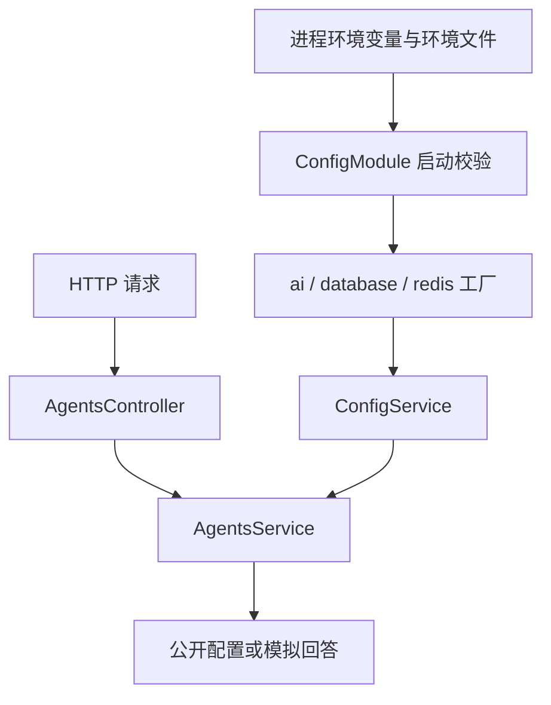

# NestJS Study 17：多环境配置

通过一个模拟 AI 生成接口，学习如何把环境变量转换为有边界、可分组的应用配置。对应 Techniques 的 Configuration 章节。

应用同一份代码可能运行在开发、测试和部署环境。模型名称、超时和地址会变化，如果每个 Service 都直接读取 `process.env`，默认值和校验规则很容易互相矛盾。本章在启动时集中处理这些问题，再由业务服务读取配置。

## 学习目标与业务边界

- 用 `ConfigModule.forRoot()` 加载环境文件，并理解加载优先级。
- 用 Joi 在启动时拒绝非法配置，而不是等某个接口调用才报错。
- 用 `registerAs()` 将配置分成 `ai`、`database`、`redis` 三个命名空间。
- 通过 `ConfigService.get()` 使用配置，区分字符串环境变量与数字业务配置。

`POST /agents/generate` 只拼接模拟回答。数据库和 Redis 配置用于展示分组，没有创建连接；不需要模型 Key、数据库或 Redis 服务。`AI_TIMEOUT` 会被读取和展示，尚未控制真实网络请求。

## 目录与职责

```text
src/
├── main.ts                         # 创建应用并监听 PORT
├── app.module.ts                   # 环境文件、校验、命名空间、业务模块
├── config/
│   ├── env.validation.ts           # Joi 规则与默认值
│   ├── ai.config.ts                # AI 配置工厂
│   ├── database.config.ts          # 数据库配置工厂
│   └── redis.config.ts             # Redis 配置工厂
├── agents/
│   ├── agents.module.ts            # 注册 Controller 与 Service
│   ├── agents.controller.ts        # 两个业务接口
│   └── agents.service.ts           # 读取公开配置、模拟生成
└── app.controller.ts / app.service.ts # 保留的脚手架类，未注册到应用
```

[AppModule](src/app.module.ts) 才是运行入口的模块图；有一个 Controller 文件并不意味着它自动成为路由。因此这里访问 `/` 会得到 404。

## 配置如何进入业务服务



### 文件优先级与进程变量

[app.module.ts](src/app.module.ts) 按下面的顺序查找：

```ts
envFilePath: [`.env.${process.env.NODE_ENV ?? 'development'}`, '.env']
```

同一个变量出现在多个文件时，前面的文件优先；进程中已经存在的变量优先于文件。`NODE_ENV` 应在启动命令中设置，因为文件名是在读取文件之前计算的。没有设置时选择 `.env.development`。

`expandVariables: true` 允许环境变量相互引用；它不会隐藏秘密。`cache: true` 缓存配置读取，和 Study 22 的 HTTP 响应缓存是不同用途。

### 为什么先校验，再转换

[env.validation.ts](src/config/env.validation.ts) 限制温度在 0～2、超时在 1000～120000 毫秒，模型和主机等必填项缺失时直接阻止启动。AI 最大 Token 数也必须为合法正整数。

[ai.config.ts](src/config/ai.config.ts) 将 `AI_TEMPERATURE`、`AI_TIMEOUT`、`AI_MAX_TOKENS` 转成数字；`registerAs('ai', ...)` 让业务通过 `ai.model` 这样的路径访问。默认值应与校验规则对应。

项目安装 `@nestjs/config 12.0.1`、Joi 18：配置校验使用 Standard Schema 适配。ESM 中 Joi 使用 `import Joi from 'joi'`，不要把命名空间导入对象当成 Joi 实例。Study 18 进一步展示库专属校验选项的写法。

### 只返回业务需要的配置

[AgentsService](src/agents/agents.service.ts) 读取 `ai.provider`、`ai.model`、`ai.temperature`、`ai.timeout`，不返回完整环境变量，也不返回 `apiKey`。配置对象不应整体作为调试接口响应。

`generate()` 对未知请求输入做运行时检查：TypeScript 的 `string` 注解本身不会校验 HTTP JSON。

## 如何运行

当前锁定环境包含 Nest core/common 12.3.2、TypeScript 6.0.3；建议 Node.js 24、pnpm 12。本章是独立 ESM 项目，不依赖其他 Study。

```bash
cd nestjs-study-17
pnpm install --frozen-lockfile
cp .env.example .env
pnpm start:dev
```

已有环境文件时先检查内容，不要覆盖个人配置。若 `.env.development` 已存在，它会覆盖 `.env` 中的同名项。模板提供本地演示地址，不需要真实基础设施。

| 配置 | 用途 | 示例/默认 |
| --- | --- | --- |
| NODE_ENV | 选择环境文件 | development / test / production |
| PORT | HTTP 监听端口 | 3000 |
| AI_PROVIDER / AI_MODEL | 模拟模型标识 | openai / gpt-4.1 |
| AI_TEMPERATURE | 模型温度 | 0.7 |
| AI_TIMEOUT | 展示的超时配置，毫秒 | 30000 |
| AI_MAX_TOKENS | 模型输出长度配置 | 4096 |
| DATABASE_HOST / DATABASE_NAME | 配置分组示例，必填 | localhost / agent_dev |
| REDIS_HOST | 配置分组示例，必填 | localhost |
| DATABASE_PORT / REDIS_PORT | 配置分组示例 | 5432 / 6379 |

模板没有 `AI_API_KEY`；当前模拟流程不使用它。不要在仓库中提交真实 Key。

## API 与 HTTP 验证

| Method | Endpoint | 行为 |
| --- | --- | --- |
| GET | /agents/config | 公开 AI 配置 |
| POST | /agents/generate | 校验 prompt 后返回模拟回答，201 |

```bash
curl http://localhost:3000/agents/config
curl -X POST http://localhost:3000/agents/generate \
  -H 'Content-Type: application/json' \
  -d '{"prompt":"解释 NestJS 配置命名空间"}'
curl -i -X POST http://localhost:3000/agents/generate \
  -H 'Content-Type: application/json' -d '{"prompt":42}'
```

第一项包含数字 `temperature` 与 `timeout`；第二项的 `result` 包含输入文本；最后一项返回 400。

停止已有进程后验证进程变量覆盖和启动校验：

```bash
AI_MODEL=local-demo PORT=3017 pnpm start
# 另一个终端
curl http://localhost:3017/agents/config
# 停止进程，再执行：温度越界应启动失败，不应开始监听
AI_TEMPERATURE=99 pnpm start
```

```bash
pnpm build
pnpm exec tsc --noEmit --incremental false
pnpm lint
pnpm test
pnpm test:e2e
```

业务 e2e 会构建并从临时工作目录启动真实 `dist/main.js`，使用合成环境文件验证覆盖、非法配置和公开响应，不读取个人环境文件。

## 推荐阅读顺序

1. [AppModule](src/app.module.ts)：先找到文件来源、命名空间和校验入口。
2. [校验规则](src/config/env.validation.ts)：确认哪些配置缺失会阻止启动。
3. [AI 工厂](src/config/ai.config.ts)：跟踪字符串如何成为数字。
4. [AgentsModule](src/agents/agents.module.ts) → [Controller](src/agents/agents.controller.ts)：确认服务已经接入 HTTP。
5. [AgentsService](src/agents/agents.service.ts)：观察配置如何影响模拟结果。

## 常见问题与练习

为什么启动报必填变量缺失？确认从本章目录启动，且已准备 `.env`；命令运行目录决定环境文件位置。为什么修改模型没有生效？检查同名进程变量和 `.env.development`，然后重启应用。

1. 在 `.env.test` 中覆盖模型，并用 `NODE_ENV=test` 启动验证优先级。
2. 给 `AI_MAX_TOKENS` 一个负数，观察错误发生在启动而非 HTTP 请求期间。
3. 给配置增加一个非敏感选项，依次修改校验、工厂和公开响应。
4. 思考数据库配置工厂与真实连接 Provider 有什么区别，对照 Study 19。

配置集中管理让业务代码少关心部署细节；它不会自动实现模型调用、重试或秘密管理。生产项目还需要部署环境注入和秘密管理。本章重点是可验证的加载与读取流程，下一章学习更强的类型化注入。

参考：[中文 Configuration](https://docs.nestjs.cn/techniques/configuration/)、[英文 Configuration](https://docs.nestjs.com/techniques/configuration)。
