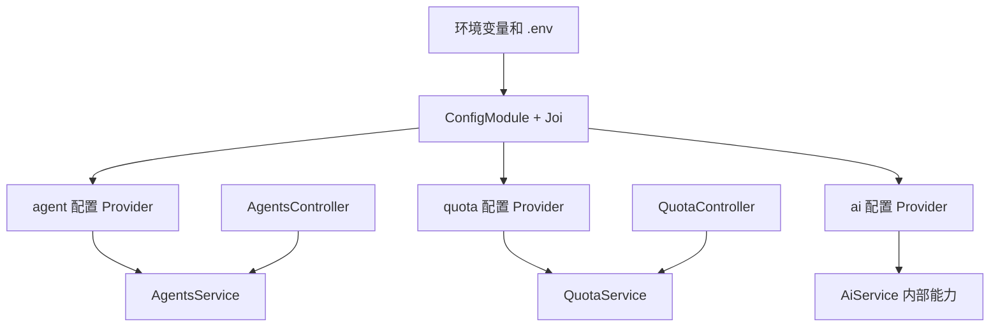

# NestJS Study 18：类型化配置注入

以 AI Agent 执行参数和用户配额为场景，继续学习 Configuration：把配置作为依赖注入到需要它的服务中，并让 TypeScript 从配置工厂推导类型。

Study 17 使用字符串路径读取配置，本章通过命名空间 Token 直接注入配置对象。修改配置字段时，服务可以获得类型提示；无需重复定义一套可能过时的 interface。

## 本章实现与学习目标

- `registerAs()` 创建命名空间及对应的注入 Token。
- `@Inject(config.KEY)` 在运行时定位配置 Provider。
- `ConfigType<typeof config>` 在编译时推导对象类型。
- Joi 在应用初始化时校验环境变量，避免非法执行参数进入服务。
- `DefaultValuePipe` 与 `ParseIntPipe` 处理 URL 字符串，Service 再校验配额计算的业务范围。

三个配置分别是 `ai`、`agent`、`quota`。HTTP 提供 Agent 配置、模拟执行和配额计算；`AiService` 是可注入的内部服务，没有独立模型接口。运行不需要数据库、Redis或真实模型 Key。

## 目录与架构

```text
src/
├── main.ts
├── app.module.ts                 # 全局加载三个配置、Joi 校验
├── config/
│   ├── ai.config.ts
│   ├── agent.config.ts
│   └── quota.config.ts
├── ai/
│   ├── ai.module.ts
│   └── ai.service.ts             # 内部模拟模型能力，未暴露 HTTP
├── agents/
│   ├── agents.module.ts
│   ├── agents.controller.ts
│   └── agents.service.ts         # 注入 agent 配置
└── quota/
    ├── quota.module.ts
    ├── quota.controller.ts
    └── quota.service.ts          # 注入 quota 配置、计算剩余配额
```



## 核心实现原理

### Token 与类型是两件事

[agents.service.ts](src/agents/agents.service.ts) 的构造参数：

```ts
@Inject(agentConfig.KEY)
private readonly config: ConfigType<typeof agentConfig>
```

`agentConfig.KEY` 是 Nest 容器在运行时能识别的 Token；`ConfigType` 只帮助编译检查，编译后会消失，所以要使用 `import type`，也不能只写类型而省略 `@Inject()`。

[agent.config.ts](src/config/agent.config.ts) 定义 `maxSteps`、`timeoutMs`、`maxConcurrent`。工厂用 `Number()` 处理字符串输入，Joi 先确保这些数字在允许范围内。

### 全局加载与模块边界

[AppModule](src/app.module.ts) 使用 `isGlobal: true` 和 `load: [aiConfig, agentConfig, quotaConfig]`。因此三个业务模块能够注入这些配置，不需要彼此导入。它们共享的是应用启动配置，不是跨 Study 的共享文件。

`AiModule` 导出 `AiService`，但当前 `AgentsService.run()` 不调用它，而是直接返回模拟结果；不要根据模块名推断已经连通真实 AI 流程。

### 当前安装版本的校验选项

本章安装 `@nestjs/config 12.0.1`，`validationSchema` 使用 Standard Schema。Joi 专属选项需要放在：

```ts
validationOptions: {
  libraryOptions: { allowUnknown: true, abortEarly: false, convert: true }
}
```

`allowUnknown` 容许 `PATH` 等其他进程环境变量；`abortEarly: false` 汇总配置错误；`convert` 允许把环境字符串转换为数字。旧版教程把这三项直接放在外层，与当前类型不兼容。ESM 的 Joi 使用默认导入。

### 配额检查没有扣费副作用

[quota.controller.ts](src/quota/quota.controller.ts) 默认把缺省 `usedToday` 设为 0，再解析为整数。[QuotaService](src/quota/quota.service.ts) 还拒绝负数和非安全整数，避免负用量反而增加剩余额度。

`remaining = max(0, dailyLimit - usedToday)`，只有剩余大于 0 时 `allowed` 为真。接口不记录用量，也没有认证；客户端传来的数字只是计算演示，不能成为真实付费系统的可信账本。

## 如何运行

建议 Node.js 24、pnpm 12；本章锁定 Nest core/common 12.3.2、TypeScript 6.0.3。可使用默认值启动，也可以复制示例配置：

```bash
cd nestjs-study-18
pnpm install --frozen-lockfile
cp .env.example .env
pnpm start:dev
```

已有 `.env` 时保留自己的配置。可用 `PORT=3018 pnpm start:dev` 更换端口；更换后也要调整下面请求地址。

| 配置 | Joi 缺省值 | 用途 |
| --- | --- | --- |
| AI_PROVIDER / AI_MODEL | openai / gpt-4.1 | 内部模拟模型配置 |
| AI_TEMPERATURE / AI_MAX_TOKENS | 0.7 / 4096 | 模型参数 |
| AGENT_MAX_STEPS | 20 | 展示的执行步数上限 |
| AGENT_TIMEOUT_MS | 30000 | 展示的超时，毫秒 |
| AGENT_MAX_CONCURRENT | 5 | 展示的并发上限 |
| QUOTA_DAILY_LIMIT | 100 | 配额计算上限 |
| QUOTA_MAX_TOKENS_PER_REQUEST | 8192 | 配额配置展示 |

`.env.example` 显式把步数设为 10、单次 Token 配额设为 8000，这是覆盖默认值的示例。配置文件与校验默认值已保持一致。`AI_API_KEY` 可为空且当前未使用，不会通过配置接口返回。

## API 与 HTTP 验证

| Method | Endpoint | 行为 |
| --- | --- | --- |
| GET | /agents/config | Agent 原始执行配置 |
| GET | /agents/limits | 将超时换算成秒后展示 |
| POST | /agents/run | 非空 prompt 的模拟执行，201 |
| GET | /quota/config | 配额配置 |
| GET | /quota/check?usedToday=1 | 计算剩余量，不保存用量 |

```bash
curl http://localhost:3000/agents/config
curl http://localhost:3000/agents/limits
curl -X POST http://localhost:3000/agents/run \
  -H 'Content-Type: application/json' -d '{"prompt":"研究配置注入"}'
curl 'http://localhost:3000/quota/check?usedToday=1'
curl 'http://localhost:3000/quota/check?usedToday=100'
curl -i 'http://localhost:3000/quota/check?usedToday=-1'
curl -i -X POST http://localhost:3000/agents/run \
  -H 'Content-Type: application/json' -d '{"prompt":""}'
```

前两个接口的超时应分别以毫秒和秒表示；模拟执行返回相同配置。使用示例配额 100 时，用量 1 对应 99，达到 100 时剩余 0、`allowed: false`；负数和空 prompt 返回 400。

停止旧进程后运行 `AGENT_MAX_STEPS=0 pnpm start`，应在初始化时被 Joi 拒绝。正常启动后根路径 `/` 没有注册，验证应使用表内业务路由。

```bash
pnpm build
pnpm exec tsc --noEmit --incremental false
pnpm lint
pnpm test
pnpm test:e2e
```

e2e 通过已构建 AppModule 检查真实注入、HTTP 参数和配额规则。

## 推荐阅读顺序与练习

1. [AppModule](src/app.module.ts)：先看配置加载和 Joi 默认值。
2. [agent 工厂](src/config/agent.config.ts)、[quota 工厂](src/config/quota.config.ts)：确认对象形状。
3. [AgentsService](src/agents/agents.service.ts)：理解 KEY 与 ConfigType 的不同作用。
4. [QuotaController](src/quota/quota.controller.ts) → [QuotaService](src/quota/quota.service.ts)：区分 HTTP 转换与计算规则。
5. [AiService](src/ai/ai.service.ts)：识别已定义但尚未接入请求链的能力。

为什么注入配置失败？检查工厂是否在 `load` 中，Token 是否来自同一工厂。为什么修改 `.env` 后响应未变？配置在启动时读取，需要重启；进程环境变量仍有更高优先级。

1. 新增一个 Agent 配置字段，在工厂、Joi 和展示方法中贯通它。
2. 对照 Study 17，把字符串路径读取改成类型化注入，比较字段名拼错时的反馈。
3. 用缺省用量、恰好耗尽和超额三种输入验证配额计算。
4. 思考真正限制并发和执行超时还需要什么；当前返回配置并不等于执行了限制。

本章重点是配置依赖的类型与运行时定位。生产配额必须由服务端用量记录、认证身份和一致性约束支撑；当前纯计算不承担这些职责。

参考：[中文 Configuration](https://docs.nestjs.cn/techniques/configuration/)、[英文 Configuration](https://docs.nestjs.com/techniques/configuration)。
