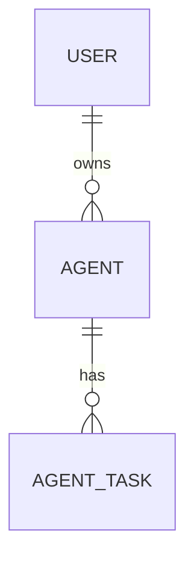
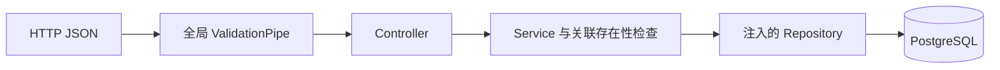

# NestJS Study 19：PostgreSQL 与 TypeORM

用“用户拥有 Agent、Agent 拥有任务”的数据关系，学习 Nest 的 SQL 集成。与前面的内存数组不同，本章会真实连接 PostgreSQL，保存记录并通过外键维护关联。

这是关系型数据与 Repository 的教学项目。任务状态由 HTTP 手动更新，没有调用模型，也没有后台 Worker。`userId` 只是关系字段，不代表已经认证的当前用户。

## 学习目标

- `TypeOrmModule.forRootAsync()`：从配置 Provider 创建数据库连接。
- `forFeature()` 与 `@InjectRepository()`：让业务服务获得对应实体的 Repository。
- `ManyToOne` / `OneToMany`：表达用户、Agent 与任务的关系。
- `relations`：显式决定查询哪些关联，而非假设关系字段总会自动加载。
- DTO 校验、404 和 409：把请求错误与数据库约束错误转换为可理解的响应。
- `onDelete: 'CASCADE'`：理解删除父记录会影响哪些数据。

## 目录结构

```text
src/
├── main.ts                         # 监听 HTTP，启用关闭钩子
├── app.module.ts                   # 配置、异步连接、全局验证管道
├── config/database.config.ts
├── common/pipes/parse-database-id.pipe.ts # 限制路径 ID 为数据库整数范围
├── users/
│   ├── users.module.ts / users.controller.ts / users.service.ts
│   ├── dto/create-user.dto.ts
│   └── entities/user.entity.ts
├── agents/
│   ├── agents.module.ts / agents.controller.ts / agents.service.ts
│   ├── dto/create-agent.dto.ts / update-agent.dto.ts
│   └── entities/agent.entity.ts
└── tasks/
    ├── tasks.module.ts / tasks.controller.ts / tasks.service.ts
    ├── dto/create-task.dto.ts / update-task-status.dto.ts
    └── entities/agent-task.entity.ts
```

## 数据与执行流程





### 连接与实体注册各负责什么

[AppModule](src/app.module.ts) 注入 `databaseConfig.KEY`，工厂返回 PostgreSQL 连接参数。`autoLoadEntities: true` 收集业务模块中由 `forFeature([Entity])` 注册的实体；它不会自动把仓库中的任意实体文件变成业务模块。

[UsersModule](src/users/users.module.ts) 为 `User` 注册 Repository 并导出 `UsersService`。AgentsModule 导入它，在保存 Agent 前确认用户存在；TasksModule 再导入 AgentsModule，确认任务所引用的 Agent 存在。存在性检查使用 `existsBy()`，避免仅为校验外键而加载整个关联任务历史。这是一条单向依赖链，无需循环依赖。

### 外键、加载与级联

[Agent 实体](src/agents/entities/agent.entity.ts) 同时保留 `userId` 和 `user` 关系：前者用于明确写入外键，后者用于加载关联对象。

```ts
@ManyToOne(() => User, user => user.agents, {
  nullable: false, onDelete: 'CASCADE'
})
@JoinColumn({ name: 'userId' })
user: Relation<User>;
```

`Relation<User>` 是当前 TypeORM 提供的类型包装。它避免 ESM 装饰器元数据在循环实体导入时过早读取尚未初始化的类；关系回调仍指向真实实体，并没有删除关系。

用户详情加载 agents，Agent 详情加载 user 与 tasks，任务详情加载 agent。删除用户会由数据库级联删除其 Agent，再删除任务。这是数据库外键行为，不等于 ORM 自动保存任意嵌套对象。

### 输入和数据库错误

[DTO](src/agents/dto/create-agent.dto.ts) 必须是 class，并通过值导入传给 Controller，供 ValidationPipe 使用运行时元数据。全局管道拒绝额外字段，防止更新请求覆盖 `id` 或 `userId`；更新允许省略字段，但拒绝 `name: null` 等破坏数据形状的值。具体 DTO 的可选 class 字段在运行时可能是自有的 undefined，Service 只将明确提供的标量字段交给 Repository.update，再读取完整结果，避免响应丢字段，也避免把陈旧 tasks 关系图交给 save 后触发孤儿处理、误删并发新增任务。路径和外键 ID 限制在 PostgreSQL integer 的 1～2147483647 范围，非法范围在查询前返回 400。

关联不存在返回 404；重复邮箱依据 PostgreSQL 唯一约束错误 `23505` 映射为 409。其他数据库故障仍作为服务故障暴露，不伪装成成功。状态只允许 `pending/running/completed/failed`，当前没有额外状态机迁移限制。

## 如何运行

建议 Node.js 24、pnpm 12、Docker。已安装 Nest 12.3.2、`@nestjs/typeorm 12.0.2`、TypeORM 1.1.2、pg 8.23.1；依赖版本以本章锁文件为准，不需要升级教程到其他 ORM 版本。

先启动独立学习数据库：

```bash
docker run --name nestjs-study19-postgres --rm \
  -e POSTGRES_USER=study \
  -e POSTGRES_PASSWORD=study_local_only \
  -e POSTGRES_DB=agent_study \
  -p 127.0.0.1:5433:5432 -d postgres:17-alpine
cd nestjs-study-19
pnpm install --frozen-lockfile
cp .env.example .env
pnpm start:dev
```

若端口或容器名已占用，请使用新的名称和端口，并同步 `.env`。`--rm` 示例没有挂载持久卷，停止容器后学习数据会丢失。

| 环境变量 | 示例值 |
| --- | --- |
| DATABASE_HOST | 127.0.0.1 |
| DATABASE_PORT | 5433（容器内仍为 5432） |
| DATABASE_USERNAME | study |
| DATABASE_PASSWORD | study_local_only |
| DATABASE_NAME | agent_study |
| PORT | 3000 |

`AppModule` 使用 `synchronize: true` 自动同步学习表结构，**只能连接专用学习数据库**。真实项目应采用迁移和受控数据库账号。例子中的密码是公开本地夹具，不是生产秘密。

## API

| Method | Endpoint | 用途 |
| --- | --- | --- |
| GET / POST | /users | 列表 / 创建用户 |
| GET / DELETE | /users/:id | 含 agents 的详情 / 删除用户并级联 |
| GET / POST | /agents | 含 user 的列表 / 创建 Agent |
| GET / PATCH / DELETE | /agents/:id | 含 user、tasks 的详情 / 更新 / 删除 |
| GET / POST | /tasks | 含 agent 的列表 / 创建 pending 任务 |
| GET / DELETE | /tasks/:id | 任务详情 / 删除 |
| PATCH | /tasks/:id/status | 手动更新状态与可选 output |

## HTTP 验证

以下命令在一个新学习数据库中执行；已有数据时，把示例 ID 替换成前一步实际返回的 ID。

```bash
curl -X POST http://localhost:3000/users \
  -H 'Content-Type: application/json' \
  -d '{"name":"Learner","email":"learner@example.test"}'
curl -X POST http://localhost:3000/agents \
  -H 'Content-Type: application/json' \
  -d '{"name":"Research","description":"SQL demo","model":"mock","userId":1}'
curl -X POST http://localhost:3000/tasks \
  -H 'Content-Type: application/json' \
  -d '{"agentId":1,"input":"解释关系型数据"}'
curl http://localhost:3000/agents/1
curl -X PATCH http://localhost:3000/tasks/1/status \
  -H 'Content-Type: application/json' \
  -d '{"status":"completed","output":"模拟研究报告"}'
```

创建响应为 201；Agent 详情应带 `user` 与 `tasks`，任务最初为 pending，更新后为 completed。

```bash
# 400：不是枚举值
curl -i -X PATCH http://localhost:3000/tasks/1/status \
  -H 'Content-Type: application/json' -d '{"status":"anything"}'
# 400：不允许借更新请求转移归属
curl -i -X PATCH http://localhost:3000/agents/1 \
  -H 'Content-Type: application/json' -d '{"userId":2}'
# 409：重复上面的邮箱
curl -i -X POST http://localhost:3000/users \
  -H 'Content-Type: application/json' \
  -d '{"name":"Duplicate","email":"learner@example.test"}'
# 删除后，所属 Agent、任务的详情应为 404
curl -X DELETE http://localhost:3000/users/1
curl -i http://localhost:3000/tasks/1
```

## 检查与常见问题

```bash
pnpm build
pnpm exec tsc --noEmit --incremental false
pnpm lint
pnpm test
RUN_DATABASE_E2E=1 pnpm test:e2e
```

e2e 真实连接 `.env` 或进程变量指定的 PostgreSQL，创建唯一邮箱夹具并删除自己创建的用户。显式开关避免无意连接已有数据库；不要对共享或生产库运行。它不替你启动数据库。关闭应用会释放连接池。

连接被拒绝时先检查 Docker 与宿主端口，不能把容器内 5432 与宿主 5433 混用。遇到实体元数据错误时检查 `forFeature()` 和关系类导入，不要通过移除关系绕过问题。

## 推荐阅读顺序与练习

1. [AppModule](src/app.module.ts) 与 [database.config](src/config/database.config.ts)：理解连接来源。
2. 三个 `entities` 文件：画出外键和删除影响。
3. [UsersModule](src/users/users.module.ts) → [AgentsModule](src/agents/agents.module.ts) → [TasksModule](src/tasks/tasks.module.ts)：跟踪 Repository 注册和跨模块依赖。
4. 对照 DTO、Controller 和 Service，沿创建任务的请求读到数据库。
5. [业务测试](test/app.e2e-spec.ts)：观察真实外键与错误响应。

1. 为用户新增一个普通展示字段，依次修改实体、DTO 和验证请求。
2. 比较带与不带 `relations` 的查询结果，解释为何没有关联对象。
3. 删除一个 Agent，确认用户保留、其任务被级联删除。
4. 思考把 userId 改为登录身份需要哪些认证和归属检查；本章没有实现认证。

本章建立“请求边界 → 服务 → Repository → 数据约束”的完整链路。生产项目还要考虑迁移、事务、分页、认证与并发删除竞态；这里不把简单关系示例扩展成完整业务系统。

参考：[中文 SQL](https://docs.nestjs.cn/techniques/sql/)、[英文数据库入口](https://docs.nestjs.com/techniques/sql)、[TypeORM 关系](https://typeorm.io/docs/relations/relations/)。
