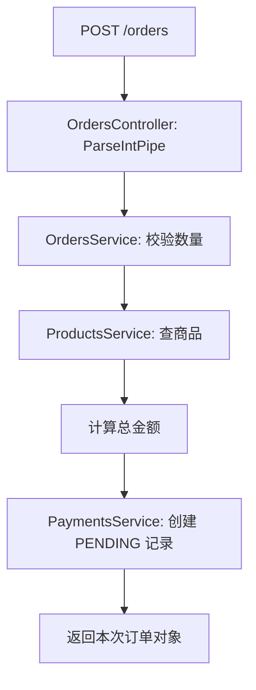

# Study 2：用商品下单理解模块边界

[返回学习路线](../README.md)

## 项目介绍

本章模拟电商中的商品查询与订单创建。一次下单需要查商品、算金额、生成待支付记录；重点是让 `OrdersModule` 使用其他模块公开的能力，而不在订单模块里复制商品和支付服务。

学习本章后，你应该能够回答：一个类已经标记 `@Injectable()`，为什么另一个模块仍然可能无法注入它？

## 学习目标

- 分清 `imports`、`providers`、`controllers`、`exports` 四个位置各自管理什么。
- 沿订单调用链理解构造函数 DI：业务依赖写在类中，实例装配交给容器。
- 判断模块应公开什么服务，而不是把每个内部类都导出。
- 用成功订单和失败请求验证模块协作，而不是只看到应用启动就认为完成。

## 真实业务场景

商品初始为 MacBook Pro、iPhone、iPad。`POST /orders` 接受 `productId` 和正整数 `quantity`，计算总金额并返回一条 `PENDING` 支付记录。

这里没有真实扣款、库存、订单持久化或订单列表。每次请求构造新的订单对象和支付记录，主要演示服务协作；不要将返回的 `paymentId` 视为支付平台的凭证。

## 项目结构

```text
src/
├── orders/
│   ├── orders.controller.ts
│   ├── orders.module.ts
│   └── orders.service.ts
├── payments/
│   ├── payments.module.ts
│   └── payments.service.ts
├── products/
│   ├── products.controller.ts
│   ├── products.module.ts
│   └── products.service.ts
├── statistics/
│   ├── statistics.module.ts
│   └── statistics.service.ts
├── app.controller.spec.ts
├── app.controller.ts
├── app.module.ts
├── app.service.ts
└── main.ts
```

`AppModule` 实际导入 `ProductsModule` 与 `OrdersModule`。`AppController`、`AppService` 是未接入根模块的脚手架；`StatisticsModule` 和 `StatisticsService` 是保留的扩展代码，目前没有 HTTP 入口，不应尝试不存在的 `/statistics` 路由。

## 核心知识讲解

### 模块是容器边界

[ProductsModule](src/products/products.module.ts) 的定义很短，却决定了商品能力怎样被使用：

```ts
@Module({
  controllers: [ProductsController],
  providers: [ProductsService],
  exports: [ProductsService],
})
```

- `controllers` 让 HTTP 路由被 Nest 发现。
- `providers` 告诉容器如何创建本模块可用的服务。
- `exports` 把服务公开给导入本模块的模块。

只有 `@Injectable()` 不等于注册，也不等于公开。文件中的 `import { ProductsService }` 只让 TypeScript 能引用类；模块的 `imports: [ProductsModule]` 才建立容器的可见性关系。

### 订单导入能力，不重新创建商品服务

[OrdersModule](src/orders/orders.module.ts) 导入商品和支付两个模块；[OrdersService](src/orders/orders.service.ts) 用构造函数声明依赖：

```ts
constructor(
  private readonly productsService: ProductsService,
  private readonly paymentsService: PaymentsService,
) {}
```

如果把同一个 `ProductsService` 再放到订单模块的 `providers`，会注册一个本地实例，容易造成不同模块读到不同内存状态。当前实现使用导出服务，由容器管理复用关系。

[PaymentsModule](src/payments/payments.module.ts) 只提供服务，没有 Controller。模块不必都有 HTTP 入口；支付在本章是由订单调用的内部能力。

### 业务验证与 HTTP 参数解析

[OrdersController](src/orders/orders.controller.ts) 对两个 Body 字段使用 `ParseIntPipe`，拒绝非整数；Service 再限制购买数量必须大于零。整数解析不代表满足业务规则，`-1` 虽是整数仍不能购买。

[ProductsService](src/products/products.service.ts) 在商品不存在时抛 `NotFoundException`，经 Nest 映射为 404。订单只做当前示例的同步步骤，Service 的异常会沿调用链返回 HTTP。

### 统计模块适合什么练习

[StatisticsModule](src/statistics/statistics.module.ts) 已导入商品模块，[StatisticsService](src/statistics/statistics.service.ts) 用商品服务计算数量。它展示同一公开能力如何被第二个模块消费，但未被根模块启用。先理解这个状态，再决定如何接入；不要把“源码里存在”误认为“接口已经上线”。

## 核心执行流程



## 如何运行

本项目独立安装和运行，无数据库、Redis 或支付平台依赖。建议 Node.js 24（实测 24.5.0）、pnpm 12.3.4。Nest 声明 `^12.0.1`，锁定/实际安装 12.3.2；TypeScript 声明 `^6.0.2`，实际 6.0.3。

```bash
pnpm install --frozen-lockfile
pnpm start:dev
# 以下检查另开终端，仍在本项目目录
pnpm build
pnpm exec tsc --noEmit --incremental false
pnpm lint
pnpm test
pnpm test:e2e
pnpm start:prod
```

默认监听 3000；例如 `PORT=3102 pnpm start:dev` 可以更换端口。不需要环境变量。`start:prod` 使用本地构建产物，不会发布服务。`test:e2e` 先 build 再测试，确保测试经过实际 ESM 依赖注入链。

## 如何验证

```bash
curl -s http://localhost:3000/products
curl -s http://localhost:3000/products/1
# 201；totalAmount=30000，payment.status=PENDING
curl -i -X POST http://localhost:3000/orders \
  -H 'Content-Type: application/json' -d '{"productId":1,"quantity":2}'
# 404：商品不存在
curl -i -X POST http://localhost:3000/orders \
  -H 'Content-Type: application/json' -d '{"productId":999,"quantity":1}'
# 400：数量不满足业务规则
curl -i -X POST http://localhost:3000/orders \
  -H 'Content-Type: application/json' -d '{"productId":1,"quantity":0}'
# 400：路径ID无法解析为整数
curl -i http://localhost:3000/products/not-a-number
```

根路径 `/` 没有注册路由，返回 404 正常。现有 [AppController 单元测试](src/app.controller.spec.ts) 只检查保留的脚手架类；真正的本章运行证据在 [e2e](test/app.e2e-spec.ts)，覆盖订单、参数和异常。

## 推荐阅读顺序

1. [AppModule](src/app.module.ts)：确认真正启动的模块图。
2. [OrdersModule](src/orders/orders.module.ts)：找清订单依赖来自哪些模块。
3. [ProductsModule](src/products/products.module.ts) → [PaymentsModule](src/payments/payments.module.ts)：核对各自的 exports。
4. [OrdersController](src/orders/orders.controller.ts) → [OrdersService](src/orders/orders.service.ts)：从一次 HTTP 请求跟到服务协作。
5. [ProductsService](src/products/products.service.ts) → [PaymentsService](src/payments/payments.service.ts)：看被调用的具体行为。
6. [StatisticsModule](src/statistics/statistics.module.ts)：最后把同样的规则用于第二个消费方。

## 思考与练习

1. 临时移除商品模块的 `exports`，启动后阅读依赖解析错误，再恢复。
2. 给统计模块添加 Controller 并导入 AppModule，通过真实 HTTP 查询商品数量。
3. 给订单返回值增加明确的 interface，避免将数据库实体等同于 HTTP 响应。
4. 如果要保存订单历史，应把内存数组放在哪里？实现后验证重启会发生什么。

## 本章总结

本章的重点是模块可见性：注册、导入、导出各有作用。Controller 负责输入，订单服务组织用例，商品和支付服务各自提供能力。下一章沿着真实请求继续观察中间件与异常处理；本章的统计模块可以作为扩展练习，尚不是完整统计功能。

参考：[Modules](https://docs.nestjs.com/modules)、[Providers](https://docs.nestjs.com/providers)。
