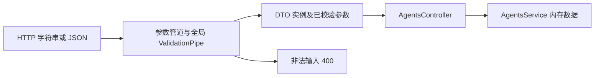

# NestJS Study 21：Validation 与 DTO

用一个内存 Agent 管理 API 学习请求验证：创建配置、分页查询、批量创建、局部更新与嵌套执行参数。数据在进程退出后丢失，不调用真实模型。

前端发送 JSON 并不意味着它遵守 TypeScript 类型。后端必须在写入状态前检查数据，避免非法配置等到任务执行阶段才出错。本章让这些检查成为实际 HTTP 请求链的一部分。

## 学习目标

- DTO class 提供运行时验证元数据；interface 和类型注解不能代替它。
- `ValidationPipe` 完成 plain object 到 DTO 的转换及规则检查。
- `whitelist` 与 `forbidNonWhitelisted` 阻止额外字段写入业务状态。
- 显式处理查询字符串，尤其不能把字符串 `false` 直接当布尔值转换。
- `PartialType` 复用规则，同时区分“未提供字段”和“提供 null”。
- `ValidateNested`、`Type`、`IsObject` 各承担不同职责。
- `ParseArrayPipe` 校验整个批量请求后才进入 Service。

## 目录与请求流程

```text
src/
├── main.ts
├── app.module.ts                     # APP_PIPE 注册全局验证
└── agents/
    ├── agents.module.ts
    ├── agents.controller.ts           # 参数管道与实际路由
    ├── agents.service.ts              # 内存 CRUD、筛选与模拟执行
    ├── interfaces/agent.interface.ts  # 内存数据形状
    └── dto/
        ├── create-agent.dto.ts
        ├── update-agent.dto.ts
        ├── query-agents.dto.ts
        └── run-agent.dto.ts           # 包含嵌套 AgentRunOptionsDto
```



## 核心原理

### 验证管道必须真正绑定

[AppModule](src/app.module.ts) 使用 `APP_PIPE` 注册全局 ValidationPipe。这样通过 main 启动和通过 AppModule 创建测试应用时都使用同一套配置，避免测试忘记安装管道而误以为验证有效。

```ts
new ValidationPipe({
  transform: true,
  whitelist: true,
  forbidNonWhitelisted: true,
  forbidUnknownValues: true,
})
```

`transform` 会创建 DTO 实例，但不会凭空知道所有 JSON 字符串该怎样转换。Body 中的 `temperature`、`maxSteps` 应传数字；查询参数通过 DTO 中的 `@Type(() => Number)` 明确转换。

### 字段规则表达业务范围

[CreateAgentDto](src/agents/dto/create-agent.dto.ts) 要求名称 3～50 字符、模型来自给定列表、温度 0～2、最大步数 1～100。工具数组需要唯一且来自允许列表。

`enabled` 和 `description` 可以省略；传入 `null` 会失败。校验发生在 Service 增加 ID 之前，因此一个失败请求不应消耗 ID 或留下半条数据。

### 为什么 PATCH 不能直接接受 null

[UpdateAgentDto](src/agents/dto/update-agent.dto.ts) 使用：

```ts
PartialType(CreateAgentDto, { skipNullProperties: false })
```

省略字段表示保留原值，传 `name: null` 不等于省略。基础 DTO 的可选字段也使用 `ValidateIf(value !== undefined)`，避免 `IsOptional` 把 null 一起跳过。否则名称后续参与搜索时可能引发运行时错误。

Service 在全局白名单验证后合并 DTO；不是所有带 TypeScript 类型的对象都适合直接 `Object.assign`。

### 嵌套对象与查询转换

[RunAgentDto](src/agents/dto/run-agent.dto.ts) 的 `@Type(() => AgentRunOptionsDto)` 创建嵌套实例，`@ValidateNested()` 继续验证内部字段，`@IsObject()` 排除数组。只有嵌套验证而没有对象形状校验时，空数组可能绕过预期规则。

[QueryAgentsDto](src/agents/dto/query-agents.dto.ts) 只把精确字符串 `true` / `false` 转成布尔值，其他值交给 `IsBoolean` 拒绝。JavaScript 的 `Boolean('false')` 为 true，不能用于这里。

`ParseIntPipe` 处理路径 ID；`ParseArrayPipe` 将逗号分隔的 ID 转成数字，或把批量请求的每项转换并验证为 CreateAgentDto。

## 如何运行

建议 Node.js 24、pnpm 12；锁定 Nest core/common 12.3.2、TypeScript 6.0.3。无需环境文件、数据库和模型 Key。

```bash
cd nestjs-study-21
pnpm install --frozen-lockfile
pnpm start:dev
```

默认端口 3000；可使用 `PORT=3021 pnpm start:dev`。当前 AppModule 只注册 AgentsModule，根路径 `/` 返回 404。

## API

| Method | Endpoint | 用途 |
| --- | --- | --- |
| POST | /agents | 创建，201 |
| GET | /agents | page/pageSize/keyword/enabled 筛选分页 |
| GET | /agents/search/by-ids?ids=1,2 | 按多个 ID 查询 |
| GET / PATCH / DELETE | /agents/:id | 详情 / 局部更新 / 删除 |
| POST | /agents/bulk | 批量创建，201，Body 为数组 |
| POST | /agents/:id/run | 嵌套选项验证、模拟执行，200 |

## HTTP 验证

新进程中创建第一条 Agent：

```bash
curl -X POST http://localhost:3000/agents \
  -H 'Content-Type: application/json' \
  -d '{"name":"Research Agent","model":"gpt-4.1","temperature":0.7,"maxSteps":10,"tools":["web_search"],"enabled":true}'
curl 'http://localhost:3000/agents?page=1&pageSize=10&enabled=true'
curl 'http://localhost:3000/agents/search/by-ids?ids=1,2'
curl -X POST http://localhost:3000/agents/1/run \
  -H 'Content-Type: application/json' \
  -d '{"input":"解释 DTO 验证","options":{"stream":false,"maxTokens":32},"tags":["study"]}'
```

创建返回 ID 1，分页响应的 `pagination.page` 是数字；执行响应包含输入、选项和模拟 output。`stream: true` 只是回显选项，**这里不会建立 SSE 连接**。

```bash
# 以下四项均为 400
curl -i -X PATCH http://localhost:3000/agents/1 \
  -H 'Content-Type: application/json' -d '{"name":null}'
curl -i -X PATCH http://localhost:3000/agents/1 \
  -H 'Content-Type: application/json' -d '{"id":99}'
curl -i -X POST http://localhost:3000/agents/1/run \
  -H 'Content-Type: application/json' -d '{"input":"合法输入","options":[]}'
curl -i 'http://localhost:3000/agents?enabled=no'
# 合法局部更新
curl -X PATCH http://localhost:3000/agents/1 \
  -H 'Content-Type: application/json' -d '{"enabled":false}'
curl -X POST http://localhost:3000/agents/1/run \
  -H 'Content-Type: application/json' -d '{"input":"再次执行"}'
```

停用后的执行仍返回 200，但 `success: false`；这是当前模拟业务约定。不存在的 ID 返回 404；非法路径数字返回 400。

## 检查、阅读顺序与练习

```bash
pnpm build
pnpm exec tsc --noEmit --incremental false
pnpm lint
pnpm test
pnpm test:e2e
```

e2e 验证非法请求不写入状态、分页转换、null 更新、嵌套对象与批量校验。批量请求只要一项非法，整个请求在进入 Service 前失败，不会创建前面的合法项；这不等于数据库事务。

1. [AppModule](src/app.module.ts)：找到全局管道。
2. [CreateAgentDto](src/agents/dto/create-agent.dto.ts) → [UpdateAgentDto](src/agents/dto/update-agent.dto.ts)：比较创建和更新边界。
3. [QueryAgentsDto](src/agents/dto/query-agents.dto.ts) → [RunAgentDto](src/agents/dto/run-agent.dto.ts)：理解转换与嵌套验证。
4. [Controller](src/agents/agents.controller.ts)：对应每个参数与管道。
5. [Service](src/agents/agents.service.ts)：观察校验通过后业务可以依赖什么。

为什么验证装饰器写了却没效果？检查管道绑定与 DTO 是否为运行时 class 值导入。为什么 `options: []` 不合法？它是数组，而执行选项需要一个对象。为什么传数字字符串会失败？本章只对查询参数显式转换，Body 要按 JSON 类型发送。

1. 在模型允许列表加入一个本地 Mock 标识，并验证合法与非法输入。
2. 为执行选项增加一个带范围限制的数字字段。
3. 构造包含一条非法项的批量请求，确认后续合法创建仍从正确 ID 开始。
4. 比较省略 description、传空字符串和传 null 的区别。

本章重点是运行时输入边界，不涉及持久化、权限或真实模型执行。Study 19 展示数据库约束；Study 38 展示真正的 SSE 输出，它们与 DTO 验证各有职责。

参考：[中文 Validation](https://docs.nestjs.cn/techniques/validation/)、[英文 Validation](https://docs.nestjs.com/techniques/validation)。
