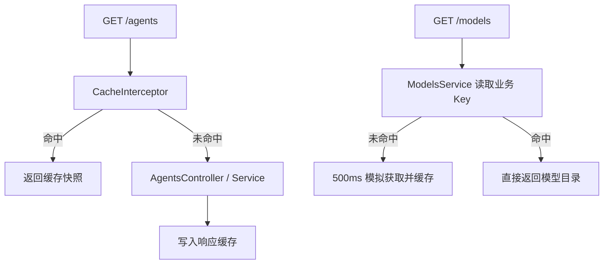

# NestJS Study 22：自动缓存与手动缓存

通过公开 Agent 目录和模拟模型列表，学习 Nest 的 Caching：哪些结果适合缓存、缓存命中后哪些代码不会再执行，以及 TTL 到期前读取旧结果意味着什么。

本章使用进程内存缓存，不需要 Redis。模型列表用 500 毫秒延迟模拟外部请求，没有调用真实模型 API。更进一步的主动失效与用户分组见 [Study 23](../nestjs-study-23/README.md)。

## 学习目标

- `CacheModule.register()` 创建缓存 Provider，并设置全局可见性和默认 TTL。
- `CacheInterceptor` 对指定 GET 路由缓存最终响应。
- `@CacheTTL()` 为不同路由设置不同的过期时间。
- `CACHE_MANAGER` 作为注入 Token，供 Service 手动读写业务缓存。
- 理解自动路由 Key 与手动业务 Key 的区别。
- 观察写入后暂时读取旧缓存的行为，避免把 TTL 缓存误认为实时一致的数据源。

## 目录与执行流程

```text
src/
├── main.ts
├── app.module.ts                    # 全局内存 CacheModule，默认 5000ms
├── agents/
│   ├── agents.module.ts
│   ├── agents.controller.ts         # GET 缓存装饰器，POST/PATCH 不缓存
│   ├── agents.service.ts            # 内存目录和小型运行时输入检查
│   └── interfaces/agent.interface.ts
└── models/
    ├── models.module.ts
    ├── models.controller.ts
    └── models.service.ts            # 手动缓存 ai:models:all
```



## 核心实现原理

### 自动缓存如何绕过 Service

[AgentsController](src/agents/agents.controller.ts) 在列表 GET 上绑定：

```ts
@UseInterceptors(CacheInterceptor)
@CacheTTL(5000)
```

缓存未命中时才执行 Controller 和 Service；命中时返回已存响应。详情 GET 的 TTL 为 10000 毫秒。`CacheModule` 全局注册并不自动让所有接口缓存，仍需绑定拦截器。

默认 HTTP Key 来自请求 URL，列表 `/agents` 与详情 `/agents/1` 是不同项；不同 URL 查询串可能形成不同缓存。这里没有自定义 `@CacheKey`，也没有全局缓存拦截器。

### 手动缓存适用于业务步骤

[ModelsService](src/models/models.service.ts) 注入 `CACHE_MANAGER`，先查 `ai:models:all`，未命中再调用模拟 fetch，然后：

```ts
await this.cacheManager.set('ai:models:all', models, 60_000);
```

这个 Key 属于“模型目录”业务，而不是某一条 HTTP 路由。若未来多个服务都需要目录，可以复用同一业务缓存逻辑；本章没有缓存击穿锁，首次并发请求仍可能重复获取。

缓存命中应判断 `undefined/null`，不能用简单真假判断排除合法的 0、false 或空字符串。

### 当前版本的 TTL 单位

锁文件对应 `@nestjs/cache-manager 12.0.2`、cache-manager 7.2.9，TTL 单位为**毫秒**。不要复制旧教程中以秒为单位的数字。

| 缓存 | Key | TTL |
| --- | --- | --- |
| Agent 列表响应 | /agents | 5000ms |
| Agent 详情响应 | /agents/:id 的实际 URL | 10000ms |
| 模型目录 | ai:models:all | 60000ms |

### 写入不会主动失效

POST/PATCH 修改内存数据，但本章没有主动删除缓存。因此修改后短时间 GET 仍可能读到旧快照；这是当前示例的 TTL 一致性边界。需要立即生效时，应该像 Study 23 那样维护受影响的 Key 并主动失效，而不是误以为缓存会监视数组变化。

Service 的写入检查仅允许 `name/description/model` 字符串，拒绝额外字段，避免运行时绕过类型注解覆盖服务端 ID 和 enabled。这里没有为了缓存主题增加 DTO 依赖。

## 如何运行

建议 Node.js 24、pnpm 12；Nest core/common 12.3.2、TypeScript 6.0.3。无需 `.env`、数据库或 Redis。

```bash
cd nestjs-study-22
pnpm install --frozen-lockfile
pnpm start:dev
```

默认端口 3000，可通过 `PORT=3022` 覆盖。未实现 cache-admin 模块或管理路由，不能调用不存在的清理接口；根路径也未注册。

## API 与 HTTP 验证

| Method | Endpoint | 行为 |
| --- | --- | --- |
| GET | /agents | 只返回 enabled 的公开目录，缓存 5 秒 |
| GET | /agents/:id | 公开详情，缓存 10 秒，停用项视为 404 |
| POST | /agents | 创建，201，不主动失效 |
| PATCH | /agents/:id | 修改三个允许字段，不主动失效 |
| GET | /models | 模拟模型目录，手动缓存 60 秒 |

```bash
curl http://localhost:3000/agents
curl http://localhost:3000/agents
curl http://localhost:3000/agents/1
curl -i http://localhost:3000/agents/3
curl -w '\n耗时 %{time_total}s\n' http://localhost:3000/models
curl -w '\n耗时 %{time_total}s\n' http://localhost:3000/models
```

新进程列表有两个启用的 Agent，ID 3 已停用，详情返回 404。重复列表命中时不会再次打印“查询 Agent 列表”；模型第一次打印未命中并模拟等待，后续打印命中。耗时会受机器影响，不应作为精确性能承诺。

观察 TTL 快照：

```bash
# 先写入列表缓存，紧接着创建
curl http://localhost:3000/agents
curl -X POST http://localhost:3000/agents \
  -H 'Content-Type: application/json' \
  -d '{"name":"New Agent","description":"缓存演示","model":"mock"}'
curl http://localhost:3000/agents
sleep 6
curl http://localhost:3000/agents
# 400：不能通过请求覆盖 id/enabled
curl -i -X PATCH http://localhost:3000/agents/1 \
  -H 'Content-Type: application/json' -d '{"id":99,"enabled":false}'
```

首次缓存仍有效时，创建后的第一次 GET 可能只有旧列表；过期后重新读取会包含新增项。例子应连续执行；如果操作间已超过 5 秒，就会直接看到新结果。

## 检查与推荐阅读顺序

```bash
pnpm build
pnpm exec tsc --noEmit --incremental false
pnpm lint
pnpm test
pnpm test:e2e
```

e2e 验证自动缓存快照、模型业务 Key、毫秒 TTL 和不允许的写入字段。测试直接操作应用注入的 Cache 来验证失效，不新增 HTTP 管理接口。

1. [AppModule](src/app.module.ts)：找到存储与默认 TTL。
2. [AgentsController](src/agents/agents.controller.ts)：区分有拦截器的 GET 与写入路由。
3. [AgentsService](src/agents/agents.service.ts)：了解底层数据和日志。
4. [ModelsService](src/models/models.service.ts)：跟踪手动 cache-aside 流程。
5. [e2e](test/app.e2e-spec.ts)：确认 Key 和过期语义。

为什么两次 GET 只打印一次 Service 日志？拦截器直接返回缓存了。为什么刚修改又看到旧名称？列表和详情各有独立 TTL。为什么重启丢失缓存和数据？二者都在进程内存中，但各自维护独立状态。

## 练习与应用边界

1. 调整详情 TTL，与列表 TTL 对比何时读到新名称。
2. 给模型目录增加一条 Mock 数据，观察已有缓存对响应的影响。
3. 练习在 PATCH 后删除详情 Key，并思考列表 Key 也需要处理的原因。
4. 阅读 Study 23，对比“等待过期”与“主动失效”的复杂度。

本章公开目录不含用户私有信息，默认 URL Key 才适用。真实多用户响应需要把可信身份等因素纳入缓存设计；内存缓存不跨进程共享，也不保证写入实时可见。不要对登录态或敏感响应直接套用本章的公开 GET 缓存。

参考：[中文 Caching](https://docs.nestjs.cn/techniques/caching/)、[英文 Caching](https://docs.nestjs.com/techniques/caching)。
