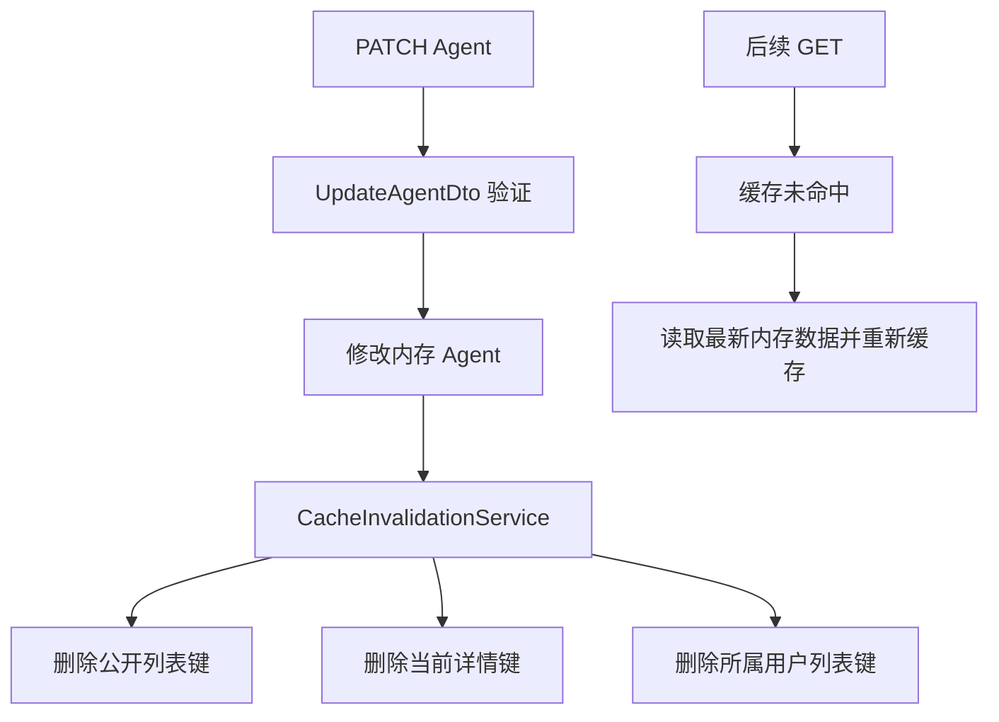

# NestJS Study 23：缓存键与写后失效

用 AI Agent 目录理解自动缓存、用户维度缓存和主动失效。对应 Techniques 的 Caching，是 Study 22 基础缓存之后的进阶示例。

本章所有业务数据和缓存均在当前进程内。虽然依赖中存在 Redis 适配器，但源码没有注册 Redis Store，启动时不需要 Redis，也不会调用真实模型。

## 学完应理解什么

- 缓存键描述的是“哪份结果”，不能只考虑 URL，也要考虑结果所属用户。
- `CacheInterceptor` 可以复用响应缓存流程；覆盖 `trackBy()` 决定是否缓存以及使用哪个键。
- `CACHE_MANAGER` 是注入 Token；Service 通过它手动读写模型目录缓存。
- TTL 限制最长存活时间，主动失效则让写入尽快反映到后续读取。
- HTTP 请求体的 TypeScript 类型不会自动阻止客户端覆盖 `id`，需要运行时 DTO 验证。

## 业务和教学边界

公开目录返回启用的 Agent，个人目录按 `x-demo-user-id` 分组。更新或删除 Agent 时，公开列表、该条详情和所属用户的列表都可能过期，其他用户列表无需清除。

`x-demo-user-id` 是可随意设置的教学标识，**不是认证**。所有接口公开，缓存管理接口也无管理员权限。个人目录不保存秘密，请勿把它直接作为真实租户隔离方案。真实系统应从认证后的用户身份生成缓存键，并保护写接口和管理接口。

## 目录和推荐阅读顺序

```text
src/
├── app.module.ts                  # 装配全局缓存和四个业务模块
├── main.ts
├── agents/
│   ├── agents.controller.ts        # 公开列表、详情和写接口
│   ├── agents.service.ts           # 内存数据和写后失效
│   ├── agents.module.ts
│   ├── agent.interface.ts
│   └── dto/update-agent.dto.ts     # 只接受可修改字段
├── cache/
│   ├── cache.module.ts             # 全局 CACHE_MANAGER 和失效服务
│   ├── cache-keys.ts               # 集中定义业务键
│   ├── cache-invalidation.service.ts
│   └── interceptors/
│       ├── agent-cache.interceptor.ts
│       └── user-cache.interceptor.ts
├── users/                         # 演示用户维度的 GET 缓存
├── models/                        # Service 手动缓存模型目录
└── cache-admin/                   # 显式清除公开列表和详情
```

建议依次阅读 [AppModule](src/app.module.ts)、[缓存模块](src/cache/cache.module.ts)、[CacheKeys](src/cache/cache-keys.ts)、[两个拦截器](src/cache/interceptors/)、[AgentsService](src/agents/agents.service.ts)，最后看用户和模型模块。先理解依赖如何可见，再追踪缓存键，最后分析一次写入影响哪些读取。

## 核心实现

### 为什么集中定义键

[cache-keys.ts](src/cache/cache-keys.ts) 同时供拦截器、模型服务和失效服务使用：

```ts
agentDetail: (agentId: number) => `agents:detail:${agentId}`,
userAgents: (userId: number) => `users:${userId}:agents`,
```

如果写接口和读接口各自拼接不同格式，删除缓存即使没有报错，也可能删不到真正使用的键。

### 自动缓存与用户缓存

[AgentCacheInterceptor](src/cache/interceptors/agent-cache.interceptor.ts) 只为 `GET /agents` 和数字详情路径生成键。列表 TTL 为 5000 毫秒，详情为 10000 毫秒。

[UserCacheInterceptor](src/cache/interceptors/user-cache.interceptor.ts) 只处理 `/users/me/agents`，从合法的正整数 header 生成 `users:1001:agents` 一类的键。Controller 仍会校验 header；`@Headers()` 本身不接受第二个 Pipe 参数，因此这里显式调用 `ParseIntPipe` 并检查安全正整数。

“未返回缓存键”代表跳过缓存，不代表身份校验成功。拦截器只解决结果分组问题。

### 更新之后删除哪些键

[AgentsService.update()](src/agents/agents.service.ts) 只赋值 `name/model/enabled`，然后等待 `invalidateAgent(agent.id, agent.userId)` 完成：



DTO 会拒绝 `id/userId` 等额外字段及错误类型，避免数据归属被覆盖后失效了错误用户的缓存。Service 同样只选择允许修改的字段。

### 手动缓存模型目录

[ModelsService](src/models/models.service.ts) 的执行顺序是 `get → 未命中时模拟查询 1 秒 → set`。键为 `models:catalog`，TTL 60000 毫秒。第二次请求可观察 `Cache Hit` 日志，不再执行模拟查询。

当前 cache-manager 7 的 TTL 单位为毫秒。旧资料中以秒为单位的示例不能直接套用。

## 独立运行

建议使用 Node.js 24、pnpm 12；实际依赖由本目录的 `pnpm-lock.yaml` 固定。主框架安装版本为 NestJS 12，缓存使用 `@nestjs/cache-manager` 12 和 cache-manager 7。

```bash
cd nestjs-study-23
pnpm install --frozen-lockfile
pnpm start:dev
```

默认端口 3000；运行其他 Study 时先退出，或使用 `PORT=3023 pnpm start:dev`。无需环境变量、数据库、Redis 或真实模型密钥。重启后数据和缓存都重置。

```bash
pnpm build
pnpm exec tsc --noEmit --incremental false
pnpm lint
pnpm test
pnpm test:e2e
```

本项目配置的是 Oxlint，而非 ESLint。e2e 先编译再导入真实 AppModule，覆盖实际拦截器与缓存存储，不以 Hello World 代替业务验证。

## 实际 API

| 方法 | 路径 | 行为 |
| --- | --- | --- |
| GET | `/` | 保留的 Hello World |
| GET | `/agents` | 缓存公开启用列表 |
| GET | `/agents/:id` | 缓存启用 Agent 详情 |
| PATCH | `/agents/:id` | 更新允许字段并失效关联缓存 |
| DELETE | `/agents/:id` | 删除并失效关联缓存 |
| GET | `/users/me/agents` | 按 demo header 分组缓存 |
| GET | `/models` | 手动缓存模型目录 |
| DELETE | `/cache/agents` | 清除公开列表 |
| DELETE | `/cache/agents/:id` | 清除指定详情 |

## HTTP 验证

在新启动的进程上依次执行，观察终端中 Service 查询日志：

```bash
curl -s http://localhost:3000/agents
curl -s http://localhost:3000/agents
curl -s http://localhost:3000/agents/1
curl -s http://localhost:3000/users/me/agents -H 'x-demo-user-id: 1001'
curl -s http://localhost:3000/users/me/agents -H 'x-demo-user-id: 1002'
```

重复读取命中缓存后不会重复打印对应查询日志。两个用户分别得到 ID 1、2 的 Agent。

```bash
curl -i -X PATCH http://localhost:3000/agents/1 \
  -H 'Content-Type: application/json' -d '{"name":"Updated Research"}'
curl -s http://localhost:3000/agents/1
curl -s http://localhost:3000/users/me/agents -H 'x-demo-user-id: 1001'
curl -i -X PATCH http://localhost:3000/agents/1 \
  -H 'Content-Type: application/json' -d '{"userId":1002}'
curl -i http://localhost:3000/users/me/agents
```

更新返回 200，后续详情和用户列表包含新名称；非法归属字段以及缺少 header 均返回 400。

```bash
curl -s http://localhost:3000/models
curl -s http://localhost:3000/models
curl -i -X DELETE http://localhost:3000/cache/agents
curl -i -X DELETE http://localhost:3000/cache/agents/1
```

首次模型请求约等待一秒，第二次读取缓存。清除公开列表不会清除模型目录或个人列表。

## 常见问题与应用思考

“安装了 Redis 包为何没有 Redis 数据？”是否使用外部 Store 取决于 `CacheModule.register()` 的实际配置，安装依赖本身不会启用它。

“禁用后的 Agent 详情为何 404？”公开详情只返回启用 Agent；个人列表仍可以展示自己禁用的条目。

单进程内存缓存不能在多个服务实例间共享。即使换成 Redis，读写并发时仍可能发生旧值回填；本章的写后删除演示基础策略，不声称解决分布式一致性。

## 练习

1. 将列表 TTL 改为 1000 毫秒，比较缓存命中与过期后的日志。
2. 修改用户 1001 的 Agent，确认用户 1002 的缓存仍然命中。
3. 为模型目录新增手动失效方法，复用已有键定义，并补充验证请求。

本章重点是业务数据与缓存结果之间的关系。下一章转向输出序列化：即使缓存正确，返回给客户端的字段仍需要明确规则。

## 官方参考

- [中文 Caching](https://docs.nestjs.cn/techniques/caching/)
- [英文 Caching](https://docs.nestjs.com/techniques/caching)
