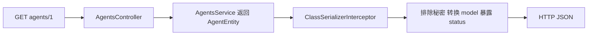

# NestJS Study 24：响应序列化

通过 AI Agent 目录和用户资料，学习如何把服务内部的数据转换为适合客户端阅读的响应。对应 Techniques 的 Serialization。

Service 中保留模型对象、成本和演示密钥，HTTP 响应则隐藏部分字段、提取模型名称，并添加计算属性。本章不连接数据库或真实 AI 服务；所有秘密字段都是固定的假数据。

## 学习目标

- 区分业务对象与 HTTP JSON：Service 内部存在的字段不一定应该发送给客户端。
- 理解实体实例上的装饰器如何与 `ClassSerializerInterceptor` 配合。
- 使用 `@Exclude()` 隐藏字段，使用 `@Expose()` 暴露 getter。
- 使用 `@Transform(..., { toPlainOnly: true })` 定义输出转换。
- 区分实体实例、普通对象以及 `@SerializeOptions({ type })` 的作用。
- 观察方法级拦截器与 Controller 级拦截器的生效范围。

## 项目结构

```text
src/
├── main.ts
├── app.module.ts                   # 导入 AgentsModule、UsersModule
├── agents/
│   ├── agents.module.ts
│   ├── agents.controller.ts         # 同一 Agent 的多种输出方式
│   ├── agents.service.ts            # 内存实体，包含假秘密
│   └── entities/
│       ├── agent.entity.ts          # 隐藏字段、转换模型、计算状态
│       └── model.entity.ts          # 内部模型对象
└── users/
    ├── users.module.ts
    ├── users.controller.ts          # Controller 级拦截器
    ├── users.service.ts
    └── entities/user.entity.ts      # 隐藏密码、组合 fullName
```

保留的 `app.controller.ts/app.service.ts` 是脚手架文件，没有在 AppModule 注册，因此根路径没有 Hello World 接口。

推荐阅读顺序：[AppModule](src/app.module.ts) → [AgentEntity](src/agents/entities/agent.entity.ts) → [AgentsService](src/agents/agents.service.ts) → [AgentsController](src/agents/agents.controller.ts) → [UserEntity](src/users/entities/user.entity.ts) → [UsersController](src/users/users.controller.ts)。先认识输出规则，再观察返回值的实际类型，最后检查拦截器绑定位置。

## 核心实现原理

### 内部字段为什么没有直接删除

Agent 的 `apiKey/systemPrompt/totalCost` 对内部业务可能有用，因此示例保留在实例上，通过 `@Exclude()` 控制序列化：

```ts
@Exclude()
apiKey!: string;

@Expose()
get status(): string {
  return this.enabled ? 'available' : 'disabled';
}
```

这不会修改 Service 保存的原始对象，也不是加密。响应经过序列化时才应用规则。实体类在本章只是输出模型，名字中有 Entity 不代表使用 ORM。

### model 为什么从对象变成字符串

[AgentEntity](src/agents/entities/agent.entity.ts) 中内部模型包含 provider、name 和 contextWindow；转换器只输出名称：

```ts
@Transform(
  ({ value }: { value: ModelEntity }) => value.name,
  { toPlainOnly: true },
)
model!: ModelEntity;
```

`toPlainOnly` 限制转换方向，避免将请求转换成实例时也错误地把模型对象变成字符串。公开结果中 `model` 是 `gpt-4.1`，无需前端了解完整内部结构。

### 装饰器为什么需要拦截器



[AgentsController](src/agents/agents.controller.ts) 为需要转换的方法绑定 `ClassSerializerInterceptor`。`raw` 路由故意不绑定它，用来比较普通 JSON 输出。

[UsersController](src/users/users.controller.ts) 则在类上绑定拦截器，因此两个用户资料接口都会隐藏密码和密钥，并输出 `fullName`。

### 普通对象与指定输出类型

`findOnePlain()` 显式创建普通对象，普通对象本身不携带 AgentEntity 的装饰器元数据。`/agents/:id/plain` 使用：

```ts
@SerializeOptions({ type: AgentEntity })
```

当前 NestJS 12 的拦截器会先按指定类型转换，再执行序列化。不要把任意 `{ ...entity }` 都当作保留实体元数据的实例。

`/agents/:id/public` 额外配置 `excludePrefixes: ['_']`；当前数据没有下划线前缀字段，因此这个选项不会产生额外可见差异。它展示配置入口，而非新增权限级别。

## 运行

建议使用 Node.js 24、pnpm 12；本项目依赖 NestJS 12 与 class-transformer 0.5。锁文件固定具体版本，无需环境变量、数据库或模型密钥。

```bash
cd nestjs-study-24
pnpm install --frozen-lockfile
pnpm start:dev
```

默认端口 3000，修改为 `PORT=3024 pnpm start:dev` 可避免与其他 Study 冲突。

```bash
pnpm build
pnpm exec tsc --noEmit --incremental false
pnpm lint
pnpm test
pnpm test:e2e
```

`lint` 使用项目已有的 Oxlint。单元测试检查实体转换，e2e 先编译，再通过实际 AppModule 发起 HTTP 请求，以确认装饰器和拦截器真的协同生效。

## API

| 方法 | 路径 | 输出差异 |
| --- | --- | --- |
| GET | `/agents` | 实体数组，经序列化 |
| GET | `/agents/:id` | 实体，经序列化 |
| GET | `/agents/:id/public` | 加上排除下划线前缀的配置 |
| GET | `/agents/:id/plain` | 普通对象，指定 AgentEntity 转换 |
| GET | `/agents/:id/raw` | 不使用序列化的对照，暴露假数据 |
| GET | `/users/:id` | 隐藏密码和密钥，输出 fullName |
| GET | `/users/:id/profile` | 同样受 Controller 级拦截器影响 |

## HTTP 验证

```bash
curl -s http://localhost:3000/agents/1
curl -s http://localhost:3000/agents/1/plain
curl -s http://localhost:3000/agents/1/public
curl -s http://localhost:3000/agents/1/raw
```

前三个响应的 `model` 是字符串，`status` 为 `available`，没有 `apiKey/systemPrompt/totalCost`。raw 响应包含假的 `sk-example-agent-secret`，model 仍是对象，也没有序列化时暴露的 status。

```bash
curl -s http://localhost:3000/agents
curl -s http://localhost:3000/users/1001
curl -s http://localhost:3000/users/1001/profile
curl -i http://localhost:3000/agents/999
curl -i http://localhost:3000/users/abc
```

列表中 Agent 3 的 `status` 是 `disabled`；用户 1001 的 `fullName` 是 `Robin Mai`，没有密码哈希和密钥。不存在的 Agent 返回 404，非整数用户 ID 返回 400。

## 常见问题和生产边界

“加了 Exclude 为什么字段还在？”先检查是否经过拦截器，再检查返回的是否为对应类实例，或是否设置了输出 `type`。装饰器不是普通 JSON.stringify 的全局规则。

“序列化等于授权吗？”不等于。本章没有用户身份或访问权限验证；隐藏字段不会阻止访问别人的资源。

raw 接口只为对照固定假数据。真实系统不能保留类似的秘密直出接口；应明确响应 DTO、保护访问身份，并避免日志打印敏感实体。不要在本示例中填入真实 API Key。

## 练习

1. 为 Agent 添加一个计算属性，验证直接 JSON 与序列化输出的差别。
2. 在 AgentEntity 上加入 `_internalNote`，比较普通详情与 public 路由。
3. 把一个方法返回值改为普通对象，先移除 type 观察变化，再恢复并说明原因。

本章重点是“返回什么字段”，与上一章“缓存哪份结果”互补。下一章的 API 版本化将进一步处理不同客户端需要不同输出契约的问题。

## 官方参考

- [中文 Serialization](https://docs.nestjs.cn/techniques/serialization/)
- [英文 Serialization](https://docs.nestjs.com/techniques/serialization)
