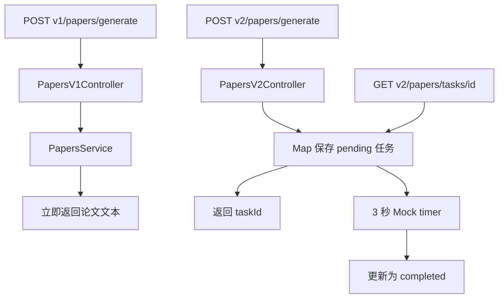

# NestJS Study 25：API 版本控制

通过 AI 论文生成 API 演示 URI 版本化：旧客户端继续使用 V1 同步接口，新客户端使用 V2 创建任务并轮询结果。对应 Techniques 的 Versioning。

本章不调用真实模型，也没有后台队列。V1 直接拼接字符串，V2 使用进程内 Map 和 3 秒计时器模拟生成。其价值是观察接口契约演进，而非构建完整论文平台。

## 学习目标

- 在同一路径上按版本提供不同的请求结构与响应。
- 区分 Controller 级版本和方法级 `@Version()`。
- 了解多版本共享方法与 `VERSION_NEUTRAL` 健康检查。
- 明白 `defaultVersion` 是路由元数据默认值，不会自动兼容无版本 URL。
- 为 V2 的嵌套配置启用真实 DTO 验证。
- 认识进程内异步任务的生命周期和持久化边界。

## 项目结构与阅读顺序

```text
src/
├── main.ts                         # 开启 URI 版本和全局 ValidationPipe
├── app.module.ts                    # PapersModule、HealthModule
├── papers/
│   ├── papers.module.ts             # 三个 Controller 共享一个 Service
│   ├── papers-v1.controller.ts      # V1 同步生成
│   ├── papers-v2.controller.ts      # V2 提交任务、查询任务
│   ├── papers-common.controller.ts  # 不同模型响应和共享模板
│   ├── papers.service.ts            # Mock 生成和内存任务
│   └── dto/
│       ├── generate-paper-v1.dto.ts
│       └── generate-paper-v2.dto.ts
└── health/
    ├── health.module.ts
    └── health.controller.ts         # 不带版本前缀
```

先看 [main.ts](src/main.ts) 的全局设置，再看 [三个 Controller](src/papers/) 如何声明版本，接着看 [DTO](src/papers/dto/) 的请求差异，最后看 [PapersService](src/papers/papers.service.ts) 的共享实现。遗留的 AppController 未在模块注册，不提供根路由。

## 核心实现原理

### 版本信息如何变成 URL

```ts
app.enableVersioning({
  type: VersioningType.URI,
  defaultVersion: '1',
});
```

[main.ts](src/main.ts) 为路由启用默认 `v` 前缀。`@Controller({ path: 'papers', version: '2' })` 下的 `@Post('generate')` 因而是 `/v2/papers/generate`。

`/papers/generate` 不会因为 defaultVersion 而自动转到 V1。客户端必须请求实际注册的 `/v1/...`。

### 为什么同时保留 V1 与 V2

V1 只接收 topic，立即返回 title/content。V2 要求 config 对象，立即返回 taskId/status/estimatedSeconds，随后通过 taskId 查询结果。



这种契约变化会破坏旧客户端，保留旧版本可以让客户端逐步迁移。两个 Controller 复用同一个 Service，并不需要复制整个应用。

### 方法级、多版本与无版本

[PapersCommonController](src/papers/papers-common.controller.ts) 中模型目录的两个方法分别声明 `@Version('1')` 和 `@Version('2')`：前者返回字符串数组，后者返回含 provider 的对象数组。

模板方法使用 `@Version(['1', '2'])`，同一实现注册两份路由。健康检查则在 [HealthController](src/health/health.controller.ts) 声明 `VERSION_NEUTRAL`，使用 `/health`。

### 嵌套验证不能只写类型

```ts
@IsDefined()
@IsObject()
@ValidateNested()
@Type(() => PaperConfigDto)
config!: PaperConfigDto;
```

`@Type` 创建嵌套类实例，`@ValidateNested` 继续检查字数、模型和引用格式；`@IsObject` 明确拒绝数组。全局 ValidationPipe 负责转换、白名单及额外字段拒绝。

V2 的 config 包含 `paperType/wordCount/citationStyle/model`。当前 Mock 结果只使用字数和引用格式；paperType/model 用于展示新版本请求契约，没有实际调用模型或选择生成策略。

### 异步任务的边界

[PapersService](src/papers/papers.service.ts) 管理自己创建的计时器，执行后移出集合，在 `onModuleDestroy()` 清理尚未执行的计时器。应用关闭不会在后台继续修改任务。

Map 和计时器无法跨进程恢复；多副本也不共享任务。本章不是持久化异步队列，真正的 Redis Worker 示例在 Study 27。

## 独立运行

建议 Node.js 24、pnpm 12；依赖为 NestJS 12、class-validator 0.15、class-transformer 0.5。无需外部基础设施或模型密钥。

```bash
cd nestjs-study-25
pnpm install --frozen-lockfile
pnpm start:dev
```

默认端口 3000，可用 `PORT=3025 pnpm start:dev` 修改。

```bash
pnpm build
pnpm exec tsc --noEmit --incremental false
pnpm lint
pnpm test
pnpm test:e2e
```

`lint` 为 Oxlint。e2e 导入编译后的 AppModule，使用与 main 相同的版本和验证设置，实际验证 V1/V2、任务轮询以及非法嵌套配置。

## API

| 方法 | 路径 | 行为 |
| --- | --- | --- |
| GET | `/health` | 无版本健康检查 |
| POST | `/v1/papers/generate` | 同步返回 Mock 论文 |
| POST | `/v2/papers/generate` | 创建 Mock 异步任务 |
| GET | `/v2/papers/tasks/:id` | 查询任务与结果 |
| GET | `/v1/papers/models` | 字符串模型目录 |
| GET | `/v2/papers/models` | 结构化模型目录 |
| GET | `/v1/papers/templates` | 共享模板 |
| GET | `/v2/papers/templates` | 同一共享模板实现 |

## HTTP 验证

```bash
curl -s http://localhost:3000/health
curl -s http://localhost:3000/v1/papers/models
curl -s http://localhost:3000/v2/papers/models
curl -i http://localhost:3000/papers/models
```

模型响应分别为字符串数组和对象数组；不带版本的模型路径返回 404。

```bash
curl -i -X POST http://localhost:3000/v1/papers/generate \
  -H 'Content-Type: application/json' -d '{"topic":"AI Agent 的研究方法"}'
curl -i -X POST http://localhost:3000/v2/papers/generate \
  -H 'Content-Type: application/json' \
  -d '{"topic":"AI Agent 的研究方法","config":{"paperType":"research","wordCount":1000,"citationStyle":"APA","model":"gpt-4.1"}}'
```

两个请求均返回 201，V1 含 content，V2 含 taskId。新进程中首个 V2 任务为 `task-1001`；若已运行其他请求，使用实际返回的 ID：

```bash
curl -s http://localhost:3000/v2/papers/tasks/task-1001
sleep 3
curl -s http://localhost:3000/v2/papers/tasks/task-1001
curl -i -X POST http://localhost:3000/v2/papers/generate \
  -H 'Content-Type: application/json' -d '{"topic":"test","config":[]}'
curl -i http://localhost:3000/v2/papers/tasks/missing
```

创建后立即查询通常为 pending，三秒后为 completed 且 result 包含字数与引用格式。数组配置返回 400，不存在的任务返回 404。

## 常见问题与应用思考

“装饰器声明版本为何仍 404？”检查是否调用 enableVersioning、是否带 `/v1` 或 `/v2`，以及模块中是否注册了对应 Controller。

“重启后任务为何消失？”任务只在内存 Map；不能承诺异步任务可靠交付。生产接口还需要持久化、身份校验、幂等提交及可查询的失败状态，但这些不在本章实现范围。

## 练习

1. 为 V2 模型目录增加一个字段，确认 V1 响应保持原样。
2. 为共享模板方法新增 V3 注册，验证只修改装饰器是否足够。
3. 比较 VERSION_NEUTRAL 与默认版本路由的实际 URL，记录 200/404 的区别。

本章重点是通过版本化维持客户端契约。后续的调度和队列会继续讨论异步工作何时触发、在哪执行。

## 官方参考

- [中文 Versioning](https://docs.nestjs.cn/techniques/versioning/)
- [英文 Versioning](https://docs.nestjs.com/techniques/versioning)
