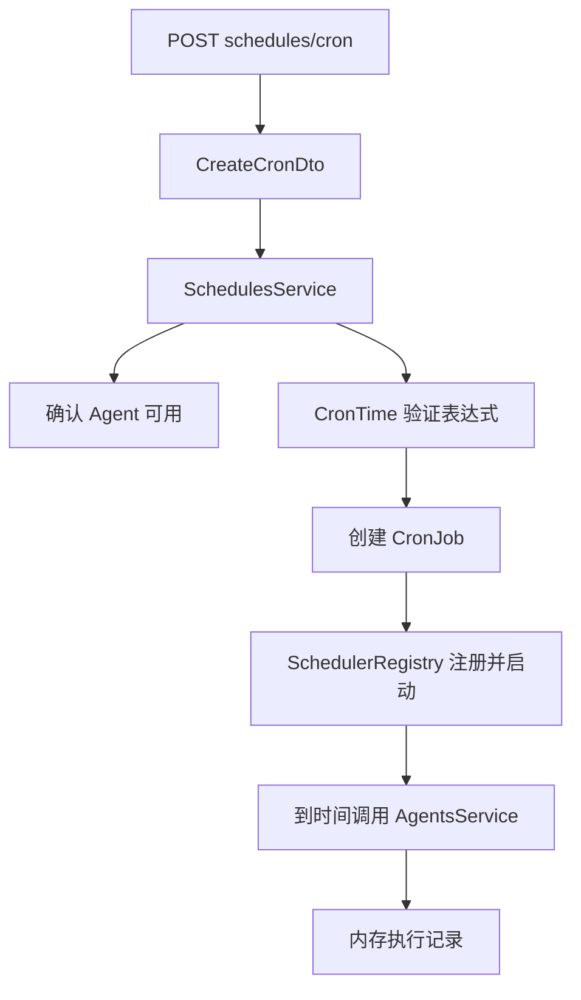

# NestJS Study 26：任务调度

通过每日 AI 研究、启动检查和可配置 Agent 任务，学习 NestJS Task Scheduling。定时器负责“何时触发”，AgentsService 负责“执行什么”。本章所有 Agent 输出都是 Mock，数据和调度配置均在内存中。

## 学习目标

- `ScheduleModule.forRoot()` 如何启动装饰器发现与调度注册。
- `@Cron/@Interval/@Timeout` 分别适合固定时刻、固定间隔和延迟一次的工作。
- `SchedulerRegistry` 如何让运行时创建的 Cron 与计时器可查询、暂停和删除。
- DTO 验证与 Cron 表达式验证各自负责什么。
- 理解应用关闭会清理调度器，但已开始的业务 Promise 与调度注册不是同一件事。

## 场景与实际职责

研究 Agent 每天上海时间 09:00 执行一次；每 30 秒输出累计执行数；启动 10 秒后输出初始化检查日志。还可以通过 HTTP 新建 Cron 或一次性延迟任务。

Agent 本身耗时约一秒，只生成执行记录，不调用模型。记录中的 trigger 区分 `manual/cron/delayed`；定期检查只统计记录，不执行新的 Agent。

## 目录结构与阅读顺序

```text
src/
├── main.ts                         # HTTP 启动与关闭信号钩子
├── app.module.ts                    # ScheduleModule.forRoot()
├── agents/
│   ├── agents.module.ts            # 导出 AgentsService 给调度模块
│   ├── agents.controller.ts        # 手动执行和历史记录
│   ├── agents.service.ts           # Mock 执行，不负责计算调度时间
│   └── agent.interface.ts
└── schedules/
    ├── schedules.module.ts         # 注册两个 Service 和 Controller
    ├── agent-scheduler.service.ts  # 三个静态装饰器
    ├── schedules.controller.ts     # 动态调度 HTTP 入口
    ├── schedules.service.ts        # Registry 管理动态任务
    └── dto/
        ├── create-cron.dto.ts
        └── create-delayed.dto.ts
```

建议 [AppModule](src/app.module.ts) → [SchedulesModule](src/schedules/schedules.module.ts) → [静态调度](src/schedules/agent-scheduler.service.ts) → [动态调度](src/schedules/schedules.service.ts) → [DTO](src/schedules/dto/) → [AgentsService](src/agents/agents.service.ts)。装饰器写在未注册的 Provider 上不会自动运行，所以先检查模块装配。

## 核心原理

### 静态装饰器与时区

```ts
@Cron('0 0 9 * * *', {
  name: 'daily-research',
  timeZone: 'Asia/Shanghai',
  waitForCompletion: true,
})
```

这条 Cron 使用六字段格式，第一位是秒。固定上海时区后，不受机器系统时区影响。`waitForCompletion` 表示当前调用尚未完成时跳过重叠触发，不会把每个错过的时刻排入持久队列。

[AgentSchedulerService](src/schedules/agent-scheduler.service.ts) 还包含 `@Interval(30000)` 和 `@Timeout(10000)`，单位均为毫秒。两个未指定名称的调度器由框架生成名称，查询列表时不应假设名称固定。

### 动态注册为什么需要 Registry



[SchedulesService](src/schedules/schedules.service.ts) 先检查名称冲突和 Agent，再用 `CronTime` 验证表达式。DTO 只能保证表达式是字符串，不能代替 Cron 解析器。

创建后先 `addCronJob(name, job)` 再启动。查询时读取 Registry；暂停与删除等待当前 cron 4 的异步 `stop()` 返回，恢复调用 `start()`。名称不存在时返回明确 404，而非底层 Registry 异常。

动态 Cron 没有设置 `waitForCompletion`，任务周期短于执行时间时可能重叠。这是与静态 daily-research 配置的一个区别。

### 一次性任务与关闭

延迟任务由 `setTimeout` 创建，并通过 `addTimeout` 注册；触发后先移除注册记录，再调用业务服务。因此超时列表只表示待触发计时器，不能当作正在运行的任务列表。

关闭时 `@nestjs/schedule` 的编排器会清理 Registry 中的 Cron、Interval 和 Timeout，应用无需重复维护另一套清理集合。main 开启 shutdown hooks，使关闭信号触发框架生命周期。已经开始执行的 Agent Promise 不会因为移除定时器而自动中断；本章不实现强制取消或持久化任务恢复。

## 运行

建议 Node.js 24、pnpm 12。本项目使用 NestJS 12、`@nestjs/schedule` 12 和 cron 4，不需要 Redis、数据库或真实模型。

```bash
cd nestjs-study-26
pnpm install --frozen-lockfile
pnpm start:dev
```

默认端口为 3000，可用 `PORT=3026 pnpm start:dev` 修改。启动后不需要请求就会注册静态调度器，等待十秒可观察初始化日志。

```bash
pnpm build
pnpm exec tsc --noEmit --incremental false
pnpm lint
pnpm test
pnpm test:e2e
```

`lint` 使用 Oxlint。e2e 先编译，验证静态注册、动态 HTTP 控制、延迟触发的执行记录，以及 app.close 后 Registry 为空。

## API

| 方法 | 路径 | 行为 |
| --- | --- | --- |
| GET | `/agents` | 查询三个 Mock Agent |
| GET | `/agents/executions` | 查询内存执行记录 |
| POST | `/agents/:id/run` | 手动执行，约一秒后返回 |
| POST | `/schedules/cron` | 创建并启动动态 Cron |
| GET | `/schedules/cron` | 查询 Cron 名称、状态、下一次时间 |
| POST | `/schedules/cron/:name/pause` | 暂停 |
| POST | `/schedules/cron/:name/resume` | 恢复 |
| DELETE | `/schedules/cron/:name` | 删除 |
| POST | `/schedules/delayed` | 创建一次性延迟任务 |
| GET | `/schedules/intervals` | 查询 Interval 名称 |
| GET | `/schedules/timeouts` | 查询未触发 Timeout 名称 |

POST 默认返回 201；查询和删除成功返回 200。未注册脚手架 AppController，没有根路径接口。

## HTTP 验证

```bash
curl -s http://localhost:3000/schedules/cron
curl -s http://localhost:3000/schedules/intervals
curl -s http://localhost:3000/schedules/timeouts
curl -i -X POST http://localhost:3000/schedules/cron \
  -H 'Content-Type: application/json' \
  -d '{"name":"demo-research","agentId":1,"cronExpression":"*/5 * * * * *"}'
```

初始 Cron 列表包含 daily-research。新增任务每五秒触发，约一秒后出现执行记录：

```bash
sleep 7
curl -s http://localhost:3000/agents/executions
curl -i -X POST http://localhost:3000/schedules/cron/demo-research/pause
curl -s http://localhost:3000/schedules/cron
curl -i -X POST http://localhost:3000/schedules/cron/demo-research/resume
curl -i -X DELETE http://localhost:3000/schedules/cron/demo-research
```

暂停后 running 为 false，恢复后为 true，删除后列表不再包含该名称。

```bash
curl -i -X POST http://localhost:3000/schedules/delayed \
  -H 'Content-Type: application/json' -d '{"name":"once","agentId":2,"delayMs":1000}'
sleep 3
curl -s http://localhost:3000/agents/executions
curl -i -X POST http://localhost:3000/schedules/cron \
  -H 'Content-Type: application/json' -d '{"name":"bad","agentId":1,"cronExpression":"bad"}'
curl -i -X POST http://localhost:3000/schedules/delayed \
  -H 'Content-Type: application/json' -d '{"name":"bad","agentId":1,"delayMs":1}'
```

新增一条 trigger 为 delayed 的记录；非法表达式和不在 1000～3600000 毫秒范围内的延迟返回 400。重复任务名返回 409，不存在或未启用的 Agent 返回 404。

## 常见问题与应用边界

“每日任务没有马上执行？”它等待上海时间 09:00；用短周期动态任务验证即可，无需修改系统时间。

“重启后自定义 Cron 消失？”动态任务只在当前进程 Registry。多实例部署时，每个实例也会各自触发静态任务。本章未提供分布式锁或唯一调度保证；需要持久化、重试和多 Worker 分发时可继续学习 Study 27。

## 练习

1. 为 Interval 指定固定名称，比较 Registry 查询结果。
2. 将动态 Cron 周期调得短于一秒，观察重叠执行，再研究 waitForCompletion。
3. 添加一个取消延迟任务的 HTTP 方法，使用 Registry 删除并验证不再产生执行记录。

本章重点是调度与业务职责分离，以及调度注册的生命周期。不要把内存计时器误认为可靠任务队列。

## 官方参考

- [中文 Task Scheduling](https://docs.nestjs.cn/techniques/task-scheduling/)
- [英文 Task Scheduling](https://docs.nestjs.com/techniques/task-scheduling)
