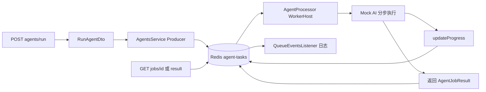

# NestJS Study 27：BullMQ 异步任务队列

使用真实 Redis 和 BullMQ Worker 模拟耗时的 AI Agent 执行。HTTP 接口负责提交与查询，Worker 负责逐步执行；请求不必等待五到十五秒才返回。对应 Techniques 的 Queues。

队列是真实的，AI 输出是 Mock。没有外部模型调用、数据库或登录认证。不要把请求体中的 userId 当作已认证身份，也不要在公网暴露本章的任务查询、重试和队列管理接口。

## 学习目标

- 区分 Queue 注册、Producer、Worker 与 QueueEvents 的职责。
- 理解 `@InjectQueue()` 如何注入命名队列，以及 `WorkerHost.process()` 如何分派任务。
- 观察等待、延迟、执行、完成、失败和重试状态。
- 区分任务进度、任务结果与 Worker/队列事件。
- 验证自动重试、指数退避和队列暂停。
- 认识 Redis 驱动与 NestJS 集成包之间的依赖关系。

## 项目结构与推荐阅读顺序

```text
src/
├── app.module.ts                        # Redis 连接配置
├── main.ts                              # HTTP 启动和关闭信号钩子
└── agents/
    ├── agents.module.ts                 # 注册 agent-tasks 队列及 Worker
    ├── agents.controller.ts             # 提交/查询/重试/暂停 HTTP API
    ├── agents.service.ts                # Producer 和 Job 查询
    ├── agent.processor.ts               # WorkerHost，concurrency: 3
    ├── agent-queue-events.listener.ts   # QueueEvents 观察跨 Worker 事件
    ├── interfaces/agent-job.interface.ts
    └── dto/run-agent.dto.ts             # 请求验证
```

依次读 [AppModule](src/app.module.ts)、[AgentsModule](src/agents/agents.module.ts)、[DTO](src/agents/dto/run-agent.dto.ts)、[AgentsService](src/agents/agents.service.ts)、[AgentProcessor](src/agents/agent.processor.ts)，最后读 [QueueEventsListener](src/agents/agent-queue-events.listener.ts)。先确认连接和命名，再追踪任务从入队到执行的全过程。

遗留 AppController/AppService 没有注册，根路径没有 Hello World 接口。

## 核心实现原理

### 三处名称为什么一致

```ts
BullModule.registerQueue({ name: 'agent-tasks' })
@InjectQueue('agent-tasks')
@Processor('agent-tasks', { concurrency: 3 })
```

三者分别注册队列、注入 Producer、声明消费者。`execute-agent` 是 Job 的业务名称，与队列名称不同。Worker 通过 `switch (job.name)` 处理它；这里不使用旧 Bull 的 `@Process()` API。



HTTP 返回的初始状态可能已经是 active，不能假定一定先观察到 waiting。Worker 并发为每个 Worker 实例最多 3 个任务，并非整个多实例集群的全局上限。

### 进度、重试和保留结果

[AgentProcessor](src/agents/agent.processor.ts) 为 Agent 1/2/3 分别模拟 10/5/15 秒耗时，分十步调用 `job.updateProgress()`，最终返回结果对象。Job 数据存储在 Redis，并可通过状态接口查询。

Producer 设置 `attempts: 3`，失败后以 2000 毫秒为基础进行指数退避。正常 Mock 任务不会随机失败；使用未支持的 Agent ID（例如 99）可观察 Worker 失败与自动重试。

完成和失败各保留最近 100 条 Job。Redis 中历史可能被后续任务清理，因此这里的结果查询并不等于长期审计存储。手动 retry 只允许 failed 状态；底层 BullMQ 的尝试计数和自动重试预算不会在此被应用自行重置。

### 暂停和优先级

`queue.pause()` 是队列级暂停，阻止取新的等待任务；已经 active 的任务继续执行。恢复后等待任务继续被消费。

当前 BullMQ 6 的 `getJobCounts()` 不接受 `paused` 作为 JobType；源码查询正常状态后，根据 `isPaused()` 和 waiting 数量补充兼容的 `counts.paused` 字段。它是暂停等待列表的展示值，不是新的一种 Job 状态，也不包含独立 prioritized 列表。

有优先级的任务必须使用 1～2097151 的整数，数值越小越优先；未指定优先级的任务由 BullMQ 的默认规则处理，不应简单宣称它排在所有显式优先级之后。DTO 的上限防止非法值进入 Redis API 后产生 500。

### 为什么额外声明 ioredis

本项目安装的 BullMQ 6.5.3 将 Redis 驱动作为可选依赖。使用 host/port 连接选项时仍需要 ioredis，因此 package.json 明确声明 ioredis 5。只安装 BullMQ 而缺少驱动可能编译成功，却在启动时报告无法加载 ioredis。

Nest 的 BullMQ 集成负责关闭 Queue、Worker 和 QueueEvents；main 开启 shutdown hooks。正常关闭会等待 Worker 当前执行结束，不代表取消任务。

## 独立运行

建议 Node.js 24、pnpm 12；本项目使用 NestJS 12、`@nestjs/bullmq` 12、BullMQ 6 和 ioredis 5。需要可连接的 Redis，无需真实模型密钥。

先启动专用学习 Redis（已有 Redis 时可以直接配置其地址）：

```bash
docker run --rm --name nest-study-27-redis \
  -p 127.0.0.1:6380:6379 redis:7-alpine
```

另开终端进入本项目：

```bash
cd nestjs-study-27
pnpm install --frozen-lockfile
REDIS_HOST=127.0.0.1 REDIS_PORT=6380 pnpm start:dev
```

默认 HTTP 端口为 3000；可额外设置 `PORT=3027`。源码的默认 Redis 地址为 `127.0.0.1:6380`，ConfigModule 也会读取本目录 `.env`。本例没有配置 Redis 密码/TLS，请仅在本机学习环境使用。

```bash
pnpm build
pnpm exec tsc --noEmit --incremental false
pnpm lint
pnpm test
REDIS_HOST=127.0.0.1 REDIS_PORT=6380 pnpm test:e2e
```

`lint` 为 Oxlint。e2e 使用真实 Redis、真实 Worker，约二十秒完成，包括故意失败的任务及重试、真实 main 收到 SIGTERM 后等待在途任务完成；错误日志是该场景的一部分。请使用专用测试 Redis，不要同时运行另一个使用同名队列的学习进程；测试会暂停队列并提交任务。

## API

| 方法 | 路径 | 行为 |
| --- | --- | --- |
| POST | `/agents/run` | 验证参数并入队，返回 201 |
| GET | `/agents/queue/stats` | 查询队列计数 |
| GET | `/agents/jobs/:id` | 查询状态、进度、尝试次数、数据及结果 |
| GET | `/agents/jobs/:id/result` | 完成时返回结果，否则返回当前状态 |
| POST | `/agents/jobs/:id/retry` | 手动重试 failed 任务 |
| POST | `/agents/queue/pause` | 暂停队列 |
| POST | `/agents/queue/resume` | 恢复队列 |

## HTTP 验证

```bash
curl -i -X POST http://localhost:3000/agents/run \
  -H 'Content-Type: application/json' \
  -d '{"agentId":2,"userId":1001,"input":"研究 NestJS 队列"}'
curl -s http://localhost:3000/agents/queue/stats
```

保存返回的 jobId，替换下方 `<jobId>` 后执行；Redis 未清空时 ID 不一定从 1 开始：

```bash
curl -s http://localhost:3000/agents/jobs/\<jobId\>
curl -s http://localhost:3000/agents/jobs/\<jobId\>/result
sleep 6
curl -s http://localhost:3000/agents/jobs/\<jobId\>/result
```

执行中 progress 逐步增长到 100。Agent 2 约五秒完成，结果包含 output 和 completedAt。

```bash
curl -i -X POST http://localhost:3000/agents/queue/pause
curl -i -X POST http://localhost:3000/agents/run \
  -H 'Content-Type: application/json' \
  -d '{"agentId":2,"userId":1001,"input":"暂停期间提交"}'
curl -s http://localhost:3000/agents/queue/stats
curl -i -X POST http://localhost:3000/agents/queue/resume
curl -i -X POST http://localhost:3000/agents/run \
  -H 'Content-Type: application/json' \
  -d '{"agentId":2,"userId":1001,"input":"错误优先级","priority":2097152}'
```

暂停期间新任务保持 waiting，统计显示 paused 等待数；恢复后开始执行。超上限优先级返回 400。

```bash
curl -i -X POST http://localhost:3000/agents/run \
  -H 'Content-Type: application/json' \
  -d '{"agentId":99,"userId":1001,"input":"观察失败重试"}'
```

用返回的 ID 查询状态。约 6 秒及调度延迟后，三次尝试结束并进入 failed；随后可调用 `POST /agents/jobs/:id/retry`。同一个不支持的 ID 重试仍会失败。对未完成或已完成任务调用 retry 返回 400，不存在的 Job 返回 404。

## 常见问题与应用边界

“请求已返回但没有结果？”提交与执行是两个阶段；先检查 Redis 连接、Worker 日志与 Job 状态，不要把入队成功等同业务完成。

“多个 Study 影响了同一队列？”队列名固定为 agent-tasks；测试和学习应使用独立 Redis 实例或 Redis 数据库设计。不要用 FLUSHALL 清理共享 Redis。

生产应用需要真实身份、资源归属校验、幂等任务、可观测失败处理及敏感数据保护。本章任务数据可被公开查询，并且缺少这些访问控制；它展示队列机制，不是可直接部署的 AI SaaS。

## 练习

1. 设置 delay 为 3000，比较 delayed 与 active 的状态变化。
2. 暂停队列后提交不同 priority 的任务，恢复后观察 Worker 开始顺序。
3. 在 Worker 中增加一个有确定失败条件的 Mock 分支，比较可恢复失败与永久失败。

从上一章的定时触发到本章的异步消费，关键变化是任务不再只存在于进程内计时器中。但 Redis 持久化方式、业务幂等和长期结果存储仍需单独设计。

## 官方参考

- [中文 Queues](https://docs.nestjs.cn/techniques/queues/)
- [英文 Queues](https://docs.nestjs.com/techniques/queues)
- [BullMQ 官方指南](https://docs.bullmq.io/)
