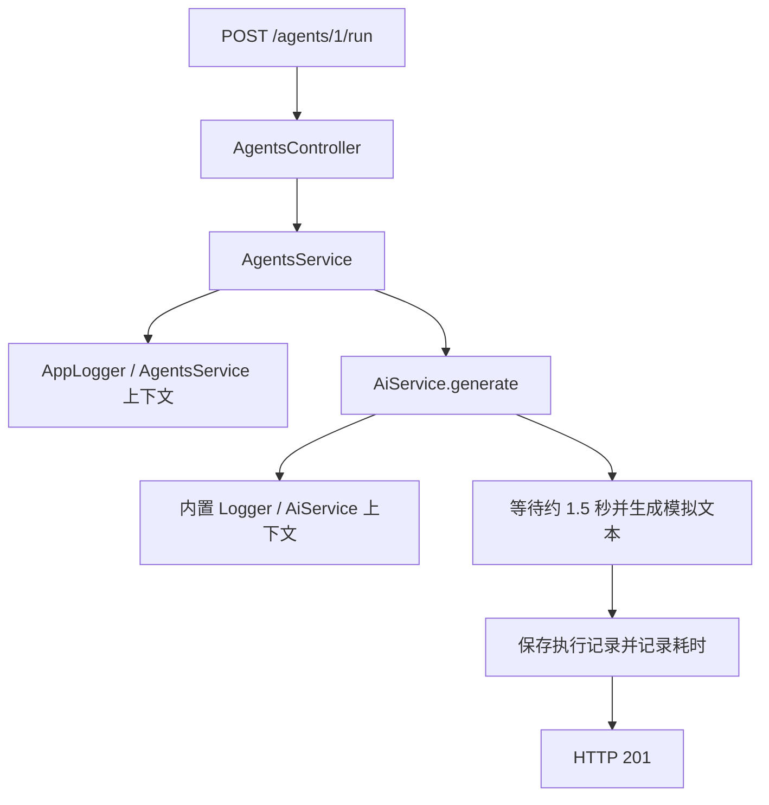

# NestJS Study 28：日志

通过 AI Agent 执行过程，学习框架日志、自定义业务日志和日志上下文。
本章对应 Techniques 的 Logger；模型调用是等待约 1.5 秒的本地模拟，不需要模型密钥。

## 学完后应该理解什么

- 为什么 Controller 只负责路由，执行阶段的信息由 Service 记录。
- `Logger(AiService.name)` 如何让模型调用日志显示来源。
- 为什么可修改 `context` 的自定义 Logger 使用 `Scope.TRANSIENT`。
- 业务执行记录和控制台日志的用途有什么不同。

真实应用中，一次 Agent 执行可能经过检索、模型调用和结果保存。
本章用最短调用链展示：从日志中区分哪个服务开始工作、执行是否成功、耗时多少。
没有接入外部日志平台，也没有实现日志查询系统。

## 目录与阅读顺序

```text
src/
├── main.ts                       # 启动 HTTP 应用
├── app.module.ts                 # 根模块，导入 AgentsModule
├── agents/
│   ├── agents.module.ts           # 组合 AI 和 Logging 模块
│   ├── agents.controller.ts       # 列表、运行和执行历史
│   ├── agents.service.ts          # 业务执行及日志
│   └── agent.interface.ts         # Agent、执行记录类型
├── ai/
│   ├── ai.module.ts
│   └── ai.service.ts              # 模拟模型调用；使用内置 Logger
└── logging/
    ├── logging.module.ts          # 注册和导出日志 Provider
    ├── app-logger.service.ts      # ConsoleLogger 的业务扩展
    └── logs.service.ts            # 独立的内存日志练习材料
```

建议依次阅读：

1. [main.ts](./src/main.ts)：确认日志最终来自一个真实 HTTP 应用。
2. [app.module.ts](./src/app.module.ts) 和 [agents.module.ts](./src/agents/agents.module.ts)：观察模块如何让依赖可注入。
3. [agents.controller.ts](./src/agents/agents.controller.ts)：找到触发执行的路由。
4. [agents.service.ts](./src/agents/agents.service.ts)：沿着开始、成功、异常三个阶段读日志。
5. [app-logger.service.ts](./src/logging/app-logger.service.ts) 和 [ai.service.ts](./src/ai/ai.service.ts)：对比自定义与内置 Logger。

## 核心机制

### 为什么不在每个地方直接 console.log

模型层使用 `new Logger(AiService.name)`，业务层通过 DI 获得 `AppLogger`。
两者都使用 Nest 的日志接口，输出携带服务上下文，便于定位来源。
日志级别用于表达信息性质：`debug` 看细节，`log` 看正常进度，`warn` 提示异常条件，`error` 记录失败。
这些级别不会改变业务返回值。

### 自定义 Logger 是一个 Provider

[AppLogger](./src/logging/app-logger.service.ts) 继承 `ConsoleLogger`，把重复业务字段集中在 `logAgentEvent()` 中：

```ts
@Injectable({ scope: Scope.TRANSIENT })
export class AppLogger extends ConsoleLogger {
  logAgentEvent(agentId: number, event: string): void {
    this.log(`[AI_AGENT] agentId=${agentId} event=${event}`);
  }
}
```

`LoggingModule` 导出它，`AgentsModule` 导入该模块，`AgentsService` 才能在构造函数中注入它。
`setContext(AgentsService.name)` 设置当前消费者的名称。
Transient 表示不同消费者可以获得不同实例，避免一个消费者设置的 context 覆盖另一个消费者。
它不等同于“每个 HTTP 请求创建一个实例”；本章 `AgentsService` 仍是默认单例。

### 日志和执行历史是两份不同的信息

`runAgent()` 先检查 Agent 是否存在和启用，再记录开始事件并调用 `AiService.generate()`。
成功时保存 `completed` 记录；异常时保存 `failed` 记录、输出错误堆栈，再继续抛出异常。
`GET /agents/executions` 查询的是 `AgentExecution[]`，不是读取控制台输出。
当前模型模拟固定成功，失败分支需要练习时主动让模型抛错才能观察。

[LogsService](./src/logging/logs.service.ts) 提供手动 `add/findAll/getStats` 方法，但没有 Controller，也没有与 Logger 自动连接。
因此当前项目没有 `/logs` 或 `/logs/stats` 接口，调用 Logger 不会自动往它的数组写入。
`AppLogger` 中的其他辅助方法也可作为后续练习材料，不代表每个方法已在执行链调用。

## 执行流程



## 如何运行

本项目独立维护依赖。使用 Node.js 24 LTS 和 pnpm；本次环境为 Node 24.5.0、pnpm 12.3.4。
依赖声明使用 Nest 12、TypeScript 6，具体锁定版本以本目录 `pnpm-lock.yaml` 为准。
无需 Redis、数据库、Docker 或 `.env`。

```bash
cd nestjs-study-28
pnpm install --frozen-lockfile
pnpm start:dev
```

默认端口 3000；同时学习多个项目时可用 `PORT=3028 pnpm start:dev`。
验证命令默认仍使用 3000，请与实际端口保持一致。

```bash
pnpm build
pnpm exec tsc --noEmit --incremental false
pnpm lint
pnpm test
pnpm test:e2e
```

`test:e2e` 先构建，再启动真实 `dist/main.js` 子进程并使用临时端口。
单元测试还验证不同消费者的 Transient Logger 上下文不会共享。
生产入口可用 `pnpm build` 后运行 `pnpm start:prod`。

## API 与 HTTP 验证

| Method | Endpoint             | 作用                         |
| ------ | -------------------- | ---------------------------- |
| GET    | `/`                  | 保留的 Hello World 根路由    |
| GET    | `/agents`            | 查询三个内存 Agent           |
| GET    | `/agents/executions` | 查询本进程执行历史           |
| POST   | `/agents/:id/run`    | 执行指定 Agent，不需要请求体 |

```bash
curl -s http://localhost:3000/agents
curl -s -X POST http://localhost:3000/agents/1/run
curl -s http://localhost:3000/agents/executions
```

执行请求约 1.5 秒后返回 `status: "completed"`、`result`、`durationMs`。
终端中可以看到 `[AgentsService]` 与 `[AiService]`，以及 `execution_started` 业务字段。
历史列表包含刚才返回的执行记录。

```bash
curl -i -X POST http://localhost:3000/agents/999/run
curl -i -X POST http://localhost:3000/agents/not-a-number/run
```

前者返回 404；后者由 `ParseIntPipe` 返回 400，不会进入模型执行。
若要只观察警告与错误，可在当前 Nest 12 版本中运行：

```bash
NEST_LOG_LEVEL=warn,error pnpm start:dev
```

## 常见问题与应用边界

- **有 Service 文件却没有路由？** 文件存在不代表已进入依赖图；先检查根模块是否导入业务模块。
- **为什么没有可查询的业务日志？** 本章输出到终端；`LogsService` 尚未接入日志写入链。
- **重启后历史去哪了？** 执行记录是内存数组。日志也没有在本项目中写入持久化存储。

真实项目通常会使用结构化日志、请求关联 ID、集中采集和持久化。
这些是本章之后的扩展方向，本章没有配置它们。
不要把用户原始提示词、模型密钥、Cookie 或完整鉴权头直接写进日志。
当前模型层仅记录输入长度，业务层记录固定示例信息。

## 思考与练习

1. 在成功分支调用现有 `logExecution()`，比较它与普通 `log()` 的输出。
2. 让 Mock 模型抛出一次异常，观察 HTTP 错误、错误日志和 `failed` 历史是否一致。
3. 添加第二个消费 `AppLogger` 的 Service；移除 Transient 后观察 context 是否互相覆盖。
4. 尝试手动接入 `LogsService.add()`，先明确它与控制台日志应如何保持职责边界。

本章重点是可定位的日志来源和清晰的业务阶段。
Study 27 的异步队列也需要这些信息；Study 30 会让一次执行触发多个独立监听器，日志上下文会更有价值。

## 官方参考

- [中文：日志](https://docs.nestjs.cn/techniques/logger/)
- [英文：Logger](https://docs.nestjs.com/techniques/logger)
