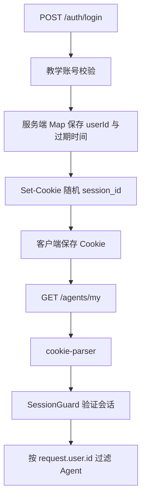

# NestJS Study 29：Cookie

用 AI SaaS 的登录和界面偏好，理解浏览器 Cookie 如何参与 HTTP 请求。
本章对应 Techniques 的 Cookies，使用 `cookie-parser` 和自行实现的内存 Session。
Study 35 才演示 `express-session`，二者实现方式不同。

## 学习目标与场景

一个 AI 工作台需要记住用户的主题和语言，也需要识别用户只能看到自己的 Agent。
这两种数据可以都通过 Cookie 往返，但信任边界不同：

- `theme/language` 是可修改的界面偏好，服务端读取时仍限制允许值。
- `session_id` 是服务端生成的随机凭据，浏览器不能直接指定可信 userId。
- Session 的 userId 和过期时间存放在服务端 Map；Cookie 只携带随机 ID。
- Guard 先验证会话，再把已验证用户传给查询业务。

## 目录与阅读顺序

```text
src/
├── main.ts                          # cookie-parser、全局 ValidationPipe
├── app.module.ts                    # Auth、Agents、Cookies 三个模块
├── auth/
│   ├── auth.controller.ts           # 设置与清除会话 Cookie
│   ├── auth.service.ts              # 校验教学账号，返回安全用户字段
│   ├── auth.module.ts
│   ├── session.service.ts           # 随机 ID、Map、过期检查
│   ├── session.guard.ts             # 验证后附加 request.user
│   └── dto/login.dto.ts             # 登录请求验证
├── agents/
│   ├── agents.controller.ts         # /agents/my，绑定 SessionGuard
│   ├── agents.service.ts            # 按已验证 userId 过滤
│   └── agents.module.ts
└── cookies/
    ├── cookies.controller.ts        # 调试名称、读取与保存偏好
    ├── cookies.decorator.ts         # 从 request.cookies 提取字段
    ├── cookies.module.ts
    └── dto/preferences.dto.ts       # 限制偏好允许值
```

建议先读 [main.ts](./src/main.ts)，看原始 Cookie 头在哪里被解析；
再读 [auth.controller.ts](./src/auth/auth.controller.ts) 和 [auth.service.ts](./src/auth/auth.service.ts)，追踪登录结果。
随后阅读 [session.service.ts](./src/auth/session.service.ts)、[session.guard.ts](./src/auth/session.guard.ts)，确认可信身份来自服务端。
最后读 [agents.controller.ts](./src/agents/agents.controller.ts) 和 [cookies.controller.ts](./src/cookies/cookies.controller.ts)，比较身份数据与普通偏好。

## 核心实现原理

### 解析 Cookie 不等于验证身份

`main.ts` 中的 `app.use(cookieParser())` 把请求 Cookie 头解析成 `request.cookies`。
`@Cookies('theme')` 是参数装饰器，只负责取值，不校验登录，也不会验证签名。
`GET /cookies/debug` 只返回 Cookie 名称，避免直接回显会话凭据。

### 登录后为什么只把随机 ID 发给浏览器

`SessionService.createSession()` 用 `randomBytes(32).toString('hex')` 生成 ID。
Map 中保存 `{ userId, expiresAt }`，有效期一小时。
`AuthService.login()` 仅返回 id、email、name，不返回密码。

```ts
response.cookie('session_id', result.sessionId, {
  httpOnly: true,
  secure: process.env.NODE_ENV === 'production',
  sameSite: 'lax',
  maxAge: 60 * 60 * 1000,
  path: '/',
});
```

`HttpOnly` 限制浏览器脚本读取会话 Cookie；`Secure` 要求浏览器通过 HTTPS 发送；
`SameSite=Lax` 限制部分跨站发送场景；`path` 决定匹配的请求路径。
这些属性各有职责，不代表完整的 CSRF 防护或真实生产认证方案。

当前每次登录都创建新 ID，不接受客户端提交的 userId 或角色作为身份。
没有使用 `express-session`，因此也没有它的 `regenerate()` 方法。

### Guard 如何保证用户数据隔离

[SessionGuard](./src/auth/session.guard.ts) 读取 Cookie，调用 `getCurrentUser()` 验证会话。
不存在、过期或用户不存在时返回 401；成功后附加 `request.user`。
`AgentsController` 通过 `@UseGuards(SessionGuard)` 真正绑定这个机制，
再把 `request.user.id` 传给 `findMyAgents()`。接口不接受客户端 userId 来决定数据归属。

### 偏好也需要运行时 DTO

TypeScript 的联合类型不会验证 HTTP JSON。
[PreferencesDto](./src/cookies/dto/preferences.dto.ts) 使用 `@IsIn()`，由全局 ValidationPipe 执行检查。
合法 theme 为 `light/dark`，language 为 `zh-CN/en-US`，两个字段都必填。
偏好 Cookie 允许脚本读取，所以 `httpOnly: false`；不能把它们当成权限依据。
读取未知偏好时返回安全默认值 `light/zh-CN`。

### 注销需要同时处理两端

`AuthService.logout()` 删除服务端 Map 条目，Controller 用同一路径清除浏览器 Cookie。
即使有人保留旧 ID，服务端也会拒绝它。
过期条目在下次访问时惰性删除；本章没有后台过期清扫或共享会话存储。

## 请求流程



## 如何运行

推荐 Node.js 24 LTS、pnpm；本次验证环境 Node 24.5.0、pnpm 12.3.4。
本项目使用 Nest 12、TypeScript 6，精确依赖见本目录锁文件。
无需数据库、Redis、模型 API 或环境文件。

```bash
cd nestjs-study-29
pnpm install --frozen-lockfile
pnpm start:dev
```

默认 `PORT=3000`。本地 HTTP 学习请使用开发模式；生产模式 Cookie 带 Secure，需要 HTTPS。

```bash
pnpm build
pnpm exec tsc --noEmit --incremental false
pnpm lint
pnpm test
pnpm test:e2e
```

e2e 会构建并启动真实入口，验证两位用户的数据隔离、注销撤销、偏好验证和生产 Secure 属性。
单元测试使用受控时间验证会话过期；不会等待一小时。

## API 接口

| Method | Endpoint               | 说明                             |
| ------ | ---------------------- | -------------------------------- |
| POST   | `/auth/login`          | email/password 登录并设置 Cookie |
| GET    | `/auth/me`             | 验证当前会话并返回用户           |
| POST   | `/auth/logout`         | 删除会话并清除 Cookie            |
| GET    | `/agents/my`           | 查询当前用户的 Agent，需要会话   |
| GET    | `/cookies/debug`       | 仅列出 Cookie 名称               |
| GET    | `/cookies/preferences` | 读取 theme/language              |
| POST   | `/cookies/preferences` | 验证并保存偏好                   |

## HTTP 验证

```bash
curl -i http://localhost:3000/agents/my
curl -i -c /tmp/study29-cookies.txt \
  -H 'Content-Type: application/json' \
  -d '{"email":"robin@example.com","password":"123456"}' \
  http://localhost:3000/auth/login
curl -s -b /tmp/study29-cookies.txt http://localhost:3000/auth/me
curl -s -b /tmp/study29-cookies.txt http://localhost:3000/agents/my
```

未登录请求返回 401。登录返回 201，响应头包含 `session_id`、HttpOnly、SameSite=Lax。
Robin 的 userId 为 1001，只能查询到两个归属于 1001 的 Agent。
另一个教学账号 `alan@example.com / 123456` 的 userId 为 1002，只能查询到自己的一个 Agent。

```bash
curl -i -b /tmp/study29-cookies.txt -c /tmp/study29-cookies.txt \
  -H 'Content-Type: application/json' \
  -d '{"theme":"dark","language":"en-US"}' \
  http://localhost:3000/cookies/preferences
curl -s -b /tmp/study29-cookies.txt http://localhost:3000/cookies/preferences
curl -i -H 'Content-Type: application/json' -d '{"theme":"admin","language":"xx"}' \
  http://localhost:3000/cookies/preferences
curl -i -X POST -b /tmp/study29-cookies.txt -c /tmp/study29-cookies.txt \
  http://localhost:3000/auth/logout
curl -i -b /tmp/study29-cookies.txt http://localhost:3000/auth/me
```

合法偏好往返为 `dark/en-US`；非法偏好返回 400。
注销后查询用户返回 401。验证结束可删除 `/tmp/study29-cookies.txt`。

## 常见问题与生产边界

- **登录成功但下一次 401？** curl 需要 `-c` 保存和 `-b` 携带 Cookie；浏览器跨源请求还需要另行设计凭据与 CORS。
- **重启后 Cookie 还在却失效？** 服务端 Map 随进程重启清空，浏览器 Cookie 不会自动恢复服务端会话。
- **为什么偏好可以改但身份不能改？** 偏好是普通输入，身份必须通过随机 ID 在服务端查验。

账号和明文密码只是公开教学夹具；真实系统需要密码哈希、会话治理和持久化 Store。
当前 Map 不适合多进程共享，过期会话也没有定时清理；本章没有实现密码重置、刷新会话或完整 CSRF 防护。
下一次登录会生成新 ID，但不会自动撤销该用户其他已登录设备的会话。

## 思考与练习

1. 为偏好新增一个允许值，分别调整保存验证与读取默认逻辑。
2. 把会话有效期改成十秒，观察浏览器 Cookie 与服务端过期检查的不同职责。
3. 为 `/auth/me` 改用现有 Guard，思考怎样复用已验证用户而不重复查验。
4. 对比 Study 35：哪些 Session 生命周期工作由中间件接管？

本章重点是 Cookie 的传输职责和服务端身份验证的边界。
“能读到 Cookie”与“已验证当前用户”需要分成两个明确步骤。

## 官方参考

- [中文：Cookie](https://docs.nestjs.cn/techniques/cookies/)
- [英文：Cookies](https://docs.nestjs.com/techniques/cookies)
