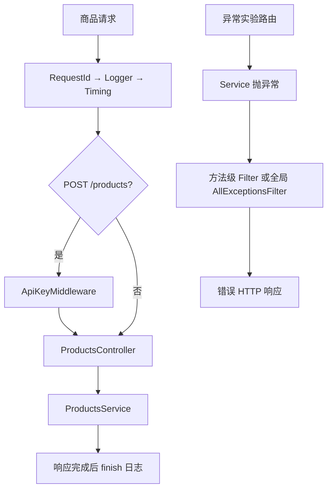

# Study 3：商品请求的中间件与 Agent 异常处理

[返回学习路线](../README.md)

## 项目介绍

本章观察一次 HTTP 请求在业务方法前后发生什么：商品路由生成请求 ID、记录访问和耗时，写商品前校验演示 API Key；Agent 实验路由则故意触发标准、自定义和未知异常，让不同层级的 Filter 真正运行。

不要只看状态码：本章还要区分请求进入了哪些中间件、异常被哪一个 Filter 捕获，以及哪些信息应该留在服务器。

## 学习目标

- 通过 `MiddlewareConsumer` 按 Controller 或 HTTP 方法绑定中间件。
- 理解中间件中的 `next()` 和响应 `finish` 事件为何处在不同时间点。
- 区分已知业务异常与未知错误，给客户端合适的状态码和信息。
- 对比方法级 `@UseFilters()` 与模块注册的全局 `APP_FILTER`。
- 认识 `ArgumentsHost`、Express Response 与 `HttpAdapterHost` 两种响应写法。

## 业务与教学边界

商品数据和 Agent 列表都存于内存。商品写入要求固定的 `study-secret-key`，仅用于观察中间件条件绑定，**不是用户认证或生产密钥方案**。没有登录、角色系统或真实 AI 调用。

`/exception-lab/crash` 故意抛错；`llm-error` 故意返回模型服务不可用；`quota` 使用固定额度数据。它们是可以重复观察的错误样本，不代表真实后端故障。

## 项目结构

```text
src/
├── common/
│   ├── middleware/
│   │   ├── api-key.middleware.ts
│   │   ├── logger.middleware.ts
│   │   ├── request-id.middleware.ts
│   │   └── timing.middleware.ts
│   └── services/
│       └── audit.service.ts
├── exception-lab/
│   ├── exceptions/
│   │   └── agent-quota.exception.ts
│   ├── filters/
│   │   ├── all-exceptions.filter.ts
│   │   └── http-exception.filter.ts
│   ├── exception-lab.controller.ts
│   └── exception-lab.service.ts
├── products/
│   ├── products.controller.ts
│   ├── products.module.ts
│   └── products.service.ts
├── app.controller.spec.ts
├── app.controller.ts
├── app.module.ts
├── app.service.ts
└── main.ts
```

`AppModule` 注册商品模块、异常实验 Controller/Service，以及全局 Filter；`AppController`/`AppService` 仍是未接入模块的脚手架。商品中间件由 `ProductsModule.configure()` 显式绑定。

## 核心知识讲解

### 中间件按照绑定范围执行

在 [ProductsModule](src/products/products.module.ts) 中：

```ts
consumer
  .apply(RequestIdMiddleware, LoggerMiddleware, TimingMiddleware)
  .forRoutes(ProductsController);
```

这三个中间件按声明顺序处理商品请求。另一个 `.apply(ApiKeyMiddleware)` 只匹配 `POST /products`，因此查询不需要 Key。中间件可以依赖注入：`LoggerMiddleware` 的 [AuditService](src/common/services/audit.service.ts) 由模块容器提供。

[RequestIdMiddleware](src/common/middleware/request-id.middleware.ts) 用服务端 UUID 写入请求和响应头，不信任客户端给定的 ID。[TimingMiddleware](src/common/middleware/timing.middleware.ts) 先记录起始时间、调用 `next()`，再通过 `res.on('finish')` 在响应完成时输出耗时。没有 `next()` 也没有主动响应，就会让请求停住。

日志只记录方法、URL、请求 ID、耗时等示例字段；不要把 Token 或完整业务 Body 加进去。URL 也可能包含敏感查询参数，练习时不要传真实凭证。

### 抛出异常不是手动拼一个成功响应

[ExceptionLabService](src/exception-lab/exception-lab.service.ts) 对缺失资源、重复名称、非法输入分别抛 404、409、400 异常。Nest 接收到异常后跳过正常返回值处理，进入匹配的 Filter。

[AgentQuotaException](src/exception-lab/exceptions/agent-quota.exception.ts) 继承 `HttpException`，携带 429 与 `errorCode`、limit、used。自定义异常适合稳定表达业务失败；它本身并不记录或扣减真实额度。

### 全局 Filter 与方法 Filter 的优先级

[AppModule](src/app.module.ts) 通过 `{ provide: APP_FILTER, useClass: AllExceptionsFilter }` 注册全局 Filter，保留 `HttpAdapterHost` 的依赖注入。直接在 main 里 `new` 一个依赖容器对象的 Filter，容易跳过装配。

[AllExceptionsFilter](src/exception-lab/filters/all-exceptions.filter.ts) 用 `@Catch()` 接住未被更局部 Filter 处理的异常。标准 `HttpException` 保留其状态码；未知错误统一返回 `Internal server error`，完整堆栈只写服务器日志。

`filtered` 方法上的 [HttpExceptionFilter](src/exception-lab/filters/http-exception.filter.ts) 使用 `@Catch(HttpException)`，用 Express API 完成响应。局部 Filter 已处理的异常不会再依次交给全局 Filter 做第二次包装。

响应形状是 `{ statusCode, message, timestamp, path }`。`message` 保留 `exception.getResponse()`：它可能是字符串，也可能是包含业务字段的对象，所以 quota 的错误码在 `message.errorCode`，不是顶层。

### TypeScript 声明与运行时输入

[ProductsService](src/products/products.service.ts) 的 `Product` interface 已导出，Controller 推断的返回类型才能生成 `.d.ts`。不要关闭 declaration 来掩盖 TS4053。

本章未使用 class-validator。商品和 Agent 创建在 Service 内执行最小类型与业务检查；单靠 TypeScript 注解不能阻止 HTTP 传入数字名称；Controller 按字段取出 unknown 后交给 Service 检查，空请求体也会得到 400。下一章专门学习 DTO 管道验证。

## 核心执行流程



## 如何运行

建议 Node.js 24（实测 24.5.0）、pnpm 12.3.4；Nest 声明 `^12.0.1`、实际锁定 12.3.2；TypeScript 声明 `^6.0.2`、实际 6.0.3。没有数据库、Redis 或真实模型依赖，也无需环境变量。

```bash
pnpm install --frozen-lockfile
pnpm start:dev
# 另一个终端，在同目录
pnpm build
pnpm exec tsc --noEmit --incremental false
pnpm lint
pnpm test
pnpm test:e2e
pnpm start:prod
```

默认端口 3000，可设置 `PORT=3103`；e2e 会先构建，再使用真实编译模块和 HTTP 应用验证 Filter。故意调用 crash 时，测试或终端出现堆栈是本章预期日志，HTTP 必须仍为 500 且不泄露数据库错误文本。

## 如何验证

```bash
# 200；检查 X-Request-ID，并看终端的访问/耗时日志
curl -i http://localhost:3000/products
# 401
curl -i -X POST http://localhost:3000/products -H 'Content-Type: application/json' \
  -d '{"name":"Keyboard","price":100}'
# 201
curl -i -X POST http://localhost:3000/products -H 'Content-Type: application/json' \
  -H 'X-API-Key: study-secret-key' -d '{"name":"Keyboard","price":100}'
# 404 / 409 / 503 / 429
curl -i http://localhost:3000/exception-lab/agents/999
curl -i -X POST http://localhost:3000/exception-lab/agents \
  -H 'Content-Type: application/json' -d '{"name":"Research Agent"}'
curl -i http://localhost:3000/exception-lab/llm-error
curl -i http://localhost:3000/exception-lab/quota
# 比较方法级过滤与全局未知错误过滤
curl -i http://localhost:3000/exception-lab/filtered
curl -i http://localhost:3000/exception-lab/crash
```

根路径 `/` 未注册。完整自动回归在 [test/app.e2e-spec.ts](test/app.e2e-spec.ts)，它覆盖写入校验、Filter 形状与错误文本边界。

## 推荐阅读顺序

1. [AppModule](src/app.module.ts)：先确认异常实验和全局 Filter 真正注册。
2. [ProductsModule](src/products/products.module.ts)：读绑定范围和中间件顺序。
3. [RequestId](src/common/middleware/request-id.middleware.ts) → [Logger](src/common/middleware/logger.middleware.ts) → [Timing](src/common/middleware/timing.middleware.ts) → [ApiKey](src/common/middleware/api-key.middleware.ts)：沿请求路径观察。
4. [ExceptionLabController](src/exception-lab/exception-lab.controller.ts) → [ExceptionLabService](src/exception-lab/exception-lab.service.ts)：挑一个 404 和一个 500 对照。
5. [AllExceptionsFilter](src/exception-lab/filters/all-exceptions.filter.ts) → [HttpExceptionFilter](src/exception-lab/filters/http-exception.filter.ts)：最后比较宿主上下文、响应方式与优先级。

## 思考与练习

1. 把 API Key 中间件绑定到一条 GET 路由，验证其余查询是否仍公开。
2. 在 Filter 响应中附加服务端 `x-request-id`，观察异常实验为何可能没有这个值。
3. 新建一个明确的业务异常并验证状态码与响应形状。
4. 给 `filtered` 路由去掉局部 Filter，对照日志和 message 的形状。

## 本章总结

中间件处理进入业务之前的横切工作，Filter 处理异常出口。先掌握实际绑定范围和异常类型，再研究平台适配。下一章用 Pipe 把参数转换和验证从临时检查变成可复用的请求规则。

参考：[Middleware](https://docs.nestjs.com/middleware)、[Exception filters](https://docs.nestjs.com/exception-filters)。
