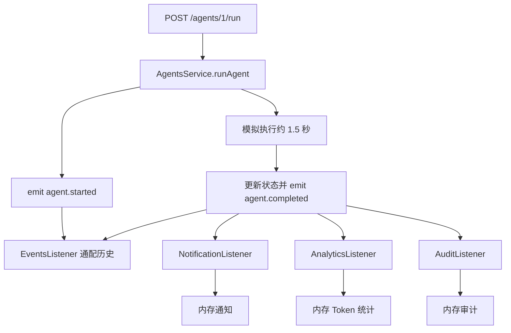

# NestJS Study 30：事件驱动

用一次 AI Agent 执行触发通知、Token 统计和审计，学习 `@nestjs/event-emitter`。
本章对应 Techniques 的 Events。AI 执行为等待约 1.5 秒的本地模拟，所有记录保存在当前进程内存。

## 学习目标与业务问题

Agent 完成以后，既要通知用户，也要统计 Token，还要记录审计。
若全部写在执行 Service 内，新增一种后续动作就要修改主流程。
本章让执行服务发布业务事实，各监听器分别完成后续工作：

- `agent.started`：表示任务已开始。
- `agent.completed`：携带执行 ID、用户 ID、Token、耗时。
- `agent.failed`：携带失败原因，供审计监听器使用。

重点是理解进程内发布订阅的解耦方式，以及它与 Study 27 持久化任务队列的区别。
本章不是跨服务消息总线，也没有保证事件持久化投递。

## 目录与推荐阅读顺序

```text
src/
├── main.ts
├── app.module.ts                  # 初始化 EventEmitterModule，开启通配符
├── agents/
│   ├── agents.module.ts
│   ├── agents.controller.ts        # Agent 列表、执行、历史
│   └── agents.service.ts           # 维护执行状态，发布三种事件
├── events/
│   ├── agent.events.ts             # 事件名称和 payload 类型
│   ├── events.module.ts
│   ├── events.listener.ts          # agent.* 通配监听，保存真实事件名
│   ├── events.service.ts           # 事件历史
│   └── events.controller.ts
├── notifications/                 # 完成事件 → 内存通知
├── analytics/                     # 完成事件 → Token 与次数统计
└── audit/                         # 完成/失败事件 → 审计记录
```

1. 先读 [app.module.ts](./src/app.module.ts)：确认事件基础设施和所有监听器模块已装配。
2. 读 [agent.events.ts](./src/events/agent.events.ts)：明确事件名称及数据契约。
3. 读 [agents.service.ts](./src/agents/agents.service.ts)：找到事实发生、状态改变和 emit 的顺序。
4. 读 [notification.listener.ts](./src/notifications/notification.listener.ts)、[analytics.listener.ts](./src/analytics/analytics.listener.ts)、[audit.listener.ts](./src/audit/audit.listener.ts)：比较独立消费者。
5. 最后读 [events.listener.ts](./src/events/events.listener.ts)：理解通配匹配与真实事件名称的区别。

## 核心实现原理

### 发布业务事实，让监听器决定后续动作

[AgentsService](./src/agents/agents.service.ts) 注入 `EventEmitter2`，创建执行记录、发布 started，
再等待 Mock 任务完成，更新结果后发布 completed：

```ts
this.eventEmitter.emit(
  AgentEventNames.COMPLETED,
  new AgentCompletedEvent(
    executionId,
    agentId,
    userId,
    tokensUsed,
    durationMs,
    new Date().toISOString(),
  ),
);
```

事件对象描述“刚刚发生什么”，不直接依赖通知或统计 Service。
通知、统计、审计分别用 `@OnEvent(AgentEventNames.COMPLETED)` 声明订阅。
这些类必须注册为模块 Provider，模块也必须被根模块导入；单有装饰器不会自动注册一个未装配的类。
监听器在应用启动阶段完成注册，因此不要在构造函数中抢先发出需要它们处理的事件。

### 通配符是匹配规则，不是事件名称

`EventEmitterModule.forRoot({ wildcard: true, delimiter: '.' })` 允许监听 `agent.*`。
这能匹配 `agent.started`、`agent.completed`、`agent.failed`，但历史记录不能把所有名称都写成 `agent.*`。
当前 [EventsListener](./src/events/events.listener.ts) 在同步入口读取 EventEmitter2 的运行时 `event`，
再把实际名称交给 `EventsService.record()`。
安装的 EventEmitter2 类型声明没有描述该属性，代码使用 `in` 和 `typeof` 收窄，没有放宽为 `any`。

`event` 是当前发布时的状态，应在任何 `await` 前读取。
若以后给监听器增加异步调度或嵌套 emit，需重新审视名称捕获时机，或把明确事件名称纳入业务载荷。

### emit 与 emitAsync 的等待语义

主流程当前使用 `emit()`，不会等待异步监听器的 Promise 完成。
本章监听器的记录工作都在同步方法体内完成，因此 HTTP 返回后可立即查询示例记录。
若把监听器改成发送邮件、请求外部服务，不能再假定 HTTP 返回代表这些工作已完成。

需要等待监听器时可考虑 `await emitter.emitAsync(...)`。
同时，当前 Nest 事件包中 `@OnEvent()` 默认 `suppressErrors: true`：监听器异常会被记录并隔离。
因此即便 `emitAsync()` 正常返回，也不能将它解释为所有副作用都成功。
需要错误传播时应明确配置和设计业务补偿，而不是让事件系统代替事务。

### 失败事件在当前示例中的边界

`runAgent()` 的 catch 会更新失败状态、发布 failed 并重新抛出异常。
当前 Mock 执行不会主动抛错，HTTP 正常演示主要覆盖 started/completed。
失败监听器保留为真实执行失败时的处理路径，练习中可让 Mock 抛错观察它。
测试还会直接通过真实应用中的 EventEmitter 发布 failed，检查已注册监听器的行为。

## 执行流程



图中的三个完成事件消费者互相独立；它们不是一个有持久化保证的工作流。

## 如何运行

推荐 Node.js 24 LTS、pnpm；本次环境 Node 24.5.0、pnpm 12.3.4。
使用 Nest 12、TypeScript 6，精确依赖由本项目 `pnpm-lock.yaml` 固定。
无需 Redis、数据库、真实 AI 服务或环境文件。

```bash
cd nestjs-study-30
pnpm install --frozen-lockfile
pnpm start:dev
```

默认端口 3000，也可用 `PORT=3030 pnpm start:dev` 独立指定端口。

```bash
pnpm build
pnpm exec tsc --noEmit --incremental false
pnpm lint
pnpm test
pnpm test:e2e
```

e2e 构建后启动真实入口，验证执行、通知、统计、审计及事件名称。
另一个独立的真实应用实例验证 `emitAsync` 和默认监听器异常隔离，无需增加调试 HTTP 接口。

## API 接口

| Method | Endpoint             | 作用                        |
| ------ | -------------------- | --------------------------- |
| GET    | `/agents`            | 查询三个模拟 Agent          |
| GET    | `/agents/executions` | 查询执行记录                |
| POST   | `/agents/:id/run`    | 执行 Agent，用户固定为 1001 |
| GET    | `/events/history`    | 查询通配监听收集的实际事件  |
| GET    | `/notifications`     | 查询内存通知                |
| GET    | `/analytics`         | 按用户汇总执行次数和 Token  |
| GET    | `/audit`             | 查询完成/失败审计           |

## HTTP 验证

在新启动的进程中执行：

```bash
curl -s http://localhost:3000/agents
curl -s -X POST http://localhost:3000/agents/1/run
curl -s http://localhost:3000/agents/executions
curl -s http://localhost:3000/events/history
curl -s http://localhost:3000/notifications
curl -s http://localhost:3000/analytics
curl -s http://localhost:3000/audit
```

执行请求返回 201 和 `status: "completed"`。
一次执行产生 started/completed 两条事件历史、一条通知、一条完成审计。
统计为 userId 1001、totalExecutions 1、totalTokens 2500；继续执行会累加。
事件历史应包含 `agent.started` 与 `agent.completed`，而不是统一显示 `agent.*`。

```bash
curl -i -X POST http://localhost:3000/agents/999/run
curl -i -X POST http://localhost:3000/agents/not-a-number/run
```

不存在的 Agent 返回 404，非数字 ID 返回 400；两者都不会创建执行记录或发布业务事件。

## 常见问题与应用边界

- **为什么监听器没触发？** 检查 Provider 注册、根模块 imports、事件名称和通配符配置，以及事件是否在应用启动完成前发出。
- **事件历史为什么不是数据库？** 它是 `EventsService` 内存数组，重启即清空。
- **监听器报错为什么请求仍成功？** 主流程使用 emit，且默认隔离监听器异常；这不是可靠投递保证。

用户 ID 固定为 1001，所有查询接口均为公开教学接口，没有实现用户认证或多租户隔离。
不要把此示例作为真实 SaaS 的用户访问控制方案。
进程崩溃会丢失内存记录；事件不会自动重试，也没有跨进程广播。
重要后台工作可以进一步对照 Study 27 的队列机制；跨存储一致性还需要另行设计。

## 思考与练习

1. 添加一个新的完成事件监听器，仅打印结果摘要，保持 AgentsService 不变。
2. 让 Mock 执行抛错，验证 failed 历史和审计，同时确认 Token 统计没有增加。
3. 给一个监听器增加延迟，比较 emit 与 emitAsync 的等待顺序。
4. 为测试中的监听器设置 `suppressErrors: false`，观察 emitAsync 的拒绝行为。

本章重点是明确的事件契约、独立监听器和真实等待语义。
发布事件降低了直接依赖，但不会自动获得队列、事务或可靠消息系统的能力。

## 官方参考

- [中文：事件](https://docs.nestjs.cn/techniques/events/)
- [英文：Events](https://docs.nestjs.com/techniques/events)
