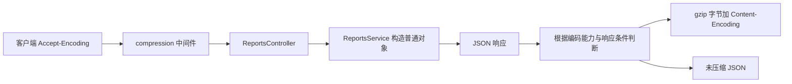

# NestJS Study 31：HTTP 响应压缩

用不同大小的 AI 研究报告，观察 HTTP 压缩协商和真实传输字节。
本章对应 Techniques 的 Compression，采用 Express 适配器和 `compression` 中间件。
报告是重复文本构成的本地样本，不会调用真实 AI 模型。

## 学习目标与业务场景

AI 报告通常包含大量自然语言和重复结构，响应体可能明显大于普通列表。
压缩可以减少传输字节，但需要额外 CPU，也受客户端能力、响应类型和缓存指令影响。
本章希望你理解：

- 压缩发生在 HTTP 响应发送阶段，业务 Service 仍然返回普通对象。
- `Accept-Encoding` 是客户端声明，`Content-Encoding` 描述实际响应编码。
- curl 或浏览器自动解压后看到的是原始内容，不能只凭页面文本判断是否压缩。
- 同样开启中间件，并不保证每个响应都使用压缩。

## 项目结构与阅读顺序

```text
src/
├── main.ts                       # 在 listen 前注册 compression()
├── app.module.ts                 # 装配 AgentsModule、ReportsModule
├── agents/
│   ├── agents.module.ts
│   ├── agents.controller.ts       # 小规模 Agent 列表
│   └── agents.service.ts
└── reports/
    ├── reports.module.ts
    ├── reports.controller.ts      # small、large、huge、stats 路由
    └── reports.service.ts         # 重复段落构造报告样本
```

1. 先读 [main.ts](./src/main.ts)：压缩中间件只注册一次，属于 HTTP 层。
2. 再读 [app.module.ts](./src/app.module.ts)：确认报告与 Agent 模块独立装配。
3. 读 [reports.controller.ts](./src/reports/reports.controller.ts)：选择要比较的路由。
4. 读 [reports.service.ts](./src/reports/reports.service.ts)：理解样本规模，没有外部模型调用。
5. 最后读 [e2e 测试](./test/app.e2e-spec.ts)：看原始 gzip 字节怎样被验证。

## 核心实现原理

### 为什么业务 Service 不需要调用 gzip

[main.ts](./src/main.ts) 中的关键配置是：

```ts
const app = await NestFactory.create(AppModule);
app.use(compression());
await app.listen(process.env.PORT ?? 3000);
```

`ReportsController` 返回一个包含 content、references、metadata 的对象。
Nest/Express 负责 JSON 响应，中间件根据请求和响应头决定是否压缩。
如果把 gzip 写进每个业务方法，业务就会知道客户端如何传输，职责也更难区分。

本项目没有手动设置压缩算法或阈值，使用已安装 compression 包的默认行为。
默认阈值约为 1 KiB，但压缩与否还受 Content-Type、客户端编码能力等条件影响。
`small` 只是业务命名，不能据此断言它一定低于阈值；中文 JSON 的字节数与字符数也不同。

### 三种报告只是体积不同

[ReportsService](./src/reports/reports.service.ts) 的 `generateReport()` 复制固定段落：

| 路由             | 段落数 | 用途                   |
| ---------------- | ------ | ---------------------- |
| `/reports/small` | 2      | 小样本                 |
| `/reports/large` | 500    | 观察大文本压缩         |
| `/reports/huge`  | 2000   | 比较更大响应的传输体积 |

这不是模型性能测试，也不是 Fastify 与 Express 的性能对比。
高度重复的样本通常容易压缩，真实模型输出的压缩率应通过真实数据测量。
报告包含生成时间，所以两次独立请求的原文未必字节完全相同。

### 如何理解几个响应头

客户端用 `Accept-Encoding: gzip` 表示可以接受 gzip。
若服务端选择它，响应包含 `Content-Encoding: gzip`，响应体才是 gzip 字节。
`Vary: Accept-Encoding` 提醒缓存区分不同编码请求的表示。

请求 `Accept-Encoding: identity` 可以要求使用未压缩表示。
响应上的 `Cache-Control: no-transform` 会让 compression 跳过转换；
注意它是响应指令，不是在 curl 请求中随便加一个头就能证明服务端路由设置了它。
本项目的公开路由没有设置 no-transform；测试通过临时中间件在同一报告路由验证这个行为，没有新增产品接口。

### 解压与传输大小要分开观察

`curl --compressed` 会协商压缩并自动解压，所以输出仍然是可读 JSON。
要保存原始 gzip，手动设置 Accept-Encoding，且不使用 `--compressed`。
比较下载字节数时也要保持同一路由和相同语义，不要把 small 与 huge 的大小差当作压缩收益。

## 执行流程



## 如何运行

推荐 Node.js 24 LTS、pnpm；本次环境 Node 24.5.0、pnpm 12.3.4。
项目声明 Nest 12、TypeScript 6，精确安装版本见本目录锁文件。
无需 `.env`、数据库、Redis、Docker 或模型服务。

```bash
cd nestjs-study-31
pnpm install --frozen-lockfile
pnpm start:dev
```

默认端口 3000，必要时 `PORT=3031 pnpm start:dev`。

```bash
pnpm build
pnpm exec tsc --noEmit --incremental false
pnpm lint
pnpm test
pnpm test:e2e
```

e2e 启动真实入口，读取未经 HTTP 客户端自动解压的响应字节，并用 gunzip 验证内容。
identity 和 no-transform 也有验证。

## API 接口

| Method | Endpoint         | 返回内容                                       |
| ------ | ---------------- | ---------------------------------------------- |
| GET    | `/agents`        | 三个模拟 Agent                                 |
| GET    | `/reports/small` | 2 段报告                                       |
| GET    | `/reports/large` | 500 段报告                                     |
| GET    | `/reports/huge`  | 2000 段报告                                    |
| GET    | `/reports/stats` | 支持的报告类型和静态 compressionSupported 标记 |

`compressionSupported: true` 只是此示例的静态说明，不能代替检查某一次响应的 Content-Encoding。

## HTTP 验证

```bash
curl -s http://localhost:3000/reports/stats
curl -sS -D /tmp/study31-gzip.headers -H 'Accept-Encoding: gzip' \
  -o /tmp/study31-report.gz http://localhost:3000/reports/large
cat /tmp/study31-gzip.headers
gzip -dc /tmp/study31-report.gz > /tmp/study31-report.json
```

应看到 HTTP 200、`Content-Encoding: gzip` 与 `Vary: Accept-Encoding`。
解压后的 JSON 包含 `metadata.paragraphs: 500`。
可以直接让 curl 解压查看：

```bash
curl --compressed -s http://localhost:3000/reports/small
```

再比较同一大报告的传输大小：

```bash
curl -s -H 'Accept-Encoding: identity' -o /dev/null \
  -w 'identity bytes: %{size_download}\n' http://localhost:3000/reports/large
curl -s -H 'Accept-Encoding: gzip' -o /dev/null \
  -w 'gzip bytes: %{size_download}\n' http://localhost:3000/reports/large
```

该重复文本样本的 gzip 字节通常显著减少。identity 响应不应包含 Content-Encoding。
验证结束后可删除刚才的 `/tmp/study31-*` 文件。

## 常见问题与生产边界

- **看到 JSON 为什么还说用了 gzip？** 客户端可能自动解压；检查响应头和原始字节。
- **为什么某个小响应没压缩？** 阈值、可压缩类型、编码协商和缓存指令共同决定，不是只看中间件是否注册。
- **为什么压缩后响应时间没有明显下降？** 本地网络开销小，压缩又需要 CPU；本章没有提供可重复的性能基准。

真实部署可能在反向代理或 CDN 压缩，应避免重复配置，结合流量和 CPU 测量决策。
图片、压缩包等已经压缩的文件通常不适合再次压缩。
SSE 等持续输出还涉及缓冲与 flush，不能直接用本章大 JSON 的结果推断流式体验；可继续阅读 Study 38。
本章没有新增全局缓存、鉴权或性能限流机制。

## 思考与练习

1. 使用相同路由比较 small/large/huge 的压缩率，并记录字节而非字符串长度。
2. 在本地修改 compression 的 threshold，观察小响应是否改变。
3. 给报告路由设置响应 `Cache-Control: no-transform`，验证它仍是未压缩 JSON。
4. 改成重复更少的文本，比较压缩率变化并解释原因。

本章重点是正确观察响应协商和传输字节，业务对象不需要随着压缩方式改变。
后续 Study 33 的文件流、Study 37 的 Fastify 适配器都应分别考虑自身 HTTP 行为。

## 官方参考

- [中文：压缩](https://docs.nestjs.cn/techniques/compression/)
- [英文：Compression](https://docs.nestjs.com/techniques/compression)
