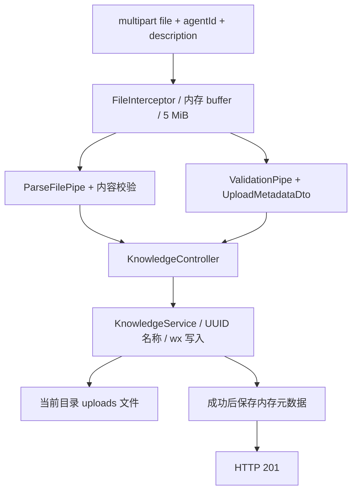

# NestJS Study 32：知识库文件上传

以 AI Agent 知识库为场景，学习 Express 平台的 multipart 上传、文件验证与本地保存。
本章对应 Techniques 的 File Upload。只管理文件和元数据，不会解析论文、切分文本、生成向量或调用 AI。

## 学习目标与业务问题

向 Agent 添加知识资料时，一个请求需要同时携带文件字节和 agentId、description。
单纯的 JSON 请求不能表达本章的 multipart 文件流程；文件名和客户端 Content-Type 也不能直接视为可信内容。
本章会帮助你理解：

- `FileInterceptor('file')` 负责解析 multipart 中名为 file 的字段。
- `ParseFilePipe` 负责缺文件与自定义内容验证。
- 全局 `ValidationPipe` 负责上传元数据，并把 multipart 字符串转换成数字。
- Service 负责生成服务端文件名、写入文件和维护元数据。
- 文件内容与内存元数据是两类状态，失败时需要避免留下错误记录。

## 项目结构与推荐阅读顺序

```text
src/
├── main.ts                            # 全局 DTO 验证与启动
├── app.module.ts                      # 注册 KnowledgeModule
└── knowledge/
    ├── knowledge.module.ts            # Controller、Service 注册
    ├── knowledge.controller.ts        # FileInterceptor、ParseFilePipe、四个接口
    ├── knowledge.service.ts           # UUID 文件名、独占写入、删除
    ├── knowledge.interface.ts         # KnowledgeFile 元数据
    ├── dto/
    │   └── upload-metadata.dto.ts      # agentId 转换和 description 验证
    └── validators/
        └── knowledge-file.validator.ts # 扩展名与内容检查
```

1. 先读 [knowledge.controller.ts](./src/knowledge/knowledge.controller.ts)：确认上传字段名、大小限制和两个验证入口。
2. 读 [upload-metadata.dto.ts](./src/knowledge/dto/upload-metadata.dto.ts)：理解表单字段为何需要转换。
3. 读 [knowledge-file.validator.ts](./src/knowledge/validators/knowledge-file.validator.ts)：看客户端名称如何与实际内容一起校验。
4. 读 [knowledge.service.ts](./src/knowledge/knowledge.service.ts)：追踪路径生成、写入成功后记录元数据、删除文件。
5. 最后回到 [main.ts](./src/main.ts) 和 [app.module.ts](./src/app.module.ts)：确认全局验证与模块装配让上述代码真正生效。

## 核心实现原理

### 文件解析和验证不是同一步

Controller 为 `/knowledge/upload` 绑定：

```ts
@UseInterceptors(FileInterceptor('file', {
  limits: { fileSize: 5 * 1024 * 1024, files: 1 },
}))
```

Multer 把文件放进内存 buffer；本章没有配置 diskStorage。
单文件最多 5 MiB，超限由拦截器转换为 HTTP 413。
限制在解析阶段生效，避免先无限制读取大文件，再交给 Service 判断。
但并发请求仍会占用多份内存，本章没有实现上传并发或用户配额控制。

`@UploadedFile(new ParseFilePipe(...))` 要求文件存在，并运行 `KnowledgeFileValidator`。
缺文件、不允许的扩展名或内容不符返回 400。
声明 validator 类却不绑定到参数，不会自动触发验证。

### 当前接受哪些文件

| 扩展名 | 内容要求                      | 保存的 MIME       |
| ------ | ----------------------------- | ----------------- |
| `.pdf` | 前五字节为 `%PDF-`            | `application/pdf` |
| `.txt` | 非空、无 NUL 字节、合法 UTF-8 | `text/plain`      |
| `.md`  | 非空、无 NUL 字节、合法 UTF-8 | `text/markdown`   |

扩展名不区分大小写。PDF 头检查只是教学中的初步识别，不代表完整 PDF 语法验证或恶意文件扫描。
TXT/Markdown 的 UTF-8 检查也不意味着内容安全，后续展示 Markdown 时仍需要考虑 HTML 清理。
客户端 `file.mimetype` 只是声明；保存的 MIME 根据已验证扩展名确定。

代码通过 `import type {} from 'multer'` 显式加载已安装的类型扩展，
因为本项目 tsconfig 的 types 白名单只自动包含 Node/Vitest，不会自动引入 Express.Multer。
这不需要关闭严格检查或升级依赖。

### multipart 元数据如何变成 DTO

表单里的 `agentId` 最初是字符串。
`UploadMetadataDto` 使用 `@Type(() => Number)`、`@IsInt()`、`@Min(1)`，
由 main.ts 的全局 ValidationPipe 执行转换与验证。
`description` 可选、必须为字符串且不超过 500 字符；未知字段会被拒绝。
本项目没有 Agent 数据库，因此 agentId 是正整数标签，不会验证对应 Agent 是否存在，也不是权限凭据。

### 为什么保存时不能直接使用原始文件名

[KnowledgeService](./src/knowledge/knowledge.service.ts) 只取已验证扩展名，
使用 `randomUUID()` 生成存储名，并固定写入 `process.cwd()/uploads`。
原始文件名只作为展示元数据，不作为任意文件路径。

文件通过 `open(filePath, 'wx')` 独占创建，只有本次成功创建的文件才归本次写入流程处理。
写入失败会关闭句柄并移除局部文件，成功后才把元数据加入数组。
如果 `open` 报 EEXIST，代码不会删除已有文件。
这避免为了“失败清理”反而破坏旧文件。

### 删除与重启行为

`DELETE /knowledge/files/:id` 先查元数据，再删除对应磁盘文件，最后移除数组项。
不存在的 ID 返回 404。
文件字节保留在磁盘，元数据只是内存数组：重启后列表为空，但旧文件仍可能存在。
因此这不是带持久化索引的完整知识库；不要把重启后空列表理解为所有磁盘文件已删除。

## 执行流程



## 如何运行

推荐 Node.js 24 LTS、pnpm；本次环境为 Node 24.5.0、pnpm 12.3.4。
使用 Nest 12、TypeScript 6，锁定版本以本目录 `pnpm-lock.yaml` 为准。
无需数据库、Redis、Docker、对象存储或模型 API。

```bash
cd nestjs-study-32
pnpm install --frozen-lockfile
pnpm start:dev
```

默认端口 3000，可通过 PORT 修改。
上传目录是启动时工作目录下的 uploads；需要当前用户有写权限。

```bash
pnpm build
pnpm exec tsc --noEmit --incremental false
pnpm lint
pnpm test
pnpm test:e2e
```

e2e 先构建，在临时工作目录启动真实入口，验证上传、metadata 转换、磁盘字节、查询、删除和非法请求。
单元测试还验证写入失败清理与 EEXIST 时保留旧文件，测试文件不会写入你的学习项目 uploads。

## API 接口

| Method | Endpoint               | 说明                                                |
| ------ | ---------------------- | --------------------------------------------------- |
| GET    | `/`                    | 保留的 Hello World 根路由                           |
| POST   | `/knowledge/upload`    | 单文件上传，multipart 字段 file/agentId/description |
| GET    | `/knowledge/files`     | 查询本进程内存元数据                                |
| GET    | `/knowledge/files/:id` | 查询单条元数据，不是下载接口                        |
| DELETE | `/knowledge/files/:id` | 删除磁盘文件与对应元数据，成功 200 空响应           |

## HTTP 验证

在启动服务的项目目录之外，另开终端准备一个 UTF-8 样本：

```bash
printf '# Agent 知识库\n这是 UTF-8 教学资料。\n' > /tmp/study32-notes.md
curl -i -X POST http://localhost:3000/knowledge/upload \
  -F 'file=@/tmp/study32-notes.md' \
  -F 'agentId=1' -F 'description=Agent 学习笔记'
curl -s http://localhost:3000/knowledge/files
curl -s http://localhost:3000/knowledge/files/1
```

新进程第一次上传的 ID 为 1；返回 201，agentId 是数字，storedName 为 UUID 加扩展名，MIME 为 text/markdown。
项目 uploads 中应出现对应字节文件。已有上传记录时，请用实际返回的 ID 替换 1。
不要自行指定 multipart 的 Content-Type 边界，让 curl 的 `-F` 自动生成。

```bash
curl -i -X POST http://localhost:3000/knowledge/upload -F 'agentId=1'
printf 'not a pdf' > /tmp/study32-fake.pdf
curl -i -X POST http://localhost:3000/knowledge/upload \
  -F 'file=@/tmp/study32-fake.pdf' -F 'agentId=1'
curl -i -X POST http://localhost:3000/knowledge/upload \
  -F 'file=@/tmp/study32-notes.md' -F 'agentId=0'
curl -i -X DELETE http://localhost:3000/knowledge/files/1
curl -i http://localhost:3000/knowledge/files/1
```

缺文件、伪 PDF、agentId=0 都返回 400。
删除成功返回 200，再次查询返回 404，磁盘上对应文件也被删除。
超过 5 MiB 的文件返回 413；不要以为更换后缀能绕过内容验证。
验证结束后可删除 `/tmp/study32-notes.md` 与 `/tmp/study32-fake.pdf`。

## 常见问题与应用边界

- **为什么返回 400？** 检查字段名是不是 file、agentId 是否正整数、内容与扩展名是否匹配。
- **为什么上传后查询为空？** 确认没有重启，也没有请求另一个 Study 的端口；元数据不持久化。
- **为什么不是 FileInterceptor 直接写磁盘？** 本章先在内存验证，再由 Service 决定存储名和写入时机。

生产系统通常还需要认证、文件归属校验、持久化元数据、对象存储、配额及恶意内容检测。
本章所有文件接口公开，返回中含本地 path，目的是观察文件与元数据的对应关系，不应直接暴露为生产 API。
没有实现下载接口、知识解析、向量检索或对象存储迁移；文件流下载可继续学习 Study 33。

## 思考与练习

1. 把大小限制改成 1 MiB，分别验证边界内与边界外文件。
2. 给 metadata 增加一个可选分类字段，贯通 DTO、接口类型、保存和返回。
3. 尝试上传非 UTF-8 的 txt，解释为什么扩展名检查不足。
4. 重启应用后观察磁盘和列表的差异，设计最小的持久化索引方案草图，暂不引入大型存储架构。

本章重点是解析、验证、业务保存三层职责，以及失败时只清理自己创建的文件。
文件已保存不等于知识库已完成检索准备，后续处理仍是独立业务步骤。

## 官方参考

- [中文：文件上传](https://docs.nestjs.cn/techniques/file-upload/)
- [英文：File upload](https://docs.nestjs.com/techniques/file-upload)
