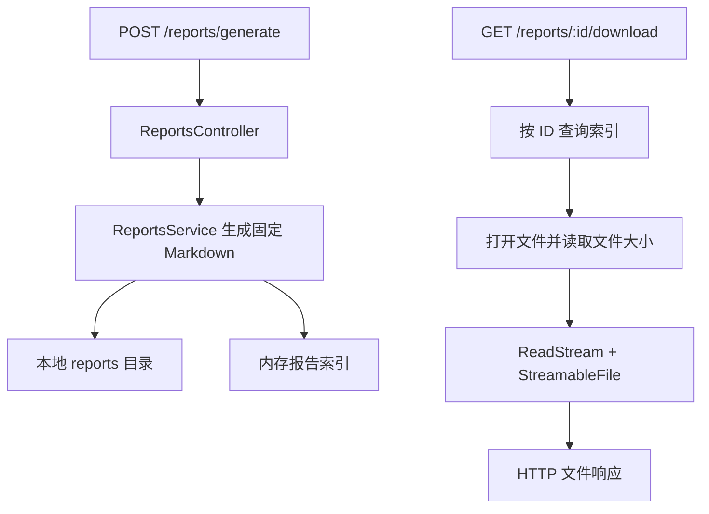

# NestJS Study 33：文件流与研究报告下载

通过生成一份 Markdown 研究报告，学习如何使用 `StreamableFile` 将磁盘文件作为 HTTP 响应发送给客户端。
对应 Techniques 的 Streaming Files。这里的“流”是文件字节流；AI 报告内容由固定文本生成，没有调用模型，也没有逐 Token 生成。

## 学习目标与场景

研究平台需要先生成报告，再允许用户下载。小型 JSON 可以直接 `return`，文件则需要正确的响应头和资源管理。
本章把报告索引放在内存，把内容写入本地磁盘，用最少的业务代码观察这两个边界。

学完应该理解：

- 文件元数据和文件内容为什么走不同接口。
- `StreamableFile` 如何保留 Nest 的响应处理链，同时交给底层适配器传输流。
- `Content-Type`、`Content-Disposition`、`Content-Length` 分别解决什么问题。
- 为什么客户端只能提交报告 ID，不能提交服务器上的任意文件路径。

## 项目结构

```text
src/
├── main.ts                         # HTTP 入口，PORT 默认 3000
├── app.module.ts                   # 注册 ReportsModule，保留根路由
└── reports/
    ├── reports.module.ts           # Controller 与 Service 的装配
    ├── reports.controller.ts       # 元数据查询与下载路由
    ├── reports.service.ts          # 生成文件、保存索引、创建文件流
    └── report.interface.ts         # 服务器内部报告记录
reports/                            # 首次生成时创建，不属于源码
```

关键测试在 [test/app.e2e-spec.ts](./test/app.e2e-spec.ts)：通过真实 HTTP 生成报告，比较下载字节与磁盘内容，并检查文件丢失时的 404。

## 请求执行流程



## 核心实现原理

### 生成与下载为什么分开

[generateReport()](./src/reports/reports.service.ts) 写入约千个章节的模拟文本，再记录文件名、大小和时间。
写文件使用 `flag: 'wx'`，UUID 文件名也由服务器生成；已有文件不会被同名写入覆盖。

`Report.path` 是内部使用的绝对路径。Controller 在列表、详情响应中去掉它，生成接口也只返回必要元数据。
前端随后拿到 `id`，请求下载接口即可，不需要了解服务器目录。

### StreamableFile 如何发送文件

[downloadReport()](./src/reports/reports.service.ts) 的关键部分是：

```ts
const file = await open(report.path, 'r');
const info = await file.stat();
return new StreamableFile(file.createReadStream(), {
  type: report.mimeType,
  disposition: `attachment; filename="${report.filename}"`,
  length: info.size,
});
```

文件内容通过 `ReadStream` 分段读取，无需把整个文件先读成一个 Buffer。
文件大小取自已经打开的同一个文件句柄，避免直接使用旧的内存元数据作为本次传输长度。
这不等于“整个进程不使用内存”：生成阶段仍先构造文本，内存索引也一直存在。

### 三个响应头如何配合

| 响应头 | 当前值 | 作用 |
| --- | --- | --- |
| Content-Type | `text/markdown` | 告诉客户端内容格式 |
| Content-Disposition | `attachment; filename="UUID.md"` | 建议以文件附件下载 |
| Content-Length | 当前文件字节数 | 标明这次响应的字节长度 |

返回的是 `StreamableFile`，Controller 不需要直接操作 Express `Response`。
这让路由仍可与 Nest Interceptor 配合，且业务层不用承担 `response.pipe()` 的细节。

### 资源与错误

Node `ReadStream` 默认自动关闭句柄；正常结束、流出错或 HTTP 连接中断后，底层流会被清理。
如果打开后、创建流前发生异常，Service 会主动关闭句柄。

不存在的报告 ID 返回 404；索引存在但磁盘文件被移除时，同样返回 404，提示重新生成。
没有接受 `path` 查询参数，也没有提供目录浏览功能。

## 如何运行

建议使用 Node.js 24、pnpm 12。本项目声明 NestJS `^12.0.1`、TypeScript `^6.0.2`，精确解析版本见本目录锁文件。
无需数据库、Redis、Docker、模型账号或环境变量文件。

```bash
cd nestjs-study-33
pnpm install --frozen-lockfile
pnpm start:dev
```

默认地址为 `http://localhost:3000`。同时运行其他 Study 时可使用 `PORT=3033 pnpm start:dev`。
生成文件的位置相对于**启动时的工作目录**，因此日常学习应在本项目目录启动。

```bash
pnpm build
pnpm exec tsc --noEmit --incremental false
pnpm lint
pnpm test
pnpm test:e2e
```

`test:e2e` 先构建，然后在临时目录启动真实应用；测试生成的文件会随临时目录清理。

## 实际 API

| Method | Endpoint | 功能 |
| --- | --- | --- |
| GET | `/` | 保留的 Hello World 根路由 |
| POST | `/reports/generate` | 生成一份固定内容的 Markdown 报告，201 |
| GET | `/reports` | 报告元数据列表 |
| GET | `/reports/:id` | 报告元数据详情 |
| GET | `/reports/:id/download` | 下载对应文件 |

## HTTP 验证

在新进程中生成第一份报告，返回的 ID 应为 1：

```bash
curl -X POST http://localhost:3000/reports/generate
curl http://localhost:3000/reports
curl http://localhost:3000/reports/1
curl -D /tmp/study33-headers.txt \
  -o /tmp/study33-report.md \
  http://localhost:3000/reports/1/download
cat /tmp/study33-headers.txt
head -n 6 /tmp/study33-report.md
```

下载返回 200，文件开头是 `# LangGraph 技术研究报告`。
检查附件文件名、Markdown Content-Type 和 Content-Length，后者按字节计算，不能用中文字符数代替。
如果已经生成过报告，请使用生成响应中的实际 ID。

```bash
curl -i http://localhost:3000/reports/abc/download
curl -i http://localhost:3000/reports/999999/download
```

前者由 `ParseIntPipe` 返回 400，后者由 Service 返回 404。

## 推荐阅读顺序

1. [report.interface.ts](./src/reports/report.interface.ts)：区分公开元数据与内部路径。
2. [reports.service.ts](./src/reports/reports.service.ts)：先读生成方法，再读下载与资源管理。
3. [reports.controller.ts](./src/reports/reports.controller.ts)：观察 ID 转换和公开响应字段。
4. [reports.module.ts](./src/reports/reports.module.ts)、[app.module.ts](./src/app.module.ts)：确认模块确实注册。
5. [test/app.e2e-spec.ts](./test/app.e2e-spec.ts)：理解字节一致性与失败验证。

## 常见问题与边界

- 重启后列表为空，但目录仍有文件：索引只在内存中，磁盘文件没有自动重建索引。这是本章明确的简化。
- 浏览器显示文本而未下载：先检查是否请求了 `/download`，并检查 Content-Disposition；元数据详情本身是 JSON。
- 文件无法写入：检查启动目录权限。本例不需要提前创建 `reports/`。
- 这是公开教学接口，没有用户归属校验；真实报告平台需要根据登录用户授权下载，并维护文件清理策略。

生产环境可能把索引放入数据库、内容放到对象存储；这不影响“按业务 ID 查授权记录，再传输文件”的核心思路。
本章没有实现 Range、断点续传、鉴权、自动删除或真实 AI 生成。

## 思考与练习

1. 把下载的文件名改为另一种由服务器生成的安全名称，观察响应头。
2. 增加一份 CSV 报告，分别设置扩展名与 Content-Type。
3. 生成后手动移除对应文件，比较“ID 不存在”和“文件丢失”的错误。
4. 对比 `readFile()` 后返回 Buffer 与现在的 ReadStream，讨论大文件时的内存差异。

## 官方参考

- [NestJS 中文 Techniques](https://docs.nestjs.cn/techniques/)
- [中文文件流](https://docs.nestjs.cn/techniques/streaming-files/)
- [官方 Streaming Files](https://docs.nestjs.com/techniques/streaming-files)

下一章通过 HTTP Module 获取外部资料；Study 38 则讨论持续生成的 SSE 事件，与这里的静态文件传输有不同生命周期。
