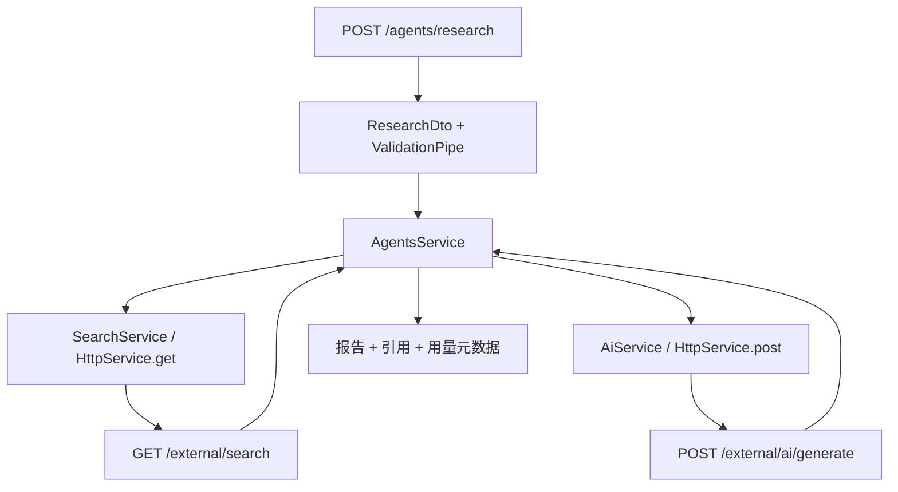

# NestJS Study 34：HTTP Module 与 Deep Research

用一个“搜索资料 → 整理 Prompt → 调用模型 → 返回研究报告”的流程，学习 Nest 的 HTTP 客户端。
所有“外部 API”默认由当前应用的 `/external` 路由模拟，无需密钥，也不会调用真实搜索或模型服务。

## 学习目标

本章对应 Techniques 的 HTTP Module。业务场景中，Nest 服务既是前端的 HTTP 服务器，也是其他服务的 HTTP 客户端。
Controller 接收前端请求，Service 负责调用和组合上游结果，`HttpModule` 提供可注入的 `HttpService`。

重点理解：

- `HttpModule.registerAsync()` 如何用配置创建 Axios 实例。
- `HttpService.get/post()` 为什么返回 Observable，如何用 `firstValueFrom()` 接入 async/await。
- `axiosRef` 何时直接返回 Promise。
- 超时、重定向限制与 502 映射为什么属于调用边界。
- 如何在没有真实模型账号时，仍然验证一次完整 HTTP 链路。

## 目录与职责

```text
src/
├── main.ts                    # 全局 ValidationPipe 与 HTTP 监听
├── app.module.ts              # 配置和业务模块的装配
├── http-options.ts            # 统一的上游地址、5 秒超时、重定向策略
├── external/                  # 本地 Mock 搜索、模型目录、生成 API
├── models/                    # axiosRef 获取模型目录
├── search/                    # Observable + catchError 获取搜索结果
├── ai/                        # firstValueFrom 调用生成 API
└── agents/
    ├── agents.service.ts      # 串联搜索和生成
    ├── agents.controller.ts   # POST /agents/research
    └── dto/research.dto.ts    # 研究主题长度验证
```

`app.controller.ts` 与 `app.service.ts` 是保留的脚手架文件，当前 AppModule 没有注册它们；本项目没有根路径 Hello World API。

## 执行流程



图中的 `/external` 默认就在同一进程；配置上游地址后，可以指向另一个实现同样协议的本地服务。
它展示的是 HTTP 调用机制，没有把搜索结果解析成真实互联网资料。

## 核心实现原理

### 配置为什么放在 HttpModule 创建阶段

[http-options.ts](./src/http-options.ts) 被 Models、Search、Ai 三个模块复用：

```ts
HttpModule.registerAsync({
  imports: [ConfigModule],
  inject: [ConfigService],
  useFactory: createHttpOptions,
});
```

工厂读取 `EXTERNAL_API_BASE_URL`，缺省时使用 `http://127.0.0.1:${PORT ?? '3000'}`。
因此改监听端口后，默认 Mock 调用也跟着改变，不会继续向固定的 3000 发请求。
三个模块仍各自拥有配置后的 HttpService，不需要把业务服务改成静态工具函数。

超时固定为 5000 毫秒，`maxRedirects: 0` 不自动跟随重定向。
API 地址只能由服务端环境配置；前端请求体不能指定任意 URL。

### Observable 与 Promise 如何衔接

[SearchService](./src/search/search.service.ts) 用 RxJS 在边界处理错误：

```ts
const { data } = await firstValueFrom(
  this.httpService.get<SearchResponse>('/external/search', {
    params: { q: query },
  }).pipe(catchError(() => {
    throw new BadGatewayException('外部搜索服务暂时不可用');
  })),
);
```

Observable 描述一次尚未完成的 HTTP 结果；`firstValueFrom()` 订阅并等待首个响应。
这里等待的是完整 JSON，不是模型 Token 流。HTTP 请求的类型参数只帮助 TypeScript，不能验证上游 JSON 的真实结构。

[AiService](./src/ai/ai.service.ts) 同样用 `firstValueFrom()`，但以 `try/catch` 处理错误；
[ModelsService](./src/models/models.service.ts) 使用 `httpService.axiosRef.get()`，可以直接 await Axios 的 Promise。
三种写法都返回 `response.data`，不把 Axios 的循环引用请求对象发送给前端。

### 研究业务如何组合

[AgentsService](./src/agents/agents.service.ts) 先等待搜索，再将标题、链接、摘要拼入 Prompt，最后等待生成结果。
它返回报告、引用，以及用量和耗时元数据。此处是顺序依赖，不适合把两步直接放入 `Promise.all()`。

搜索、模型目录或生成请求失败时对外返回 502；研究参数错误在调用上游前返回 400。
模型 Mock 会等待约 1 秒，返回固定模型名、模拟 token 用量和包含 Prompt 的文本，没有真实推理。

## 如何运行

建议 Node.js 24、pnpm 12；NestJS 和 `@nestjs/axios` 声明为 `^12.0.1`，TypeScript `^6.0.2`。
精确版本由本项目 `pnpm-lock.yaml` 决定，无需统一升级其他 Study。

```bash
cd nestjs-study-34
pnpm install --frozen-lockfile
cp .env.example .env
pnpm start:dev
```

`.env` 可省略，默认端口 3000；无需数据库、Redis、Docker或真实模型密钥。
更换端口可以直接 `PORT=3034 pnpm start:dev`。

| 环境变量 | 缺省值 | 用途 |
| --- | --- | --- |
| PORT | `3000` | 当前应用监听端口，也参与默认上游地址 |
| EXTERNAL_API_BASE_URL | `http://127.0.0.1:PORT` | 搜索、模型目录、生成请求共同的服务根地址 |

ConfigModule 会加载 `.env`；进程环境中的同名变量优先，因此命令行也能覆盖端口或上游地址。

```bash
pnpm build
pnpm exec tsc --noEmit --incremental false
pnpm lint
pnpm test
pnpm test:e2e
```

业务 e2e 会启动独立的本地 HTTP 上游和实际应用，验证自定义地址、三种调用方式及 502；不访问云 API。

## 实际 API

| Method | Endpoint | 说明 |
| --- | --- | --- |
| GET | `/models` | 通过 axiosRef 代理模型目录 |
| GET | `/search?q=...` | 搜索，关键词不能为空 |
| POST | `/agents/research` | `{ "topic": "LangGraph" }`，主题长度 3–200 |
| GET | `/external/models` | 本地模型目录 Mock |
| GET | `/external/search?q=...` | 本地搜索结果 Mock |
| POST | `/external/ai/generate` | 本地生成 Mock，请求体包含 prompt |

## HTTP 验证

```bash
curl http://localhost:3000/models
curl 'http://localhost:3000/search?q=LangGraph'
curl -X POST http://localhost:3000/agents/research \
  -H 'Content-Type: application/json' \
  -d '{"topic":"LangGraph Agent workflow"}'
```

前两项返回 200；研究返回 201，包含 `report`、两条 `references`、`metadata.referenceCount: 2`。
返回模型和 token 数是 Mock 值，不代表真实模型规格或账单。

```bash
curl -i http://localhost:3000/search
curl -i -X POST http://localhost:3000/agents/research \
  -H 'Content-Type: application/json' -d '{"topic":"x"}'
```

均返回 400。验证上游异常时，停止应用后重新启动：

```bash
EXTERNAL_API_BASE_URL=http://127.0.0.1:1 pnpm start:dev
# 在另一个终端执行，应返回 502：
curl -i http://localhost:3000/models
curl -i 'http://localhost:3000/search?q=LangGraph'
```

## 阅读顺序、练习与边界

依次阅读 [http-options.ts](./src/http-options.ts) → [search.module.ts](./src/search/search.module.ts) →
[search.service.ts](./src/search/search.service.ts) → [ai.service.ts](./src/ai/ai.service.ts) →
[agents.service.ts](./src/agents/agents.service.ts) → [main.ts](./src/main.ts)。先理解依赖如何配置，再看一次业务如何组合它们。

1. 在本地 Mock 搜索结果增加一条引用，观察研究报告的 referenceCount。
2. 对比 SearchService 的 catchError 与 AiService 的 try/catch，保持 HTTP 语义一致。
3. 把 Mock 延时调到 5 秒以上，观察超时与 502。
4. 用第二个本地服务实现同样的 `/external` 协议，再通过环境变量切换。

常见错误是上游地址的端口与实际端口不一致，或把 Observable 当作已经解析的 JSON。
502 表示当前应用调用上游失败，不等于输入验证失败。

生产应用还需要验证上游响应、管理密钥、处理配额和模型供应商错误；是否重试需结合幂等性与费用判断。
本章不自动重试，不实现真实搜索、提示注入防护或可靠研究任务持久化，公开 Mock 路由仅为本地练习。

## 官方参考

- [NestJS 中文 HTTP 模块](https://docs.nestjs.cn/techniques/http-module/)
- [官方 HTTP Module / HTTP client](https://docs.nestjs.com/techniques/http-module)
- [Techniques 总目录](https://docs.nestjs.cn/techniques/)
