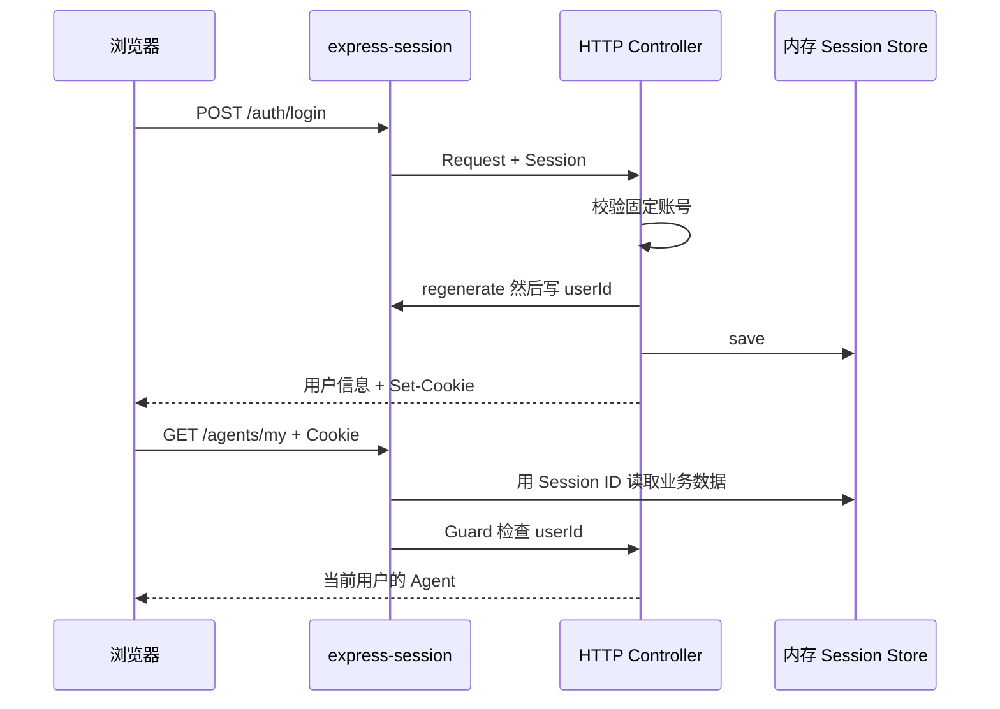

# NestJS Study 35：Session 与 AI SaaS 登录状态

用 `express-session` 实现一个本地 AI SaaS 的登录、个人 Agent、用户偏好和访问计数。
本章对应 Techniques 的 Session，重点是浏览器 Cookie 与服务端 Session 的协作，而不是实现完整账号系统。

## 为什么需要 Session

HTTP 的两次请求天然不共享“当前用户”。React 页面登录后，再请求“我的 Agent”，后端仍需要识别请求来自谁。
本章登录成功后在服务端保存 `userId`，浏览器只保留带签名的 Session ID；后续请求携带 Cookie，Session 中间件恢复对应数据。

学习目标：

- 理解 Cookie 中的 Session ID 与 Session Store 中业务数据的区别。
- 理解 `@Session()`、`@Req()` 和 Guard 如何读取同一份会话。
- 登录后为什么重新生成 ID，为什么等待 `save()` 完成。
- 区分 `destroy()` 删除服务端记录与 `clearCookie()` 清理客户端凭据。
- 理解 HttpOnly、SameSite、Secure 的作用与教学环境边界。

## 目录结构

```text
src/
├── main.ts                         # session 中间件、Cookie 配置、ValidationPipe
├── app.module.ts                   # Config/Auth/Agents/Sessions 模块
├── auth/
│   ├── auth.controller.ts          # 登录、当前用户、退出
│   ├── auth.service.ts             # 两个固定学习账号
│   ├── session.guard.ts            # 检查 Session 中的 userId
│   ├── session.types.ts            # 扩展 express-session SessionData
│   └── dto/login.dto.ts            # 邮箱、密码格式验证
├── agents/                         # 按会话用户过滤“我的 Agent”
└── sessions/                       # 偏好、访问次数、会话 ID 重新生成
.env.example                        # 本地练习用配置示例
```

## 一次登录如何流转



登录由 AuthController 处理；“我的 Agent”由 AgentsController/AgentsService 处理，后者使用 Guard 检查同一个服务器会话。

## 核心实现原理

### 中间件必须先于 Controller 运行

[main.ts](./src/main.ts) 注册 session，再注册全局参数验证：

```ts
session({
  name: 'agent.sid',
  secret,
  resave: false,
  saveUninitialized: false,
  cookie: { httpOnly: true, secure: isProduction,
    sameSite: 'lax', maxAge: 3600000, path: '/' },
});
```

`saveUninitialized: false` 避免为没有会话数据的访客创建空记录；`resave: false` 避免无修改时强制重存。
当前默认 Store 是 express-session 自带的 MemoryStore，仅用于单进程学习，重启即丢失。
它没有使用 Redis，也不与 Study 29 的自定义 Map 会话实现共享任何数据。

`secret` 用于签名 ID，不是加密全部业务数据。用户偏好和登录状态保存在服务端，不直接放进 Cookie。

### 登录与 ID 轮换

[AuthController](./src/auth/auth.controller.ts) 先校验账号，然后等待 `request.session.regenerate()`。
新的会话中写入 `userId` 和 `loginAt`，再等待 `save()` 后响应，避免立即跳转发出后续请求时尚未保存。
这也让登录前的旧 Session ID 不会沿用到登录状态。

`POST /session/regenerate` 则保留已有 userId、loginAt 和 preferences，主动轮换 ID；访问计数不保留。
这只是会话标识轮换，不是重新验证密码。

### 类型扩展与运行机制不是一回事

[session.types.ts](./src/auth/session.types.ts) 通过模块声明扩展 `SessionData`。
`@Session()` 参数采用 `ExpressSession & Partial<SessionData>`，既保留 `save/regenerate` 等方法，又准确描述可选业务字段。
TypeScript 声明不会自动给运行时创建数据；真正的值来自中间件与登录操作。

[SessionGuard](./src/auth/session.guard.ts) 检查服务器会话中的 userId，个人 Agent 查询使用这个 ID 过滤。
客户端即使在请求体或查询参数里伪造另一个 userId，也不会改变该查询使用的用户身份。

### 登出需要清理两端

`destroy()` 成功后，再 `response.clearCookie('agent.sid', ...)`。
清理时沿用 `/` 路径及 Cookie 属性，不传入原来的 maxAge。删除服务器记录后，旧 ID 不能恢复登录状态。

HttpOnly 阻止普通页面 JavaScript 读取 Cookie；SameSite=Lax 限制部分跨站发送；生产环境设置 Secure，只通过 HTTPS 发送。
这些属性不构成完整 CSRF 防护，也不能替代服务端授权。

## 如何运行

建议 Node.js 24、pnpm 12。依赖包含 NestJS `^12.0.1`、express-session `^1.19.0`、TypeScript `^6.0.2`，以本目录锁文件为准。
无需数据库、Redis、Docker或模型密钥。

```bash
cd nestjs-study-35
pnpm install --frozen-lockfile
cp .env.example .env
pnpm start:dev
```

`SESSION_SECRET` 必须至少 32 个字符，未配置时应用主动拒绝启动。
示例 secret 公开且仅用于本地练习，生产环境必须替换，不能当作部署凭据。
默认端口 3000；可使用 `PORT=3035 pnpm start:dev`。

```bash
pnpm build
pnpm exec tsc --noEmit --incremental false
pnpm lint
pnpm test
pnpm test:e2e
```

e2e 从真实 main 启动应用，分别验证两个用户的数据、偏好、ID 轮换、Cookie 清理和非法请求。

## 实际 API

| Method | Endpoint | 功能 |
| --- | --- | --- |
| POST | `/auth/login` | 校验邮箱和密码，创建登录状态 |
| GET | `/auth/me` | 当前用户，需登录 |
| POST | `/auth/logout` | 删除会话并清理 Cookie |
| GET | `/agents/my` | 当前会话用户的 Agent |
| GET | `/session/info` | 当前 ID、userId、loginAt |
| GET | `/session/preferences` | 默认或已保存的偏好 |
| POST | `/session/preferences` | 保存 theme、language |
| GET | `/session/visits` | 累加当前会话访问次数 |
| POST | `/session/regenerate` | 轮换 ID，保留登录和偏好 |

除登录和退出外，上述接口均由 SessionGuard 保护。脚手架根 Controller 没有注册，不需要验证 `/`。

## HTTP 验证

用 Cookie jar 模拟浏览器保存和携带 Cookie；后续会轮换 ID 的请求同时使用 `-b` 和 `-c`。

```bash
curl -i http://localhost:3000/agents/my
curl -i -c /tmp/study35.cookies \
  -X POST http://localhost:3000/auth/login \
  -H 'Content-Type: application/json' \
  -d '{"email":"robin@example.com","password":"123456"}'
curl -b /tmp/study35.cookies http://localhost:3000/auth/me
curl -b /tmp/study35.cookies http://localhost:3000/agents/my
curl -b /tmp/study35.cookies http://localhost:3000/session/info
```

未登录返回 401。登录返回 201 和 `agent.sid` Cookie；Robin 的 userId 为 1001，只能查询到归属 1001 的两个 Agent。
另一个学习账号是 `alan@example.com` / `123456`，只返回归属 1002 的 Agent。密码明文固定仅为演示，不能用于生产。

```bash
curl -b /tmp/study35.cookies -c /tmp/study35.cookies \
  -X POST http://localhost:3000/session/preferences \
  -H 'Content-Type: application/json' -d '{"theme":"dark","language":"en"}'
curl -b /tmp/study35.cookies http://localhost:3000/session/preferences
curl -b /tmp/study35.cookies http://localhost:3000/session/visits
curl -b /tmp/study35.cookies http://localhost:3000/session/visits
curl -b /tmp/study35.cookies -c /tmp/study35.cookies \
  -X POST http://localhost:3000/session/regenerate
curl -b /tmp/study35.cookies http://localhost:3000/session/preferences
curl -i -b /tmp/study35.cookies -c /tmp/study35.cookies \
  -X POST http://localhost:3000/auth/logout
curl -i -b /tmp/study35.cookies http://localhost:3000/auth/me
```

偏好保存后为 dark/en；访问次数依次 1、2；轮换后 ID 改变但偏好保留。
退出响应含过期 Cookie，随后 `/auth/me` 返回 401。

```bash
curl -i -X POST http://localhost:3000/auth/login \
  -H 'Content-Type: application/json' \
  -d '{"email":"robin@example.com","password":"wrong-password"}'
```

账号密码不匹配返回 401；不符合 LoginDto 的邮箱/短密码返回 400。

## 常见问题、阅读与练习

本地 HTTP 下设置 `NODE_ENV=production` 会启用 Secure，浏览器不会按普通 HTTP 登录流程保存有效 Cookie。
跨域前端还涉及 credentials、CORS、SameSite 与 HTTPS 配置，本章没有配套跨域前端。

推荐依次阅读 [main.ts](./src/main.ts) → [session.types.ts](./src/auth/session.types.ts) →
[auth.controller.ts](./src/auth/auth.controller.ts) → [session.guard.ts](./src/auth/session.guard.ts) →
[agents.service.ts](./src/agents/agents.service.ts) → [sessions.controller.ts](./src/sessions/sessions.controller.ts)。
先看会话如何建立，再看谁有权读取它。

1. 登录前后对比 Session ID，再用旧 Cookie 请求受保护接口。
2. 为 Session 增加一个可选偏好字段，同时补类型和运行验证。
3. 调小 Cookie maxAge，观察客户端过期与服务端登录状态的关系。
4. 重启进程后再次携带旧 Cookie，解释 MemoryStore 的限制。

真实项目应使用适合多实例的 Session Store、密码散列、登录限流、CSRF 策略和细粒度业务授权。
本章不提供生产账号系统；重点是会话的建立、读取、轮换和销毁。
`/session/info` 与 `/session/regenerate` 返回完整 Session ID 仅供观察轮换；生产接口不应回传完整 ID，日志也应脱敏。

## 官方参考

- [中文 Session](https://docs.nestjs.cn/techniques/sessions/)
- [官方 Session](https://docs.nestjs.com/techniques/session)
- [Techniques 总目录](https://docs.nestjs.cn/techniques/)
