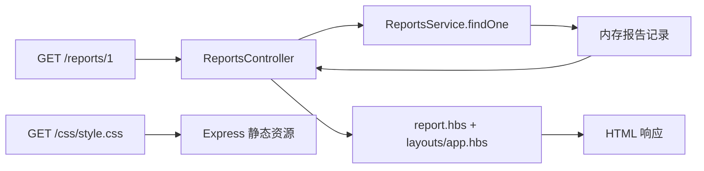

# NestJS Study 36：MVC 与研究报告页面

使用 Nest + Express + Handlebars，直接在服务端渲染一个 AI 研究报告展示站。
本章对应 Techniques 的 MVC：与 React 客户端先拿 JSON 再渲染不同，本例的 Controller 返回模板数据，服务器发送完整 HTML。

## 项目介绍与学习目标

平台展示三份预置研究报告，包括首页统计、列表、详情、打印页和 JSON 查看接口。
内容来自内存固定数据，没有真正生成 AI 报告，没有数据库，也没有客户端 React 应用。

希望理解：

- Service 提供数据、Controller 选择页面、View 负责 HTML 展示的职责。
- `@Render()` 的返回对象为什么成为模板上下文。
- Layout 与独立打印模板如何选择。
- 静态 CSS、模板文件为何必须随构建产物发布。
- HTML 默认转义与直接输出用户内容的区别。

## 目录结构

```text
src/
├── main.ts                        # Express 视图引擎、静态目录、全局 Layout
├── app.module.ts                  # 装配 HomeModule、ReportsModule
├── home/
│   ├── home.module.ts
│   └── home.controller.ts         # 首页 @Render('index')
└── reports/
    ├── reports.module.ts
    ├── reports.controller.ts      # HTML/JSON/动态渲染路由
    ├── reports.service.ts         # 三份固定研究报告
    └── report.interface.ts
views/
├── layouts/app.hbs                # 共享页面框架
├── index.hbs                      # 首页
├── reports.hbs                    # 列表
├── report.hbs                     # 详情
├── report-print.hbs               # 不使用 Layout 的打印页
└── report-generating.hbs          # generating 状态预览
public/css/style.css               # 静态样式
nest-cli.json                      # 将模板和 CSS 复制到 dist
```

模板目录只放 `.hbs`，Controller 位于 `src/`，因此 TypeScript 编译和模块引用都能找到它。

## 页面生成流程



访问 `/reports/1/raw` 时跳过模板，返回同一份业务数据的 JSON。
这样可以直接比较“数据接口”和“服务端页面”两种响应。

## 核心实现原理

### Controller 返回数据，模板决定展示

[ReportsController](./src/reports/reports.controller.ts) 的详情路由：

```ts
@Get(':id')
@Render('report')
findOne(@Param('id', ParseIntPipe) id: number) {
  return { report: this.reportsService.findOne(id) };
}
```

`@Render('report')` 告诉 Nest 用 `report.hbs` 渲染返回对象。
模板里的 `{{report.title}}` 对应 `report` 字段，不是重新从服务端请求数据。
`ParseIntPipe` 在 Service 前处理字符串 ID；缺失报告由 Service 抛出 404。

[HomeModule](./src/home/home.module.ts) 导入并使用 ReportsModule 导出的 Service，首页统计和列表共用同一个数据源。
不用在首页 Controller 中复制一份报告数组。

### 全局 Layout 与打印页

[main.ts](./src/main.ts) 注册 `hbs` 引擎，并用当前 Nest Express API `app.setLocal('layout', 'layouts/app')` 设置共享布局。
Layout 中的 `{{{body}}}` 是 hbs 插入已经渲染的页面片段的位置。

打印页返回 `{ report, layout: false }`，使用自己的 HTML 文档，不嵌入导航和共享样式。
`@Res()` 的 preview 方法则调用 `response.render()` 动态选择模板：completed 使用 report，generating 使用 report-generating。

当前三份报告都为 completed，没有“开始生成”接口。
生成中模板是状态分支示例；可以在 Service 中把一项 status 改为 generating 后刷新 `/preview` 观察。
它没有后台异步任务，不应把显示“生成中”理解为实际开始生成。

### 为什么构建需要复制文件

TypeScript 只编译 `.ts`，不会自动把 `.hbs` 和 `.css` 放进 dist。
[nest-cli.json](./nest-cli.json) 显式配置这两类资源。
资源 `include` 相对 `sourceRoot: src`，所以当前根目录下的 views/public 使用 `../views/**/*.hbs` 和 `../public/**/*`。

运行时使用 `join(import.meta.dirname, 'views')` 与 `'public'`。
构建后 `import.meta.dirname` 是 dist 目录，因此从其他工作目录启动绝对路径的 `dist/main.js`，仍能找到页面和 CSS。
这里需要支持 `import.meta.dirname` 的 Node，建议 Node 24。

### 模板里的内容是否安全

`{{report.content}}` 默认转义 HTML。当前 `<pre>` 展示的是纯文本，不会把 Markdown 转成 HTML。
不要为实现 Markdown 随意改成 `{{{report.content}}}`，那会让未清理的内容成为 HTML。
Layout 的 body 是框架渲染片段，与来自用户或模型的原始文本有不同信任边界。

## 如何运行

建议 Node.js 24、pnpm 12。NestJS 声明 `^12.0.1`、hbs `^4.4.0`、TypeScript `^6.0.2`。
无需 `.env`、模型账号、数据库、Redis或Docker。

```bash
cd nestjs-study-36
pnpm install --frozen-lockfile
pnpm start:dev
```

浏览器打开 `http://localhost:3000`，进入报告列表、详情与打印页。
端口冲突时使用 `PORT=3036 pnpm start:dev`。

```bash
pnpm build
pnpm start:prod
```

部署时需要整个 dist，不能只复制 `.js`；确认包含 dist/views 和 dist/public。

```bash
pnpm exec tsc --noEmit --incremental false
pnpm lint
pnpm test
pnpm test:e2e
```

业务 e2e 从临时工作目录启动真实应用，验证 HTML、CSS、JSON和打印布局；另测试 generating 状态的模板分支。

## 实际 API / 页面

| Method | Endpoint | 返回内容 |
| --- | --- | --- |
| GET | `/` | 首页 HTML，报告总数 3 |
| GET | `/reports` | 报告列表 HTML |
| GET | `/reports/:id` | 详情 HTML |
| GET | `/reports/:id/print` | 独立打印 HTML |
| GET | `/reports/:id/raw` | 原始报告 JSON |
| GET | `/reports/:id/preview` | 按状态选择模板 |
| GET | `/css/style.css` | 静态 CSS |

## HTTP 验证

```bash
curl -i http://localhost:3000/
curl -i http://localhost:3000/reports
curl -i http://localhost:3000/reports/1
curl -i http://localhost:3000/reports/1/print
curl -i http://localhost:3000/reports/1/raw
curl -i http://localhost:3000/reports/1/preview
curl -i http://localhost:3000/css/style.css
```

页面接口为 200、Content-Type 为 HTML；raw 为 JSON；CSS有相应样式类型。
详情页包含共享导航与 CSS 链接，打印页使用独立文档。

```bash
curl -i http://localhost:3000/reports/abc
curl -i http://localhost:3000/reports/999999
```

非数字 ID 返回 400，不存在的数字 ID 返回 404。
若只用 curl，能验证 HTML内容与响应头；打印排版与页面视觉仍需在浏览器观察。

## 常见问题

- “Failed to lookup view”：确认运行过 build，模板已进入 dist/views，且部署没有漏复制资源。
- 页面有字但没有样式：检查 `/css/style.css` 是否返回 200，以及 dist/public/css 是否存在。
- Markdown 没有变成标题：本例按纯文本展示，尚未实现 Markdown 渲染器。
- 修改 generating 没效果：访问 `/reports/:id/preview`；普通详情始终选择 report 模板。

## 推荐阅读顺序与练习

先读 [main.ts](./src/main.ts) 和 [nest-cli.json](./nest-cli.json)，确认模板如何被找到；
再读 [reports.service.ts](./src/reports/reports.service.ts) → [reports.controller.ts](./src/reports/reports.controller.ts) →
[report.hbs](./views/report.hbs) → [layouts/app.hbs](./views/layouts/app.hbs)，沿一条请求追踪数据到页面。
最后阅读 HomeModule，理解跨模块复用 Service。

1. 增加一个报告摘要字段并在列表展示，保持模板和 JSON 都能使用。
2. 将一份报告改为 generating，对比 preview 与普通详情。
3. 给报告标题加入 `<script>` 文本，观察默认转义，不改成三花括号。
4. 构建后从其他目录启动 dist/main.js，确认资源不依赖当前目录。

## 企业级应用思考

真实项目可能把报告存数据库，异步生成后再更新状态；页面也可以由独立前端消费 API。
本例保留服务端模板，有助于理解低交互后台、邮件内容或简单报表页面的另一种实现路径。
没有账号、真实生成任务、缓存、数据库或 Markdown HTML 清理流程。

## 官方参考

- [中文 MVC](https://docs.nestjs.cn/techniques/mvc/)
- [官方 MVC](https://docs.nestjs.com/techniques/mvc)
- [Techniques 总目录](https://docs.nestjs.cn/techniques/)
