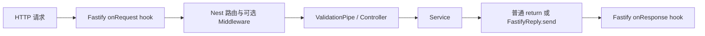

# NestJS Study 37：Fastify 适配器与 AI API

把 Agent 查询、模拟研究和响应大小示例运行在 Fastify 上，学习 Nest 与底层 HTTP 平台之间的边界。
对应 Techniques 的 Performance（Fastify），本项目展示适配方式和验证入口，没有宣称完成性能基准测试。

## 为什么学习 Fastify

Nest 的 Module、Service 和多数 Controller 不依赖 Express。
通过替换 HTTP Adapter，可以保留大部分业务代码，同时使用 Fastify 的请求、响应和插件能力。
真实选择还要考虑插件兼容性和实际负载，不能只根据框架名称推断业务吞吐量。

学习目标：

- `FastifyAdapter` 如何成为 Nest 的 HTTP 执行平台。
- 平台无关的普通 return 与平台专用 `@Req()` / `@Res()` 有什么差别。
- Fastify 原生 hook 与 Nest Middleware 如何参与请求。
- 如何在真实 Fastify 实例上验证 DTO、状态码和原生响应。
- 如何区分可运行的性能观察接口与可比较的压测结果。

## 实际场景与结构

预置三个 Agent 和三个模型目录，`POST /agents/research` 等待约 1 秒后返回固定研究结果。
性能模块分别返回小型 JSON、1000 项大型 JSON 和平台信息，便于观察序列化与传输，不调用真实模型。

```text
src/
├── main.ts                         # 创建 FastifyAdapter、注册 hook/ValidationPipe
├── app.module.ts                   # 装配全部业务模块，保留根路由
├── agents/
│   ├── agents.controller.ts        # 列表、详情、研究
│   ├── agents.service.ts          # 内存 Agent 与模拟研究
│   └── dto/research.dto.ts         # 研究主题长度验证
├── models/                        # 内存模型目录
└── performance/
    ├── performance.module.ts      # 绑定请求日志 Middleware
    ├── logger.middleware.ts       # 原始 Node 请求/响应上的耗时日志
    ├── performance.controller.ts  # 普通 return 与 Fastify Request/Reply
    └── performance.service.ts     # 大小 JSON、平台元数据
```

## 请求流程



LoggerMiddleware 只绑定 `/performance/*path`，不是所有请求都会输出它的日志。
原生 hooks 在 main 中注册；测试中的 `FastifyAdapter.inject()` 直接验证同一种 HTTP 平台，无需占用固定端口。

## 核心实现原理

### 适配器是业务与平台的连接点

[main.ts](./src/main.ts) 使用真实适配器实例：

```ts
const adapter = new FastifyAdapter();
const app = await NestFactory.create<NestFastifyApplication>(
  AppModule, adapter,
);
const fastify = adapter.getInstance();
```

将实例保留下来，注册 hook 时的 request/reply 类型直接从它推导。
锁文件中适配器内部 Fastify 与顶层 `fastify` 可能解析为不同补丁版本；不要强制把整个实例断言为另一个版本的复杂类型。
当前做法不需要 `any`、关闭 strict 或升级依赖。

`NestFastifyApplication` 让应用层 API 具有 Fastify 适配器的类型，实际平台仍由第二个参数决定。
只修改 TypeScript 类型，不传适配器，并不会把 Express 改成 Fastify。

### 普通响应与原生响应

[AgentsController](./src/agents/agents.controller.ts) 直接返回 Service 结果，Nest 负责响应处理，这部分几乎不依赖底层平台。

[PerformanceController](./src/performance/performance.controller.ts) 的原生响应示例：

```ts
@Get('reply')
getReply(@Res() reply: FastifyReply) {
  return reply.code(200)
    .header('X-AI-Platform', 'Fastify')
    .send({ message: 'Fastify Reply Example' });
}
```

这里使用 Fastify 的 `code()`、`header()`、`send()`，不能照搬 Express 的 `response.status()`。
使用完整 `@Res()` 后，这个方法自己负责完成响应；不要再等待 Nest 把普通返回值写第二次。
普通业务接口优先采用直接 return，确实需要平台能力时再使用原生对象。

### Hook、Middleware 与日志

`onRequest/onResponse` 是 Fastify 生命周期 hook；main 中使用 `request.log.info()` 演示平台日志入口。
当前 `new FastifyAdapter()` 没有启用 Fastify 原生 logger，因此这些调用默认不会显示 Pino 输出。
想观察该日志可在练习时启用适配器 logger；这是与 Nest Logger 不同的配置。

[LoggerMiddleware](./src/performance/logger.middleware.ts) 操作 Node IncomingMessage/ServerResponse，并监听 `finish` 记录耗时。
它适用于当前 HTTP 请求日志教学，不是分布式追踪，也不会测量真实 AI 模型处理性能。

### 验证仍由 Nest 完成

全局 ValidationPipe 验证 `ResearchDto`，主题长度为 3–200。
`ParseIntPipe` 处理 Agent ID，找不到记录返回 404。
Service 的模拟 1 秒等待会直接影响响应耗时，不能把该耗时归结为 Fastify 的框架开销。

## 如何运行

建议 Node.js 24、pnpm 12。Nest core 声明 `^12.0.1`，platform-fastify `^12.3.2`，顶层 fastify `^5.12.8`，TypeScript `^6.0.2`。
具体安装结果以本项目锁文件为准。没有数据库、Redis、Docker、环境变量文件或模型密钥要求。

```bash
cd nestjs-study-37
pnpm install --frozen-lockfile
pnpm start:dev
```

监听 `127.0.0.1:3000`；可用 `PORT=3037 pnpm start:dev` 改端口。
容器映射端口时还需根据环境调整监听 host，当前默认专供本地访问。

```bash
pnpm build
pnpm exec tsc --noEmit --incremental false
pnpm lint
pnpm test
pnpm test:e2e
```

业务 e2e 先构建源码，再创建真实 FastifyAdapter，用 inject 验证平台标识、原生响应头、列表与输入验证。
没有使用 Express 适配器替代 Fastify，也没有伪造性能测试结论。

## 实际 API

| Method | Endpoint | 功能 |
| --- | --- | --- |
| GET | `/` | 保留的 Hello World |
| GET | `/agents` | 三个 Agent |
| GET | `/agents/:id` | Agent 详情 |
| POST | `/agents/research` | 模拟研究，body 包含 topic |
| GET | `/models` | 三个模拟模型 |
| GET | `/performance/json` | 小型 JSON |
| GET | `/performance/large` | 1000 项 Agent JSON |
| GET | `/performance/info` | 平台、Node、进程信息 |
| GET | `/performance/request` | Fastify Request 的部分字段 |
| GET | `/performance/reply` | Fastify Reply 设置响应头并发送 |

## HTTP 验证

```bash
curl http://localhost:3000/agents
curl http://localhost:3000/models
curl http://localhost:3000/performance/info
curl -i http://localhost:3000/performance/reply
curl -H 'User-Agent: study37-client' \
  http://localhost:3000/performance/request
curl -X POST http://localhost:3000/agents/research \
  -H 'Content-Type: application/json' -d '{"topic":"LangGraph Agent"}'
```

info 的 adapter 应为 `fastify`；reply 包含 `X-AI-Platform: Fastify`；request 返回发送的 User-Agent。
研究返回 201，约 1 秒后得到固定结果。

```bash
curl -i http://localhost:3000/agents/abc
curl -i http://localhost:3000/agents/999999
curl -i -X POST http://localhost:3000/agents/research \
  -H 'Content-Type: application/json' -d '{"topic":"x"}'
curl -s -o /dev/null -w 'bytes=%{size_download} time=%{time_total}\n' \
  http://localhost:3000/performance/large
```

前两项分别为 400、404，短主题为 400。最后一条仅观察单次下载大小/时间；这不构成并发基准测试。

## 推荐阅读顺序

1. [main.ts](./src/main.ts)：确认实际创建了 FastifyAdapter。
2. [app.module.ts](./src/app.module.ts)：确认业务模块都进入运行图。
3. [agents.controller.ts](./src/agents/agents.controller.ts)：看平台无关写法。
4. [performance.controller.ts](./src/performance/performance.controller.ts)：对比原生 request/reply。
5. [performance.module.ts](./src/performance/performance.module.ts)、[logger.middleware.ts](./src/performance/logger.middleware.ts)：追踪日志绑定范围。
6. [test/app.e2e-spec.ts](./test/app.e2e-spec.ts)：看 Fastify inject 如何验证真实响应。

## 常见问题与练习

Express 中间件不一定能直接用于 Fastify；涉及 Cookie、Session、压缩、上传时需要检查对应 Fastify 插件。
此前 Study 的 Multer FileInterceptor 是 Express 路径，不应不加判断地复制到这里。

1. 启用适配器 logger，对比原生 hook 日志与 Nest Middleware 日志。
2. 为普通 return 路由增加响应头，与原生 Reply 示例比较代码耦合。
3. 改变 large 的项目数量，观察响应大小；保持数据一致再设计两种适配器的公平压测。
4. 为新业务路由增加 DTO，并通过 inject 验证非法请求。

真实应用评估性能需固定数据、Node版本、日志配置、并发与运行机器，并报告误差。
本项目不提供“Fastify 一定快多少”的结论；平台选择的价值也包括生态、兼容性和维护成本。
Agent、模型目录和研究输出均为 Mock，没有持久化或真实模型调用。

## 官方参考

- [中文 Performance / Fastify](https://docs.nestjs.cn/techniques/performance/)
- [官方 HTTP adapters / Fastify](https://docs.nestjs.com/techniques/performance)
- [Techniques 总目录](https://docs.nestjs.cn/techniques/)
