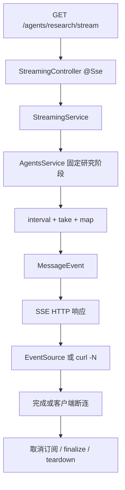

# NestJS Study 38：SSE 与 AI Agent 流式生成

用模拟 Deep Research 阶段、Token 输出、心跳和会话清理，学习 Server-Sent Events。
对应 Techniques 的 SSE。本章没有连接真实大模型；Observable 的定时事件代表生成过程，重点是 HTTP 事件格式和连接生命周期。

## 为什么用 SSE

研究任务可能需要数秒甚至更久。与等待一个最终 JSON 相比，页面可以逐步显示“规划、搜索、分析、生成、完成”。
SSE 在一条 HTTP 响应上从服务器持续发送事件，适合单向进度和文本输出。
它不提供双向聊天通道，也不会自动把业务任务变成可靠的后台任务。

学习目标：

- `@Sse()` 如何把 Observable 的值写成 `text/event-stream`。
- `MessageEvent` 的 data、type、id 如何对应浏览器事件。
- `take()`、`concat()`、`complete()` 如何结束有限流。
- Observable teardown 与 `finalize()` 如何释放定时器、会话。
- 当前 Nest 12 的 `@SseSignal()` 如何感知异步初始化期间的断连。
- 区分“SSE 连接断开”和“AI 任务取消”，理解自动重连的影响。

## 实际结构

```text
src/
├── main.ts
├── app.module.ts                        # 注册 StreamingModule，保留根路由
├── agents/
│   ├── agent.interface.ts               # Agent 和研究阶段类型
│   ├── agents.module.ts                 # 导出模拟业务 Service
│   └── agents.service.ts                # 固定阶段与 Token 数组
└── streaming/
    ├── streaming.module.ts              # 连接业务 Provider 与 HTTP Controller
    ├── streaming.controller.ts          # 六种 SSE 路由和异步 Session 示例
    ├── streaming.service.ts             # 阶段、Token、心跳、清理、错误流
    └── streaming.interface.ts           # 可阅读的事件数据类型定义
```

`streaming.interface.ts` 保留事件结构的学习类型；当前 Service 直接返回 Nest `MessageEvent`，不要把定义接口误认为运行时验证。
AgentsService 的列表数据没有对应的 `/agents` 查询路由，不能凭 Service 方法推断 HTTP API。

## 流式执行流程



## 核心实现原理

### Observable 的一个值就是一个事件

[streamResearch()](./src/streaming/streaming.service.ts) 每秒取一个阶段，发送：

```ts
return {
  id: String(index + 1),
  type: stage.stage === 'completed' ? 'completed' : 'progress',
  data: { stage: stage.stage, message: stage.message,
    progress: Math.round(((index + 1) / stages.length) * 100),
    timestamp: new Date().toISOString() },
};
```

Nest 将 type 写成 `event:`、id 写成 `id:`、data 序列化成 `data:`。
这里的 MessageEvent 来自 `@nestjs/common`，不是浏览器 DOM MessageEvent 类型。
五个阶段由 `take(5)` 自动完成，最后事件的进度为 100。

### Token、结束与失败

Token 流每 300 毫秒发送一项，共 10 项，再用 `concat(tokenStream, of(completedEvent))` 追加完成事件。
它是固定数组的拆分演示，不是已经接入模型 SDK。

错误示例先发送 started，约 2 秒后发送 failed（AI_MODEL_TIMEOUT）并 complete。
这是应用自定义的业务失败事件，HTTP 连接正常结束；它与浏览器 EventSource 的网络 `error` 回调不是同一个事件名。
响应头已发出后，不能再把流中业务失败当作一个新的普通 HTTP 500 JSON 响应。

### 断连后到底清理什么

`streamCleanup()` 创建 setInterval，并返回 teardown 函数。
Nest 在客户端断连时取消订阅，该函数 `clearInterval()` 并记录“定时器已清理”。
有限流完成或发生取消订阅时，`finalize()` 同样可以处理收尾。

这只证明本例持有的资源被清理。本章没有独立 BullMQ Job 或真实模型请求，不能推导“断开 SSE 必然取消所有后端任务”。
生产任务如果要继续后台运行，应把任务生命周期与连接分开，并使用任务 ID 查询或重新订阅进度。
需要取消上游模型时，还必须由 SDK/HTTP 调用实际接收并处理 AbortSignal。

### 异步初始化期间也可能断连

[session()](./src/streaming/streaming.controller.ts) 使用当前安装版本支持的 `@SseSignal()`：

```ts
const session = await this.createAiSession();
if (signal.aborted) {
  await session.close();
  return EMPTY;
}
```

Mock 初始化会等 2 秒，**没有把 signal 传入初始化函数**。
因此初始化期间断连不会停止这个等待；创建结束后检测 aborted，再立即释放会话。
初始化成功且客户端仍连接时，Observable 先发送 started，再每秒发送 progress，取消订阅会清理 timer，finalize 关闭 session。

这里 close() 仅输出释放日志，代表 Mock 资源释放。对真实异步资源还需处理关闭失败与 SDK 自身的取消能力。
旧版本 Nest 可能没有 SseSignal；本项目按锁文件中的 Nest 12 API 编写，不应根据旧教程删除它。

## 如何运行

建议 Node.js 24、pnpm 12。NestJS 声明 `^12.0.1`，TypeScript `^6.0.2`，使用本目录锁文件解析版本。
无需数据库、Redis、Docker、模型账号或 `.env`。

```bash
cd nestjs-study-38
pnpm install --frozen-lockfile
pnpm start:dev
```

端口默认 3000，可使用 `PORT=3038 pnpm start:dev`。

```bash
pnpm build
pnpm exec tsc --noEmit --incremental false
pnpm lint
pnpm test
pnpm test:e2e
```

业务 e2e 启动真实 main，读取完整 SSE 帧，并用 HTTP 客户端主动断连验证定时器清理、初始化中/初始化后的 Session 释放。

## 实际 API

| Method | Endpoint | 行为 |
| --- | --- | --- |
| GET | `/` | 保留的 Hello World |
| GET | `/agents/research/stream` | 约每秒一个研究阶段，五项后结束 |
| GET | `/agents/research/tokens` | 每 300ms 一个 Token，随后 completed |
| GET | `/agents/research/heartbeat` | 每 5 秒心跳，持续到断连 |
| GET | `/agents/research/cleanup` | 每秒进度，取消订阅清理定时器 |
| GET | `/agents/research/error` | started → failed → 结束 |
| GET | `/agents/research/session` | 等待 2 秒初始化，持续会话进度 |

## HTTP 验证

```bash
curl -N http://localhost:3000/agents/research/stream
curl -N http://localhost:3000/agents/research/tokens
curl -N http://localhost:3000/agents/research/error
```

`-N` 禁用 curl 输出缓冲。研究流包含四个 progress 和一个 completed；Token 流包含十个 token，再发 completed。
failed 是业务事件；curl 收到它后正常结束并不意味着业务成功。

```bash
curl -N --max-time 6 http://localhost:3000/agents/research/heartbeat
curl -N --max-time 3 http://localhost:3000/agents/research/cleanup
curl -N --max-time 1 http://localhost:3000/agents/research/session
curl -N --max-time 4 http://localhost:3000/agents/research/session
```

这些持续连接会被 curl 主动结束，返回超时退出码 28 属于预期。
观察应用终端：cleanup 应记录定时器清理；1 秒结束的 session 在约 2 秒初始化完成后记录释放，4 秒结束的在断连后释放。
不要期待初始化中断连立即取消模拟等待。

## 浏览器 EventSource 与重连

```js
const source = new EventSource('http://localhost:3000/agents/research/stream');
source.addEventListener('progress', event => console.log(JSON.parse(event.data)));
source.addEventListener('completed', event => {
  console.log(JSON.parse(event.data));
  source.close();
});
```

可在同源页面控制台运行。不同源页面需要配置 CORS，本例没有配套前端或跨域策略。
本例使用命名事件，不能只设置 onmessage。完成时主动 close，避免 EventSource 自动重连后重新开始一个新的模拟任务。
虽然发送了 id，但服务端没有实现 Last-Event-ID 恢复、任务持久化或断点续流；重连不等于继续旧任务。

## 常见问题与练习

没有持续输出时，先确认用 `curl -N`，再检查代理是否缓冲 SSE；不要给响应强行设置 Content-Length。
心跳首项在第 5 秒，session 首项在约第 2 秒，启动后短暂没有正文可能正常。

阅读顺序：[agents.service.ts](./src/agents/agents.service.ts) → [streaming.service.ts](./src/streaming/streaming.service.ts) →
[streaming.controller.ts](./src/streaming/streaming.controller.ts) → [streaming.module.ts](./src/streaming/streaming.module.ts) →
[test/app.e2e-spec.ts](./test/app.e2e-spec.ts)。先理解有限数据，再看它如何变成事件与资源生命周期。

1. 添加一个研究阶段，检查事件数量和最后的进度计算。
2. 改变 Token 间隔，观察客户端收到的时序，保留 completed。
3. 在 cleanup 中记录释放时间，对比客户端 Ctrl+C 的时间。
4. 设计按任务 ID 重新订阅的协议，说明需要保存什么状态；不必在本章实现队列或数据库。

## 企业级应用边界与参考

真实 Agent 可以由独立 Worker 执行，SSE 只订阅状态；可靠重连需要身份校验、任务归属、事件存储与恢复协议。
本章是连接绑定的内存模拟，既不保证后台可靠执行，也没有取消真实模型或多实例消息分发。

- [中文 SSE](https://docs.nestjs.cn/techniques/server-sent-events/)
- [官方 Server-Sent Events](https://docs.nestjs.com/techniques/server-sent-events)
- [Techniques 总目录](https://docs.nestjs.cn/techniques/)
