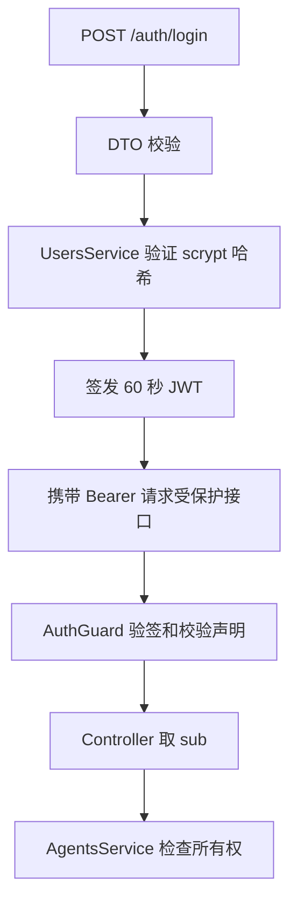

# NestJS Study 39：JWT 身份认证

用一个多用户 Agent 目录理解：登录、携带身份、检查资源所有权是三个不同步骤。本章使用真实 HS256 JWT 和 Node.js `scrypt` 密码哈希；Agent 执行只是 1.5 秒延迟模拟，不会访问任何模型 API。

## 学习目标与业务场景

- `JwtModule.registerAsync()` 从配置读取签名密钥；启动时拒绝缺失或过短的密钥。
- `APP_GUARD` 默认保护所有路由；`@Public()` 用元数据明确放行登录、目录和健康检查。
- JWT 验签后仍校验 `sub`、`username`、`role` 的结构，不能把类型参数当作运行时验证。
- 认证回答“你是谁”；`AgentsService.findOne()` 再比较 `userId`，回答“你能访问这条资源吗”。管理员角色也没有自动绕过本章的所有权判断。
- `APP_PIPE` 把 DTO 校验放在模块入口，HTTP 请求中的密码对象会返回 400，而不是进入 `scrypt` 引发 500。

## 项目结构与推荐阅读顺序

```text
src/
├── app.module.ts                    # 全局配置与 DTO 校验
├── auth/
│   ├── auth.module.ts               # JwtModule、APP_GUARD
│   ├── auth.guard.ts                # Bearer 解析、验签与声明校验
│   ├── auth.controller.ts           # 登录与个人资料
│   ├── auth.service.ts              # 密码验证与签发
│   ├── dto/login.dto.ts
│   └── public.decorator.ts          # 公开路由元数据
├── users/users.service.ts           # 启动时生成盐与 scrypt 哈希
├── agents/agents.service.ts         # 所有权与模拟执行
└── health/health.controller.ts
```

按 `app.module.ts → auth.module.ts → auth.guard.ts → auth.service.ts → users.service.ts → agents.controller.ts → agents.service.ts` 阅读。先弄清全局保护如何注册，再跟踪身份如何进入业务层。

## 核心实现

`AuthService.signIn()` 根据服务端用户记录创建 `{ sub, username, role }`，不接受客户端指定角色。令牌有效期固定为 60 秒，且验签只允许 HS256；`JWT_EXPIRES_IN` 不是当前实现的配置项。

`UsersService` 使用随机盐生成哈希，用 `timingSafeEqual()` 比较同长度结果。对外资料通过解构移除 `passwordHash`，公开目录也只返回展示字段。



## 启动

需要 Node.js 24、pnpm；不需要数据库、Redis 或真实 AI Key。项目使用 NestJS 12、TypeScript 6，独立安装自己的依赖。

```bash
pnpm install --frozen-lockfile
cp .env.example .env
export JWT_SECRET="$(node -e "process.stdout.write(require('node:crypto').randomBytes(32).toString('hex'))")"
pnpm start:dev
```

也可以将随机密钥填入本地 `.env` 的 `JWT_SECRET`。不要提交 `.env`。`PORT` 默认 3000，同时只启动一个使用该端口的 Study。

## 接口与验证

| Method | 路由 | 行为 |
|---|---|---|
| POST | `/auth/login` | 登录，200，返回 JWT |
| GET | `/auth/profile` | 当前用户资料 |
| GET | `/agents` | 公开展示目录 |
| GET | `/agents/my` | 当前用户的 Agent |
| GET | `/agents/:id` | 自己的 Agent 详情 |
| POST | `/agents/:id/run` | 模拟执行自己的 Agent |
| GET | `/health` | 公开健康检查 |

教学账号为 `robin / Robin123456!`、`alan / Alan123456!`、`admin / Admin123456!`，只保存在内存中。

```bash
curl http://localhost:3000/health
curl -i http://localhost:3000/agents/my
curl -s http://localhost:3000/auth/login -H 'Content-Type: application/json' \
  -d '{"username":"robin","password":"Robin123456!"}'
# 将上一步 access_token 赋给 TOKEN，须在 60 秒内使用
TOKEN='替换为登录响应中的 access_token'
curl http://localhost:3000/auth/profile -H "Authorization: Bearer $TOKEN"
curl -i http://localhost:3000/agents/3 -H "Authorization: Bearer $TOKEN"
curl -X POST http://localhost:3000/agents/1/run -H "Authorization: Bearer $TOKEN"
```

依次观察公开响应、未登录 401、登录 JWT、无密码哈希的个人资料、跨用户 403、模拟完成结果。过期后重新登录。

```bash
pnpm exec tsc --noEmit --incremental false
pnpm lint
pnpm test
pnpm test:e2e
pnpm build
pnpm start:prod
```

E2E 启动真正的 `dist/main.js`，覆盖验证失败、JWT、所有权和执行。`test:e2e` 会先构建，避免 Vitest 转译缺失装饰器元数据。

## 限制、练习与总结

本章没有注册、数据库、刷新令牌或撤销列表，固定教学账号不能作为生产身份系统。真实部署还需要 HTTPS、密钥管理和登录防滥用。`AppController` 是保留的模板练习文件，没有注册进业务模块，`GET /` 不是业务验证入口。

练习：将有效期调短观察过期；新增一个明确公开的接口；为禁用的 Agent 增加执行拒绝验证。重点掌握身份可信来源与资源所有权的先后顺序，下一章将比较不同授权粒度。

参考：[中文认证文档](https://docs.nestjs.cn/security/authentication/)、[官方认证文档](https://docs.nestjs.com/security/authentication)。
