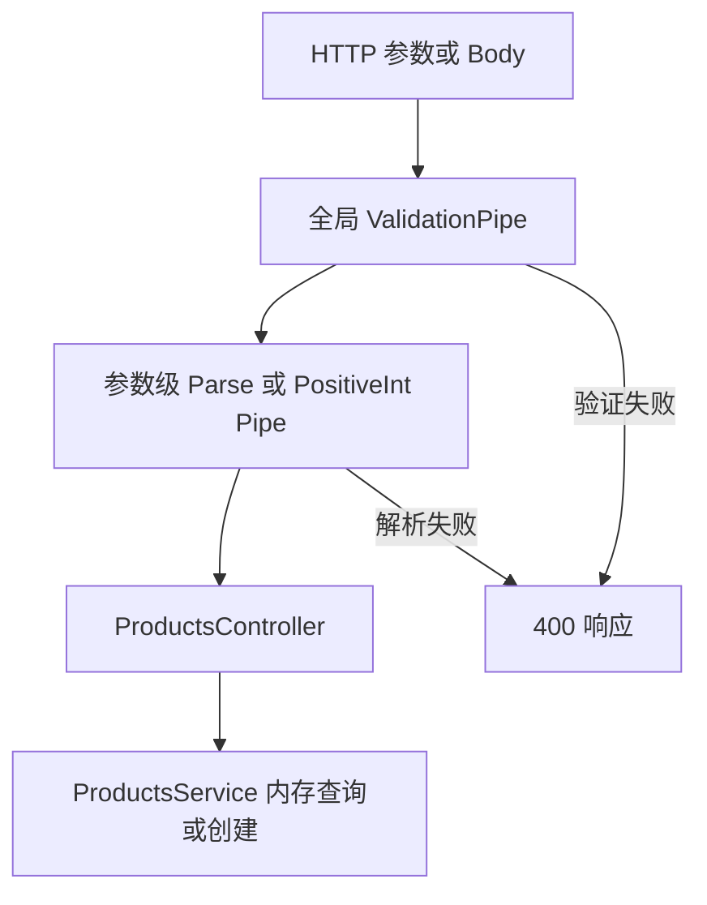

# Study 4：商品输入转换与验证管道

[返回学习路线](../README.md)

## 项目介绍

本章围绕商品查询与创建，分别观察路径、Query 和 Body 怎样经过 Pipe。你会看到：URL 的 `"false"` 不应直接按 JavaScript truthy 判断，能转为整数也不代表它一定是正整数，给 TypeScript 写好类型也不等于 HTTP 输入已经被验证。

## 学习目标

- 用内置 Parse 管道把外部文本转成业务方法需要的值，并观察非法输入的 400。
- 给缺省分页设置默认值，而不是在业务代码中到处判断 undefined。
- 用 DTO class 和 class-validator 约束商品输入，拒绝额外字段。
- 实现并实际绑定 `PositiveIntPipe`，比较类型解析与业务约束。
- 理解全局 Pipe 和参数 Pipe 的执行顺序。

## 真实业务场景

商品保存在内存，包含名称、价格、库存、状态和创建时间。支持列表、详情、按状态/最低价格筛选，以及创建商品；分页路由只回显解析后的 page/limit，不会对列表真的分页。`filter/active` 只回显转换结果，不筛选商品；真正状态筛选使用 `filter/status`。

没有数据库或外部服务；价格只是 JavaScript 数字的教学表示，没有货币精度方案；没有更新、删除或权限控制。

## 项目结构

```text
src/
├── products/
│   ├── dto/
│   │   └── create-product.dto.ts
│   ├── interfaces/
│   │   └── product.interface.ts
│   ├── pipes/
│   │   └── positive-int.pipe.ts
│   ├── schemas/
│   ├── products.controller.ts
│   └── products.service.ts
├── app.controller.spec.ts
├── app.controller.ts
├── app.module.ts
├── app.service.ts
└── main.ts
```

[AppModule](src/app.module.ts) 直接注册 ProductsController、ProductsService、PositiveIntPipe 和全局 APP_PIPE，没有额外 ProductsModule。根路径保留 Hello World 脚手架供对照。

## 核心知识讲解

### ParseInt 不等于正整数验证

[ProductsController](src/products/products.controller.ts) 的 `detail/:id` 用 `ParseIntPipe` 将字符串 ID 解析为整数；`positive/:id` 用 [PositiveIntPipe](src/products/pipes/positive-int.pipe.ts) 额外检查 `Number.isSafeInteger()` 和 `> 0`。

```ts
@Get('positive/:id')
findPositive(@Param('id', PositiveIntPipe) id: number): Product {
  return this.productsService.findOne(id);
}
```

自定义 Pipe 的 `transform(value, metadata)` 获得原值和来源信息，成功返回转换后的值，失败抛 `BadRequestException`。本例用 `Number()` 的转换语法，所以 `1.0` 会成为整数 1；它并不是限定十进制文本形式的正则解析器。

### 默认值和转换是两件事

分页参数使用 `new DefaultValuePipe(1), ParseIntPipe`：先补缺省值，再解析。默认值不会把 `page=abc` 自动纠正为 1。这个路由只演示解析，不限制正数或实际分页。

`ParseEnumPipe(ProductStatus)` 只允许 `active`、`inactive`；`ParseBoolPipe` 只允许 true/false。状态枚举是运行时的值，因此使用普通导入；`Product` interface 只用于类型，使用 `import type`，以兼容 NodeNext、isolatedModules 和装饰器元数据。

### DTO 不是任意对象上的类型标签

[CreateProductDto](src/products/dto/create-product.dto.ts) 声明：name 至少两个字符、price 是非负数字、stock 是非负整数、status 属于枚举。Body 的 price 必须是 JSON 数字，`"100"` 不会被自动当作合法价格。

[AppModule](src/app.module.ts) 在全局注册：

```ts
{
  provide: APP_PIPE,
  useValue: new ValidationPipe({
    whitelist: true,
    forbidNonWhitelisted: true,
    transform: true,
  }),
}
```

`whitelist` 以验证装饰器为依据判断允许字段；搭配 `forbidNonWhitelisted` 后遇到 `id` 等额外字段直接报错。DTO 是运行时 class，interface 无法替代这些验证元数据。

### 为什么 active 参数写 unknown

全局 `ValidationPipe({ transform: true })` 先于参数级 `ParseBoolPipe`。在当前安装的 Nest 12.3.2 中，如果参数的设计类型是 Boolean，全局转换会把非 `true` 值转成 `false`，包括 `active=no`；后面的 ParseBoolPipe 就收不到非法原始文本。

本例在该入口用 `active: unknown` 保留原值，交给显式绑定的 ParseBoolPipe 先验证，再返回实际 boolean。这里 unknown 表示输入在验证之前不可信，并非用 any 跳过检查。返回的 `type` 可以帮助观察转换。

## 核心执行流程



## 如何运行

建议 Node.js 24（实测 24.5.0）、pnpm 12.3.4。Nest 声明 `^12.0.1`/实际 12.3.2；TypeScript 声明 `^6.0.2`/实际 6.0.3。已安装 class-validator、class-transformer；zod 与 mapped-types 虽列在依赖中，当前源码没有使用，不代表本章实现了 Zod 或更新 DTO。

```bash
pnpm install --frozen-lockfile
pnpm start:dev
# 另开终端，在同目录执行
pnpm build
pnpm exec tsc --noEmit --incremental false
pnpm lint
pnpm test
pnpm test:e2e
pnpm start:prod
```

无需环境变量或外部服务。默认 3000，可用 `PORT=3104 pnpm start:dev` 改端口。`test:e2e` 先构建，测试和真实运行共用 AppModule 中的全局管道配置。

## 如何验证

```bash
curl -s http://localhost:3000/products
curl -s http://localhost:3000/products/detail/1
curl -s http://localhost:3000/products/pagination
curl -s 'http://localhost:3000/products/pagination?page=2&limit=5'
curl -s 'http://localhost:3000/products/filter/active?active=false'
curl -s 'http://localhost:3000/products/filter/status?status=active'
curl -s 'http://localhost:3000/products/filter/price?minPrice=10000'
# 201；新商品ID为3（新启动时）
curl -i -X POST http://localhost:3000/products -H 'Content-Type: application/json' \
  -d '{"name":"Keyboard","price":100,"stock":2,"status":"active"}'
# 以下分别400：非法整数、非法布尔、非法枚举、非正数、自定义DTO类型错误
curl -i http://localhost:3000/products/detail/nope
curl -i 'http://localhost:3000/products/filter/active?active=no'
curl -i 'http://localhost:3000/products/filter/status?status=deleted'
curl -i http://localhost:3000/products/positive/0
curl -i -X POST http://localhost:3000/products -H 'Content-Type: application/json' \
  -d '{"name":"Keyboard","price":"100","stock":2,"status":"active"}'
```

[e2e 测试](test/app.e2e-spec.ts) 另外覆盖额外字段拒绝和合法创建后的查询；`pnpm test` 中的根 Controller 测试不是验证管道的主要证据。

## 推荐阅读顺序

1. [AppModule](src/app.module.ts)：先找到全局验证的注册位置。
2. [ProductsController](src/products/products.controller.ts)：按 detail、pagination、filter、create 顺序识别不同输入。
3. [CreateProductDto](src/products/dto/create-product.dto.ts) → [Product 类型](src/products/interfaces/product.interface.ts)：区分输入约束和内部存储结构。
4. [PositiveIntPipe](src/products/pipes/positive-int.pipe.ts)：把内置机制迁移到自己的参数规则。
5. [ProductsService](src/products/products.service.ts) → [e2e](test/app.e2e-spec.ts)：核对业务行为与成功/失败验证。

## 思考与练习

1. 将 PositiveIntPipe 用于分页参数，验证 page=0 与缺省值分别怎样处理。
2. 给创建 DTO 增加 description，观察只写属性与加验证装饰器的区别。
3. 暂时将 active 参数改回 boolean，复现全局转换与局部 ParseBoolPipe 的顺序问题，再恢复。
4. 增加按库存筛选的路由，明确“解析成数字”与“库存必须非负”的责任边界。

## 本章总结

管道把不可信的 HTTP 输入转换成可用的业务参数。重点是验证真正绑定、DTO 在运行时存在，以及转换与业务规则分工。后续 Guard 章节会处理能否访问，不能用参数校验代替身份和权限判断。

参考：[Pipes](https://docs.nestjs.com/pipes)、[Validation](https://docs.nestjs.com/techniques/validation)。
