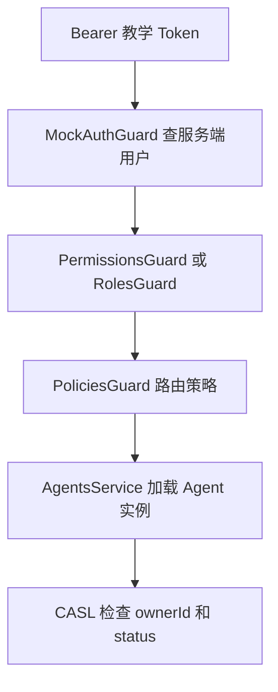

# NestJS Study 40：角色、权限与 CASL 授权

以多用户 Agent 管理为例，对比三种授权粒度：管理员角色、功能权限、具体资源条件。本章重点是授权，使用固定公开的教学 Token 映射服务端用户；它不提供真实登录、JWT 签名、过期或撤销能力。真实 JWT 认证请先看 Study 39。

## 核心知识与业务场景

- `@Roles()` + `RolesGuard`：管理后台只允许管理员。
- `@RequirePermissions()` + `PermissionsGuard`：通过 `ROLE_PERMISSIONS` 判断是否拥有创建、更新等功能权限。
- `@CheckPolicies()` + `PoliciesGuard`：声明路由级策略，如能否创建 Agent。
- `CaslAbilityFactory`：在 Service 中对已经加载的 `Agent` 实例判断所有权和状态。
- `MockAuthGuard` 必须先建立可信的教学身份，再运行授权 Guard；客户端的 `role`、`ownerId` 或 `X-Role` 都不会成为身份来源。

## 结构与阅读顺序

```text
src/
├── app.module.ts                     # 注册业务模块与 APP_PIPE
├── authorization/
│   ├── authorization.module.ts       # 注册和导出 Guard、Ability 工厂
│   ├── mock-auth.guard.ts            # 固定 Token → 服务端用户
│   ├── roles.guard.ts
│   ├── permissions.guard.ts
│   ├── policies.guard.ts
│   ├── casl-ability.factory.ts        # 所有权、管理员和运行状态规则
│   └── role-permissions.ts
├── agents/
│   ├── agent.entity.ts               # CASL 的实际资源类型
│   ├── agents.controller.ts
│   └── agents.service.ts
├── admin/admin.controller.ts
└── users/users.service.ts
```

推荐 `app.module.ts → authorization.module.ts → mock-auth.guard.ts → agents.controller.ts → role-permissions.ts → casl-ability.factory.ts → agents.service.ts → admin.controller.ts`。先跟踪身份与 Guard 顺序，再比较路由级权限和资源级条件。

## 为什么还要在 Service 判断资源？

普通用户都具有 `agent:update`，这不代表能更新任何人的 Agent。Service 找到资源之后执行 `ability.can(Action.Update, agent)`，才能把 `ownerId` 条件带入判断。创建时 `ownerId` 来自服务端身份，DTO 不允许写入它。

内存记录通过 `new Agent()` 创建实例，让 CASL 的 `detectSubjectType` 能识别类型。管理员可以管理全部资源，但最后声明的 `cannot(Delete, Agent, { status: 'running' })` 仍禁止删除运行中的 Agent。不要仅对 `Agent` 类判断所有权，资源实例才有 owner 和 status。



## 启动与接口

需要 Node.js 24、pnpm；不需要 `.env`、数据库、Redis 或真实 AI API。NestJS 12、TypeScript 6。

```bash
pnpm install --frozen-lockfile
pnpm start:dev
```

默认端口 3000。可用 `PORT=3001 pnpm start:dev` 更换端口。

| Method | 路由 | 验证内容 |
|---|---|---|
| GET | `/` | 保留的 Hello World 入口 |
| GET | `/agents` | 普通用户自己的资源；管理员所有资源 |
| GET | `/agents/my` | 当前用户自己的资源 |
| POST | `/agents` | 按认证用户创建 |
| PATCH | `/agents/:id` | 只能修改自己有权限的资源 |
| DELETE | `/agents/:id` | 有权限且不在运行中才能删除 |
| POST | `/agents/:id/run` | 资源级执行检查，1 秒模拟 |
| GET | `/admin/users` | 仅管理员，返回不含哈希的用户 |
| GET | `/admin/stats` | 仅管理员统计 |

公开教学 Token 为 `demo-robin-token`、`demo-alan-token`、`demo-admin-token`，分别映射用户 1001、1002、1003。知道这些固定值即可扮演教学身份，所以只能用于本地学习。

```bash
curl -i http://localhost:3000/agents
curl http://localhost:3000/agents -H 'Authorization: Bearer demo-robin-token'
curl -i http://localhost:3000/admin/users -H 'Authorization: Bearer demo-robin-token'
curl http://localhost:3000/admin/users -H 'Authorization: Bearer demo-admin-token'
curl -i -X PATCH http://localhost:3000/agents/3 \
  -H 'Authorization: Bearer demo-robin-token' -H 'Content-Type: application/json' \
  -d '{"name":"Cannot edit another owner"}'
curl -i -X DELETE http://localhost:3000/agents/2 -H 'Authorization: Bearer demo-admin-token'
curl -X POST http://localhost:3000/agents -H 'Authorization: Bearer demo-robin-token' \
  -H 'Content-Type: application/json' -d '{"name":"My Agent","model":"mock"}'
```

预期未认证 401、普通用户访问后台 403、管理员后台 200、跨用户更新 403、管理员删除正在运行的 Agent 2 也为 403、合法创建 201。PATCH 的 `null` 和创建时注入 `ownerId` 都返回 400。

```bash
pnpm exec tsc --noEmit --incremental false
pnpm lint
pnpm test
pnpm test:e2e
pnpm build
pnpm start:prod
```

CASL 单测验证允许与拒绝规则；HTTP E2E 验证真实 Guard 注册、角色伪造、资源所有权与 DTO。E2E 先构建再启动真实应用。

## 限制、练习与总结

数据只在内存中，已有 Agent 2 用固定 `running` 状态展示禁止删除规则。当前没有持久化、真实认证和用户管理写接口；`UsersService` 的哈希示例保留，但 Mock Token 流程不验证密码。

练习：新增一个只读角色；为一个接口增加新的功能权限；增加“仅管理员能修改某字段”的资源规则。重点是不要把“拥有功能权限”误认为“拥有每条资源”。

参考：[中文授权文档](https://docs.nestjs.cn/security/authorization/)、[官方授权文档](https://docs.nestjs.com/security/authorization)。
