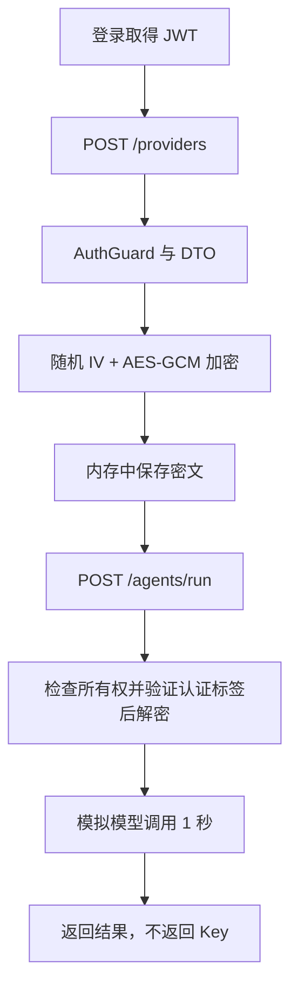

# NestJS Study 41：加密与密码哈希

模拟用户保存模型服务商 API Key，再由 Agent 内部解密使用。项目使用真实 AES-256-GCM 和 bcrypt，但模型执行仅延迟 1 秒返回模拟结果，不会发送真实付费请求。

## 学习目标

密码登录只需要验证原密码，不应能够还原，因此用 bcrypt 哈希。模型 Key 在调用时必须还原，因此用对称加密。这两个需求不能互相替代。

- AES-256-GCM：随机 12 字节 IV、认证标签和密文，既保护内容，也检测篡改。
- bcrypt：每次哈希使用随机盐；同一密码可产生不同结果，验证使用 `compare()`。
- `MaxPasswordBytes`：bcrypt 的长度限制按 UTF-8 字节计算，不能用 JavaScript 字符长度代替。
- JWT：登录后才允许保存和执行 Provider；资源所有权由服务端的 `sub` 决定。
- 公共响应类型：Provider API 只返回是否已配置 Key，不返回明文或密文。

## 项目结构与阅读顺序

```text
src/
├── security/
│   ├── encryption.service.ts         # v1:iv:tag:ciphertext
│   ├── password.service.ts           # bcrypt 12 轮
│   ├── security.controller.ts        # 固定教学文本的比较结果
│   └── encryption.service.spec.ts    # 随机性、还原与篡改拒绝
├── users/users.service.ts            # 启动时哈希教学账号密码
├── auth/
│   ├── auth.module.ts                # JWT 密钥与 HS256
│   └── dto/password-byte-length.validator.ts
├── providers/
│   ├── providers.service.ts          # 所有权、加密保存与内部解密
│   └── provider.interface.ts         # 存储与公共类型分离
├── agents/agents.service.ts          # 模拟使用解密 Key
└── main.ts                          # ValidationPipe
```

推荐 `app.module.ts → security/encryption.service.ts → security/password.service.ts → auth/dto/login.dto.ts → providers/providers.service.ts → agents/agents.service.ts → test/app.e2e-spec.ts`。

## 核心执行流程

`ProvidersService.create()` 加密后只把密文放入内存数组；`toPublic()` 只返回 `id`、`provider`、`hasApiKey`、`createdAt`。Agent 通过内部方法 `getDecryptedApiKey(userId, id)` 获取 Key，先检查所有权，再解密。API 没有“取回明文 Key”的路由。



GCM 的认证标签不是可省略的装饰字段；密文或标签被修改时必须拒绝解密。当前格式带 `v1`，便于理解未来格式迁移；项目尚未实现密钥轮换。

## 启动

需要 Node.js 24、pnpm，NestJS 12 / TypeScript 6。不需要外部服务。bcrypt 是原生依赖；仓库已有 `pnpm-workspace.yaml` 中的构建许可，安装失败时检查平台和安装日志，不要改成明文密码比较。

```bash
pnpm install --frozen-lockfile
cp .env.example .env
export JWT_SECRET="$(node -e "process.stdout.write(require('node:crypto').randomBytes(32).toString('hex'))")"
export ENCRYPTION_KEY="$(node -e "process.stdout.write(require('node:crypto').randomBytes(32).toString('hex'))")"
pnpm start:dev
```

两项配置都要求 64 位十六进制字符串。也可填入本地 `.env`。应分别生成，勿把示例密钥投入真实业务。默认监听 `127.0.0.1:3000`。

## 接口与验证

| Method | 路由 | 说明 |
|---|---|---|
| GET | `/security/demo` | 固定教学字符串的加密、解密与哈希比较 |
| POST | `/auth/login` | 教学账号登录，200 |
| GET | `/auth/profile` | JWT 保护的用户资料 |
| GET / POST | `/providers` | 查询自己的配置 / 保存加密 Key |
| GET / DELETE | `/providers/:id` | 只访问自己的配置 |
| POST | `/agents/run` | `providerId` 指定配置，模拟执行 |

```bash
curl http://localhost:3000/security/demo
curl http://localhost:3000/auth/login -H 'Content-Type: application/json' \
  -d '{"username":"robin","password":"Robin123456!"}'
TOKEN='替换为登录返回的 access_token'
curl -X POST http://localhost:3000/providers -H "Authorization: Bearer $TOKEN" \
  -H 'Content-Type: application/json' -d '{"provider":"openai","apiKey":"demo-not-real"}'
curl http://localhost:3000/providers -H "Authorization: Bearer $TOKEN"
curl -X POST http://localhost:3000/agents/run -H "Authorization: Bearer $TOKEN" \
  -H 'Content-Type: application/json' -d '{"providerId":1}'
```

新进程第一条配置 ID 为 1。`/security/demo` 中两个密文不同、解密匹配、两个哈希不同、正确密码 true、错误密码 false。配置响应不应包含 Key。另一个教学账号 `alan / Alan123456!` 访问该配置返回 403。

```bash
pnpm exec tsc --noEmit --incremental false
pnpm lint
pnpm test
pnpm test:e2e
pnpm build
pnpm start:prod
```

单测覆盖密文随机性、还原和篡改拒绝；E2E 运行真正构建产物，覆盖登录、72 字节边界、Key 响应与所有权。`AppController` 模板未注册进业务模块，不应以 `/` 的 Hello World 判断业务是否完成。

## 限制、练习与总结

内存数据重启丢失；教学账号与密码固定；Key 管理、持久化、轮换、访问审计都未实现。公开 `/security/demo` 只处理固定假数据，生产不应保留可无限计算 bcrypt 的演示接口。将来接入真实模型前仍需要超时、授权和成本控制。

练习：改变认证标签观察拒绝；比较相同明文多次加密；输入超过 72 字节的中文密码观察 DTO。重点掌握可逆加密与不可逆密码哈希的业务边界。

参考：[中文加密与哈希文档](https://docs.nestjs.cn/security/encryption-and-hashing/)、[官方文档](https://docs.nestjs.com/security/encryption-and-hashing)。
