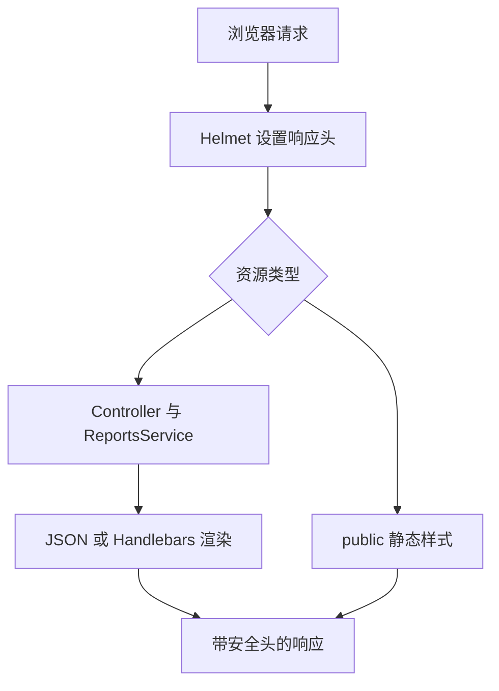

# NestJS Study 42：Helmet 与 HTTP 安全响应头

给一个 Handlebars 研究报告展示站点添加 Helmet，观察 HTML、JSON 和静态资源上的安全响应头。本章报告内容来自内存假数据，不执行研究或模型请求。

## 核心知识与业务场景

一个能够渲染报告的网页还需要告诉浏览器：哪些脚本、样式和嵌入来源可以加载。Helmet 通过 HTTP 响应头表达这些策略；它不会替代登录、授权、输入验证或模板转义。

- `Content-Security-Policy`：本站脚本和样式只允许 `'self'`，禁止对象资源及第三方 iframe 嵌入。
- `X-Frame-Options: DENY` 与 `frame-ancestors 'none'`：限制页面被嵌入。
- `X-Content-Type-Options: nosniff`：限制浏览器猜测内容类型。
- `Referrer-Policy: no-referrer`：控制外发请求的来源信息。
- `@Render()`、静态资源与构建资产：安全头必须和真正能够展示的页面一起验证。

## 项目结构与阅读顺序

```text
src/
├── main.ts                          # Helmet → 静态资源 → 模板 → listen
├── app.module.ts                    # HomeController 放在 controllers
├── home.controller.ts               # 首页
├── reports/
│   ├── reports.controller.ts        # 列表、JSON、HTML 预览
│   └── reports.service.ts           # 三份内存报告
├── security/security.controller.ts  # 观察响应头的接口
└── health/health.controller.ts
views/
├── layouts/app.hbs                  # 可信模板中的 body 插槽
├── index.hbs
├── reports.hbs
└── report-preview.hbs
public/css/style.css
nest-cli.json                        # 将 views/public 复制到 dist 子目录
```

推荐 `app.module.ts → main.ts → home.controller.ts → reports/reports.controller.ts → views/layouts/app.hbs → views/report-preview.hbs → test/app.e2e-spec.ts`。先确认控制器注册，再观察中间件顺序如何影响所有响应。

## 核心实现

`main.ts` 在静态文件和路由前安装 `helmet()`。模板数据用 `{{report.content}}` 输出，Handlebars 会转义；布局中的 `{{{body}}}` 用于装入受信任的已渲染模板，不能据此给用户原始 HTML 开一个不受限的出口。

CLI 构建会将模板复制到 `dist/views`、样式复制到 `dist/public`。运行时根据 `import.meta.dirname` 定位资产，所以从其他目录执行 `node /绝对路径/dist/main.js` 也能找到页面，不依赖启动时的 `cwd`。



CSP 里的 `'self'` 不允许内联脚本和内联样式。增加页面交互时，应优先使用本站外部文件，或研究 nonce/hash，而不是直接把 `unsafe-inline` 放宽到所有页面。

## 启动与接口

需要 Node.js 24、pnpm，NestJS 12 / TypeScript 6。不需要 `.env`、数据库或外部 API。默认监听 `127.0.0.1:3000`。

```bash
pnpm install --frozen-lockfile
pnpm start:dev
```

| Method | 路由 | 返回 |
|---|---|---|
| GET | `/` | 首页 HTML |
| GET | `/reports` | 报告列表 HTML |
| GET | `/reports/:id` | 报告 JSON |
| GET | `/reports/:id/preview` | 报告预览 HTML |
| GET | `/security/headers` | 观察响应头的说明 |
| GET | `/security/csp-demo` | CSP 示例页面 |
| GET | `/security/frame-demo` | iframe 防护示例页面 |
| GET | `/health` | JSON 健康检查 |
| GET | `/css/style.css` | 本站样式 |

```bash
curl -i http://localhost:3000/security/headers
curl -i http://localhost:3000/reports/1/preview
curl -i http://localhost:3000/reports/999
curl -I http://localhost:3000/css/style.css
```

预期前两个响应带 CSP、DENY、nosniff 和 no-referrer；不存在的报告返回 404。浏览器访问 `/reports` 后点击预览，可观察样式是否正常、开发者工具是否存在 CSP 拒绝。

```bash
pnpm exec tsc --noEmit --incremental false
pnpm lint
pnpm test
pnpm test:e2e
pnpm build
pnpm start:prod
```

HTTP E2E 从临时工作目录启动构建产物，验证模板、样式、缺失报告与实际响应头。保留的 AppController 单测只验证模板类，不代表 Helmet 生效；应以 HTTP 测试为依据。

## 限制、练习与总结

本章未提供用户登录，也没有用户上传的 HTML。Helmet 默认 HSTS 和 HTTPS 相关策略需要结合真实 HTTPS 部署评估；本地 HTTP 不会因此自动获得 TLS。浏览器策略不等于数据访问控制。

练习：加入一个本站脚本文件；对比内联与外部样式的 CSP 行为；检查 JSON、404 和静态文件的安全头。重点是把安全策略和真实资源加载一起验证。

参考：[中文 Helmet 文档](https://docs.nestjs.cn/security/helmet/)、[官方 Helmet 文档](https://docs.nestjs.com/security/helmet)。
