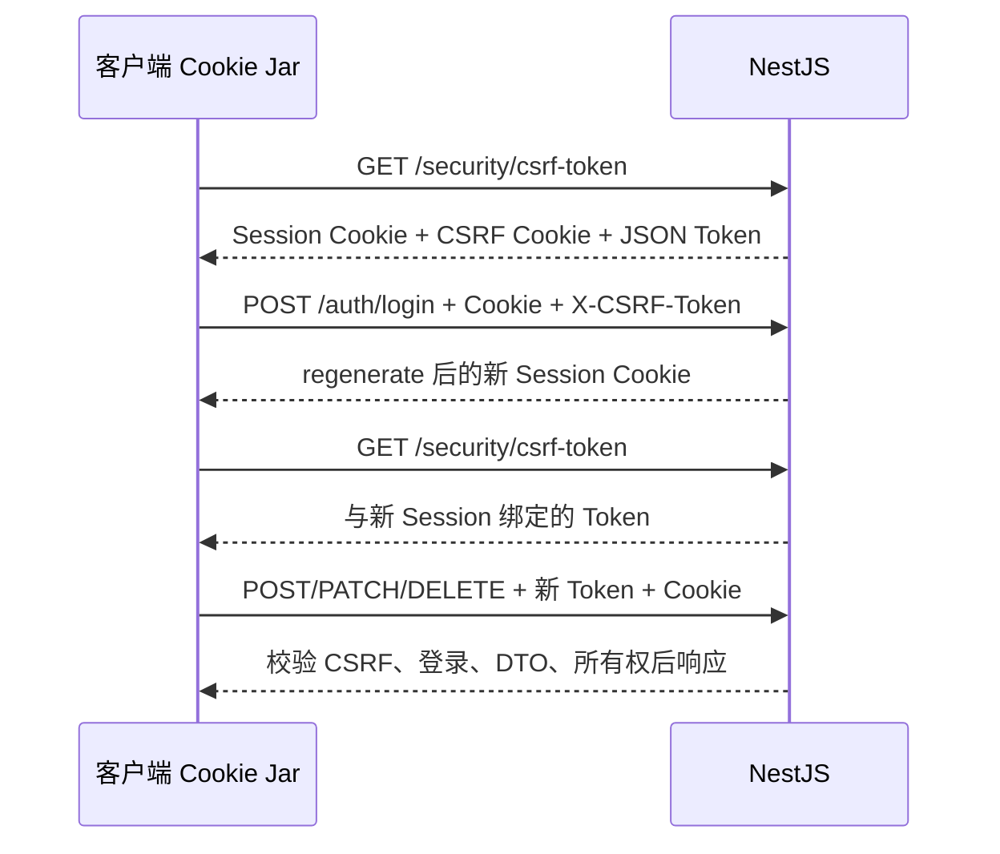

# NestJS Study 43：CORS、Session 与 CSRF

模拟一个使用 Cookie 登录的 Agent 管理站点。前端与后端跨端口访问时，CORS 决定浏览器能否读取响应，CSRF 则要求修改操作携带与当前 Session 绑定的 Token。两者解决不同问题。

## 核心知识

- `express-session`：浏览器只保存不透明 Session ID，用户 ID 在服务端内存会话中。
- `cookie-parser → session → CSRF middleware`：中间件顺序保证 CSRF 验证能读取 Cookie 与会话标识。
- `csrf-csrf` 4.x 的 `generateCsrfToken()`：生成基于会话标识和服务端密钥的双重提交 Token。旧示例中的 `generateToken()` 不适用于此版本。
- CSRF Cookie 为 HttpOnly；前端通过 JSON 响应取得 Token，再写入 `X-CSRF-Token`，不需要读取 HttpOnly Cookie。
- 登录后 `session.regenerate()` 改变 Session ID，因此必须重新获取 CSRF Token。
- `SessionGuard` 检查登录；`AgentsService.findOwned()` 检查资源属于当前用户。CSRF 本身不授予访问权。

## 结构与推荐阅读顺序

```text
src/
├── app.module.ts                     # ConfigModule 与业务模块
├── main.ts                           # CORS、Cookie、Session、CSRF、DTO
├── security/
│   ├── csrf.config.ts                # 会话绑定与 Cookie 配置
│   └── security.controller.ts        # 获取 Token、查看 CORS 说明
├── auth/
│   ├── auth.controller.ts            # regenerate、save、destroy
│   ├── auth.service.ts               # 固定教学账号
│   └── session.guard.ts
├── agents/
│   ├── agents.controller.ts
│   ├── agents.service.ts             # 写操作校验所有权
│   └── dto/update-agent.dto.ts        # PATCH name 也必须校验
└── types/session.d.ts                # 扩展 SessionData
```

推荐 `main.ts → security/csrf.config.ts → security/security.controller.ts → auth/auth.controller.ts → auth/session.guard.ts → agents/agents.controller.ts → agents/agents.service.ts`。

## 执行流程

匿名请求 `/security/csrf-token` 时写入 `csrfInitialized`，确保 `saveUninitialized: false` 下仍会保存匿名会话。登录的 POST 本身也受 CSRF 防护，不能跳过第一步。



旧 Token 在登录后失效是预期行为。获取新 Token 时会验证旧 Cookie 是否适用于当前会话，不匹配时重新生成。另一个会话的 Token 不能移植使用。

## 启动

需要 Node.js 24、pnpm，NestJS 12 / TypeScript 6。不需要 Redis、数据库或模型 API。

```bash
pnpm install --frozen-lockfile
cp .env.example .env
export SESSION_SECRET="$(node -e "process.stdout.write(require('node:crypto').randomBytes(32).toString('hex'))")"
export CSRF_SECRET="$(node -e "process.stdout.write(require('node:crypto').randomBytes(32).toString('hex'))")"
pnpm start:dev
```

两项密钥都要求至少 32 字符，分别生成并保存在本地环境。`FRONTEND_ORIGIN` 默认 `http://localhost:8888`，`PORT` 默认 3000。教学 HTTP Cookie 使用 `secure: false`、`sameSite: lax`；HTTPS 部署需要相应调整。

## 接口与 curl 验证

| Method | 路由 | 说明 |
|---|---|---|
| GET | `/security/csrf-token` | 初始化会话并取得 Token |
| GET | `/security/cors-info` | 查看允许的来源与 Header 名 |
| POST | `/auth/login` | Cookie 登录，201，必须有 CSRF Token |
| GET | `/auth/me` | 当前会话用户 |
| POST | `/auth/logout` | 销毁会话，清除 Session Cookie |
| GET | `/agents` | 公开教学目录 |
| GET | `/agents/my` | 当前用户的 Agent |
| POST | `/agents` | 创建自己的 Agent |
| PATCH | `/agents/:id` | 校验 `name` 后更新自己的 Agent |
| DELETE | `/agents/:id` | 删除自己的 Agent |

以下命令用 Node.js 提取 JSON，不要求额外安装 jq。在同一终端执行；Cookie 文件放到临时目录。

```bash
JAR="$(mktemp)"
CSRF="$(curl -s -c "$JAR" -b "$JAR" http://localhost:3000/security/csrf-token | node -pe 'JSON.parse(require("fs").readFileSync(0,"utf8")).csrfToken')"
curl -i -c "$JAR" -b "$JAR" -X POST http://localhost:3000/auth/login \
  -H "X-CSRF-Token: $CSRF" -H 'Content-Type: application/json' \
  -d '{"username":"robin","password":"Robin123456!"}'
CSRF="$(curl -s -c "$JAR" -b "$JAR" http://localhost:3000/security/csrf-token | node -pe 'JSON.parse(require("fs").readFileSync(0,"utf8")).csrfToken')"
curl -i -b "$JAR" -X POST http://localhost:3000/agents \
  -H "X-CSRF-Token: $CSRF" -H 'Content-Type: application/json' \
  -d '{"name":"Research","model":"mock"}'
curl -i -b "$JAR" -X POST http://localhost:3000/agents \
  -H 'Content-Type: application/json' -d '{"name":"No token","model":"mock"}'
curl -i -b "$JAR" -X PATCH http://localhost:3000/agents/3 \
  -H "X-CSRF-Token: $CSRF" -H 'Content-Type: application/json' -d '{"name":"Denied"}'
curl -i -c "$JAR" -b "$JAR" -X POST http://localhost:3000/auth/logout -H "X-CSRF-Token: $CSRF"
rm "$JAR"
```

合法创建 201；缺少 Token 403；修改另一个用户资源 403。账号 `robin / Robin123456!`、`alan / Alan123456!` 均为固定假账号。

```bash
pnpm exec tsc --noEmit --incremental false
pnpm lint
pnpm test
pnpm test:e2e
pnpm build
pnpm start:prod
```

E2E 启动真实 HTTP 应用，验证匿名 Token、登录后轮换、旧 Token 拒绝、跨会话 Token 拒绝、CORS、DTO、所有权与退出。

## 常见问题与边界

- 登录立即返回 403：检查是否先获取 Token，是否同时保存 Cookie 并发送 Header。
- 登录后写操作 403：Session 已轮换，请重新获取 Token。
- curl 可以读取“不允许的来源”：CORS 是浏览器读取限制，不是网络级访问防火墙；curl 不执行浏览器的 CORS 策略。
- 内存 Session Store 重启丢失，也不能跨进程共享。教学密码是明文固定值；真实认证应使用密码哈希。本章没有前端项目，不把跨站 HTTPS Cookie 配置误写成已经验证。

练习：在另一个 Cookie Jar 中重放 Token；修改允许的 Origin 观察浏览器结果；给 PATCH 添加字段并保持 DTO 白名单。重点掌握 Cookie 身份、CSRF、CORS 和资源授权各自的边界。

参考：[中文 CSRF 文档](https://docs.nestjs.cn/security/csrf/)、[官方 CSRF 文档](https://docs.nestjs.com/security/csrf)、[官方 CORS 文档](https://docs.nestjs.com/security/cors)。
