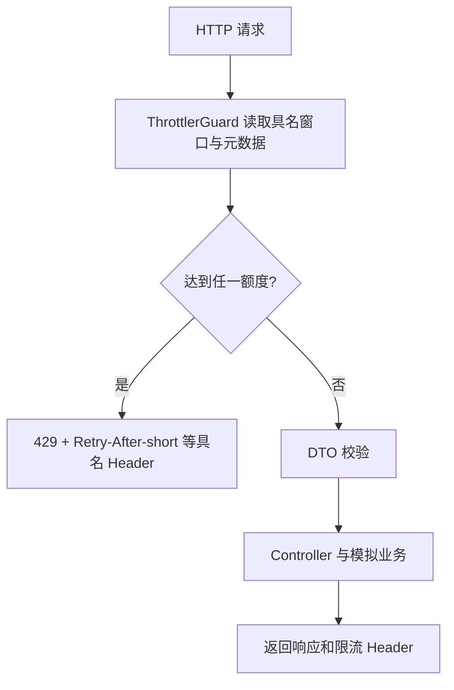

# NestJS Study 44：请求限流

模拟模型目录、登录与研究任务，给不同成本的接口配置不同访问额度。研究任务仅等待 1 秒后返回假结果，项目不会调用真实付费模型。

## 核心知识

- `ThrottlerModule.forRoot()` 定义 `short`、`medium`、`long` 三个具名窗口，`ttl` 单位是毫秒。
- `APP_GUARD` 全局注册 `ThrottlerGuard`，装饰器才会真正限制 HTTP 请求。
- `@Throttle()` 覆盖指定路由的窗口额度，例如研究接口更严格。
- `@SkipThrottle()` 必须逐个标明具名窗口；健康检查和显式 skip 接口均跳过三个窗口。
- 默认以来源 IP 识别请求者，状态存在当前进程内存中。它不是用户配额、并发限制或持久化计费系统。

## 项目结构与阅读顺序

```text
src/
├── app.module.ts                     # 具名窗口和 APP_GUARD
├── main.ts                           # DTO ValidationPipe
├── rate-limit/rate-limit.controller.ts # info、严格 test、skip
├── auth/auth.controller.ts           # 更严格的登录额度
├── auth/auth.service.ts              # 固定凭据比较，不签发登录态
├── agents/agents.controller.ts       # 研究接口覆盖额度
├── agents/agents.service.ts          # 模拟研究
├── models/models.controller.ts       # 全局默认额度
└── health/health.controller.ts       # 全部窗口跳过
```

推荐 `app.module.ts → rate-limit/rate-limit.controller.ts → auth/auth.controller.ts → agents/agents.controller.ts → main.ts → test/app.e2e-spec.ts`。先了解默认规则，再比较覆盖与跳过。

## 核心执行流程



研究接口为 1 次/秒、5 次/10 秒、10 次/分钟；登录接口为 2 次/秒、3 次/10 秒、5 次/分钟。额度按路由与窗口分别跟踪，不是“整个服务一分钟只能访问十次”。快速重复研究请求会在 Guard 阶段被拒绝，不必等待模拟任务完成。

当前参数直接写在 `app.module.ts` 和路由装饰器中；虽然项目安装了 ConfigModule，`THROTTLE_*` 环境变量不会改变这些规则。修改额度应阅读这些真实配置位置。

## 启动与接口

需要 Node.js 24、pnpm；NestJS 12、`@nestjs/throttler` 6.x、TypeScript 6。不需要 `.env`、Redis、数据库或模型 Key。

```bash
pnpm install --frozen-lockfile
pnpm start:dev
```

`PORT` 默认 3000。不要在演示前对同一路由反复压测，否则已有计数会影响观察；重启可清空教学内存状态。

| Method | 路由 | 行为 |
|---|---|---|
| GET | `/rate-limit/info` | 展示全局默认额度 |
| GET | `/rate-limit/test` | 严格额度：1/秒、3/10秒、5/分钟 |
| GET | `/rate-limit/skip` | 跳过所有具名窗口 |
| GET | `/health` | 健康检查，不限流 |
| POST | `/auth/login` | 固定凭据比较，200，无 Token/Session |
| GET | `/agents` | Agent 目录 |
| GET | `/agents/:id` | Agent 详情，缺失 404 |
| POST | `/agents/research` | 校验 topic 后模拟研究 |
| GET | `/models` | 模型目录 |

```bash
curl -i http://localhost:3000/rate-limit/test
curl -i http://localhost:3000/rate-limit/test
curl -i http://localhost:3000/health
curl -i http://localhost:3000/rate-limit/skip
curl -i -X POST http://localhost:3000/agents/research \
  -H 'Content-Type: application/json' -d '{"topic":"NestJS Agent architecture"}'
curl -i http://localhost:3000/auth/login -H 'Content-Type: application/json' \
  -d '{"username":"robin","password":"Robin123456!"}'
```

前两条要在 1 秒内执行，第二次返回 429，并带具名 `Retry-After-short`（秒）。健康检查与 skip 仍为 200。研究参数 topic 必须是 3～200 字符的字符串。登录返回固定教学用户资料，并未建立身份认证，不能把“登录成功”用于保护其他接口。

```bash
pnpm exec tsc --noEmit --incremental false
pnpm lint
pnpm test
pnpm test:e2e
pnpm build
pnpm start:prod
```

HTTP E2E 验证实际 429、恢复时间 Header、健康检查跳过、研究参数 400 与登录模拟边界。它不是吞吐量基准测试。

## 限制、练习与总结

默认内存计数无法跨实例共享。生产中代理配置必须与真实拓扑匹配，不能盲目信任客户端 `X-Forwarded-For`；按用户限额需要先建立可信身份，再选择 tracker。限流也不能自动取消已在执行的任务或限制全部后台并发。

练习：调整一个窗口观察 429；给模型目录设置独立额度；对比健康检查与普通接口 Header。重点掌握全局注册、路由覆盖和具名跳过的关系。

参考：[中文限流文档](https://docs.nestjs.cn/security/rate-limiting/)、[官方限流文档](https://docs.nestjs.com/security/rate-limiting)。
