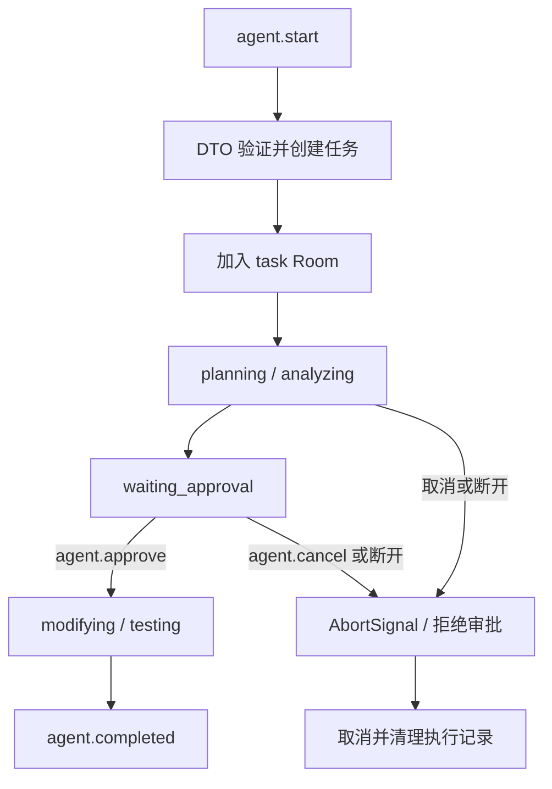

# NestJS Study 45：WebSocket Gateway 与人工审批

用 Socket.IO 模拟一个 AI Coding Agent：客户端提出修复需求，服务端依次规划、分析，等待人工批准后再模拟修改和测试。没有调用真实模型，也不会修改仓库代码。

## 学习目标

- 理解 Gateway 也是 Provider，需要注册到 Module 才会监听消息。
- 区分客户端发出的消息、服务端主动推送的事件和 ACK 回调。
- 通过 Room 只向任务所属连接发送进度。
- 将任务状态、审批 Promise 和 AbortSignal 组合起来，理解连接断开时的资源清理。

## 项目结构与阅读顺序

```text
src/
├── main.ts
├── app.module.ts
├── agents/
│   ├── agents.module.ts
│   ├── agents.gateway.ts
│   ├── agents.service.ts
│   ├── agent.interface.ts
│   └── dto/start-agent.dto.ts
└── health/
    ├── health.module.ts
    └── health.controller.ts
client/test-client.ts
```

先读 [AppModule](./src/app.module.ts) 和 [AgentsModule](./src/agents/agents.module.ts)，确认 Gateway 的注册；然后读 [Gateway](./src/agents/agents.gateway.ts) 的 `startAgent()` 和 `executeAgent()`，最后读 [Service](./src/agents/agents.service.ts) 的审批和取消方法。[客户端](./client/test-client.ts) 展示事件如何对应起来。

## 核心实现

`@WebSocketGateway()` 复用 HTTP 服务的端口，`@SubscribeMessage('agent.start')` 把消息交给处理函数。`@MessageBody()` 提取消息体，`@ConnectedSocket()` 取到当前连接。

启动请求经过 `ValidationPipe` 和 [StartAgentDto](./src/agents/dto/start-agent.dto.ts)：prompt 必须是 3～500 字符的字符串。验证失败通过 Socket.IO 的 `exception` 事件通知客户端；不能把 HTTP 的 400 响应方式套到这里。

Service 用 Map 保存任务，任务的 `clientId` 来自服务端 Socket。查询、批准和取消均比较任务拥有者与当前连接；客户端自己传入角色或 clientId 不会改变归属。

审批并不是定时等待：`waitForApproval()` 保存 Promise 的 resolve/reject；`approveTask()` 只会唤醒正在等待的审批。`abortTask()` 同时中断阶段定时器并拒绝待审批 Promise，`finally` 清理执行记录。



## 启动

使用 Node.js 24、pnpm 12；锁文件对应 NestJS 12.3.3、TypeScript 6。无需 Redis、数据库和模型密钥。

```bash
pnpm install --frozen-lockfile
pnpm start:dev
```

默认端口 3000，可用 `PORT=3100 pnpm start:dev`。示例客户端固定访问 3000；换端口时同步修改客户端 URL。浏览器演示允许的 Origin 为 `http://localhost:3000`。

## 消息与验证

| 方向 | 名称 | 消息体或含义 |
| --- | --- | --- |
| 客户端 → 服务端 | `agent.start` | `{"prompt":"分析并修复 TypeScript 错误"}` |
| 客户端 → 服务端 | `agent.status` | `{"taskId":"启动返回的 UUID"}` |
| 客户端 → 服务端 | `agent.approve` | 同上，仅任务拥有者可批准 |
| 客户端 → 服务端 | `agent.cancel` | 同上，仅任务拥有者可取消 |
| 服务端 → 客户端 | `connected`、`agent.started` | 连接与任务建立 |
| 服务端 → 客户端 | `agent.progress`、`agent.approval_required` | 阶段进度、等待批准 |
| 服务端 → 客户端 | `agent.completed`、`agent.cancelled`、`agent.failed` | 结束状态 |

另开终端运行真实客户端，Node.js 24 可直接执行该文件中的可擦除 TypeScript 类型：

```bash
node client/test-client.ts
curl http://localhost:3000/health
```

正常客户端会在收到审批事件后等待两秒批准，最后打印完成事件并断开。普通 `curl` 无法模拟 Socket.IO 协议。

```bash
pnpm build
pnpm exec tsc --noEmit --incremental false
pnpm lint
pnpm test
pnpm test:e2e
```

E2E 使用真实本机 Socket.IO 连接，覆盖合法执行、非法输入、另一连接不能批准、取消审批、断开取消；Service 测试覆盖应用关闭时拒绝等待。具体通过状态以根目录最终报告为准。

## 限制与练习

- 任务属于连接而非已认证用户。重新连接会产生新 clientId，不能恢复旧任务；断开会取消该连接的任务。
- 内存任务没有持久化、过期清理或并发限流。模拟修改和测试仅为文字状态。
- CORS 不是身份认证；生产应用应将资源归属绑定到可信用户。

练习：给任务增加一种进度；在审批前尝试提前批准并观察异常；用两个客户端验证任务归属；比较“断连取消”和可后台持续执行的任务设计。

本章重点是 Gateway 注册、消息边界和异步任务的结束条件。下一章将 Guard、Pipe、Interceptor、Filter 应用到同一条消息链路。

参考：[NestJS Gateway](https://docs.nestjs.com/websockets/gateways)。
