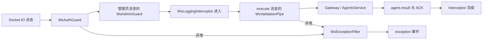

# NestJS Study 46：WebSocket 中的 Guard、Pipe、Interceptor 与 Filter

模拟带用户身份的 Coding Agent 平台。三个演示 Token 在服务端映射为两个普通用户和一个管理员，用同一个 Socket.IO Gateway 展示消息执行前后的四类扩展点。

## 学习目标

- Guard 决定消息是否可以进入业务处理，不能信任客户端传来的 role。
- Pipe 将消息体校验为 DTO，防止缺失字段和额外字段流入 Service。
- Interceptor 记录处理过程与耗时，Filter 统一 WebSocket 错误事件。
- 将任务保存在用户名下，验证两个连接之间的数据隔离。

## 源码入口

```text
src/
├── app.module.ts
├── main.ts
├── auth/
│   ├── auth.service.ts
│   ├── ws-auth.guard.ts
│   └── ws-admin.guard.ts
├── agents/
│   ├── agents.gateway.ts
│   ├── agents.service.ts
│   ├── agents.module.ts
│   └── dto/execute-agent.dto.ts
└── common/
    ├── pipes/ws-validation.pipe.ts
    ├── interceptors/ws-logging.interceptor.ts
    └── filters/ws-exception.filter.ts
client/test-client.ts
```

建议先看 [Gateway](./src/agents/agents.gateway.ts) 上绑定了哪些装饰器，再看 [AgentsModule](./src/agents/agents.module.ts) 和 [AuthModule](./src/auth/auth.module.ts) 如何注册依赖。随后依次读认证 Guard、DTO/Pipe、Service、Interceptor 和 Filter，最后运行客户端。

## 一条消息经过什么



认证 Guard 在每条消息上读取 `client.handshake.auth.token`，到 [AuthService](./src/auth/auth.service.ts) 的 Map 查询用户，再写入 `client.data.user`。管理员 Guard 读取这个服务端身份，不读取消息体的 role。`agent.status` 调用 `findByUser()`，只能得到当前用户的任务。

[WsValidationPipe](./src/common/pipes/ws-validation.pipe.ts) 启用 transform、whitelist 和 forbidNonWhitelisted。执行消息的 prompt 长度 5～500，model 仅允许 `gpt-4.1` 或 `claude-sonnet`；这两个名称只是模拟任务标签，没有真实模型调用。

Filter 把 `WsException` 转成 `exception` 事件；目前统一返回 `code: WS_ERROR` 和可读 message。Pipe 内部的 `VALIDATION_ERROR/details` 不会原样对外传出。异常请求通常没有成功 ACK，客户端应监听 `exception`，不能一直等 ACK。

## 运行与手动验证

Node.js 24、pnpm 12，NestJS 12.3.3。无需外部服务、JWT 密钥或 AI API Key。

```bash
pnpm install --frozen-lockfile
pnpm start:dev
```

新终端运行：

```bash
pnpm exec tsx client/test-client.ts
```

客户端访问固定 `http://localhost:3000`，携带 `demo-robin-token`，启动任务、收到结果后查询自己的任务并断开。服务端也固定监听 3000；一次运行一个 Study。

| 消息 | 参数 | 结果 |
| --- | --- | --- |
| `agent.execute` | `{"prompt":"分析 TypeScript 类型错误","model":"gpt-4.1"}` | `agent.result` 推送和包含 taskId 的 ACK |
| `agent.status` | 无需业务参数 | 当前用户任务数组 |
| `agent.admin.stats` | 无需业务参数 | 仅管理员可查询任务统计 |

把客户端 Token 改为 `demo-alan-token`，应查不到 robin 的任务；改为 `demo-admin-token` 才能查询统计。错误 Token 仍可能建立连接，但发送受保护消息时会被 Guard 拒绝。将 model 改为未知值可观察 Pipe 与 Filter。

```bash
pnpm build
pnpm exec tsc --noEmit --incremental false
pnpm lint
pnpm test
pnpm test:e2e
```

E2E 启动真实 Socket.IO 服务，验证认证拒绝、DTO 拒绝、执行结果、用户隔离、普通用户伪造 role 无效、管理员统计。没有把 Guard 或 Service 替换为假实现。

## 教学边界

演示 Token 是写在源码里的公开凭证，任何读者都能使用管理员 Token。这是认证机制的 Mock，不是 JWT 或生产登录方案，也没有过期与撤销。任务仅在内存中保留，进程重启后丢失。客户端看到的 prompt/result 是模拟数据；Interceptor 不记录 Token 和整条消息体。

练习：新增一个模型标签并同步 DTO；为管理员增加另一个统计字段；调整 Filter 保留结构化验证详情；解释“握手连接成功”为什么不代表每条消息都获授权。

理解本章后，应能判断扩展点是否真正绑定并运行，而不只是存在一个带装饰器的类。

参考：[WebSocket Guards](https://docs.nestjs.com/websockets/guards)、[Gateway](https://docs.nestjs.com/websockets/gateways)。
