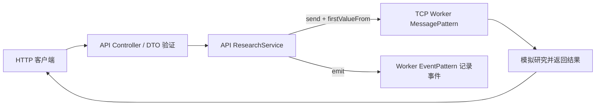

# NestJS Study 48：TCP 微服务与共享消息契约

本章在一个独立 Study 内保留两个 Nest 应用：HTTP API 接收研究请求，Agent Worker 用 Nest TCP Transport 执行模拟研究。无需 Redis、RabbitMQ、数据库或真实模型账户。

## 学习目标

- 区分 HTTP Controller 和微服务的 `@MessagePattern()`、`@EventPattern()`。
- 用 `ClientProxy.send()` 建立请求响应，用 `emit()` 发布事件。
- 理解 Observable 订阅、`firstValueFrom()` 和调用方超时之间的关系。
- 在同一个教学项目中共用 TypeScript 契约，避免消息名称两边拼写不一致。

## 项目结构

```text
apps/
├── api/
│   ├── src/main.ts
│   ├── src/app.module.ts
│   └── src/research/
│       ├── research.controller.ts
│       ├── research.service.ts
│       ├── research.module.ts
│       └── dto/research.dto.ts
└── agent-worker/
    ├── src/main.ts
    ├── src/agent-worker.module.ts
    └── src/research/
        ├── research.controller.ts
        ├── research.service.ts
        └── research.module.ts
libs/contracts/src/
├── index.ts
└── research.contract.ts
```

推荐从 [消息契约](./libs/contracts/src/research.contract.ts) 开始，再读 API 的 [ClientsModule 注册](./apps/api/src/research/research.module.ts) 和 [Service](./apps/api/src/research/research.service.ts)，最后读 Worker 的 [入口](./apps/agent-worker/src/main.ts)、Controller 与 Service。返回查看两个 `tsconfig.app.json`，理解为何编译输出包含 apps 和 libs 的目录层级。

## 核心实现



`send()` 返回冷 Observable，只有被订阅才会发送。API 使用 `firstValueFrom()` 订阅并等待首个结果。Worker `analyze()` 延迟约 1.5 秒后返回报告摘要；没有执行真实检索和模型推理。

`emit()` 用于提交事件，HTTP 响应表示传输发布完成，不能据此推断研究任务已经完成或事件获得持久化。本例事件处理器只记录日志。

API 为分析请求设置 5 秒超时、模型查询设置 3 秒超时、慢任务设置 2 秒超时。慢任务 Worker 本身等待 10 秒，因此返回 504 是预期演示。**调用方停止等待不会自动取消 Worker 内部的 Promise 或定时器**。

## 安装与启动

Node.js 24、pnpm 12，NestJS 12.3.3、TypeScript 6。两应用均只绑定本机地址。

```bash
pnpm install --frozen-lockfile
pnpm build
```

构建脚本依次构建 api 与 agent-worker。现有 TypeScript builder 保留相对目录和共享 contracts，真实生产入口如下。

终端 A 启动 Worker：

```bash
WORKER_TCP_PORT=4001 node dist/agent-worker/apps/agent-worker/src/main.js
```

终端 B 启动 API：

```bash
PORT=3000 WORKER_TCP_PORT=4001 pnpm start:prod
```

也可以分别运行 `pnpm exec nest start agent-worker --watch` 和 `pnpm exec nest start api --watch`。不要将整个仓库当成一个 Nest monorepo；只有本 Study 内部包含这两个应用。

## HTTP 接口与验证

| 方法 | 路径 | 作用 |
| --- | --- | --- |
| POST | `/research/analyze` | 通过 TCP 获取模拟研究结果 |
| POST | `/research/submit` | 发布研究提交事件，只记录日志 |
| GET | `/research/models` | 通过 TCP 获取两个模型标签 |
| GET | `/research/slow` | 演示超时，预期 504 |

```bash
curl -X POST http://localhost:3000/research/analyze \
  -H 'Content-Type: application/json' \
  -d '{"topic":"NestJS Agent 架构","model":"gpt-4.1"}'
curl http://localhost:3000/research/models
curl -X POST http://localhost:3000/research/submit \
  -H 'Content-Type: application/json' \
  -d '{"topic":"事件驱动研究","model":"claude-sonnet"}'
curl -i http://localhost:3000/research/slow
```

topic 必须为 3～200 字符；model 只能使用表中的两个标签；额外字段会被拒绝。`submit` 沿用同一 DTO，因此也需要 model 字段，虽然事件内容只使用 topic。

```bash
pnpm exec tsc --noEmit --incremental false
pnpm lint
pnpm test
pnpm test:e2e
```

E2E 启动真实本机 TCP Worker 和 HTTP API，验证请求结果、参数拒绝、模型查询、事件到达和超时；独立 Worker 测试还直接发送 TCP 模型请求。关闭 API 时 ClientsModule 负责关闭 ClientProxy。

## 限制、练习与总结

TCP 端口仅用于受信任的本机演示，没有服务间认证、TLS、持久消息、重试和任务幂等。TypeScript Interface 只提供编译期约束；不能把它当成 Worker 的运行时入站验证。API 的 DTO 保护本例 HTTP 入口，若公开 TCP 端口，需要另行定义信任与校验边界。

练习：新增一个消息 Pattern 并在两端实现；停掉 Worker 观察分析和模型请求的 503；修改慢任务超时后比较结果；解释为什么事件发布成功不等于任务完成。

本章通过两进程通信建立微服务基本模型，不要求引入消息中间件。之后的部署章节关注如何打包、健康检查和退出已有服务。

参考：[NestJS Microservices Basics](https://docs.nestjs.com/microservices/basics)。
