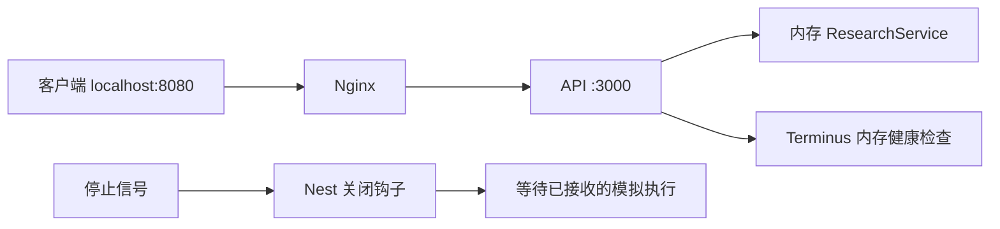

# NestJS Study 49：部署、健康检查与优雅退出

本章将一个内存版 AI Research HTTP 服务打包为 Docker 镜像，使用 Nginx 转发请求，并用 Terminus 暴露健康状态。研究任务由定时器模拟，重点是服务运行与退出的工程边界，没有真正调用模型。

## 学习目标

- 从 TypeScript 源码构建 `dist`，运行时只携带生产依赖。
- 用 Compose 组织 API 与 Nginx，用健康检查决定代理何时启动。
- 区分“进程在线”“当前堆内存正常”和“业务服务完整健康”。
- 用 Nest 关闭钩子等待已接收的模拟任务，而不是突然终止执行。

## 结构与推荐阅读顺序

```text
src/
├── main.ts
├── app.module.ts
├── health/
│   ├── health.controller.ts
│   └── health.module.ts
└── research/
    ├── research.controller.ts
    ├── research.service.ts
    ├── research.interface.ts
    ├── research.module.ts
    └── dto/create-research.dto.ts
Dockerfile
compose.yaml
deploy/nginx/default.conf
.env.example
.dockerignore
```

先读 [main.ts](./src/main.ts) 的监听地址、ValidationPipe 和 shutdown hooks；再读 [ResearchService](./src/research/research.service.ts) 的任务及退出等待；随后读 [HealthController](./src/health/health.controller.ts)，最后对照 Dockerfile、Compose 和 Nginx 配置。

## 服务如何运行



[ResearchController](./src/research/research.controller.ts) 接收输入和查询，Service 保存任务并逐步更新进度。创建响应通常已经是 `running`，约四秒后变为 `completed`。`onModuleDestroy()` 等待本进程已接收的执行 Promise；Service 进入关闭状态后拒绝新建任务并返回 503，避免排空期间又加入未等待的执行。

健康检查仅调用 `MemoryHealthIndicator.checkHeap()`，阈值为 512 MiB。它没有检查数据库、Redis、模型 API，也不是业务任务成功率监控。

Dockerfile 使用 Node.js 24，构建阶段安装锁定依赖、编译并保留生产依赖；运行阶段以 `node` 用户执行 `dist/main.js`。`.dockerignore` 排除本机 node_modules、dist、日志和 `.env`，不会将本地环境文件带进镜像。

## 本机运行

要求 Node.js 24、pnpm 12。锁文件使用 NestJS 12.3.3。

```bash
pnpm install --frozen-lockfile
cp .env.example .env
pnpm start:dev
```

环境变量只有 `NODE_ENV` 和 `PORT`；默认 3000。没有数据库和 API Key。生产构建后可以直接运行：

```bash
pnpm build
pnpm start:prod
```

## 容器运行

安装并启动 Docker 后执行：

```bash
docker compose build
docker compose up -d
curl http://localhost:8080/health
docker compose logs api
docker compose down
```

Compose 内 API 只 expose 3000，Nginx 向宿主机开放 8080。Nginx 配置中的 `api:3000` 来自 Compose 服务名，不是宿主机地址。容器 healthcheck 用 Node 的 fetch 调用 `/health`；Nginx 在 API 首次健康后启动。`depends_on` 不提供运行期间自动故障转移。

构建需要获取 Node 镜像和依赖包。网络失败属于环境阻塞，不意味着已经完成容器运行验收；根目录最终审查报告分别记录本机与容器验证结果。本例不包含云端发布或真实生产部署。

## API 与验证

| 方法 | 路径 | 功能 |
| --- | --- | --- |
| GET | `/health` | 当前堆内存健康检查 |
| POST | `/research` | 创建模拟研究任务 |
| GET | `/research` | 列出本进程任务 |
| GET | `/research/:id` | 查询任务，不存在返回 404 |

以下使用本机直连端口；容器运行时把 3000 换成 8080。

```bash
curl http://localhost:3000/health
curl -X POST http://localhost:3000/research \
  -H 'Content-Type: application/json' \
  -d '{"topic":"NestJS 的部署和关闭流程","model":"gpt-4.1"}'
curl http://localhost:3000/research
```

复制创建响应的 id，再请求 `/research/实际id`，可观察 running、20/40/60/80 和 completed/100。topic 为 5～200 字符；非法模型或多余字段返回 400。

```bash
pnpm exec tsc --noEmit --incremental false
pnpm lint
pnpm test
pnpm test:e2e
```

业务 E2E 验证真实健康接口、DTO 拒绝、任务完成与 404；Service 测试验证关闭钩子等待任务。没有把成功构建等同于容器或远端部署成功。

## 限制与总结

任务保存在内存中，容器重启会丢失；服务没有用户认证、持久队列和恢复机制。优雅退出只等待当前进程的模拟任务，不等于可靠作业系统。容器停止超时仍可能强制结束进程，真实耗时任务需要另外规划超时与恢复策略。

练习：比较本机与容器的 `/health`；修改内存阈值观察不健康响应；创建任务后停止应用，观察结束日志；解释 Nginx 存活和 API 健康的区别。

本章重点是把已有服务正确启动、检查和结束。最后一章将保留 Nest 的依赖注入能力，同时去掉 HTTP 服务，运行一次性 CLI 工作。

参考：[NestJS Deployment](https://docs.nestjs.com/deployment)。
