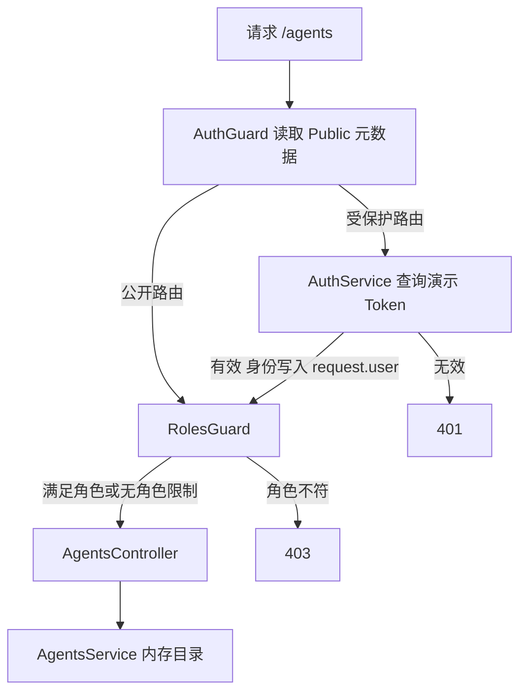

# Study 5：用 Guard 区分认证与角色授权

本章模拟一个共享 AI Agent 目录：访客可以看公开列表，登录用户可以查询，开发者可以创建，管理员可以删除。重点是让请求在进入 Controller 之前经过身份与角色检查，而不是接入真实登录系统。

## 学习目标

- 理解认证解决“你是谁”，授权解决“你能做什么”，分别由两个 Guard 负责。
- 用路由元数据描述权限，让 Controller 保持清晰。
- 理解 `ExecutionContext` 如何提供当前路由与 HTTP 请求。
- 区分 401（身份无效）、403（权限不足）和 404（资源不存在）。

## 业务场景与边界

Agent 是所有用户共享的目录资源，本章没有“个人 Agent”或多租户隔离。`POST /agents` 固定创建名为 `New Agent` 的模拟记录，不读取请求体；重启会恢复初始数据。

[AuthService](./src/auth/auth.service.ts) 在服务端用 Map 保存三个演示 Token：

| Token            | 服务端角色 | 允许操作         |
| ---------------- | ---------- | ---------------- |
| `demo-viewer`    | viewer     | 查询             |
| `demo-developer` | developer  | 查询、创建       |
| `demo-admin`     | admin      | 查询、创建、删除 |

这些公开的固定字符串只适合本地实验，没有签名、过期、撤销、密码校验或 Token 签发流程。客户端传来的角色字段不会参与授权判断。真实项目需要验证可信凭证，再从可信身份来源取得角色。

## 项目结构

```text
src/
├── main.ts
├── app.module.ts
├── app.controller.ts / app.service.ts / app.controller.spec.ts
├── agents/
│   ├── agents.module.ts
│   ├── agents.controller.ts
│   └── agents.service.ts
└── auth/
    ├── auth.module.ts
    ├── auth.service.ts
    ├── auth.types.ts
    ├── auth.guard.ts
    ├── roles.guard.ts
    ├── public.decorator.ts
    └── roles.decorator.ts
test/
└── app.e2e-spec.ts
```

`AppModule` 实际导入 `AuthModule` 和 `AgentsModule`。保留的 `AppController`、`AppService` 是脚手架阅读材料，没有注册为 HTTP 路由，因此 `/` 返回 404。

## 核心机制

### 先识别身份，再判断角色

[AgentsController](./src/agents/agents.controller.ts) 的类级装饰器：

```ts
@UseGuards(AuthGuard, RolesGuard)
```

这使所有 Agent 路由先运行 `AuthGuard`，再运行 `RolesGuard`。认证成功后，`AuthGuard` 将服务端查到的用户写入 `request.user`；角色 Guard 读取它，不再次解析客户端数据。

[AuthGuard](./src/auth/auth.guard.ts) 要求严格的 `Bearer <token>` 格式。缺失、无效 Token 或多余片段均返回 401。不要把给请求对象添加一个 TypeScript 类型误认为完成认证，决定身份的是 `AuthService.validateToken()` 的结果。

### 装饰器只写元数据，Guard 才执行规则

[Roles](./src/auth/roles.decorator.ts) 使用 `Reflector.createDecorator<Role[]>()` 创建具有类型的元数据键。创建路由声明：

```ts
@Roles(['admin', 'developer'])
```

[RolesGuard](./src/auth/roles.guard.ts) 用 `getAllAndOverride()` 按“方法、类”的顺序查找规则，所以方法上的声明优先。数组表示具有任意一个允许角色即可访问，没有角色声明的路由仍需通过认证。

`@Public()` 写入另一份元数据。`AuthGuard` 检查到公开标记后跳过认证；此时 `RolesGuard` 因公开路由没有角色要求而放行。公开标记本身不会注册 Guard。

### 让状态变化保持自洽

[AgentsService](./src/agents/agents.service.ts) 用递增 `nextId` 创建 ID，而不是用数组长度。删除中间记录再创建，也不会与已有 ID 冲突。不存在的 Agent 统一抛出 `NotFoundException`，交给 Nest 转成 HTTP 404。

## 请求执行流程



## 如何运行

建议使用 Node.js 24、pnpm 12；本次审查环境为 Node.js 24.5.0、pnpm 12.3.4。项目没有 `engines` 固定版本，其他环境需要同时满足 Nest、Vite 和 Vitest 的要求。依赖声明 Nest `^12.0.1`、TypeScript `^6.0.2`，当前锁文件及安装结果为 Nest 12.3.2、TypeScript 6.0.3。

```bash
cd nestjs-study-5
pnpm install --frozen-lockfile
pnpm start:dev
```

默认端口 3000，可用 `PORT=3005 pnpm start:dev` 修改；没有必填环境变量、数据库或外部 API。每个 Study 独立启动，注意端口占用。

```bash
pnpm build
pnpm exec tsc --noEmit
pnpm lint
pnpm test
pnpm test:e2e
pnpm start:prod
```

`test:e2e` 会先构建，再导入 `dist` 中的应用进行真实 HTTP 验证；`start:prod` 需要先执行 `build`。`type: module` 与 NodeNext 配置要求源码的相对运行时导入保留 `.js` 扩展名。

## 如何验证

先在新启动的应用中执行，`curl -i` 可以看到状态码：

```bash
# 200：匿名公开访问
curl -i http://localhost:3000/agents/public
# 401：缺少身份
curl -i http://localhost:3000/agents
# 200：viewer 查询
curl -i http://localhost:3000/agents -H 'Authorization: Bearer demo-viewer'
# 403：viewer 不能创建
curl -i -X POST http://localhost:3000/agents -H 'Authorization: Bearer demo-viewer'
# 201：developer 创建，响应 id 初次为 3
curl -i -X POST http://localhost:3000/agents -H 'Authorization: Bearer demo-developer'
# 403：developer 不能删除
curl -i -X DELETE http://localhost:3000/agents/3 -H 'Authorization: Bearer demo-developer'
# 200：管理员删除刚创建的记录
curl -i -X DELETE http://localhost:3000/agents/3 -H 'Authorization: Bearer demo-admin'
# 404：记录已删除
curl -i http://localhost:3000/agents/3 -H 'Authorization: Bearer demo-admin'
```

已有状态会影响 ID，重复操作时应使用创建响应中的实际 ID。自动化测试另外覆盖了错误 Token 格式和删除后 ID 不重复。

## 推荐阅读顺序

1. [app.module.ts](./src/app.module.ts) → [agents.module.ts](./src/agents/agents.module.ts)：先确认哪些模块真正生效。
2. [agents.controller.ts](./src/agents/agents.controller.ts)：把每条路由映射成权限表。
3. [auth.guard.ts](./src/auth/auth.guard.ts) → [auth.service.ts](./src/auth/auth.service.ts)：跟踪 Token 到用户的来源。
4. [roles.decorator.ts](./src/auth/roles.decorator.ts) → [roles.guard.ts](./src/auth/roles.guard.ts)：观察元数据如何变为拒绝或放行。
5. [agents.service.ts](./src/agents/agents.service.ts) → [e2e 测试](./test/app.e2e-spec.ts)：确认通过 Guard 后才发生状态变化。

## 思考与练习

1. 将创建权限改为仅管理员可用，重新验证 developer 的响应。
2. 为控制器声明默认角色，再为一个方法单独声明角色，观察覆盖顺序。
3. 给公开路由增加 `@Roles(['admin'])`，观察两个 Guard 如何组合，并解释为何公开不一定等于免授权。
4. 添加一个只读审核角色，在服务端 Token 映射与授权规则中完成接线。

## 本章总结

Guard 的价值在于把身份与访问控制放到统一入口；装饰器负责声明，`Reflector` 负责读取，Service 负责业务。本章重点是认证与授权的先后关系。下一章观察请求进入业务后的 Interceptor；Study 7 会进一步将可信用户上下文封装成参数装饰器，并加入资源归属检查。

参考：[官方 Guards](https://docs.nestjs.com/guards)、[中文守卫文档](https://docs.nestjs.cn/guards)。
