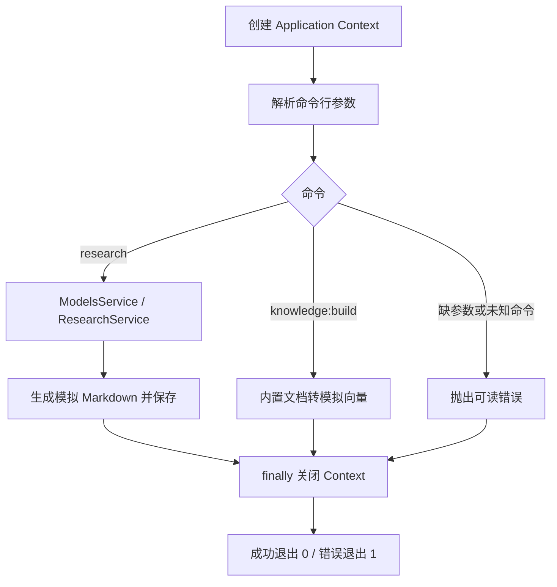

# NestJS Study 50：Standalone Applications 与研究 CLI

学习 NestJS 不只为了编写 HTTP API。本章复用 Module、Provider 和依赖注入，创建不监听 HTTP 端口的 Application Context，运行研究报告生成和知识库预处理两个一次性命令。

## 学习目标

- 理解 `createApplicationContext()` 与 `NestFactory.create()` 的区别。
- 从容器中用 `app.get()` 取得业务 Service，并在命令结束时关闭上下文。
- 将 CLI 参数解析、模型配置、研究步骤和本地文件保存分开。
- 根据退出码判断命令是否成功，避免后台资源让命令一直不退出。

## 项目结构

```text
src/
├── cli/main.ts
├── main.ts
├── app.module.ts
├── models/
│   ├── models.module.ts
│   └── models.service.ts
├── research/
│   ├── research.module.ts
│   ├── research.service.ts
│   └── report-storage.service.ts
└── knowledge/
    ├── knowledge.module.ts
    ├── knowledge.service.ts
    └── documents.ts
```

先读 [CLI 入口](./src/cli/main.ts)，定位创建上下文、获取 Service 和 `finally` 里的 `app.close()`；然后读 [AppModule](./src/app.module.ts) 及模块导出。研究分支从 [ResearchService](./src/research/research.service.ts) 读到 [ReportStorageService](./src/research/report-storage.service.ts)，知识库分支从 [documents](./src/knowledge/documents.ts) 读到 [KnowledgeService](./src/knowledge/knowledge.service.ts)。

## 命令执行流程



入口创建 Context 并解析命令参数，不会开启 HTTP。`ResearchModule` 导出 ResearchService，内部的 ModelsModule 提供模型标签，StorageService 用 UUID 文件名将报告写到当前工作目录的 `reports/`。

研究步骤用三次 500ms 延迟模拟 planning、analysis 和报告生成。KnowledgeService 处理三个内置文档，生成固定三维数值；它没有调用 Embedding API、向量数据库或 LangChain。

## 安装和运行

使用 Node.js 24、pnpm 12，NestJS 12.3.3。所有数据与模型均为本地 Mock，不需要收费账户、数据库、Redis 或环境密钥。

```bash
pnpm install --frozen-lockfile
pnpm research "NestJS Application Context 的使用场景"
pnpm knowledge:build
```

也可以从统一 CLI 入口传入命令：

```bash
pnpm cli research "TypeScript 后端模块设计"
pnpm cli knowledge:build
```

这些快捷脚本会先执行 `pnpm build`，再用 Node.js 运行 `dist/cli/main.js`。Nest 依靠 TypeScript 发出的构造器装饰器元数据推断注入 Token；直接用 `tsx` 转译此入口不会发出这些元数据，可能让 Service 的依赖变成 `undefined`。本章保留框架编译流程，不为绕过构建而修改各个业务 Service。

运行研究命令后应看到成功日志，`reports/` 内新增 `research-随机UUID.md`。知识库命令应打印处理三个文档、生成三个 Chunk 和三个模拟向量，然后退出。

## 构建与验证

```bash
pnpm build
node dist/cli/main.js research "NestJS 独立应用"
node dist/cli/main.js knowledge:build
pnpm exec tsc --noEmit --incremental false
pnpm lint
pnpm test
pnpm test:e2e
```

E2E 直接启动构建后的 CLI 子进程，在测试专属临时目录生成报告、检查 Markdown 内容，验证知识库输出以及正常退出；缺少 topic、未知命令必须返回退出码 1。另在隔离的源码/配置副本中执行真正的 `pnpm research` 和 `pnpm knowledge:build`，验证快捷入口的构建与注入。测试不会写入学习者已有的 reports 文件。

手动验证错误输入：

```bash
node dist/cli/main.js research
node dist/cli/main.js unknown
```

应分别显示“请提供研究主题”和未知命令提示，命令状态为失败。它们是有意的错误案例，不是正常运行应当成功的命令。

`pnpm start:dev` 与 `pnpm start:prod` 使用保留的 HTTP 启动入口 `src/main.ts`，并不是 CLI。这份 AppModule 没有注册 HTTP Controller，因此不会提供示例研究 REST API。学习本章应运行上面的 CLI 命令，而不是用 curl 访问一个虚构接口。

## 已知限制

- 报告写入相对于启动命令的工作目录；从其他目录运行构建产物时，reports 也位于那个目录。
- UUID 文件名避免将用户 topic 当作文件路径；模拟内容仍未经知识检索和事实核对。
- 模型名称只是配置示例，向量只是固定数值，没有真实 AI 能力。
- Application Context 不会自动运行 HTTP 路由的 Pipe、Guard 或 Interceptor；CLI 输入由入口自己检查。
- 生成文件位于本地，`reports/` 已忽略，不作为源码提交。

## 练习与阶段总结

练习：增加一个只打印可用模型的命令；给报告增加生成时间；新增一篇内置文档比较向量数量；在 Service 中观察生命周期钩子与 `app.close()` 的关系。

本章串起 Module、Provider、依赖注入和生命周期，说明这些概念可以用于脚本、迁移、定时离线任务。后续可以进入开源 NestJS 项目、TypeScript 全栈与 Agent 实战；本项目没有提前实现 LangChain.js 或 LangGraph.js 集成。

参考：[NestJS Standalone Applications](https://docs.nestjs.com/standalone-applications)。
