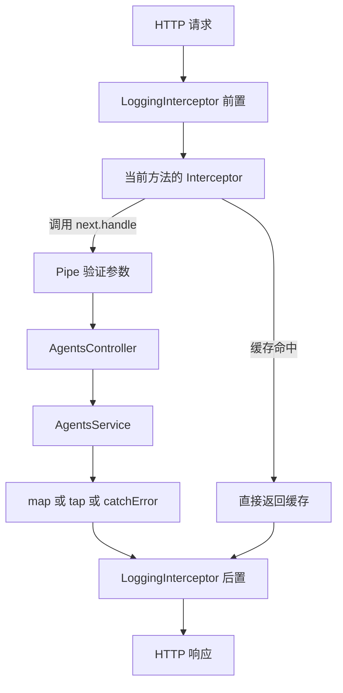

# Study 6：用 Interceptor 观察和控制 Agent 请求

同一个 Agent 查询，可能需要计时、统一响应、缓存或超时控制。如果把这些逻辑都写进 Controller，每个接口都会重复。本章用一个内存 Agent 目录观察 Interceptor 在业务调用前后工作的方式。

## 学习目标

- 区分“进入 Controller 前检查”的 Guard 与“包住后续处理过程”的 Interceptor。
- 理解 `next.handle()` 返回的 Observable，以及 `map`、`tap`、`catchError` 的作用。
- 观察缓存如何直接返回结果，绕过 Service。
- 区分超时响应、未知错误转换与已有 HTTP 异常。

## 业务场景与边界

[AgentsService](./src/agents/agents.service.ts) 提供三个预置 Agent、查询、创建和两个故障实验。全部数据保存在单进程内存中，应用重启后重置。没有真实模型调用、数据库或认证；所有访问者共享这份教学目录。

缓存示例故意保持简短：没有 TTL、容量限制或写入后的失效机制。它保存第一次查询的快照，后续新增记录不会自动刷新缓存。它不适合直接缓存真实用户的私有数据。

## 项目结构

```text
src/
├── main.ts
├── app.module.ts
├── app.controller.ts / app.service.ts / app.controller.spec.ts
├── agents/
│   ├── agents.module.ts
│   ├── agents.controller.ts
│   ├── agents.service.ts
│   ├── dto/create-agent.dto.ts
│   └── interfaces/agent.interface.ts
└── common/interceptors/
    ├── logging.interceptor.ts
    ├── transform.interceptor.ts
    ├── cache.interceptor.ts
    ├── timeout.interceptor.ts
    └── errors.interceptor.ts
test/
└── app.e2e-spec.ts
```

[AgentsModule](./src/agents/agents.module.ts) 注册 Service 和五个 Interceptor。脚手架 `AppController` 未注册，`/` 返回 404；本章实际入口是 `/agents`。

## 核心机制

### `next.handle()` 是后续处理过程

[LoggingInterceptor](./src/common/interceptors/logging.interceptor.ts) 在调用前记录方法与路径，再通过 `tap` 观察成功或错误。`tap` 用于副作用，不修改返回值。Controller 上的类级绑定让所有 Agent 路由都经过日志拦截器。

[TransformInterceptor](./src/common/interceptors/transform.interceptor.ts) 则使用 `map` 把成功结果转换为：

```ts
({ success: true, data })
```

它只绑定在普通列表、单条查询和创建方法上，缓存、慢请求和异常实验不使用这层包装。统一成功响应并不意味着异常也自动成为同一结构，错误仍由 Nest 的异常处理机制生成。

### 缓存命中时，业务方法可以完全不执行

[CacheInterceptor](./src/common/interceptors/cache.interceptor.ts) 用 `HTTP方法:URL` 作为键：

```ts
if (this.cache.has(key)) {
  return of(this.cache.get(key));
}
```

只有未命中时才调用 `next.handle()`。首次结果通过 `structuredClone(data)` 保存为快照，避免 Service 持有的数组发生变化时，缓存也随引用被修改。连续查询 `/agents/cached`，第二次应看到缓存命中日志，并且没有再次打印 Service 查询日志。

### 让耗时与错误有可观察的边界

[TimeoutInterceptor](./src/common/interceptors/timeout.interceptor.ts) 使用 `timeout(5000)`，将 RxJS 的 `TimeoutError` 转换为 HTTP 408。[慢请求](./src/agents/agents.service.ts) 等待 7 秒，所以能稳定触发这一分支。

超时只终止 Observable 订阅，不会自动取消一个已经运行的 Promise、数据库查询或外部请求。本例的计时任务还会继续完成；真实外部调用需要配套取消机制。

[ErrorsInterceptor](./src/common/interceptors/errors.interceptor.ts) 将未知错误转换为 502，但保留已有 `HttpException`。这是本例模拟下游故障的策略，不意味着真实业务的所有未知错误都应返回 502。

### DTO 必须有实际校验入口

[CreateAgentDto](./src/agents/dto/create-agent.dto.ts) 描述名称、说明、模型和状态。Controller 绑定的 `ValidationPipe` 负责执行这些规则，并拒绝 `id` 等额外字段。只有类型声明或校验装饰器，没有 Pipe，HTTP 请求仍可能携带无效字段。

## 执行流程



图中的 `map/tap/catchError` 对应不同路由的独立实验，并非所有拦截器同时执行。

## 如何运行

建议使用 Node.js 24、pnpm 12；本次环境为 24.5.0 / 12.3.4。项目未设置 `engines`，其他版本需满足 Nest、Vite、Vitest 的共同要求。声明 Nest `^12.0.1`、TypeScript `^6.0.2`，当前锁定并安装 Nest 12.3.2、TypeScript 6.0.3。

```bash
cd nestjs-study-6
pnpm install --frozen-lockfile
pnpm start:dev
```

默认端口 3000，可设置 `PORT=3006`。不需要密钥或外部基础设施。

```bash
pnpm build
pnpm exec tsc --noEmit
pnpm lint
pnpm test
pnpm test:e2e
pnpm start:prod
```

端到端脚本会先构建再测试 `dist` 的真实应用；超时用例会实际等待约 5 秒。启动编译后的应用前先执行 `build`。NodeNext/ESM 源码相对导入使用 `.js` 后缀。

## 如何验证

```bash
# 200，{success:true,data:[...]}，并输出 Before/After 日志
curl -i http://localhost:3000/agents
# 连续两次：第一次未命中，第二次命中；响应是原始数组
curl -i http://localhost:3000/agents/cached
curl -i http://localhost:3000/agents/cached
# 201，创建有效 Agent
curl -i -X POST http://localhost:3000/agents \
  -H 'Content-Type: application/json' \
  -d '{"name":"Writer","description":"写作助手","model":"mock","status":"active"}'
# 普通列表有新增项；相同 URL 的缓存仍是首次快照
curl -i http://localhost:3000/agents
curl -i http://localhost:3000/agents/cached
# 400：缺少必填字段与非法状态
curl -i -X POST http://localhost:3000/agents \
  -H 'Content-Type: application/json' -d '{"status":"broken"}'
# 404：不会被成功响应转换器包装
curl -i http://localhost:3000/agents/999
# 502：未知错误转换
curl -i http://localhost:3000/agents/error
# 大约 5 秒后 408
curl -i http://localhost:3000/agents/slow
```

## 推荐阅读顺序

1. [agents.controller.ts](./src/agents/agents.controller.ts)：先识别每条路由绑定了哪个实验。
2. [logging.interceptor.ts](./src/common/interceptors/logging.interceptor.ts) → [transform.interceptor.ts](./src/common/interceptors/transform.interceptor.ts)：对比副作用与结果转换。
3. [cache.interceptor.ts](./src/common/interceptors/cache.interceptor.ts)：查找没有执行 `next.handle()` 的分支。
4. [timeout.interceptor.ts](./src/common/interceptors/timeout.interceptor.ts) → [errors.interceptor.ts](./src/common/interceptors/errors.interceptor.ts)：追踪异常如何流回请求链。
5. [agents.service.ts](./src/agents/agents.service.ts) → [e2e 测试](./test/app.e2e-spec.ts)：用真实状态变化解释缓存快照和错误响应。

## 思考与练习

1. 在日志中增加响应耗时，但不要记录 Authorization 或完整请求体。
2. 给缓存添加一个短 TTL，验证到期后能够看到新 Agent。
3. 调整超时阈值，对比成功返回与 408，并观察底层任务是否仍然完成。
4. 将缓存和响应转换同时绑定在一个方法，交换顺序并解释结果差异。

## 本章总结

Interceptor 适合处理横跨多个接口的请求前后逻辑。重点是理解 Observable 链和短路行为，进阶部分是多层拦截器顺序、缓存一致性与真正的任务取消。下一章将回到 Controller 参数，学习把可信用户上下文封装成可复用装饰器。

参考：[官方 Interceptors](https://docs.nestjs.com/interceptors)、[中文拦截器文档](https://docs.nestjs.cn/interceptors)。
