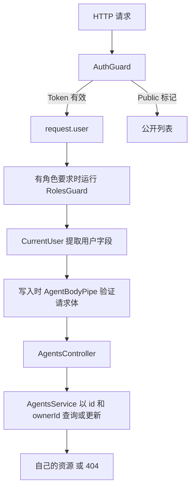

# Study 7：把可信用户上下文变成自定义装饰器

本章在个人 Agent 管理中使用 `@CurrentUser()`、`@Public()`、`@Roles()` 和 `@Auth()`。它们并非为了减少几个字符，而是让路由明确表达“从哪里取得身份、谁可以调用、操作谁的资源”。

## 学习目标

- 用 `createParamDecorator()` 从请求上下文读取已验证的用户。
- 理解参数装饰器、元数据装饰器与组合装饰器的区别。
- 将角色授权与资源归属检查分开，避免“登录后可以访问任意 ID”。
- 认识 DTO 类型声明与运行时输入验证之间的边界。

## 业务场景

初始 Agent 分别属于 `user_001`、`user_002`，其中部分公开。普通用户只能管理自己的 Agent；管理员另有全量查询和删除入口。

| 演示 Token    | 用户 ID    | 角色        |
| ------------- | ---------- | ----------- |
| `admin-token` | `user_001` | admin、user |
| `user-token`  | `user_002` | user        |

[AuthService](./src/auth/auth.service.ts) 用服务端 Map 查询身份。Token 是公开的教学字符串，不是 JWT，也没有过期、签名、刷新或撤销。这个应用不能作为真实认证系统使用。公开列表返回公开 Agent 的完整教学记录，包括模拟 ownerId；真实业务应按自己的公开字段规则设计响应。

## 项目结构

```text
src/
├── main.ts
├── app.module.ts
├── app.controller.ts / app.service.ts / app.controller.spec.ts
├── agents/
│   ├── agents.module.ts
│   ├── agents.controller.ts
│   ├── agents.service.ts
│   ├── dto/
│   │   ├── create-agent.dto.ts
│   │   └── update-agent.dto.ts
│   └── pipes/agent-body.pipe.ts
└── auth/
    ├── auth.module.ts
    ├── auth.service.ts
    ├── interfaces/auth-user.interface.ts
    ├── guards/
    │   ├── auth.guard.ts
    │   └── roles.guard.ts
    └── decorators/
        ├── current-user.decorator.ts
        ├── public.decorator.ts
        ├── roles.decorator.ts
        └── auth.decorator.ts
test/
└── app.e2e-spec.ts
```

`AuthModule` 注册并导出认证服务与 Guard，`AgentsModule` 导入它。路由上的 `@UseGuards()` 在使用方模块上下文中解析 Guard，因此其 `AuthService` 依赖也必须可见。保留的 AppController 未注册，所以 `/` 返回 404。

## 核心知识

### 用户上下文必须有可信来源

[AuthGuard](./src/auth/guards/auth.guard.ts) 从 Authorization 取出 Token，交给服务端 `AuthService` 校验，然后写入 `request.user`。[CurrentUser](./src/auth/decorators/current-user.decorator.ts) 只读取这一结果：

```ts
@CurrentUser() user: AuthUser
@CurrentUser('id') userId: string
```

前者读取完整用户，后者读取指定字段。装饰器使用 `ExecutionContext.switchToHttp()` 访问请求；没有经过认证的用户上下文会触发 401。ID 在本例是 `user_002` 这样的字符串，不能随意声明为 number。

自定义参数装饰器没有验证 Token 的能力，因此必须与 Guard 配合。请求体中的 `ownerId`、`roles` 不能成为身份来源。

### 元数据必须被实际读取

[Public](./src/auth/decorators/public.decorator.ts) 写入公开标记；`GET /agents/public` 也绑定了 `AuthGuard`，让 Guard 确实读取该标记并放行。只写一个未被任何 Guard 读取的装饰器，不会演示访问控制机制。

[Roles](./src/auth/decorators/roles.decorator.ts) 是 `Reflector.createDecorator<string[]>()`，所以本例使用 `@Roles(['admin'])`。`RolesGuard` 按方法优先于类的规则取出允许角色，并检查可信用户的角色列表。

### 组合装饰器封装一套接线

[Auth](./src/auth/decorators/auth.decorator.ts) 用 `applyDecorators()` 组合角色规则与两个 Guard：

```ts
return applyDecorators(Roles(roles), UseGuards(AuthGuard, RolesGuard));
```

Controller 的 `@Auth('admin')` 等价于明确绑定上述规则。它适合稳定、重复的权限模式；如果某条路由需要不同规则，应先理解展开后的行为。

### 通过认证，还要检查资源归属

[AgentsService](./src/agents/agents.service.ts) 的 `findOneForUser(id, ownerId)` 同时匹配 Agent ID 和所有者；更新也复用这个检查。无权访问别人的资源返回 404，避免向普通用户确认私有资源是否存在。

创建时由服务端写入所有者，更新只允许名称、说明、公开状态。[AgentBodyPipe](./src/agents/pipes/agent-body.pipe.ts) 检查必填字段、类型、未知字段；部分更新只检查提交的字段。它拒绝 `ownerId`、`id` 等字段，防止批量赋值覆盖身份数据。本章没有安装 class-validator，因此没有声称 DTO 类能够自动校验输入。

## 执行流程



只读个人路由不执行 Body Pipe。公开路由仅查询公开记录，不提取当前用户。

## 如何运行

建议 Node.js 24、pnpm 12，本次使用 24.5.0 / 12.3.4。项目没有设置 `engines`，其他版本需同时满足 Nest、Vite、Vitest 的要求。依赖声明 Nest `^12.0.1`、TypeScript `^6.0.2`，当前锁定并安装 Nest 12.3.2、TypeScript 6.0.3。

```bash
cd nestjs-study-7
pnpm install --frozen-lockfile
pnpm start:dev
```

默认端口 3000，可用 `PORT=3007 pnpm start:dev` 修改。没有必填密钥、外部认证服务或数据库，所有状态重启后恢复。

```bash
pnpm build
pnpm exec tsc --noEmit
pnpm lint
pnpm test
pnpm test:e2e
pnpm start:prod
```

`test:e2e` 自动构建后测试编译应用；`start:prod` 需要先 `build`。NodeNext/ESM 相对运行时导入使用 `.js` 扩展名。

## 如何验证

```bash
# 200：只看公开记录
curl -i http://localhost:3000/agents/public
# 401：没有经过认证
curl -i http://localhost:3000/agents/me
# 200：查看当前用户与字符串 ID
curl -i http://localhost:3000/agents/me -H 'Authorization: Bearer user-token'
curl -i http://localhost:3000/agents/my-id -H 'Authorization: Bearer user-token'
# 200：user_002 的初始列表只有 Agent 3
curl -i http://localhost:3000/agents -H 'Authorization: Bearer user-token'
# 404：Agent 2 属于其他用户
curl -i http://localhost:3000/agents/2 -H 'Authorization: Bearer user-token'
# 201：新建记录的 ownerId 由服务端设置
curl -i -X POST http://localhost:3000/agents \
  -H 'Authorization: Bearer user-token' -H 'Content-Type: application/json' \
  -d '{"name":"Writer","description":"写作助手","isPublic":false}'
# 200：更新自己的初始记录
curl -i -X PATCH http://localhost:3000/agents/3 \
  -H 'Authorization: Bearer user-token' -H 'Content-Type: application/json' \
  -d '{"name":"Updated Writer"}'
# 400：不能通过 Body 转移所有者
curl -i -X PATCH http://localhost:3000/agents/3 \
  -H 'Authorization: Bearer user-token' -H 'Content-Type: application/json' \
  -d '{"ownerId":"user_001"}'
# 403 与 200：相同管理员接口，不同身份
curl -i http://localhost:3000/agents/admin/all -H 'Authorization: Bearer user-token'
curl -i http://localhost:3000/agents/admin/all -H 'Authorization: Bearer admin-token'
# 200：组合装饰器允许管理员删除
curl -i -X DELETE http://localhost:3000/agents/admin/1 -H 'Authorization: Bearer admin-token'
```

自动化测试还会用 `constructor`、`toString` 等字符串尝试认证，确认普通对象的原型属性不会被误认成用户。

## 推荐阅读顺序

1. [agents.controller.ts](./src/agents/agents.controller.ts)：先找出四种装饰器各用在哪里。
2. [auth.module.ts](./src/auth/auth.module.ts) → [auth.guard.ts](./src/auth/guards/auth.guard.ts)：确认身份如何被创建。
3. [current-user.decorator.ts](./src/auth/decorators/current-user.decorator.ts)：跟踪同一请求中的用户读取。
4. [roles.guard.ts](./src/auth/guards/roles.guard.ts) → [auth.decorator.ts](./src/auth/decorators/auth.decorator.ts)：展开组合规则。
5. [agent-body.pipe.ts](./src/agents/pipes/agent-body.pipe.ts) → [agents.service.ts](./src/agents/agents.service.ts)：分清输入格式与资源权限两个检查位置。
6. [e2e 测试](./test/app.e2e-spec.ts)：验证公开、认证、角色与跨用户访问的组合。

## 思考与练习

1. 在 `/agents/me` 中使用 `@CurrentUser('email')`，观察字段与完整对象读取的区别。
2. 新建一个仅 user 角色可访问的只读接口，选择展开写法或 `@Auth('user')` 并说明原因。
3. 为 UpdateAgentDto 增加允许修改的字段，补齐 Pipe 和 Service，确认不能修改 ownerId。
4. 让公开列表只返回 id、name、description，比较业务模型与公开响应的职责。

## 本章总结

装饰器让路由意图更明确，但真正的认证、授权和归属判断仍需要 Guard 与 Service 执行。重点是可信身份的流向，进阶内容是组合规则和资源级访问控制。接下来的 Study 8 将转向 Provider，学习如何向这些组件提供配置与可替换实现。

参考：[官方自定义装饰器](https://docs.nestjs.com/custom-decorators)、[中文自定义装饰器](https://docs.nestjs.cn/custom-decorators)。
