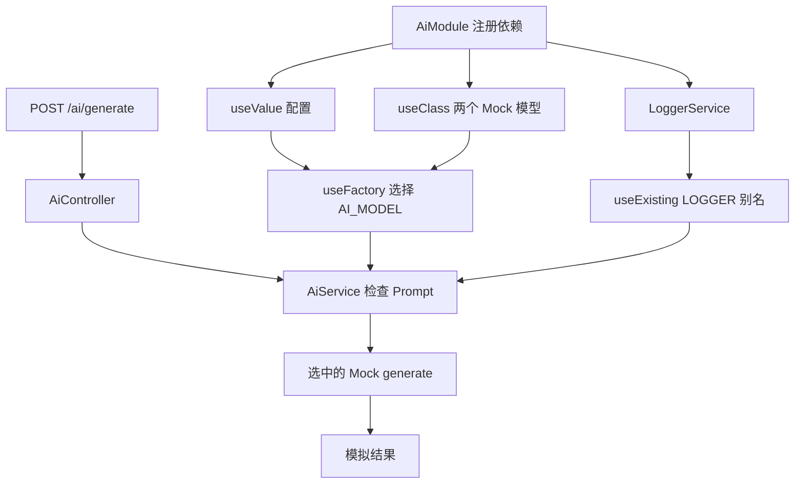

# Study 8：为 AI 模型接线自定义 Provider

业务服务如果直接 `new` 某个模型实现，切换模型和替换测试依赖就会变得困难。本章通过一个模拟 AI 生成接口，展示 Nest 容器如何根据 Token 提供配置、模型与共享日志实例。

## 学习目标

- 理解 Provider 是容器提供的依赖，Token 是查找该依赖的运行时键。
- 分清 `useValue`、`useClass`、`useFactory`、`useExisting` 创建或引用依赖的方式。
- 理解 TypeScript interface 会在运行时消失，所以不能直接作为注入 Token。
- 沿着 Module → Provider → Service 的链路解释模型切换。

## 业务场景与边界

`POST /ai/generate` 接收 Prompt，调用当前选中的模型并返回模拟文本。OpenAI 与 Anthropic 的实现都只拼接字符串，不连接任何真实 API，不需要 API Key，也不会产生模型费用。

配置包含 provider、maxTokens、temperature。只有 provider 影响本例的模型选择；其余参数用于演示配置注入和响应展示，不会实际控制输出长度或采样。用户 Prompt 会在响应中回显，但不会写入本例日志。

没有认证、数据库、真实模型 SDK、流式生成或工具调用。`/ai/config` 只适合展示这里的公开模拟配置，真实项目不能直接返回含密钥的配置对象。

## 项目结构

```text
src/
├── main.ts
├── app.module.ts
├── app.controller.ts / app.service.ts / app.controller.spec.ts
├── ai/
│   ├── ai.module.ts
│   ├── ai.controller.ts
│   ├── ai.service.ts
│   ├── dto/chat.dto.ts
│   ├── interfaces/
│   │   ├── ai-model.interface.ts
│   │   └── ai-config.interface.ts
│   ├── tokens/ai.tokens.ts
│   └── providers/
│       ├── ai-model.provider.ts
│       ├── openai-model.service.ts
│       └── anthropic-model.service.ts
└── common/logger/logger.service.ts
test/
└── app.e2e-spec.ts
```

`AppModule` 实际导入 `AiModule`。保留的脚手架 AppController 未注册，`/` 返回 404。

## 核心机制

### Token 负责定位，interface 负责类型约束

[AIModel](./src/ai/interfaces/ai-model.interface.ts) 约定 `name` 与 `generate(prompt)`。这个 interface 不能在 JavaScript 运行时代表一个对象；[ai.tokens.ts](./src/ai/tokens/ai.tokens.ts) 使用 Symbol 定义 `AI_MODEL` 等键：

```ts
@Inject(AI_MODEL)
private readonly model: AIModel
```

`@Inject()` 告诉容器用哪个键找依赖，类型注解告诉 TypeScript 如何检查它。两个分别创建的同名 Symbol 不是同一个键，因此所有文件都从同一个 tokens 文件导入。

### `useValue` 提供已经存在的值

[AiModule](./src/ai/ai.module.ts) 用 `AI_CONFIG` 注册对象：

```ts
{ provide: AI_CONFIG, useValue: { provider: 'openai', maxTokens: 1000, temperature: 0.7 } }
```

服务通过 Token 读取同一份配置。`satisfies AIConfig` 检查配置形状，不会改变其运行时行为。这里配置没有经过环境变量读取或外部配置服务。

### `useClass` 告诉容器创建哪个实现

模块显式声明：

```ts
{ provide: OpenAIModelService, useClass: OpenAIModelService }
```

`provide` 是消费者用来查找的键，`useClass` 是容器用来构造实例的类；二者可以不同。当前类 Token 和实现类相同，也可以简写成 `OpenAIModelService`。两个 Mock 模型均注册到容器中，没有让 Controller 自己创建模型对象。

### `useFactory` 根据其他依赖选择模型

[aiModelProvider](./src/ai/providers/ai-model.provider.ts) 在 `inject` 中列出配置和两个模型。Nest 按这一顺序将依赖传给工厂；工厂根据 provider 返回容器已有的模型实例。

这样 [AiService](./src/ai/ai.service.ts) 只依赖 `AIModel` 约定，不需要知道如何选择 OpenAI 或 Anthropic。当前工厂是同步的，异步初始化会在 Study 9 单独学习。

### `useExisting` 为同一实例增加别名

```ts
{ provide: LOGGER, useExisting: LoggerService }
```

这不会再创建一份 LoggerService。`AiController` 同时注入类 Token 和别名 Token，`GET /ai/logger` 返回两个 instanceId 与 `sameInstance`，用可见结果验证共享关系。如果改为 `useClass: LoggerService`，容器将为别名键创建另一个实例。

### 输入类型不等于运行时验证

[ChatDto](./src/ai/dto/chat.dto.ts) 只描述结构。本章没有安装 class-validator；`AiService.chat()` 显式检查 Prompt 必须是非空字符串且不超过 2000 字符。无效输入返回 400，避免误把 TypeScript 编译通过当作 HTTP 输入已经安全。

## 执行流程



配置和依赖在启动时完成接线；每次 HTTP 请求复用这些默认单例。查询 `/ai/model` 不会每次重新执行工厂。

## 如何运行

建议使用 Node.js 24、pnpm 12；本次环境为 24.5.0 / 12.3.4。项目未通过 `engines` 固定环境，其他版本需同时满足 Nest、Vite、Vitest 要求。声明 Nest `^12.0.1`、TypeScript `^6.0.2`，当前锁定并安装 Nest 12.3.2、TypeScript 6.0.3。

```bash
cd nestjs-study-8
pnpm install --frozen-lockfile
pnpm start:dev
```

默认端口 3000，可设置 `PORT=3008`。没有必填环境变量、密钥或外部服务；`NODE_ENV=production` 不会改变这里的 Mock 配置。

```bash
pnpm build
pnpm exec tsc --noEmit
pnpm lint
pnpm test
pnpm test:e2e
pnpm start:prod
```

端到端脚本先构建再加载 `dist`；`start:prod` 需要先构建。项目采用 NodeNext/ESM，源码的相对运行时导入使用 `.js` 后缀。

## 如何验证

```bash
# 200：配置的 provider 为 openai
curl -i http://localhost:3000/ai/config
# 200：当前模型为 OpenAI GPT
curl -i http://localhost:3000/ai/model
# 201：result 为 [OpenAI] 已处理你的请求：Hello
curl -i -X POST http://localhost:3000/ai/generate \
  -H 'Content-Type: application/json' -d '{"prompt":"Hello"}'
# 400：缺失或错误类型的 Prompt
curl -i -X POST http://localhost:3000/ai/generate \
  -H 'Content-Type: application/json' -d '{}'
curl -i -X POST http://localhost:3000/ai/generate \
  -H 'Content-Type: application/json' -d '{"prompt":123}'
# 200：sameInstance 为 true，两个 instanceId 相等
curl -i http://localhost:3000/ai/logger
```

要验证另一种配置，在 `ai.module.ts` 中将 `provider: 'openai'` 改为 `'anthropic'`，等待重新构建或重启，再请求模型与生成接口。应分别得到 `Anthropic Claude` 和 `[Anthropic]` 前缀的模拟结果。自动化测试通过覆盖 `AI_CONFIG` 验证同一路径，无需修改本地配置。

## 推荐阅读顺序

1. [ai-model.interface.ts](./src/ai/interfaces/ai-model.interface.ts) → [ai.tokens.ts](./src/ai/tokens/ai.tokens.ts)：区分类型约定与运行时键。
2. [ai.module.ts](./src/ai/ai.module.ts)：建立 Token 与依赖的对应表。
3. [ai-model.provider.ts](./src/ai/providers/ai-model.provider.ts) → 两个 [模型实现](./src/ai/providers/openai-model.service.ts)：检查工厂选择与实现约定。
4. [ai.service.ts](./src/ai/ai.service.ts) → [ai.controller.ts](./src/ai/ai.controller.ts)：从业务依赖看到 HTTP 结果。
5. [logger.service.ts](./src/common/logger/logger.service.ts) → [e2e 测试](./test/app.e2e-spec.ts)：验证别名确实共享实例，并检查配置覆盖后行为。

## 思考与练习

1. 切换配置中的 provider，比较 Controller 和 Service 是否需要修改。
2. 将日志别名改为 `useClass`，观察 instanceId，再恢复 `useExisting`。
3. 新增一个 Mock 模型，补齐配置类型、注册与工厂选择，保持 AiService 不变。
4. 在工厂加入一次不含 Prompt 的初始化日志，观察启动与重复请求时的打印次数。

## 本章总结

自定义 Provider 把“依赖如何产生”从业务逻辑中移到模块接线层。重点是 Token 的身份、工厂依赖的顺序、别名是否复用实例；选择真实 SDK、密钥管理和异步连接属于后续内容。Study 9 继续研究异步 Provider，Study 10 会让模块配置由导入方提供。

参考：[官方自定义 Provider](https://docs.nestjs.com/fundamentals/custom-providers)、[中文自定义提供程序](https://docs.nestjs.cn/fundamentals/dependency-injection)。
