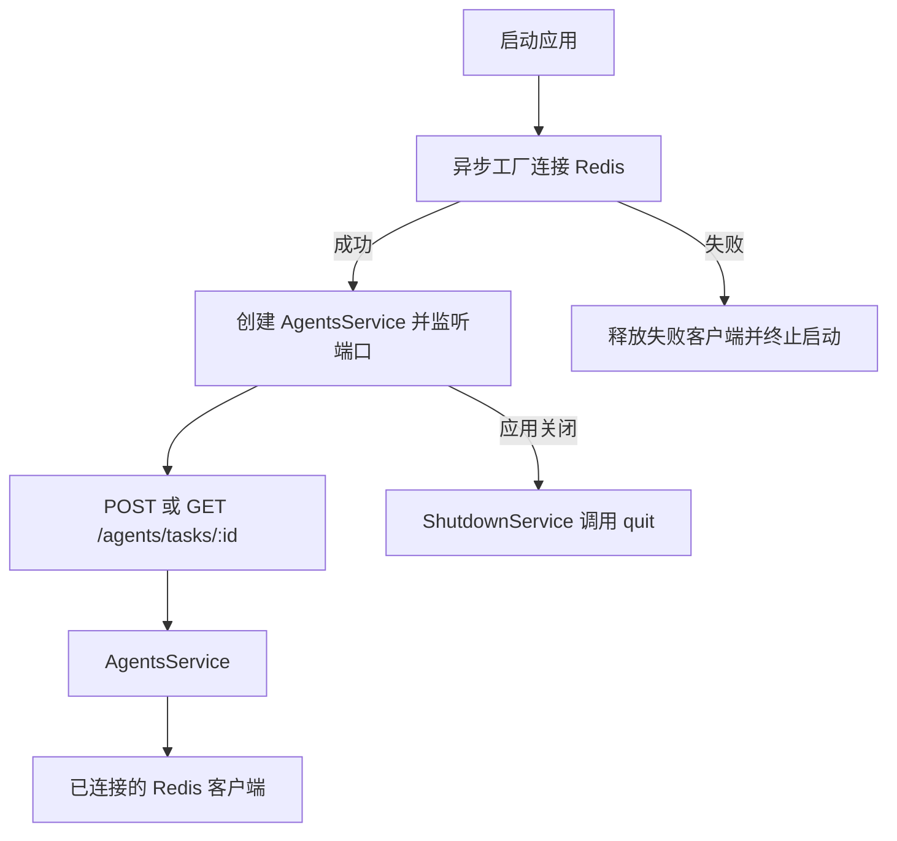

# Study 9：等待 Redis 就绪的异步 Provider

## 项目介绍

本章模拟 Agent 任务状态的写入与查询：创建任务时把 `pending` 保存到 Redis，再通过任务 ID 读取状态。重点不是任务调度，而是让依赖 Redis 的业务 Service **在连接成功以后才创建**。

这里的 Redis 是真实外部依赖，没有默认内存替代；Agent 任务只是状态演示，没有后台执行器、队列、模型调用或用户系统。学习前建议先理解 Study 8 的自定义 Token 和工厂 Provider。

## 学习目标与业务场景

- 理解 `useFactory` 可以返回 Promise：Nest 会等待工厂完成，而不是把尚未连接的客户端交给业务代码。
- 用 `REDIS_CLIENT` Token 隔开连接创建和任务业务；`AgentsService` 不负责自己连接 Redis。
- 通过模块的 `exports` 和 `imports` 共享同一个客户端，避免每个请求重新建立连接。
- 观察依赖启动失败和应用关闭时的资源释放，区分“HTTP 服务起来了”与“外部依赖已准备好”。

真实系统往往要在启动阶段准备连接池或 SDK。把准备过程放在异步 Provider 中，可以让启动失败直接暴露，而不是等第一位用户访问时才发现连接未建立。

## 项目结构

```text
src/
├── main.ts                         # 创建应用，开启关闭信号钩子
├── app.module.ts                   # 接入 AgentsModule
├── app.controller.ts               # 保留的脚手架文件，未注册路由
├── app.controller.spec.ts
├── app.service.ts
├── agents/
│   ├── agents.module.ts            # 导入 RedisModule
│   ├── agents.controller.ts        # 创建/查询任务的 HTTP 入口
│   └── agents.service.ts           # 使用客户端读写状态
└── redis/
    ├── redis.tokens.ts             # REDIS_CLIENT 注入标识
    ├── redis.provider.ts           # 异步连接工厂
    └── redis.module.ts             # 导出客户端并负责关闭
 test/app.e2e-spec.ts               # 替换客户端后的 HTTP 测试
```

本章入口是 `/agents/tasks/:id`，没有注册 `GET /`；看到根路径 404 不代表启动失败。

## 核心知识讲解

### 连接为什么放在工厂中

阅读 [redis.provider.ts](./src/redis/redis.provider.ts)：

```ts
{
  provide: REDIS_CLIENT,
  useFactory: async () => {
    // 创建客户端、绑定 error 事件……
    await client.connect();
    return client;
  },
}
```

`provide` 是容器查找依赖时使用的标识，`useFactory` 决定依赖如何创建。工厂返回的 Promise 完成以后，Nest 才能向下构造依赖它的 `AgentsService`。

连接地址来自 `REDIS_URL`，默认 `redis://localhost:6379`。当前代码设置 5 秒连接超时并关闭自动重连，连接失败会销毁客户端并让启动失败；这适合观察初始化过程，不是生产环境的高可用策略。

### 接口类型和运行时 Token 各司其职

[agents.service.ts](./src/agents/agents.service.ts) 中：

```ts
constructor(
  @Inject(REDIS_CLIENT) private readonly redis: RedisClientType,
) {}
```

`RedisClientType` 只负责 TypeScript 检查；接口在 JavaScript 中不存在，因此容器需要 `REDIS_CLIENT` 这个实际值。`RedisModule` 导出该 Token，`AgentsModule` 导入模块，业务层才有权限声明这个依赖。

### 状态存储与生命周期

创建任务写入 `agent:task:<id>`，值固定为 `pending`；查询不存在的键返回 `status: null`。重复创建同一 ID 会再次写入 `pending`，这里没有唯一性约束和状态机。

[redis.module.ts](./src/redis/redis.module.ts) 中的 `RedisShutdownService` 在应用关闭时调用 `quit()`。`main.ts` 开启 `enableShutdownHooks()`，使 Ctrl+C/SIGTERM 能触发 Nest 的关闭流程。正常启动过程中不要把客户端放进每个请求的 Service 构造函数中反复创建。

## 核心执行流程



## 如何运行

使用 Node.js 22（22.12 及以上）或 24+ 与 pnpm。本次审查环境是 Node.js 24.5.0、pnpm 12.3.4；项目声明 Nest `^12.0.1`、TypeScript `^6.0.2`，当前锁文件安装为 Nest 12.3.2、TypeScript 6.0.3，Redis 客户端为 6.3.1。保留本章锁文件，不需要全局 Nest CLI。

**先准备一个可连接的 Redis 实例**。仓库不自带 Redis 服务；默认地址使用本机 6379 端口。无需 AI API Key、数据库或 Observe 凭据。

```bash
cd nestjs-study-9
pnpm install --frozen-lockfile
pnpm build
pnpm exec tsc --noEmit
REDIS_URL=redis://localhost:6379 pnpm start:dev
# 或构建后运行；PORT 可改，默认 3000
REDIS_URL=redis://localhost:6379 PORT=3009 pnpm start:prod
```

同一时间只运行一个占用 3000 端口的 Study。自定义端口后，下面请求地址也要相应修改。环境变量通过命令行或 shell 设置，本章不依赖自动读取 `.env`。

## 如何验证

确认启动日志先出现 Redis 连接成功，再出现业务 Service 创建成功和 HTTP 监听信息。

```bash
# 201：写入 pending
curl -i -X POST http://localhost:3000/agents/tasks/research-1
# 200：读取刚才的状态
curl -i http://localhost:3000/agents/tasks/research-1
# 200：status 为 null
curl -i http://localhost:3000/agents/tasks/not-created
```

第二次请求应得到 `{"taskId":"research-1","status":"pending"}`。停止 Nest 后重新启动，只要 Redis 中的键仍存在，状态就仍能读到；Redis 本身是否持久化由外部服务配置决定。

停止当前应用后，用一个确定未监听的 Redis 地址启动，例如 `REDIS_URL=redis://127.0.0.1:6399 pnpm start`。预期启动失败，不能继续提供任务接口。不要对正在使用的 Redis 执行清空操作。

```bash
pnpm test
pnpm test:e2e
pnpm lint
```

`test:e2e` 先构建，再使用编译后的真实模块执行 HTTP 测试，并用内存客户端替换 `REDIS_CLIENT`。它覆盖任务读写和关闭回调，**不能证明真实 Redis 连接、网络故障或关闭信号已经通过**；这些请按上面的实连步骤验证。

## 推荐阅读顺序

1. [redis.tokens.ts](./src/redis/redis.tokens.ts)：先知道容器识别哪一个依赖。
2. [redis.provider.ts](./src/redis/redis.provider.ts)：找到 Promise、连接成功和失败的分界。
3. [redis.module.ts](./src/redis/redis.module.ts)：理解导出和释放资源为什么放在同一模块。
4. [agents.module.ts](./src/agents/agents.module.ts) → [agents.service.ts](./src/agents/agents.service.ts)：追踪依赖如何进入业务代码。
5. [agents.controller.ts](./src/agents/agents.controller.ts) → [main.ts](./src/main.ts)：最后把 HTTP 入口、监听和关闭信号连起来。

## 思考与练习

1. 给任务增加一个“完成”操作，观察如何保持读写使用同一个 Redis 键规则。
2. 给任务状态增加过期时间，再比较“未创建”和“已过期”在当前查询结果中能否区分。
3. 临时在连接工厂中加入等待，观察业务 Service 构造日志和 HTTP 监听出现的时间。
4. 为 Redis 客户端定义业务实际需要的最小接口，思考如何让单元测试替身保持类型约束。

## 本章总结与边界

本章把 Study 8 的 Provider 工厂推进到异步初始化：容器负责等依赖准备好，业务 Service 只使用就绪对象。关闭钩子则补上资源的另一半生命周期，后续 Study 15 会更集中地研究启动和关闭顺序。

本章没有认证和用户隔离，任何调用者都可以按任务 ID 读写示例状态；只使用无敏感信息的实验数据。真实任务系统还需要身份校验、授权、状态流转和可靠执行机制，当前代码没有实现这些能力。

参考：[异步 Provider](https://docs.nestjs.com/fundamentals/async-providers)、[生命周期](https://docs.nestjs.com/fundamentals/lifecycle-events)。阅读文档时回到本章实际安装版本和源码核对。
